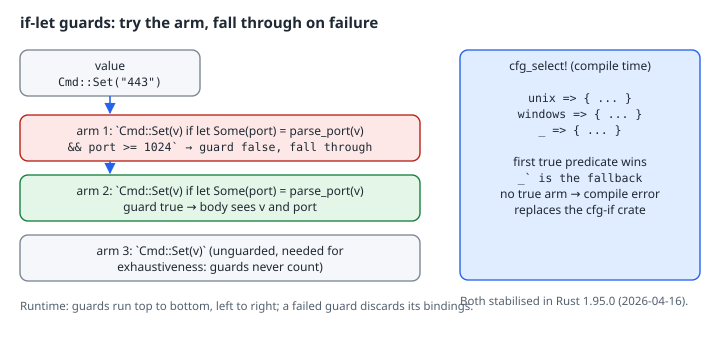

# if-let Guards and `cfg_select!`

## Thesis

Rust 1.95 stabilised two small features that remove a lot of everyday boilerplate:

- **if-let guards** let a `match` arm *bind and test* in its guard: `Pat if let Some(x) = f(y) && x > 0 => …`. If the guard fails, matching falls through to the next arm, just like a plain `if` guard.
- **`cfg_select!`** is a compile-time `match` over `cfg` predicates. The first arm whose predicate is true is expanded, and `_` is the fallback. It does the job the `cfg-if` crate has done for years, with no dependency.

Both have one sharp edge. The compiler doesn't count guards towards exhaustiveness, and a `cfg_select!` where no arm is true is a hard error.

## Mental model

{fig-alt="Left: the value Cmd::Set(\"443\") flows through three match arms. Arm 1 is Cmd::Set(v) if let Some(port) = parse_port(v) && port >= 1024: the guard is false, so it falls through. Arm 2 is Cmd::Set(v) if let Some(port) = parse_port(v): the guard is true and the body sees v and port. Arm 3 is an unguarded Cmd::Set(v), needed for exhaustiveness because guards never count. A note says guards run top to bottom and a failed guard discards its bindings. Right: cfg_select! is evaluated at compile time with arms unix, windows and _. The first true predicate wins, _ is the fallback, no true arm is a compile error, and it replaces the cfg-if crate. Both were stabilised in Rust 1.95.0 on 2026-04-16."}

An if-let guard runs after the arm's pattern has matched. It can use the pattern's bindings, introduce new ones, and chain more conditions with `&&` (the same let-chain grammar that was stabilised for `if` in Rust 1.88). The new bindings are in scope only in that arm's body. If any part of the chain fails, those bindings are dropped and the next arm is tried.

## Worked example

Verified with **rustc 1.99.1**, edition 2024, on x86-64 Linux.

```rust
// cfg_select! picks the first arm whose predicate holds; `_` is the fallback.
cfg_select! {
    unix => {
        fn platform() -> &'static str { "unix" }
    }
    windows => {
        fn platform() -> &'static str { "windows" }
    }
    _ => {
        fn platform() -> &'static str { "other" }
    }
}

// It also works in expression position.
fn word_size() -> u32 {
    cfg_select! {
        target_pointer_width = "64" => 64,
        target_pointer_width = "32" => 32,
        _ => 0,
    }
}

#[derive(Debug)]
enum Cmd {
    Set(String),
    Del(String),
}

fn parse_port(s: &str) -> Option<u16> {
    s.parse().ok()
}

// if-let guards: bind inside the guard, and fall through to later arms if it fails.
fn describe(cmd: &Cmd) -> String {
    match cmd {
        Cmd::Set(v) if let Some(port) = parse_port(v) && port >= 1024 => {
            format!("set unprivileged port {port}")
        }
        Cmd::Set(v) if let Some(port) = parse_port(v) => format!("set privileged port {port}"),
        Cmd::Set(v) => format!("set non-numeric value {v:?}"),
        Cmd::Del(k) => format!("delete {k}"),
    }
}

// The same logic before Rust 1.95: the binding has to move into the arm body,
// and the fall-through has to be duplicated by hand.
fn describe_old(cmd: &Cmd) -> String {
    match cmd {
        Cmd::Set(v) => match parse_port(v) {
            Some(port) if port >= 1024 => format!("set unprivileged port {port}"),
            Some(port) => format!("set privileged port {port}"),
            None => format!("set non-numeric value {v:?}"),
        },
        Cmd::Del(k) => format!("delete {k}"),
    }
}

fn main() {
    println!("platform={} word_size={}", platform(), word_size());
    for c in [
        Cmd::Set("8080".into()),
        Cmd::Set("443".into()),
        Cmd::Set("abc".into()),
        Cmd::Del("x".into()),
    ] {
        assert_eq!(describe(&c), describe_old(&c));
        println!("{c:?} -> {}", describe(&c));
    }
}
```

```bash
cargo run -q
```

```text
platform=unix word_size=64
Set("8080") -> set unprivileged port 8080
Set("443") -> set privileged port 443
Set("abc") -> set non-numeric value "abc"
Del("x") -> delete x
```

The `assert_eq!` in `main` checks that the guarded version and the pre-1.95 nested version agree on every input. The difference is shape. In `describe_old`, everything about `Set` has to live inside one arm, so other variants can't be interleaved by priority. In `describe`, each arm states exactly what it needs.

`cfg_select!` appears twice: once at item level, choosing which `fn platform` to define, and once in expression position, as the tail of `word_size`. Expression-position arms are separated by commas and take a plain expression. Item-level arms take a braced block of items.

## The traps

Both mistakes below are in one file so you can see the real diagnostics:

```rust
cfg_select! {
    windows => {
        fn platform() -> &'static str { "windows" }
    }
}

enum Cmd {
    Set(String),
    Del(String),
}

fn describe(cmd: &Cmd) -> String {
    match cmd {
        Cmd::Set(v) if let Ok(port) = v.parse::<u16>() => format!("port {port}"),
        Cmd::Del(k) => format!("delete {k}"),
    }
}

fn main() {
    println!("{} {}", platform(), describe(&Cmd::Del("x".into())));
}
```

```text
error: none of the predicates in this `cfg_select` evaluated to true
 --> src/main.rs:1:1
  |
1 | / cfg_select! {
2 | |     windows => {
3 | |         fn platform() -> &'static str { "windows" }
4 | |     }
5 | | }
  | |_^

error[E0425]: cannot find function `platform` in this scope
  --> src/main.rs:20:23
   |
20 |     println!("{} {}", platform(), describe(&Cmd::Del("x".into())));
   |                       ^^^^^^^^ not found in this scope

error[E0004]: non-exhaustive patterns: `&Cmd::Set(_)` not covered
  --> src/main.rs:13:11
   |
13 |     match cmd {
   |           ^^^ pattern `&Cmd::Set(_)` not covered
   |
note: `Cmd` defined here
  --> src/main.rs:7:6
   |
 7 | enum Cmd {
   |      ^^^
 8 |     Set(String),
   |     --- not covered
   = note: the matched value is of type `&Cmd`
   = note: match arms with guards don't count towards exhaustivity
help: ensure that all possible cases are being handled by adding a match arm with a wildcard pattern or an explicit pattern as shown
   |
15 ~         Cmd::Del(k) => format!("delete {k}"),
16 ~         &Cmd::Set(_) => todo!(),
   |
```

1. **No true arm.** This is deliberate. `cfg_select!` won't silently expand to nothing, so a missing platform is a compile error on that platform rather than a confusing "cannot find function" later. (You get that second error too, as a knock-on.) Add a `_ =>` arm whenever a fallback makes sense, and use `_ => { compile_error!("…") }` when it doesn't, so the message is yours.
2. **Guards don't count.** Even though `v.parse::<u16>()` is either `Ok` or `Err`, the compiler doesn't reason about guards. The Rust 1.95 release notes state this explicitly. Always finish a run of guarded arms with an unguarded arm for the same pattern (or `_`). Don't take the help text's `todo!()` literally.

## Migrating from `cfg-if`

The `cfg-if` crate's `if #[cfg(unix)] { … } else if #[cfg(windows)] { … } else { … }` maps one to one onto `cfg_select! { unix => { … } windows => { … } _ => { … } }`. Before you drop the dependency, check two things:

- **MSRV.** `cfg_select!` needs Rust 1.95. If you publish a library with a lower `rust-version`, keep `cfg-if` until you raise it.
- **Expression position.** `cfg-if` only expands to items. `cfg_select!` also works as an expression, so `let x = cfg_select! { … };` replaces the common `#[cfg]` + `#[cfg(not)]` pair of `let` statements.

## Try this

1. Add `target_os = "linux" => "linux",` as the first arm of a new expression-position `cfg_select!`, and confirm that the more specific arm wins over `unix` when it comes first.
2. Rewrite one of your `match` + nested `if let` blocks with an if-let guard, and keep an `assert_eq!` against the old version, as above, until the tests pass.
3. Delete arm 3 (`Cmd::Set(v) =>`) from `describe` and read the E0004 note.

## Sources

- Announcing Rust 1.95.0: <https://blog.rust-lang.org/2026/04/16/Rust-1.95.0/>
- `cfg_select!` in the standard library docs: <https://doc.rust-lang.org/std/macro.cfg_select.html>
- The Rust Reference, match guards: <https://doc.rust-lang.org/reference/expressions/match-expr.html#match-guards>
- The Rust Reference, conditional compilation (`cfg` predicates): <https://doc.rust-lang.org/reference/conditional-compilation.html>
