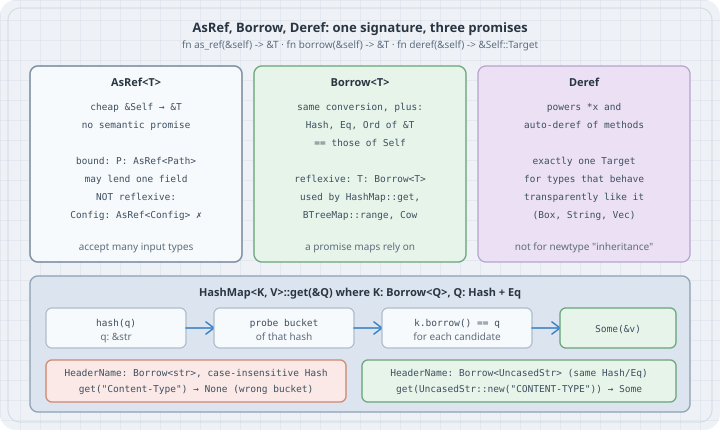

# `AsRef`, `Borrow` and `Deref`: Same Signature, Different Promises

## Thesis

Three standard traits all turn `&Self` into `&T`:

```rust
pub trait AsRef<T: ?Sized>  { fn as_ref(&self) -> &T; }
pub trait Borrow<T: ?Sized> { fn borrow(&self) -> &T; }
pub trait Deref             { type Target: ?Sized; fn deref(&self) -> &Self::Target; }
```

They are not interchangeable. The difference is what each one **promises** to the code that uses it.

- **`AsRef<T>`** promises only a cheap conversion. Use it as a generic bound, such as `P: AsRef<Path>`, to accept many input types.
- **`Borrow<T>`** promises the same conversion **and** that "`Eq`, `Ord` and `Hash` must be equivalent for borrowed and owned values" (std docs). That promise is the only reason `HashMap<String, V>::get` can take a `&str`. The map hashes the `&str` you pass and trusts it to land in the same bucket as the `String` it stored.
- **`Deref`** drives the `*` operator and auto-deref method lookup. The std docs reserve it for types that "transparently behave like a value of the target type".

The compiler checks the signatures of all three. It doesn't check the promises. This chapter shows each trait doing its job, then breaks `Borrow`'s contract on purpose. The result is a map that compiles, passes a lowercase-only test, and loses `"Content-Type"`.

## Mental model

{fig-alt="Three cards. AsRef of T: a cheap conversion with no semantic promise, used as a bound like P: AsRef<Path>, may lend one field, not reflexive so Config does not implement AsRef<Config>. Borrow of T: the same conversion plus Hash, Eq and Ord of the borrowed form equal those of Self, reflexive, used by HashMap::get, BTreeMap::range and Cow. Deref: powers star and auto-deref of methods, exactly one Target, for types that behave transparently like it such as Box, String and Vec, not for newtype inheritance. Bottom: HashMap get hashes q, probes the bucket of that hash, compares k.borrow() == q for each candidate, and returns Some. A HeaderName with Borrow<str> and a case-insensitive Hash returns None for get Content-Type because it probes the wrong bucket; a HeaderName with Borrow<UncasedStr> that shares Hash and Eq returns Some for CONTENT-TYPE."}

| | `AsRef<T>` | `Borrow<T>` | `Deref` |
|---|---|---|---|
| What it promises | a cheap `&T` | a cheap `&T` whose `Hash`/`Eq`/`Ord` match `Self`'s | `*x` and method calls go to `Target` |
| Reflexive (`T: Trait<T>`)? | **no** | yes (blanket `impl<T> Borrow<T> for T`) | n/a |
| Several targets per type? | yes (`String: AsRef<str>`, `AsRef<[u8]>`, `AsRef<Path>`, `AsRef<OsStr>`) | yes, if each keeps the contract | no, exactly one |
| May lend just one field? | yes | no (the field's `Hash`/`Eq` would differ) | not recommended |
| Typical user | `fn open<P: AsRef<Path>>(p: P)` | `HashMap::get`, `BTreeMap::range`, `Cow`/`ToOwned` | `Box<T>`, `String`, `Vec<T>`, guards |

## Worked examples

Built and run with **rustc/cargo 1.85.1** (the distro toolchain on the box), edition 2024. The current stable Rust is **1.99.1**. Every API used here has been stable since well before 1.85, and its documentation is unchanged. The project has no dependencies.

```bash
cargo new --vcs none conv && cd conv
rm src/main.rs && mkdir -p src/bin
```

```toml
# Cargo.toml
[package]
name = "conv"
version = "0.1.0"
edition = "2024"
rust-version = "1.85"

[dependencies]
```

### Case 1: How `HashMap<String, V>` answers a `&str`

```rust
// src/bin/lookup.rs — why HashMap<String, V>::get accepts a &str
use std::borrow::Borrow;
use std::collections::{BTreeMap, HashMap};
use std::hash::{BuildHasher, RandomState};
use std::ops::Bound::{Excluded, Included};

fn main() {
    let mut ports: HashMap<String, u16> = HashMap::new();
    ports.insert("http".to_string(), 80);
    ports.insert("https".to_string(), 443);

    // get<Q: ?Sized>(&self, k: &Q) where String: Borrow<Q>, Q: Hash + Eq
    let key: &str = "https";
    println!("get(&str)    -> {:?}", ports.get(key));
    println!("get(&String) -> {:?}", ports.get(&"http".to_string()));

    // The contract that makes it sound: hashing the owned key and the borrowed key agree.
    let s = RandomState::new();
    let owned = String::from("https");
    let borrowed: &str = owned.borrow();
    println!("hash(String) == hash(&str)? {}", s.hash_one(&owned) == s.hash_one(borrowed));

    // Ordered maps use the same trick with Ord: range queries by &str over String keys.
    let mut users: BTreeMap<String, u32> = BTreeMap::new();
    for (name, id) in [("alice", 1), ("bob", 2), ("carol", 3), ("dave", 4)] {
        users.insert(name.to_string(), id);
    }
    // `"b".."d"` is a Range<&str>, which is not RangeBounds<str>; spell the bounds out instead.
    let picked: Vec<_> = users
        .range::<str, _>((Included("b"), Excluded("d")))
        .map(|(k, v)| (k.as_str(), *v))
        .collect();
    println!("range(b..d)  -> {picked:?}");
}
```

```text
$ cargo run -q --bin lookup
get(&str)    -> Some(443)
get(&String) -> Some(80)
hash(String) == hash(&str)? true
range(b..d)  -> [("bob", 2), ("carol", 3)]
```

`HashMap::get` is declared as `get<Q: ?Sized>(&self, k: &Q) -> Option<&V> where K: Borrow<Q>, Q: Hash + Eq`. With `K = String` and `Q = str`, the map hashes the `&str`, finds the bucket, and compares each candidate with `key.borrow() == q`. No `String` is allocated for the lookup. The `hash_one` line shows the property that makes this correct: `String` and `str` produce the same hash, because `String`'s `Hash` forwards to `str`'s. `BTreeMap` uses the same bound with `Ord` for `get` and `range`. (The `range` call needs its bounds spelled out, because `"b".."d"` is a `Range<&str>`, not a `RangeBounds<str>`.)

### Case 2: `AsRef` as an "accept anything" bound

```rust
// src/bin/asref.rs — AsRef as a cheap "accept anything that can lend me a &T" bound
use std::ffi::OsString;
use std::path::{Path, PathBuf};

fn describe<P: AsRef<Path>>(p: P) -> String {
    let p = p.as_ref(); // one conversion, then work with &Path
    format!("{:<18} file_name={:?} ext={:?}", p.display().to_string(), p.file_name(), p.extension())
}

fn checksum<B: AsRef<[u8]>>(data: B) -> u32 {
    data.as_ref().iter().fold(0u32, |a, &b| a.rotate_left(5) ^ b as u32)
}

fn main() {
    println!("{}", describe("notes/today.md"));
    println!("{}", describe(String::from("Cargo.toml")));
    println!("{}", describe(PathBuf::from("/etc/hosts")));
    println!("{}", describe(Path::new("archive.tar.gz")));
    println!("{}", describe(OsString::from("README")));

    // The same bound works for every byte container.
    println!("checksum: {} {} {} {}",
        checksum("abc"), checksum(String::from("abc")), checksum(b"abc"), checksum(vec![b'a', b'b', b'c']));
}
```

```text
$ cargo run -q --bin asref
notes/today.md     file_name=Some("today.md") ext=Some("md")
Cargo.toml         file_name=Some("Cargo.toml") ext=Some("toml")
/etc/hosts         file_name=Some("hosts") ext=None
archive.tar.gz     file_name=Some("archive.tar.gz") ext=Some("gz")
README             file_name=Some("README") ext=None
checksum: 100387 100387 100387 100387
```

`AsRef<Path>` is implemented for `str`, `String`, `OsStr`, `OsString`, `Path`, `PathBuf` and more, and `&T` forwards to `T`. One generic signature accepts all of them, and `.as_ref()` happens once at the top of the function. This is the pattern `std::fs::File::open` uses. `AsRef` makes no promise about hashing or equality, so a type is free to implement it for several targets, or to lend out just one of its fields. `Borrow` can't do either of those.

### Case 3: Break the `Borrow` contract and the map loses keys

HTTP header names are case-insensitive. A natural first attempt is a newtype with case-insensitive `Eq` and `Hash`, plus `Borrow<str>` so that lookups by `&str` "just work":

```rust
// src/bin/broken_borrow.rs — a case-insensitive key that implements Borrow<str> (wrongly)
use std::borrow::Borrow;
use std::collections::HashMap;
use std::hash::{Hash, Hasher};

#[derive(Debug, Clone)]
struct HeaderName(String);

impl PartialEq for HeaderName {
    fn eq(&self, other: &Self) -> bool {
        self.0.eq_ignore_ascii_case(&other.0)
    }
}
impl Eq for HeaderName {}

impl Hash for HeaderName {
    fn hash<H: Hasher>(&self, state: &mut H) {
        for b in self.0.bytes() {
            state.write_u8(b.to_ascii_lowercase()); // hash the lowercase form
        }
        state.write_u8(0xff);
    }
}

// Compiles fine. Breaks the contract: str's Hash/Eq are case-SENSITIVE and hash differently.
impl Borrow<str> for HeaderName {
    fn borrow(&self) -> &str {
        &self.0
    }
}

fn main() {
    let mut h: HashMap<HeaderName, &str> = HashMap::new();
    h.insert(HeaderName("Content-Type".into()), "text/html");

    println!("get(&HeaderName(\"content-type\")) -> {:?}", h.get(&HeaderName("content-type".into())));
    println!("get(\"content-type\")              -> {:?}", h.get("content-type"));
    println!("get(\"Content-Type\")              -> {:?}", h.get("Content-Type"));
    println!("contains_key(\"Content-Type\")     -> {}", h.contains_key("Content-Type"));

    // Why tests often miss it: an all-lowercase key hashes the same both ways.
    h.insert(HeaderName("accept".into()), "*/*");
    println!("get(\"accept\")                    -> {:?}", h.get("accept"));
}
```

```text
$ cargo run -q --bin broken_borrow
get(&HeaderName("content-type")) -> Some("text/html")
get("content-type")              -> None
get("Content-Type")              -> None
contains_key("Content-Type")     -> false
get("accept")                    -> Some("*/*")
```

It compiles without a warning, and it is wrong in a way that is easy to miss:

- Lookups by `&HeaderName` work, in any case.
- Lookups by `&str` go through `str`'s `Hash`, which is case-*sensitive*. `"content-type"` and even the exact `"Content-Type"` hash into a different bucket from the stored key, so the lookup returns `None`.
- For an all-lowercase key, both hashes see the same bytes. std's `str` hash writes the bytes followed by `0xff`, and so does this `HeaderName` impl. (That is an implementation detail of the default `Hasher::write_str` and std's SipHasher, not a guarantee.) So `get("accept")` succeeds. A test suite that only uses lowercase names passes.

The std docs are explicit that this is a logic error, not undefined behaviour. `HashMap` stays memory-safe, but its results stop meaning anything. That is why `Borrow` is a safe trait, and also why the compiler can't help you here.

### Case 4: The correct shape: borrow as a type with the same `Hash` and `Eq`

The fix is to *borrow as* a type whose `Hash` and `Eq` really are the key's. Here that is an unsized, case-insensitive view of `str`, built the same way std builds `Path` over `OsStr`:

```rust
// src/bin/uncased.rs — the correct shape: borrow as a str-like type with the SAME Hash/Eq
use std::borrow::Borrow;
use std::collections::HashMap;
use std::hash::{Hash, Hasher};

/// A borrowed, case-insensitive view of a `str` (an unsized type, like `Path` over `OsStr`).
#[repr(transparent)]
#[derive(Debug)]
struct UncasedStr(str);

impl UncasedStr {
    fn new(s: &str) -> &UncasedStr {
        // SAFETY: UncasedStr is #[repr(transparent)] over str, so &str and &UncasedStr have
        // the same layout and metadata; this is the pattern std uses for Path::new.
        unsafe { &*(s as *const str as *const UncasedStr) }
    }
}

impl PartialEq for UncasedStr {
    fn eq(&self, other: &Self) -> bool {
        self.0.eq_ignore_ascii_case(&other.0)
    }
}
impl Eq for UncasedStr {}

impl Hash for UncasedStr {
    fn hash<H: Hasher>(&self, state: &mut H) {
        for b in self.0.bytes() {
            state.write_u8(b.to_ascii_lowercase());
        }
        state.write_u8(0xff);
    }
}

/// The owned key. Its Hash/Eq simply delegate to the borrowed form, so they agree by construction.
#[derive(Debug, Clone)]
struct HeaderName(String);

impl Borrow<UncasedStr> for HeaderName {
    fn borrow(&self) -> &UncasedStr {
        UncasedStr::new(&self.0)
    }
}
impl PartialEq for HeaderName {
    fn eq(&self, other: &Self) -> bool {
        Borrow::<UncasedStr>::borrow(self) == Borrow::<UncasedStr>::borrow(other)
    }
}
impl Eq for HeaderName {}
impl Hash for HeaderName {
    fn hash<H: Hasher>(&self, state: &mut H) {
        Borrow::<UncasedStr>::borrow(self).hash(state)
    }
}

fn main() {
    let mut h: HashMap<HeaderName, &str> = HashMap::new();
    h.insert(HeaderName("Content-Type".into()), "text/html");

    for probe in ["content-type", "CONTENT-TYPE", "Content-Type", "Content-Length"] {
        println!("get(UncasedStr::new({probe:?})) -> {:?}", h.get(UncasedStr::new(probe)));
    }
}
```

```text
$ cargo run -q --bin uncased
get(UncasedStr::new("content-type")) -> Some("text/html")
get(UncasedStr::new("CONTENT-TYPE")) -> Some("text/html")
get(UncasedStr::new("Content-Type")) -> Some("text/html")
get(UncasedStr::new("Content-Length")) -> None
```

Now the owned key's `Hash` and `Eq` *delegate* to the borrowed form, so they agree by construction, and every case of the name finds the entry. The single `unsafe` line is the standard `#[repr(transparent)]` reference cast that `Path::new` and `OsStr::new` use. Miri was not run on it here, because there is no nightly toolchain on the box. If you'd rather avoid the cast, lowercase the key on insert and look it up with a lowercased `&str`. That costs an allocation, or a check, per lookup.

### Case 5: `Borrow` is reflexive, `AsRef` is not

```rust
// src/bin/reflexive.rs — Borrow<T> holds for T itself; AsRef<T> does not
use std::borrow::Borrow;

#[derive(Debug)]
struct Config {
    name: String,
}

fn by_borrow<C: Borrow<Config>>(c: C) -> usize {
    c.borrow().name.len()
}

fn by_asref<C: AsRef<Config>>(c: C) -> usize {
    c.as_ref().name.len()
}

fn main() {
    let cfg = Config { name: "prod".into() };
    println!("by_borrow(&cfg) = {}", by_borrow(&cfg)); // impl Borrow<T> for &T
    println!("by_borrow(cfg)  = {}", by_borrow(cfg)); //  impl Borrow<T> for T
    let cfg = Config { name: "dev".into() };
    println!("by_asref(&cfg)  = {}", by_asref(&cfg));
}
```

```text
$ cargo build --bin reflexive
   Compiling conv v0.1.0 (/tmp/borrow/conv)
error[E0277]: the trait bound `Config: AsRef<Config>` is not satisfied
  --> src/bin/reflexive.rs:22:48
   |
22 |     println!("by_asref(&cfg)  = {}", by_asref(&cfg));
   |                                      --------  ^^^ the trait `AsRef<Config>` is not implemented for `Config`
   |                                      |
   |                                      required by a bound introduced by this call
   |
   = note: required for `&Config` to implement `AsRef<Config>`
note: required by a bound in `by_asref`
  --> src/bin/reflexive.rs:13:16
   |
13 | fn by_asref<C: AsRef<Config>>(c: C) -> usize {
   |                ^^^^^^^^^^^^^ required by this bound in `by_asref`

For more information about this error, try `rustc --explain E0277`.
error: could not compile `conv` (bin "reflexive") due to 1 previous error
```

`by_borrow` accepts both `cfg` and `&cfg`. The blanket impls `impl<T> Borrow<T> for T` and `impl<T> Borrow<T> for &T` cover both. `by_asref(&cfg)` fails: `&T: AsRef<U>` only forwards when `T: AsRef<U>`, and nothing makes `Config: AsRef<Config>`. The `AsRef` docs explain that a reflexive blanket impl "is currently not provided due to technical restrictions of Rust's type system (it would be overlapping with another existing blanket implementation for `&T`…)". If you want generic code that accepts "a `T` or a `&T`", write `C: Borrow<T>`. Use `AsRef` for "anything that can lend me a `&T`".

### Case 6: `ToOwned` is `Borrow` run backwards, and `Cow` stands on both

```rust
// src/bin/cow.rs — ToOwned is Borrow run backwards, and Cow is built on both
use std::borrow::Cow;

/// Normalise a header value: trim it, and collapse internal runs of spaces.
/// Allocates only when the input actually needs changing.
fn normalize(v: &str) -> Cow<'_, str> {
    let t = v.trim();
    if !t.contains("  ") {
        return Cow::Borrowed(t); // zero-copy: a slice of the caller's string
    }
    let mut out = String::with_capacity(t.len());
    for word in t.split(' ').filter(|w| !w.is_empty()) {
        if !out.is_empty() {
            out.push(' ');
        }
        out.push_str(word);
    }
    Cow::Owned(out)
}

fn main() {
    for input in ["text/html", "  text/html ", "text/html;  charset=utf-8"] {
        let n = normalize(input);
        let kind = match &n {
            Cow::Borrowed(_) => "borrowed",
            Cow::Owned(_) => "owned (allocated)",
        };
        println!("{input:<28} -> {n:<26} {kind}");
    }

    // <str as ToOwned>::Owned = String, and String: Borrow<str>: the pair Cow<str> relies on.
    let owned: String = "abc".to_owned();
    let back: &str = std::borrow::Borrow::borrow(&owned);
    println!("to_owned -> {owned:?}, borrow -> {back:?}");

    // into_owned() allocates only if it still has to.
    let c: Cow<'_, str> = normalize("plain");
    let s: String = c.into_owned();
    println!("into_owned -> {s:?}");
}
```

```text
$ cargo run -q --bin cow
text/html                    -> text/html                  borrowed
  text/html                  -> text/html                  borrowed
text/html;  charset=utf-8    -> text/html; charset=utf-8   owned (allocated)
to_owned -> "abc", borrow -> "abc"
into_owned -> "plain"
```

`Cow<'a, B>` requires `B: ToOwned`, and `ToOwned` requires `Self::Owned: Borrow<Self>`. That pair lets a `Cow<str>` hold either a `&str` or a `String` and deref to `&str` either way. `normalize` allocates only for the input that needs rewriting. The other two return a slice of the caller's string.

## The trap

The trap is treating `Borrow` as "`AsRef` with a better name for maps", and implementing it whenever you want `get(&str)` to compile. Case 3 compiles and passes a lowercase test, and in production it returns `None` for `"Content-Type"`. The same class of bug appears whenever `Borrow<T>` lends a form whose `Hash`, `Eq` or `Ord` differ from the owner's:

- a struct that borrows as one of its fields (`User: Borrow<u64>` returning `&self.id`, while `User`'s `Eq` compares every field);
- a float wrapper with a total order that borrows as `f64` (whose `PartialOrd` disagrees for NaN);
- a path-like key that normalises on `Eq` but borrows as the raw string.

The related `Deref` trap is newtype "inheritance": `struct Email(String)` with `Deref<Target = String>` so that `email.len()` works. Every `String` method becomes part of the `Email` API, `email.to_uppercase()` silently returns a plain `String`, and the std docs' conditions ("transparently behaves like a value of the target type", "will not be surprised by any deref coercion behavior") no longer hold. Implement `AsRef<str>` and a few explicit methods instead.

## The boring rule

> Use `AsRef<T>` for generic parameters that just need to read a `&T` (paths, bytes, strings). Implement `Borrow<T>` only when `T`'s `Hash`, `Eq` and `Ord` agree exactly with `Self`'s, and get there by delegating `Self`'s impls *to* the borrowed form. If they can't agree (case-insensitive, normalised or partial keys), borrow as a dedicated `#[repr(transparent)]` view type, or normalise the key before you store it. Implement `Deref` only for smart-pointer-like types, never to inherit methods. Test map lookups with keys in more than one form.

## Try this

1. Add `impl AsRef<Config> for Config { fn as_ref(&self) -> &Config { self } }` to `reflexive.rs`. Does `by_asref(&cfg)` compile now? Does `by_asref(cfg)`?
2. In `broken_borrow.rs`, replace `HashMap` with `BTreeMap`, give `HeaderName` a case-insensitive `Ord`, and keep `Borrow<str>`. Which lookups fail now, and why is the failure different from the hash-based one?
3. Write `fn total_len<I, S>(items: I) -> usize where I: IntoIterator<Item = S>, S: AsRef<str>` and call it with a `Vec<String>`, a `[&str; 3]`, and a `HashSet<Box<str>>`.
4. Change `normalize` in `cow.rs` to lowercase the value too. How many inputs are still `Borrowed`? Use `str::bytes().any(|b| b.is_ascii_uppercase())` so that it only allocates when needed.
5. Find `impl Borrow<str> for String` and `impl Hash for String` in the std source. Confirm that `String` hashes exactly as its `str` does, and explain why that equality is the whole contract.

## Sources

- Rust standard library, `std::borrow::Borrow` (the `Hash`/`Eq`/`Ord` equivalence requirement and the `HashMap` example): <https://doc.rust-lang.org/std/borrow/trait.Borrow.html>
- Rust standard library, `std::convert::AsRef` ("Relation to `Borrow`", "Reflexivity"): <https://doc.rust-lang.org/std/convert/trait.AsRef.html>
- Rust standard library, `std::ops::Deref` ("When to implement `Deref` or `DerefMut`"): <https://doc.rust-lang.org/std/ops/trait.Deref.html>
- Rust standard library, `HashMap::get` and `BTreeMap::range` signatures: <https://doc.rust-lang.org/std/collections/struct.HashMap.html#method.get>, <https://doc.rust-lang.org/std/collections/struct.BTreeMap.html#method.range>
- Rust standard library, `std::borrow::ToOwned` and `Cow`: <https://doc.rust-lang.org/std/borrow/trait.ToOwned.html>, <https://doc.rust-lang.org/std/borrow/enum.Cow.html>
- Rust standard library, `Path::new` (the `#[repr(transparent)]` unsized-view pattern): <https://doc.rust-lang.org/std/path/struct.Path.html#method.new>
- Rust source, `core::hash` (`Hasher::write_str` writes the bytes then `0xff`): <https://github.com/rust-lang/rust/blob/master/library/core/src/hash/mod.rs>
- The Rust Reference, type layout: `#[repr(transparent)]`: <https://doc.rust-lang.org/reference/type-layout.html#the-transparent-representation>
- Rust API Guidelines, C-DEREF ("Only smart pointers implement `Deref`"): <https://rust-lang.github.io/api-guidelines/predictability.html#c-deref>
- Rust release channel manifest (stable 1.99.1, 2026-10-13): <https://static.rust-lang.org/dist/channel-rust-stable.toml>
