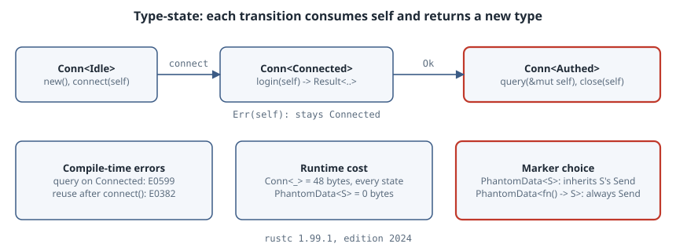

# `PhantomData` and the Type-State Pattern: Protocol States the Compiler Enforces

## Thesis

A lot of APIs have an order to them: connect, then log in, then query. Most libraries check that order at runtime, with a `state` field and an `Err(NotConnected)` when it's wrong. Rust can check it at compile time instead. Make the state a **type parameter**, give each state its own `impl` block, and have every transition take `self` by value and return the next state. Calling a method in the wrong state is then a type error. Reusing an old state is a use-after-move error.

The part that makes this work is `std::marker::PhantomData<S>`. It is a zero-sized field that "uses" the type parameter without storing anything. This chapter builds a small type-state connection, shows the compiler errors it produces, measures what it costs at runtime (nothing), and covers the one decision you have to get right: *which* `PhantomData`.

{fig-alt="Conn<Idle> goes to Conn<Connected> via connect(self). Conn<Connected> goes via login(self) to either Ok: Conn<Authed> or Err: Conn<Connected>. Only Conn<Authed> has query and close. Calling query on Conn<Connected> is error E0599; reusing a moved Conn<Idle> is E0382. Every Conn<_> is 48 bytes and PhantomData<S> is 0 bytes. PhantomData<S> inherits S's auto traits; PhantomData<fn() -> S> is always Send and Sync."}

All listings were compiled with `rustc 1.99.1`, edition 2024.

## Why you need `PhantomData` at all

Rust rejects a type parameter that no field mentions:

```rust
struct Conn<S> { host: String }
```

```text
error[E0392]: type parameter `S` is never used
 --> bad3.rs:1:13
  |
1 | struct Conn<S> { host: String }
  |             ^ unused type parameter
  |
  = help: consider removing `S`, referring to it in a field, or using a marker such as `PhantomData`
  = help: if you intended `S` to be a const parameter, use `const S: /* Type */` instead

error: aborting due to 1 previous error

For more information about this error, try `rustc --explain E0392`.
```

The error is deliberate. The compiler needs to know how `Conn<S>` relates to `S` for **variance**, **drop checking** and **auto traits** (`Send`/`Sync`). `PhantomData<T>` answers that question by saying "act as if this struct holds a `T`" ([std docs](https://doc.rust-lang.org/std/marker/struct.PhantomData.html)), while taking zero bytes.

## The type-state connection

The states are empty structs that are never constructed. They exist only as type arguments.

```rust
use std::marker::PhantomData;
use std::mem::size_of;

// States are zero-sized marker types. They never exist at runtime.
pub struct Idle;
pub struct Connected;
pub struct Authed;

pub struct Conn<S> {
    host: String,
    log: Vec<String>,
    _state: PhantomData<S>,
}

impl Conn<Idle> {
    pub fn new(host: &str) -> Self {
        Conn { host: host.to_string(), log: vec![], _state: PhantomData }
    }
    pub fn connect(mut self) -> Conn<Connected> {
        self.log.push(format!("connect {}", self.host));
        Conn { host: self.host, log: self.log, _state: PhantomData }
    }
}

impl Conn<Connected> {
    pub fn login(mut self, user: &str) -> Result<Conn<Authed>, Conn<Connected>> {
        if user.is_empty() {
            return Err(self); // stay in Connected, caller keeps the value
        }
        self.log.push(format!("login {user}"));
        Ok(Conn { host: self.host, log: self.log, _state: PhantomData })
    }
}

impl Conn<Authed> {
    pub fn query(&mut self, q: &str) -> usize {
        self.log.push(format!("query {q}"));
        q.len()
    }
    pub fn close(self) -> Vec<String> {
        self.log
    }
}

// Methods every state shares go on the generic impl.
impl<S> Conn<S> {
    pub fn host(&self) -> &str { &self.host }
}

```

Three design choices carry the pattern:

- **Transitions take `self` by value.** `connect(self) -> Conn<Connected>` *consumes* the idle connection, so the old state can't be used again.
- **Fallible transitions return the old state on failure.** `login` returns `Result<Conn<Authed>, Conn<Connected>>`. A failed login hands back the still-connected value instead of dropping it.
- **Shared behaviour goes on `impl<S> Conn<S>`.** `host()` works in every state, so it isn't copied three times.

The driver:

```rust
fn main() {
    let c = Conn::new("db.internal");
    println!("size_of::<Conn<Idle>>()   = {}", size_of::<Conn<Idle>>());
    println!("size_of::<Conn<Authed>>() = {}", size_of::<Conn<Authed>>());
    println!("size_of::<PhantomData<Authed>>() = {}", size_of::<PhantomData<Authed>>());
    let c = c.connect();
    let c = match c.login("") {
        Ok(_) => unreachable!(),
        Err(still_connected) => { println!("empty user rejected, still on {}", still_connected.host()); still_connected }
    };
    let mut c = c.login("kanthi").ok().expect("login");
    let n = c.query("SELECT 1");
    println!("query returned {n}");
    for line in c.close() { println!("log: {line}"); }
}
```

```text
size_of::<Conn<Idle>>()   = 48
size_of::<Conn<Authed>>() = 48
size_of::<PhantomData<Authed>>() = 0
empty user rejected, still on db.internal
query returned 8
log: connect db.internal
log: login kanthi
log: query SELECT 1
```

`Conn<Idle>` and `Conn<Authed>` are both 48 bytes (a `String` and a `Vec`, 24 bytes each on x86-64), and `PhantomData<Authed>` is 0. The state costs nothing at runtime: there's no tag byte and no branch. Each `impl` block is monomorphised separately, so `query` only exists for `Conn<Authed>`.

## What the compiler catches

Querying before login:

```rust
let c = Conn::new("db.internal").connect();
c.query("SELECT 1"); // not logged in yet
```

```text
error[E0599]: no method named `query` found for struct `Conn<Connected>` in the current scope
  --> bad1.rs:67:7
   |
 9 | pub struct Conn<S> {
   | ------------------ method `query` not found for this struct
...
67 |     c.query("SELECT 1"); // not logged in yet
   |       ^^^^^ method not found in `Conn<Connected>`
   |
   = note: the method was found for `Conn<Authed>`

error: aborting due to 1 previous error

For more information about this error, try `rustc --explain E0599`.
```

The note `the method was found for Conn<Authed>` points straight at the missing transition.

Reusing a state after it has been consumed:

```rust
let c = Conn::new("db.internal");
let a = c.connect();
let b = c.connect(); // reuse the Idle value
```

```text
error[E0382]: use of moved value: `c`
  --> bad2.rs:68:13
   |
66 |     let c = Conn::new("db.internal");
   |         - move occurs because `c` has type `Conn<Idle>`, which does not implement the `Copy` trait
67 |     let a = c.connect();
   |               --------- `c` moved due to this method call
68 |     let b = c.connect(); // reuse the Idle value
   |             ^ value used here after move
   |
note: `Conn::<Idle>::connect` takes ownership of the receiver `self`, which moves `c`
  --> bad2.rs:19:24
   |
19 |     pub fn connect(mut self) -> Conn<Connected> {
   |                        ^^^^

error: aborting due to 1 previous error

For more information about this error, try `rustc --explain E0382`.
```

A runtime state machine would catch neither mistake until the code ran, if at all.

## Choosing the right `PhantomData`

`PhantomData<S>` says "I own an `S`", so `Conn<S>` takes on `S`'s auto traits. That matters if a state marker happens to be `!Send`, even though no `S` value ever exists:

```rust
use std::marker::PhantomData;
use std::rc::Rc;

// A state marker that happens to be !Send (it is never constructed).
#[allow(dead_code)]
struct Local(Rc<()>);

struct Owns<S>(PhantomData<S>);          // "acts like it owns an S"
struct Tag<S>(PhantomData<fn() -> S>);   // "only names S": Send + Sync, covariant

fn assert_send<T: Send>() {}

fn main() {
    assert_send::<Tag<Local>>();
    assert_send::<Owns<Local>>();
}
```

```text
error[E0277]: `Rc<()>` cannot be sent between threads safely
  --> auto.rs:15:19
   |
15 |     assert_send::<Owns<Local>>();
   |                   ^^^^^^^^^^^ `Rc<()>` cannot be sent between threads safely
   |
   = help: within `Owns<Local>`, the trait `Send` is not implemented for `Rc<()>`
note: required because it appears within the type `Local`
  --> auto.rs:6:8
   |
 6 | struct Local(Rc<()>);
   |        ^^^^^
note: required because it appears within the type `PhantomData<Local>`
  --> /rustc/58cf8f9c35b355199727627d07ae34a4e2846d67/library/core/src/marker.rs:811:11
note: required because it appears within the type `Owns<Local>`
  --> auto.rs:8:8
   |
 8 | struct Owns<S>(PhantomData<S>);          // "acts like it owns an S"
   |        ^^^^
note: required by a bound in `assert_send`
  --> auto.rs:11:19
   |
11 | fn assert_send<T: Send>() {}
   |                   ^^^^ required by this bound in `assert_send`

error: aborting due to 1 previous error

For more information about this error, try `rustc --explain E0277`.
```

`Tag<Local>` compiles and `Owns<Local>` does not. The [Rustonomicon's PhantomData table](https://doc.rust-lang.org/nomicon/phantom-data.html) lists the options:

| Marker | Variance in `T` | `Send`/`Sync` | `T` may dangle in drop glue? |
|---|---|---|---|
| `PhantomData<T>` | covariant | inherited from `T` | no ("owns `T`") |
| `PhantomData<&'a T>` | covariant | `Send + Sync` require `T: Sync` | yes |
| `PhantomData<*const T>` | covariant | `!Send + !Sync` | yes |
| `PhantomData<fn() -> T>` | covariant | `Send + Sync` | yes |
| `PhantomData<fn(T)>` | **contra**variant | `Send + Sync` | yes |
| `PhantomData<fn(T) -> T>` | **in**variant | `Send + Sync` | yes |

For type-state markers, where `S` is only a label, `PhantomData<fn() -> S>` is usually the most accurate choice. The struct never owns an `S`, so it shouldn't inherit `S`'s thread-safety or drop behaviour. Use plain `PhantomData<S>` when the struct really does own `S` values in a way the compiler can't see, such as a raw-pointer collection, because that is what keeps drop checking sound.

## When not to use type-state

- **The state comes from runtime data.** If the server decides whether you're authenticated, you still need `Result` at the boundary, as `login` shows. You can't hold a `Vec` of connections in different states without an enum or a trait object, so mixed collections go back to runtime state.
- **There are many states and many shared methods.** Every state you add means another `impl` block and more generic signatures. More than four or five states is usually a sign you want an enum.
- **The API is public and stable.** Each state type becomes part of your public API, and renaming one is a breaking change.

## Takeaways

- A type parameter plus `PhantomData` turns protocol order into type checking, with zero runtime cost (48 bytes in every state, measured).
- Transitions consume `self`. A failed transition returns the old state in `Err`.
- Out-of-order calls become E0599 and reuse becomes E0382, both at compile time.
- Pick the marker on purpose: `PhantomData<fn() -> S>` for pure labels, `PhantomData<S>` only when you logically own an `S`.

## Sources

- Rust standard library, [`std::marker::PhantomData`](https://doc.rust-lang.org/std/marker/struct.PhantomData.html)
- The Rustonomicon, [PhantomData](https://doc.rust-lang.org/nomicon/phantom-data.html) (variance, auto-trait and drop-check table)
- Rust compiler error index, [E0392](https://doc.rust-lang.org/error_codes/E0392.html), [E0599](https://doc.rust-lang.org/error_codes/E0599.html), [E0382](https://doc.rust-lang.org/error_codes/E0382.html)
- The Rust Reference, [Subtyping and Variance](https://doc.rust-lang.org/reference/subtyping.html)
