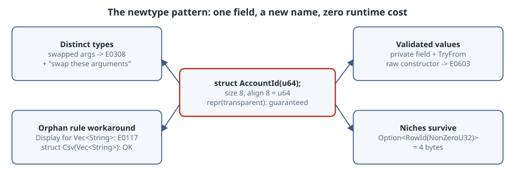

# The Newtype Pattern: Zero-Cost Type Safety, Validated Values and the Orphan Rule

## Thesis

A **newtype** is a tuple struct with one field: `struct AccountId(u64);`. It costs nothing at runtime, because it has the same size and alignment as what it wraps, but it is a *different type* to the compiler. That one property gives you three tools:

1. Values with the same representation can no longer be mixed up. Account IDs, amounts, metres and seconds all stop being "just a `u64`".
2. A private field plus a validating constructor means that holding the type is *proof* the value was checked.
3. A local wrapper lets you implement a foreign trait for a foreign type, which the orphan rule otherwise forbids.

This chapter demonstrates each one with compiler output from rustc 1.99.1, and shows where `#[repr(transparent)]` becomes necessary rather than optional.

{fig-alt="Centre: struct AccountId(u64), a single-field tuple struct. Measured: same size and alignment as the wrapped type (Meters wraps f64: size 8, align 8); repr(transparent) guarantees the identical layout and ABI. Four uses around it. Distinct types: transfer(alice, Cents(500), bob) is rejected with E0308 and a swap-these-arguments hint, while plain u64 arguments are silently swapped. Validated values: a private field plus TryFrom makes the constructor the only way in, so holding an Email proves it was checked; E0603 outside the module. Orphan rule: impl Display for Vec<String> is E0117; wrap it as struct Csv(Vec<String>) and implement Display on the wrapper. Niches survive: Option of a newtype over NonZeroU32 is 4 bytes, the same as Option<NonZeroU32>."}

All listings come from one Cargo package (edition 2024). Each one is a binary under `src/bin/`. The `*_bug.rs` files fail to compile on purpose.

## 1. The swapped-argument bug

```rust
// Two IDs with the same representation: the compiler cannot tell them apart.
fn transfer(from_account: u64, to_account: u64, cents: u64) {
    println!("move {cents} cents from {from_account} to {to_account}");
}

#[derive(Clone, Copy, Debug, PartialEq, Eq, Hash)]
struct AccountId(u64);
#[derive(Clone, Copy, Debug, PartialEq, Eq, Hash)]
struct Cents(u64);

fn transfer_typed(from: AccountId, to: AccountId, amount: Cents) {
    println!("move {} cents from {} to {}", amount.0, from.0, to.0);
}

fn main() {
    let (alice, bob) = (1001_u64, 2002_u64);
    transfer(alice, 500, bob); // compiles; bob's id is now the amount

    let (alice, bob) = (AccountId(1001), AccountId(2002));
    transfer_typed(alice, bob, Cents(500));
}
```

```text
$ cargo run -q --bin swapped
move 2002 cents from 1001 to 500
move 500 cents from 1001 to 2002
```

The first call moves **2002 cents to account 500**. Every argument is a `u64`, so nothing could catch the mistake. Here is the same mistake with newtypes:

```rust
#[derive(Clone, Copy, Debug)]
struct AccountId(u64);
#[derive(Clone, Copy, Debug)]
struct Cents(u64);

fn transfer_typed(from: AccountId, to: AccountId, amount: Cents) {
    println!("{from:?} {to:?} {amount:?}");
}

fn main() {
    let (alice, bob) = (AccountId(1001), AccountId(2002));
    transfer_typed(alice, Cents(500), bob);
}
```

```text
$ cargo build -q --bin swapped_typed_bug
error[E0308]: arguments to this function are incorrect
  --> src/bin/swapped_typed_bug.rs:12:5
   |
12 |     transfer_typed(alice, Cents(500), bob);
   |     ^^^^^^^^^^^^^^        ----------  --- expected `Cents`, found `AccountId`
   |                           |
   |                           expected `AccountId`, found `Cents`
   |
note: function defined here
  --> src/bin/swapped_typed_bug.rs:6:4
   |
 6 | fn transfer_typed(from: AccountId, to: AccountId, amount: Cents) {
   |    ^^^^^^^^^^^^^^
help: swap these arguments
   |
12 -     transfer_typed(alice, Cents(500), bob);
12 +     transfer_typed(alice, bob, Cents(500));
   |
```

The compiler rejects the call and even suggests the fix. Deriving `Clone, Copy, Debug, PartialEq, Eq, Hash` keeps IDs as convenient as plain integers in hash maps and comparisons. Leave out `Add` and the other arithmetic traits unless the operation makes sense: adding two account IDs never does. The Rust API Guidelines list this as [C-NEWTYPE](https://rust-lang.github.io/api-guidelines/type-safety.html#c-newtype): "Newtypes provide static distinctions".

## 2. Zero cost, and what `repr(transparent)` adds

```rust
use std::mem::{align_of, size_of};

#[allow(dead_code)]
struct Meters(f64);
#[allow(dead_code)]
#[repr(transparent)]
struct UserId(u32);
#[allow(dead_code)]
struct RowId(std::num::NonZeroU32);

fn main() {
    println!("f64: size {} align {}", size_of::<f64>(), align_of::<f64>());
    println!("Meters: size {} align {}", size_of::<Meters>(), align_of::<Meters>());
    println!("Option<u32>: size {}", size_of::<Option<u32>>());
    println!("Option<UserId>: size {}", size_of::<Option<UserId>>());
    println!("Option<std::num::NonZeroU32>: size {}", size_of::<Option<std::num::NonZeroU32>>());
    println!("Option<RowId>: size {}", size_of::<Option<RowId>>());
    println!("[UserId; 1000]: size {}", size_of::<[UserId; 1000]>());
}
```

```text
$ cargo run -q --bin zero_cost
f64: size 8 align 8
Meters: size 8 align 8
Option<u32>: size 8
Option<UserId>: size 8
Option<std::num::NonZeroU32>: size 4
Option<RowId>: size 4
[UserId; 1000]: size 4000
```

- `Meters` has the same size and alignment as `f64`, and an array of 1000 `UserId`s is exactly 4000 bytes. There is no header and no tag.
- **Niches survive the wrapper.** `Option<RowId>` is 4 bytes because `RowId` wraps `NonZeroU32`, and the compiler reuses the forbidden zero as `None`. `Option<UserId>` over a plain `u32` has no niche, so it needs the extra discriminant and is 8 bytes.

What you measure for a default-representation (`repr(Rust)`) struct is not a *promise*. The [Reference's type-layout chapter](https://doc.rust-lang.org/reference/type-layout.html) gives `repr(Rust)` very few guarantees. `#[repr(transparent)]` is the attribute that guarantees "the same layout and ABI as the only non-size 0 non-alignment 1 field". You need it whenever `unsafe` code or FFI depends on the layout:

```rust
// #[repr(transparent)] guarantees UserId has the same layout and ABI as u32,
// so a &[u32] from storage or FFI can be viewed as &[UserId] without copying.
#[derive(Debug, Clone, Copy, PartialEq, Eq)]
#[repr(transparent)]
struct UserId(u32);

fn as_user_ids(raw: &[u32]) -> &[UserId] {
    // SAFETY: UserId is repr(transparent) over u32, so size, alignment and
    // validity are identical; the lifetime is carried over from `raw`.
    unsafe { std::slice::from_raw_parts(raw.as_ptr().cast::<UserId>(), raw.len()) }
}

fn main() {
    let raw = vec![7_u32, 42, 99];
    let ids = as_user_ids(&raw);
    println!("{ids:?}");
    println!("same address: {}", raw.as_ptr() as usize == ids.as_ptr() as usize);
}
```

```text
$ cargo run -q --bin transparent
[UserId(7), UserId(42), UserId(99)]
same address: true
```

Without `#[repr(transparent)]`, this cast would be relying on layout the language doesn't promise. With it, a `&[u32]` from a file, a database page or a C library becomes a typed `&[UserId]` with no copy (`same address: true`). The [Nomicon](https://doc.rust-lang.org/nomicon/other-reprs.html) describes the same rule for passing newtypes across `extern "C"` boundaries.

## 3. Validated values: parse, don't re-check

```rust
// A newtype whose only constructor validates: holding an Email *proves* it was checked.
mod email {
    #[derive(Debug, Clone, PartialEq, Eq)]
    pub struct Email(String); // private field: no Email("junk".into()) outside this module

    #[derive(Debug)]
    pub struct InvalidEmail(pub String);

    impl TryFrom<String> for Email {
        type Error = InvalidEmail;
        fn try_from(s: String) -> Result<Self, Self::Error> {
            match s.split_once('@') {
                Some((user, host)) if !user.is_empty() && host.contains('.') => {
                    Ok(Email(s.to_ascii_lowercase()))
                }
                _ => Err(InvalidEmail(s)),
            }
        }
    }

    impl AsRef<str> for Email {
        fn as_ref(&self) -> &str {
            &self.0
        }
    }
}

use email::Email;

fn send_welcome(to: &Email) {
    println!("sending to {}", to.as_ref());
}

fn main() {
    for raw in ["Ada@Example.org", "no-at-sign", "@example.org", "bob@localhost"] {
        match Email::try_from(raw.to_string()) {
            Ok(e) => send_welcome(&e),
            Err(err) => println!("rejected: {:?}", err.0),
        }
    }
}
```

```text
$ cargo run -q --bin validated
sending to ada@example.org
rejected: "no-at-sign"
rejected: "@example.org"
rejected: "bob@localhost"
```

The field is private, so outside `mod email` the **only** way to get an `Email` is `TryFrom`, which validates it and normalises it to lower case. `send_welcome(&Email)` has no reason to check again. Trying to bypass the constructor fails:

```rust
mod email {
    #[derive(Debug)]
    pub struct Email(String);
}

fn main() {
    let e = email::Email("not an email".to_string());
    println!("{e:?}");
}
```

```text
$ cargo build -q --bin validated_bug
error[E0603]: tuple struct constructor `Email` is private
 --> src/bin/validated_bug.rs:7:20
  |
3 |     pub struct Email(String);
  |                      ------ a constructor is private if any of the fields is private
...
7 |     let e = email::Email("not an email".to_string());
  |                    ^^^^^ private tuple struct constructor
  |
note: the tuple struct constructor `Email` is defined here
 --> src/bin/validated_bug.rs:3:5
  |
3 |     pub struct Email(String);
  |     ^^^^^^^^^^^^^^^^^^^^^^^^^
help: consider making the field publicly accessible
  |
3 |     pub struct Email(pub String);
  |                      +++
```

The compiler's `help` suggests `pub String`. In this case that is the **wrong** fix, because it would let anyone build an unvalidated `Email`. The privacy is the whole point.

The validation here is deliberately small. Real email validation belongs in a dedicated crate. The pattern stays the same whatever rule you plug in.

## 4. Getting around the orphan rule

You can't implement a trait from another crate (`Display`) for a type from another crate (`Vec<String>`):

```rust
use std::fmt;

impl fmt::Display for Vec<String> {
    fn fmt(&self, f: &mut fmt::Formatter<'_>) -> fmt::Result {
        write!(f, "{}", self.join(","))
    }
}

fn main() {}
```

```text
$ cargo build -q --bin orphan_bug
error[E0117]: only traits defined in the current crate can be implemented for types defined outside of the crate
 --> src/bin/orphan_bug.rs:3:1
  |
3 | impl fmt::Display for Vec<String> {
  | ^^^^^^^^^^^^^^^^^^^^^^-----------
  |                       |
  |                       `Vec` is not defined in the current crate
  |
  = note: impl doesn't have any local type before any uncovered type parameters
  = note: for more information see https://doc.rust-lang.org/reference/items/implementations.html#orphan-rules
  = note: define and implement a trait or new type instead
```

The last note gives the fix, "define and implement a trait or new type instead":

```rust
use std::fmt;

// impl fmt::Display for Vec<String> { ... }  // E0117: only traits defined in
// the current crate can be implemented for types defined outside of the crate

struct Csv(Vec<String>);

impl fmt::Display for Csv {
    fn fmt(&self, f: &mut fmt::Formatter<'_>) -> fmt::Result {
        write!(f, "{}", self.0.join(","))
    }
}

fn main() {
    let row = Csv(vec!["id".into(), "name".into(), "email".into()]);
    println!("{row}");
}
```

```text
$ cargo run -q --bin orphan
id,name,email
```

The [Book](https://doc.rust-lang.org/book/ch20-02-advanced-traits.html) presents exactly this use. The [orphan rules](https://doc.rust-lang.org/reference/items/implementations.html#orphan-rules) exist so that two crates can never provide conflicting impls of the same trait for the same type.

## Pitfalls

- **`Deref` as inheritance.** `impl Deref<Target = String> for Email` makes `email.len()` work, but it also adds every `String` method to the `Email` API, and `email.to_uppercase()` quietly returns a plain `String`. Implement `AsRef<str>` and the few methods you actually mean.
- **`DerefMut` breaks validation.** It lets callers write `*email = "junk".into()` and skip `TryFrom` altogether.
- **`pub` fields** remove validation the same way (section 3).
- **Boilerplate.** Each trait you want, such as `Display`, `FromStr`, `serde`, or arithmetic for units, has to be derived or forwarded. `#[derive]` covers the standard traits, and `#[serde(transparent)]` serialises the newtype as its inner value. Write impls by hand where the semantics differ, as with `Cents * Cents`.

## Takeaways

- A single-field tuple struct is a new type at compile time and nothing at runtime: same size and alignment, and niches are preserved.
- Use newtypes for IDs and units so that swapped arguments become `E0308` errors.
- A private field plus `TryFrom` turns "was this validated?" into a type-level fact.
- Add `#[repr(transparent)]` as soon as `unsafe` code or FFI relies on the layout.
- A wrapper is the standard answer to `E0117`.

## Sources

- The Rust Book, [Using the Newtype Pattern to Implement External Traits](https://doc.rust-lang.org/book/ch20-02-advanced-traits.html) and [Advanced Types](https://doc.rust-lang.org/book/ch20-03-advanced-types.html)
- Rust API Guidelines, [C-NEWTYPE](https://rust-lang.github.io/api-guidelines/type-safety.html)
- The Rust Reference, [Type layout: the transparent representation](https://doc.rust-lang.org/reference/type-layout.html) and [Orphan rules](https://doc.rust-lang.org/reference/items/implementations.html#orphan-rules)
- The Rustonomicon, [Alternative representations](https://doc.rust-lang.org/nomicon/other-reprs.html)
- std docs, [`NonZero`](https://doc.rust-lang.org/std/num/struct.NonZero.html) and [`Option` representation](https://doc.rust-lang.org/std/option/index.html#representation)
