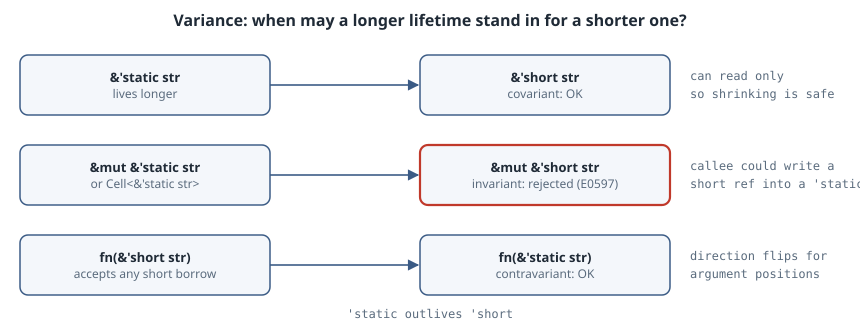

# Variance: Why `&mut` Makes Lifetimes Rigid

## Thesis

Most lifetime errors that look like "the borrow checker is being stubborn" are really about **variance**. Variance is the rule that decides when a type with a longer lifetime can be used where a shorter one is expected. A `&'static str` can be passed anywhere a `&'a str` is wanted, but a `&mut &'static str` can't be passed where a `&mut &'a str` is wanted. The reason isn't arbitrary: if it were allowed, safe code could put a dangling reference into a `'static` slot.

This chapter shows the three kinds of variance in compiler output, explains why each one has to be that way, and then works through the most common real bug variance causes: the `&'a mut self` signature that locks a struct for the rest of its life.

{fig-alt="Three rows, where 'static outlives 'short. Covariant: &'static str can be used as &'short str, which is OK. Invariant: &mut &'static str can NOT be used as &mut &'short str, because the callee could write a short-lived reference into a 'static slot; the same holds for Cell<&'a str>. Contravariant: fn(&'short str) can be used as fn(&'static str), because a callback that accepts any borrow also accepts a 'static one."}

All listings were compiled with `rustc 1.99.1`, edition 2024. Every error message shown is the compiler's actual output.

## Subtyping, but only for lifetimes

Rust has no struct inheritance, so the only subtyping is between lifetimes. If `'long` outlives `'short` (written `'long: 'short`), then `&'long T` is a subtype of `&'short T`, and a value of the first type can be used where the second is expected ([Reference: Subtyping and Variance](https://doc.rust-lang.org/reference/subtyping.html)).

Variance describes how that relationship carries through a type constructor `F<T>`:

- **Covariant:** if `A` is a subtype of `B`, then `F<A>` is a subtype of `F<B>`. The relationship carries through unchanged.
- **Invariant:** `F<A>` and `F<B>` are unrelated unless `A` and `B` are the same type.
- **Contravariant:** the relationship flips, so `F<B>` is a subtype of `F<A>`.

## Covariant: shared references shrink freely

```rust
// &'a T is covariant in 'a: a longer-lived reference can stand in for a shorter one.
fn pick<'a>(x: &'a str, y: &'a str) -> &'a str { if x.len() >= y.len() { x } else { y } }

fn main() {
    let forever: &'static str = "static text";
    let owned = String::from("local");
    let r = pick(forever, &owned); // &'static str shrinks to the local lifetime
    println!("{r}");
}
```

```text
$ rustc --edition 2024 cov.rs && ./cov
static text
```

`pick` needs a single `'a` for both arguments. The compiler chooses `'a` as the lifetime of `owned` and shrinks the `&'static str` to fit. That is safe because a shared reference can only be read, and reading something for less time than it lives is never a problem.

## Invariant: `&mut T` can't shrink its `T`

Now make the shrinking happen behind a `&mut`:

```rust
// &'a mut T is invariant in T: this is what keeps the next line from compiling.
fn overwrite<T>(slot: &mut T, value: T) { *slot = value; }

fn main() {
    let mut s: &'static str = "static text";
    {
        let local = String::from("short-lived");
        overwrite(&mut s, &local);
    }
    println!("{s}");
}
```

```text
$ rustc --edition 2024 inv_mut.rs && ./inv_mut
error[E0597]: `local` does not live long enough
 --> inv_mut.rs:8:27
  |
5 |     let mut s: &'static str = "static text";
  |                ------------ type annotation requires that `local` is borrowed for `'static`
6 |     {
7 |         let local = String::from("short-lived");
  |             ----- binding `local` declared here
8 |         overwrite(&mut s, &local);
  |                           ^^^^^^ borrowed value does not live long enough
9 |     }
  |     - `local` dropped here while still borrowed

error: aborting due to 1 previous error

For more information about this error, try `rustc --explain E0597`.
```

`&'a mut T` is covariant in `'a` but **invariant in `T`**. Here `T` is `&'static str`, so `overwrite` needs `value` to have exactly that type, and `&local` would have to be borrowed for `'static`. Suppose `&mut &'static str` could be treated as `&mut &'short str` instead. `overwrite` would store a pointer to `local` in `s`, `local` would be dropped at the closing brace, and `println!` would read freed memory. Invariance is what prevents that.

The same reasoning covers every type that lets you write through a shared handle. `Cell<T>`, `RefCell<T>`, `UnsafeCell<T>` and `*mut T` are all invariant in `T`. A struct's variance is **inferred from its fields**, so one `Cell` field is enough to make the whole struct invariant:

```rust
use std::cell::Cell;

// Variance of a struct is inferred from its fields.
struct Plain<'a>(&'a str);          // covariant in 'a
struct Shared<'a>(Cell<&'a str>);   // invariant in 'a (interior mutability)

fn shorten_plain<'s>(p: Plain<'static>, _scope: &'s str) -> Plain<'s> { p }
fn shorten_shared<'s>(p: Shared<'static>, _scope: &'s str) -> Shared<'s> { p }

fn main() {
    let local = String::from("x");
    let p = shorten_plain(Plain("static"), &local);
    let s = shorten_shared(Shared(Cell::new("static")), &local);
    println!("{} {}", p.0, s.0.get());
}
```

```text
$ rustc --edition 2024 structs.rs && ./structs
error: lifetime may not live long enough
 --> structs.rs:8:76
  |
8 | fn shorten_shared<'s>(p: Shared<'static>, _scope: &'s str) -> Shared<'s> { p }
  |                   -- lifetime `'s` defined here                            ^ returning this value requires that `'s` must outlive `'static`
  |
  = note: requirement occurs because of the type `Shared<'_>`, which makes the generic argument `'_` invariant
  = note: the struct `Shared<'a>` is invariant over the parameter `'a`
  = help: see <https://doc.rust-lang.org/nomicon/subtyping.html> for more information about variance

error: aborting due to 1 previous error
```

The compiler names the cause directly ("the struct `Shared<'a>` is invariant over the parameter `'a`") and links to the Rustonomicon. `Plain` has the same shape without the `Cell`, so `shorten_plain` compiles without complaint. When `shorten_shared` and its call are deleted, the program prints `static`.

## Contravariant: function arguments flip the direction

A function pointer `fn(T)` is **contravariant** in `T`. A callback that accepts a borrow of *any* lifetime can safely be used where only `'static` borrows will ever be passed. The other direction isn't safe: a callback that requires `'static` might store its argument somewhere global.

```rust
// fn(T) is contravariant in T: a callback that accepts *any* lifetime
// can be used where one accepting only 'static is expected, not vice versa.
struct Sink<'a> { f: fn(&'a str) }

fn print_it(s: &str) { println!("got {s}"); }

fn widen<'s>(k: Sink<'s>) -> Sink<'static> { k }   // OK: contravariant
fn narrow<'s>(k: Sink<'static>, _x: &'s str) -> Sink<'s> { k } // rejected

fn main() {
    let k: Sink<'static> = widen(Sink { f: print_it });
    (k.f)("hello");
    let local = String::from("y");
    let _ = narrow(k, &local);
}
```

```text
$ rustc --edition 2024 contra.rs && ./contra
error: lifetime may not live long enough
 --> contra.rs:8:60
  |
8 | fn narrow<'s>(k: Sink<'static>, _x: &'s str) -> Sink<'s> { k } // rejected
  |           -- lifetime `'s` defined here                    ^ returning this value requires that `'s` must outlive `'static`

error: aborting due to 1 previous error
```

`widen` (short to `'static`) is accepted and `narrow` (`'static` to short) is rejected. With `narrow` removed:

```text
$ rustc --edition 2024 contra_ok.rs && ./contra_ok
got hello
```

Contravariance is rare in everyday code. In practice it comes from `fn(T)` fields and from `PhantomData<fn(T)>` markers.

## The common case: `&'a mut self` on a type with `'a`

Here is the variance bug most Rust programmers hit, usually in a parser, interner or arena:

```rust
// The "&'a mut Thing<'a>" trap: tying the borrow to the invariant parameter.
struct Interner<'a> { words: Vec<&'a str> }

impl<'a> Interner<'a> {
    fn add(&'a mut self, w: &'a str) { self.words.push(w); }
}

fn main() {
    let text = String::from("alpha beta");
    let mut i = Interner { words: Vec::new() };
    for w in text.split(' ') {
        i.add(w);
    }
    println!("{}", i.words.len());
}
```

```text
$ rustc --edition 2024 vec_trap.rs && ./vec_trap
error[E0499]: cannot borrow `i` as mutable more than once at a time
  --> vec_trap.rs:12:9
   |
12 |         i.add(w);
   |         ^
   |         |
   |         `i` was mutably borrowed here in the previous iteration of the loop
   |         first borrow used here, in later iteration of loop

error[E0502]: cannot borrow `i.words` as immutable because it is also borrowed as mutable
  --> vec_trap.rs:14:20
   |
12 |         i.add(w);
   |         - mutable borrow occurs here
13 |     }
14 |     println!("{}", i.words.len());
   |                    ^^^^^^^
   |                    |
   |                    immutable borrow occurs here
   |                    mutable borrow later used here

error: aborting due to 2 previous errors

Some errors have detailed explanations: E0499, E0502.
For more information about an error, try `rustc --explain E0499`.
```

The signature `fn add(&'a mut self, w: &'a str)` says: "borrow `self` mutably for `'a`, the *same* lifetime the struct holds its data for." `Interner<'a>` contains `Vec<&'a str>`, and `&mut Interner<'a>` is invariant in `Interner<'a>`. The compiler can't shrink `'a` to make the borrow shorter, so the first call to `add` borrows `i` mutably for all of `'a`, which is every remaining use of `i`. The second loop iteration can't borrow it again, and neither can the `println!`.

The fix is to stop tying the borrow of `self` to the data lifetime. The `&mut self` borrow gets its own short, elided lifetime:

```rust
struct Interner<'a> { words: Vec<&'a str> }

impl<'a> Interner<'a> {
    fn add(&mut self, w: &'a str) { self.words.push(w); }
}

fn main() {
    let text = String::from("alpha beta");
    let mut i = Interner { words: Vec::new() };
    for w in text.split(' ') {
        i.add(w);
    }
    println!("{} words: {:?}", i.words.len(), i.words);
}
```

```text
$ rustc --edition 2024 vec_fixed.rs && ./vec_fixed
2 words: ["alpha", "beta"]
```

As a rule: **a `&'a mut Thing<'a>` signature is almost always a mistake.** The same goes for `&'a mut Vec<&'a T>` in function signatures. Give the mutable borrow its own lifetime, which in most cases means leaving it elided.

## The variance table

From the [Reference](https://doc.rust-lang.org/reference/subtyping.html#variance):

| Type | Variance in `'a` | Variance in `T` |
|---|---|---|
| `&'a T` | covariant | covariant |
| `&'a mut T` | covariant | **invariant** |
| `*const T` | | covariant |
| `*mut T` | | **invariant** |
| `[T]`, `[T; n]`, `Box<T>`, `Vec<T>` | | covariant |
| `fn() -> T` | | covariant |
| `fn(T) -> ()` | | **contra**variant |
| `UnsafeCell<T>`, `Cell<T>`, `RefCell<T>` | | **invariant** |
| `PhantomData<T>` | | covariant |
| `dyn Trait<T> + 'a` | covariant | **invariant** |

A struct or enum is covariant in a parameter only if every field that uses that parameter is covariant in it. If fields disagree, or any field is invariant, the parameter is invariant. You can't annotate variance yourself. To change it, you change the fields, often by adding a `PhantomData` marker of the right shape.

## Pitfalls

- **Assuming `Cell` is "just a wrapper".** Adding a `Cell<&'a T>` field to a struct that used to be covariant makes it invariant. That is a **breaking change** for downstream code that relied on shrinking lifetimes, even though no public signature changed.
- **Reaching for `'static` to "fix" invariance errors.** Writing `T: 'static` or `&'static` everywhere makes the error go away by making the API useless for borrowed data. Find the `&mut` or `Cell` that forces invariance instead.
- **Reading E0499 or E0502 at face value.** "Mutably borrowed in the previous iteration of the loop" on a method call usually means the method's signature ties `&mut self` to a struct lifetime. Check the signature before you restructure the loop.
- **Unsafe code with the wrong variance.** A raw-pointer container that stores `*const T` is covariant, but if it hands out `&mut T` it probably needs to be invariant. Variance mistakes in `unsafe` code are soundness bugs, not just inconvenient compile errors.

## Takeaways

- Shared references are covariant, so longer lifetimes shrink to fit.
- Anything you can write through (`&mut T`, `Cell<T>`, `*mut T`) is invariant in `T`, because otherwise safe code could store a dangling reference.
- Function arguments are contravariant, so callbacks that accept more are acceptable where callbacks that accept less are expected.
- A struct's variance comes from its fields, so changing a field type can be a breaking change.
- `&'a mut Thing<'a>` locks `Thing` for its whole lifetime. Let the `&mut self` borrow have its own lifetime.

## Sources

- The Rust Reference, [Subtyping and Variance](https://doc.rust-lang.org/reference/subtyping.html)
- The Rustonomicon, [Subtyping and Variance](https://doc.rust-lang.org/nomicon/subtyping.html)
- Rust standard library, [`std::cell::Cell`](https://doc.rust-lang.org/std/cell/struct.Cell.html)
- Rust compiler error index, [E0597](https://doc.rust-lang.org/error_codes/E0597.html), [E0499](https://doc.rust-lang.org/error_codes/E0499.html), [E0502](https://doc.rust-lang.org/error_codes/E0502.html)
