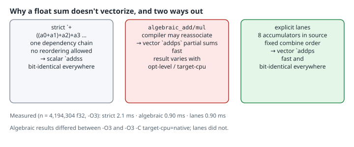

# Fast Float Reductions: Algebraic Operations vs Explicit Lanes

After this page you can explain why `iter().map(|(x, y)| x * y).sum()` over `f32` runs as a slow scalar loop even at `-O3`, speed it up with the `algebraic_*` float methods stabilized in **Rust 1.98**, and decide when to write explicit accumulator lanes instead. Both run at about the same speed, but only the lanes give the same bits on every build.

## Thesis

IEEE 754 addition isn't associative, so `(a + b) + c` and `a + (b + c)` can round differently. Rust's `+` on floats promises the exact IEEE result of the expression as written. That forbids the reordering a vectorizer needs, so a float reduction becomes one long dependency chain. `f32::algebraic_add`/`algebraic_mul` (and `_sub`, `_div`, `_rem`, likewise on `f64`) lift that promise *per operation*. The standard library docs say they "allow the compiler to optimize floating point operations using all the usual algebraic properties of real numbers," and also that "algebraic operations are non-deterministic." You get the speed and give up reproducibility. Writing the reassociation yourself gets you the speed and keeps reproducibility.

## Mental model

{fig-alt="Three panels. Strict plus: one dependency chain, no reordering allowed, scalar addss, bit-identical everywhere. algebraic_add and algebraic_mul: the compiler may reassociate into vector addps partial sums, which is fast, but the result varies with opt-level and target-cpu. Explicit lanes: 8 accumulators written in the source with a fixed combine order, vector addps, fast and bit-identical everywhere. Notes: measured at -O3 with 4,194,304 f32, strict 2.1 ms, algebraic 0.90 ms, lanes 0.90 ms; algebraic results differed between -O3 and -O3 -C target-cpu=native, lanes did not."}

The docs' own example is that `a.algebraic_add(b).algebraic_add(c).algebraic_add(d)` may be computed as written or as `(a + c) + (b + d)`. The rewrites allowed are deliberately unspecified. Typically they include reassociation, contraction into fused multiply-add, replacing division with reciprocal multiplication, and ignoring the sign of zero. NaN, ±Inf and `-0.0` "may behave in unexpected ways." The results are always valid floats and never undefined behavior, but unsafe code must not depend on any property of them.

## Worked example: three dot products

```rust
use std::hint::black_box;
use std::time::Instant;

#[inline(never)]
pub fn dot_strict(a: &[f32], b: &[f32]) -> f32 {
    a.iter().zip(b).fold(0.0, |acc, (x, y)| acc + x * y)
}

#[inline(never)]
pub fn dot_algebraic(a: &[f32], b: &[f32]) -> f32 {
    a.iter()
        .zip(b)
        .fold(0.0, |acc, (x, y)| acc.algebraic_add(x.algebraic_mul(*y)))
}

/// Deterministic alternative: eight explicit accumulators, combined in a
/// fixed order. Same result at every opt level and target; still vectorizes.
#[inline(never)]
pub fn dot_lanes(a: &[f32], b: &[f32]) -> f32 {
    let mut acc = [0.0f32; 8];
    let (ca, cb) = (a.chunks_exact(8), b.chunks_exact(8));
    let tail: f32 = ca.remainder().iter().zip(cb.remainder()).map(|(x, y)| x * y).sum();
    for (xa, xb) in ca.zip(cb) {
        for i in 0..8 {
            acc[i] += xa[i] * xb[i];
        }
    }
    ((acc[0] + acc[4]) + (acc[1] + acc[5])) + ((acc[2] + acc[6]) + (acc[3] + acc[7])) + tail
}

#[inline(never)]
pub fn dot_f64(a: &[f32], b: &[f32]) -> f64 {
    a.iter().zip(b).fold(0.0, |acc, (x, y)| acc + (*x as f64) * (*y as f64))
}

pub fn time(name: &str, f: impl Fn() -> f32, reference: f64) {
    let mut best = f64::MAX;
    let mut r = 0.0;
    for _ in 0..20 {
        let t = Instant::now();
        r = black_box(f());
        best = best.min(t.elapsed().as_secs_f64());
    }
    println!(
        "{name:<10} {r:>14.6}  rel.err {:>9.2e}  best {:>7.3} ms",
        ((r as f64 - reference) / reference).abs(),
        best * 1e3
    );
}

fn main() {
    let n = 1 << 22;
    // Deterministic pseudo-random data in [0, 1).
    let mut s: u32 = 12345;
    let mut next = || {
        s = s.wrapping_mul(1664525).wrapping_add(1013904223);
        (s >> 8) as f32 / (1u32 << 24) as f32
    };
    let a: Vec<f32> = (0..n).map(|_| next()).collect();
    let b: Vec<f32> = (0..n).map(|_| next()).collect();
    let reference = dot_f64(&a, &b);
    println!("n = {n}, f64 reference = {reference:.6}");
    time("strict", || dot_strict(black_box(&a), black_box(&b)), reference);
    time("algebraic", || dot_algebraic(black_box(&a), black_box(&b)), reference);
    time("lanes", || dot_lanes(black_box(&a), black_box(&b)), reference);
}
```

Verified with **rustc 1.99.1 (58cf8f9c3 2026-10-13)** on x86-64 (`Intel(R) Xeon(R) Processor`, 8 vCPUs). The same program was built three ways:

```bash
for o in "-C opt-level=0" "-C opt-level=3" "-C opt-level=3 -C target-cpu=native"; do
  echo "== rustc $o"; rustc $o --edition 2024 dot.rs -o dotx && ./dotx | tail -3
done
```

```text
== rustc -C opt-level=0
strict     1046494.187500  rel.err   1.92e-3  best  40.257 ms
algebraic  1046494.187500  rel.err   1.92e-3  best  38.999 ms
lanes      1048457.937500  rel.err   4.60e-5  best  29.115 ms
== rustc -C opt-level=3
strict     1046494.187500  rel.err   1.92e-3  best   2.100 ms
algebraic  1048457.937500  rel.err   4.60e-5  best   0.899 ms
lanes      1048457.937500  rel.err   4.60e-5  best   0.901 ms
== rustc -C opt-level=3 -C target-cpu=native
strict     1046494.187500  rel.err   1.92e-3  best   2.100 ms
algebraic  1048502.125000  rel.err   3.84e-6  best   1.003 ms
lanes      1048457.937500  rel.err   4.60e-5  best   1.010 ms
```

Here's what that shows:

- **At `-O3` the algebraic version is ~2.3× faster than strict** and as fast as the hand-written lanes. (Timings are best of 20 on a shared VM, so treat them as ratios, not absolutes.)
- **The algebraic result depends on the build.** Unoptimized, it matches strict bit for bit. At `-O3` it happens to match the 8-lane order. With `target-cpu=native` (AVX-capable here) the compiler picked a different reduction tree and produced a third value. All three are "correct" under the docs' rules.
- **The lanes result is the same in all three builds**, because the combine order is written in the source and `+` may not be reordered.
- **Here, reassociation also made the result *more* accurate.** A single accumulator grows to about 10⁶ and then adds terms near 0.25, losing their low bits. Several smaller partial sums lose less. That's a property of this data (all positive), not a guarantee. With cancelling terms, a reordered sum can just as easily be worse.

The assembly confirms the vectorization (`--crate-type=lib --emit asm`, then counting arithmetic instructions in each function body):

```bash
rustc -C opt-level=3 --edition 2024 --crate-type=lib -A dead_code --emit asm -o dot.s dot.rs
```

```text
dot_strict     addss=5 mulss=5
dot_algebraic  addps=4 addss=1 mulps=2 mulss=1
dot_lanes      addps=7 addss=11 mulps=6 mulss=7
```

`ss` is scalar single precision and `ps` is packed. The strict loop is unrolled five times but is still one scalar `addss` chain. The other two run packed `addps` loops, and their remaining scalar instructions are the tail and the final horizontal sum.

## Choosing between them

| Need | Use |
|---|---|
| Bit-identical results across builds, targets and runs (tests with exact expectations, consensus, replay, deterministic simulation) | strict `+`, or explicit lanes when you need speed |
| Fastest reduction in a hot loop, tolerance-based checks, results that may differ between machines | `algebraic_*` |
| A specific vector width or FMA on purpose | explicit lanes, or `f32::mul_add` (which is exact fused multiply-add, not "maybe") |

The algebraic methods are opt-in per operation. Unlike C's `-ffast-math`, they don't change the semantics of every float operation in the crate, and they don't add `-ffinite-math-only`'s assumption that NaNs and infinities never occur, the assumption that lets a compiler delete `isnan` checks. Only the operations you mark can be rewritten.

## Things that bite

- **`assert_eq!` on an algebraic result is a flaky test.** The docs say two evaluations of the same expression may differ "even within a single program run." Compare with a tolerance, or test the strict reference.
- **It's all or nothing per chain.** One strict `+` in the middle of the fold restores the dependency chain at that point. Both the add and the multiply in the fold above are algebraic.
- **`Iterator::sum` stays strict.** There's no algebraic `sum()`, so write the `fold` (or the lanes) yourself.
- **`const` contexts work too** (the methods are `const` since 1.98), but the docs promise nothing more about their compile-time results either.

## Try this

1. Change the data generator to produce values in `[-1, 1)`. Does the algebraic sum stay more accurate than strict, and does lanes?
2. Make only the multiply algebraic (`acc + x.algebraic_mul(*y)`). Does it still vectorize? Check the asm counts.
3. Change `dot_lanes` to 16 accumulators and compare `-O3` with `-O3 -C target-cpu=native`. Does the result change between builds? Why not?

## Sources

- `f32` algebraic operators and `algebraic_add` (stable since 1.98.0): <https://doc.rust-lang.org/std/primitive.f32.html#algebraic-operators>
- `f64::algebraic_add`: <https://doc.rust-lang.org/std/primitive.f64.html#method.algebraic_add>
- `f32::mul_add`: <https://doc.rust-lang.org/std/primitive.f32.html#method.mul_add>
- `std::hint::black_box`: <https://doc.rust-lang.org/std/hint/fn.black_box.html>
- `slice::chunks_exact`: <https://doc.rust-lang.org/std/primitive.slice.html#method.chunks_exact>
- Rust 1.98.0 release notes: <https://doc.rust-lang.org/beta/releases.html>
