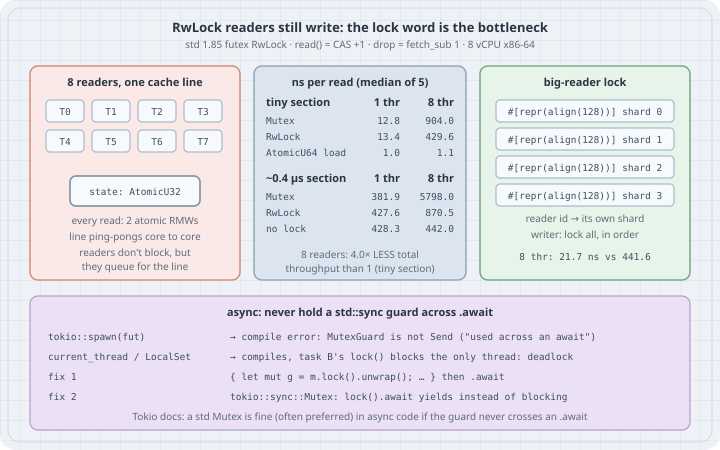

# RwLock Is Not a Faster Mutex: Lock Choice by Measurement, and Locks Across `.await`

## Thesis

"Reads don't conflict, so use `RwLock` for read-heavy data" is half right. Readers don't *logically* exclude each other. But every `read()` still **writes** to the lock: it adds one to a shared reader count, and dropping the guard subtracts one. In the standard library's Linux implementation, that is a compare-exchange and a `fetch_sub` on one 32-bit word. With eight threads reading, that word's cache line moves between cores on every acquisition. When the work inside the lock is tiny, the line transfer *is* the cost. The readers queue for the cache line just as `Mutex` users queue for the lock, and adding threads makes total throughput **worse**.

`RwLock` pays off only when the read-side critical section is long enough to hide that traffic. If the data really is read-mostly and the section is tiny, the answer is to stop sharing the written word: use an atomic, or give each reader its own lock (a "big-reader" lock). This chapter measures all of these.

Async code has a second lock rule: never hold a `std::sync` guard across an `.await`. The compiler enforces it only when the future has to be `Send`. On a current-thread runtime the same mistake compiles and deadlocks.

## Mental model

{fig-alt="Left: eight reader threads T0 to T7 all pointing at one AtomicU32 state word; every read is two atomic read-modify-writes, so the line ping-pongs between cores and readers queue for it. Middle: a table of ns per read. Tiny section, 1 and 8 threads: Mutex 12.8 and 904.0, RwLock 13.4 and 429.6, AtomicU64 load 1.0 and 1.1. With about 0.4 microseconds of work: Mutex 381.9 and 5798.0, RwLock 427.6 and 870.5, no lock 428.3 and 442.0. Eight readers give 4 times less total throughput than one with a tiny section. Right: a big-reader lock with four 128-byte-aligned shards; each reader uses its own shard, the writer locks all shards in order; 8 threads read in 21.7 ns versus 441.6. Bottom: tokio::spawn rejects a future holding a MutexGuard across await because it is not Send; on current_thread or LocalSet it compiles and deadlocks; fix by scoping the guard or by using tokio::sync::Mutex."}

What one uncontended acquisition costs, from the standard library's futex-based implementation (`library/std/src/sys/sync/rwlock/futex.rs`):

| Operation | Atomic work on the shared word | Notes |
|-----------|--------------------------------|-------|
| `RwLock::read()` | `load`, then `compare_exchange_weak(state, state + 1)` | falls into `read_contended()` (spin, then futex wait) if the CAS fails or a writer is waiting |
| drop of a read guard | `fetch_sub(1)` | wakes a writer if this was the last reader |
| `Mutex::lock()` / drop | `compare_exchange(0, 1)` / `swap(0)` | waiters sleep on a futex |
| `AtomicU64::load` | none: a plain load | the line can stay shared in every core's cache |

The std source also fixes the priority policy. `is_read_lockable` returns false whenever the writers-waiting bit is set, and a comment in the same function calls these "writers, which have priority over readers". So on Linux this `RwLock` is writer-preferring. That matters for the trap at the end of the chapter.

## Worked examples

Built with **rustc/cargo 1.85.1** (the distro toolchain on the box), edition 2024, `--release`. The current stable Rust is **1.99.1** (2026-10-13). The `RwLock` and `Mutex` implementations quoted above are from the current `master` source. The machine is a shared 8-vCPU x86-64 VM (Intel Xeon, one thread per core). Absolute numbers will differ on your hardware, but the shape should not. Every benchmark reports the median of 5 runs, and each run measures the slowest thread.

```bash
cargo new --vcs none locks && cd locks
rm src/main.rs && mkdir -p src/bin
```

```toml
# Cargo.toml
[package]
name = "locks"
version = "0.1.0"
edition = "2024"
rust-version = "1.85"

[dependencies]

[profile.release]
debug = false
```

```rust
// src/lib.rs — the shared harness: N threads start together, each does `ops` operations
use std::hint::black_box;
use std::sync::{Arc, Barrier};
use std::thread;
use std::time::{Duration, Instant};

/// Runs `op` `ops` times on each of `threads` threads and returns ns per operation
/// for the slowest thread. Repeats the measurement 5 times and reports the median.
pub fn bench<T: Send + Sync + 'static>(threads: usize, ops: u64, shared: Arc<T>, op: fn(&T, usize, u64) -> u64) -> f64 {
    let mut samples: Vec<f64> = (0..5)
        .map(|_| {
            let start = Arc::new(Barrier::new(threads + 1));
            let handles: Vec<_> = (0..threads)
                .map(|id| {
                    let (shared, start) = (Arc::clone(&shared), Arc::clone(&start));
                    thread::spawn(move || {
                        start.wait();
                        let t = Instant::now();
                        let mut acc = 0u64;
                        for i in 0..ops {
                            acc = acc.wrapping_add(op(&shared, id, i));
                        }
                        black_box(acc);
                        t.elapsed()
                    })
                })
                .collect();
            start.wait();
            let worst: Duration = handles.into_iter().map(|h| h.join().unwrap()).max().unwrap();
            worst.as_nanos() as f64 / ops as f64
        })
        .collect();
    samples.sort_by(|a, b| a.partial_cmp(b).unwrap());
    samples[2]
}
```

### Case 1: A tiny read-only critical section

```rust
// src/bin/tiny.rs — read-only workload, tiny critical section: Mutex vs RwLock vs a plain atomic load
use locks::bench;
use std::sync::atomic::{AtomicU64, Ordering};
use std::sync::{Arc, Mutex, RwLock};

const OPS: u64 = 1_000_000;

fn main() {
    println!("{:>7}  {:>11}  {:>12}  {:>12}", "threads", "Mutex ns/op", "RwLock ns/op", "atomic ns/op");
    for t in [1, 2, 4, 8] {
        let m = bench(t, OPS, Arc::new(Mutex::new(42u64)), |m, _, _| *m.lock().unwrap());
        let r = bench(t, OPS, Arc::new(RwLock::new(42u64)), |r, _, _| *r.read().unwrap());
        let a = bench(t, OPS, Arc::new(AtomicU64::new(42)), |a, _, _| a.load(Ordering::Acquire));
        println!("{t:>7}  {m:>11.1}  {r:>12.1}  {a:>12.1}");
    }
}
```

```text
$ cargo build --release && ./target/release/tiny
threads  Mutex ns/op  RwLock ns/op  atomic ns/op
      1         12.8          13.4           1.0
      2        135.1         104.2           1.1
      4        448.1         218.0           1.0
      8        904.0         429.6           1.1
```

Read the columns as *latency per operation for each thread*. One thread reading through `RwLock` costs 13.4 ns. Eight threads reading the *same* value take 429.6 ns per read each. Total throughput falls from 1/13.4 ns ≈ 75 M reads/s to 8/429.6 ns ≈ 19 M reads/s, so adding seven readers made the program **four times slower** overall. `RwLock` does beat `Mutex` here, because readers that win the CAS don't sleep. But neither lock scales. The `AtomicU64` column is the floor. A load writes nothing, so the cache line stays shared, and eight threads read in about 1 ns each.

### Case 2: The same reads with real work inside

```rust
// src/bin/work.rs — the same read-only workload, but ~0.4 µs of work inside the lock
use locks::bench;
use std::hint::black_box;
use std::sync::{Arc, Mutex, RwLock};

const OPS: u64 = 20_000;

// A dependent chain of 256 multiply-xorshift steps over the table: it cannot be vectorized.
fn walk(table: &[u64]) -> u64 {
    let mut h = 0x9e37_79b9_7f4a_7c15u64;
    for &x in black_box(table) {
        h = (h ^ x).wrapping_mul(0xbf58_476d_1ce4_e5b9);
        h ^= h >> 29;
    }
    h
}

fn main() {
    let table: Vec<u64> = (0..256).collect();
    println!("{:>7}  {:>11}  {:>12}  {:>13}", "threads", "Mutex ns/op", "RwLock ns/op", "no lock ns/op");
    for t in [1, 2, 4, 8] {
        let m = bench(t, OPS, Arc::new(Mutex::new(table.clone())), |m, _, _| walk(&m.lock().unwrap()));
        let r = bench(t, OPS, Arc::new(RwLock::new(table.clone())), |r, _, _| walk(&r.read().unwrap()));
        let n = bench(t, OPS, Arc::new(table.clone()), |v, _, _| walk(v));
        println!("{t:>7}  {m:>11.1}  {r:>12.1}  {n:>13.1}");
    }
}
```

```text
$ ./target/release/work
threads  Mutex ns/op  RwLock ns/op  no lock ns/op
      1        381.9         427.6          428.3
      2       1053.5         473.7          410.5
      4       2456.9         514.7          423.9
      8       5798.0         870.5          442.0
```

Now each read holds the lock for about 0.4 µs (the "no lock" column). `Mutex` serialises everyone: at eight threads, each operation waits behind seven others, about 5.8 µs. `RwLock` lets the readers overlap, and its cost stays within about 2× of the lock-free version. This is the workload `RwLock` was designed for. The lock word still bounces, but a few hundred nanoseconds of work between bounces hides it.

The rule from Cases 1 and 2 is about the **ratio of critical-section length to cache-line transfer cost** (roughly 50–200 ns between cores). The read/write ratio alone doesn't decide it.

### Case 3: One write in a hundred

```rust
// src/bin/mixed.rs — tiny critical section, one write in every 100 operations
use locks::bench;
use std::sync::{Arc, Mutex, RwLock};

const OPS: u64 = 500_000;

fn main() {
    println!("{:>7}  {:>11}  {:>12}", "threads", "Mutex ns/op", "RwLock ns/op");
    for t in [1, 2, 4, 8] {
        let m = bench(t, OPS, Arc::new(Mutex::new(0u64)), |m, _, i| {
            let mut g = m.lock().unwrap();
            if i % 100 == 0 {
                *g += 1;
            }
            *g
        });
        let r = bench(t, OPS, Arc::new(RwLock::new(0u64)), |r, _, i| {
            if i % 100 == 0 {
                let mut g = r.write().unwrap();
                *g += 1;
                *g
            } else {
                *r.read().unwrap()
            }
        });
        println!("{t:>7}  {m:>11.1}  {r:>12.1}");
    }
}
```

```text
$ ./target/release/mixed
threads  Mutex ns/op  RwLock ns/op
      1         11.0          13.3
      2        149.5         109.8
      4        483.2         309.1
      8       1012.8         726.0
```

With one thread, `RwLock` is the slower lock (13.3 vs 11.0 ns). It does more bookkeeping, and nothing is gained without contention. Under contention it stays ahead of `Mutex` on this box, but both are about 55–90× slower per operation than the single-threaded case. If your profile shows time in `futex` or in `read_contended`, switching between `Mutex` and `RwLock` won't fix it. Changing what is shared will.

### Case 4: Stop sharing the written word: a big-reader lock

The classic fix for read-mostly data with tiny sections is to give each reader its *own* lock. Readers write only to their own cache line, and the rare writer takes every lock:

```rust
// src/bin/sharded.rs — a "big-reader" lock: one RwLock per reader slot, writers take them all
use locks::bench;
use std::sync::{Arc, RwLock};

const OPS: u64 = 1_000_000;
const SHARDS: usize = 8;

// Align each shard to 128 bytes so readers of different shards never share a cache line
// (adjacent-line prefetch on x86 pulls lines in pairs).
#[repr(align(128))]
struct Shard(RwLock<u64>);

pub struct BigReader {
    shards: Vec<Shard>,
}

impl BigReader {
    pub fn new(v: u64) -> Self {
        BigReader { shards: (0..SHARDS).map(|_| Shard(RwLock::new(v))).collect() }
    }
    pub fn read(&self, reader: usize) -> u64 {
        *self.shards[reader % SHARDS].0.read().unwrap()
    }
    pub fn write(&self, v: u64) {
        // Every writer locks the shards in the same order, so writers cannot deadlock.
        let mut guards: Vec<_> = self.shards.iter().map(|s| s.0.write().unwrap()).collect();
        for g in guards.iter_mut() {
            **g = v;
        }
    }
}

fn main() {
    let big = BigReader::new(42);
    big.write(43);
    assert!((0..SHARDS).all(|i| big.read(i) == 43));

    println!("{:>7}  {:>14}  {:>13}", "threads", "1 RwLock ns/op", "sharded ns/op");
    for t in [1, 2, 4, 8] {
        let one = bench(t, OPS, Arc::new(RwLock::new(42u64)), |r, _, _| *r.read().unwrap());
        let sh = bench(t, OPS, Arc::new(BigReader::new(42)), |b, id, _| b.read(id));
        println!("{t:>7}  {one:>14.1}  {sh:>13.1}");
    }
}
```

```text
$ ./target/release/sharded
threads  1 RwLock ns/op  sharded ns/op
      1            13.3           14.8
      2            99.1           14.8
      4           203.7           15.6
      8           441.6           21.7
```

At eight threads the sharded read costs 21.7 ns, against 441.6 ns for a single `RwLock`. That is about 20× better, and close to the single-threaded figure. The price is on the write side: a write takes `SHARDS` locks, and the structure uses `SHARDS × 128` bytes. The `#[repr(align(128))]` matters. Without it, several shards share a cache line, and you are back to Case 1. For a single `u64`, Case 1's atomic beats all of it. For a larger snapshot, the same idea appears in crates as "arc-swap"-style pointer swaps and per-CPU data. Those were not measured here.

### Case 5: A `std::sync::MutexGuard` held across `.await`

The Tokio documentation is explicit: "Contrary to popular belief, it is ok and often preferred to use the ordinary Mutex from the standard library in asynchronous code." The condition is that the guard never lives across an `.await`. First, what happens when it does, under the multi-threaded `tokio::spawn`:

```toml
# Cargo.toml
[package]
name = "awaitlock"
version = "0.1.0"
edition = "2024"
rust-version = "1.85"

[dependencies]
tokio = { version = "1.53.3", features = ["rt", "rt-multi-thread", "macros", "time", "sync"] }
```

```rust
// src/bin/not_send.rs — holding a std MutexGuard across .await inside tokio::spawn
use std::sync::{Arc, Mutex};
use std::time::Duration;

async fn bump(state: Arc<Mutex<u64>>) {
    let mut n = state.lock().unwrap();
    tokio::time::sleep(Duration::from_millis(1)).await; // guard still alive here
    *n += 1;
}

#[tokio::main]
async fn main() {
    let state = Arc::new(Mutex::new(0));
    tokio::spawn(bump(Arc::clone(&state))).await.unwrap();
    println!("n = {}", state.lock().unwrap());
}
```

```text
$ cargo build --bin not_send
   Compiling awaitlock v0.1.0 (/tmp/rwlock/awaitlock)
error: future cannot be sent between threads safely
   --> src/bin/not_send.rs:14:18
    |
14  |     tokio::spawn(bump(Arc::clone(&state))).await.unwrap();
    |                  ^^^^^^^^^^^^^^^^^^^^^^^^ future returned by `bump` is not `Send`
    |
    = help: within `impl Future<Output = ()>`, the trait `Send` is not implemented for `std::sync::MutexGuard<'_, u64>`
note: future is not `Send` as this value is used across an await
   --> src/bin/not_send.rs:7:50
    |
6   |     let mut n = state.lock().unwrap();
    |         ----- has type `std::sync::MutexGuard<'_, u64>` which is not `Send`
7   |     tokio::time::sleep(Duration::from_millis(1)).await; // guard still alive here
    |                                                  ^^^^^ await occurs here, with `mut n` maybe used later
note: required by a bound in `tokio::spawn`
   --> /tmp/rwlock/.cargo-home/registry/src/index.crates.io-1949cf8c6b5b557f/tokio-1.53.3/src/task/spawn.rs:176:21
    |
174 |     pub fn spawn<F>(future: F) -> JoinHandle<F::Output>
    |            ----- required by a bound in this function
175 |     where
176 |         F: Future + Send + 'static,
    |                     ^^^^ required by this bound in `spawn`

error: could not compile `awaitlock` (bin "not_send") due to 1 previous error
```

This is the good outcome. `MutexGuard` is not `Send`, and the future keeps it alive across an `.await`, so the future is not `Send` and `tokio::spawn` refuses it. The same mistake on a single-threaded runtime compiles cleanly:

```rust
// src/bin/deadlock.rs — a std Mutex held across .await on a current-thread runtime
use std::sync::{Arc, Mutex};
use std::time::{Duration, Instant};

#[tokio::main(flavor = "current_thread")]
async fn main() {
    // Watchdog on a plain OS thread: if the runtime makes no progress, report and exit.
    let t0 = Instant::now();
    std::thread::spawn(move || {
        std::thread::sleep(Duration::from_secs(2));
        eprintln!("watchdog: no progress after {:?}: the runtime thread is blocked", t0.elapsed());
        std::process::exit(1);
    });

    let state = Arc::new(Mutex::new(0u64));
    let local = tokio::task::LocalSet::new();
    local
        .run_until(async {
            let s1 = Arc::clone(&state);
            let a = tokio::task::spawn_local(async move {
                let mut n = s1.lock().unwrap();
                println!("task A: locked, now awaiting while holding the guard");
                tokio::time::sleep(Duration::from_millis(10)).await;
                *n += 1;
                println!("task A: done");
            });
            let s2 = Arc::clone(&state);
            let b = tokio::task::spawn_local(async move {
                println!("task B: calling lock() ...");
                *s2.lock().unwrap() += 1; // blocks the only runtime thread
                println!("task B: done");
            });
            a.await.unwrap();
            b.await.unwrap();
        })
        .await;
    println!("n = {}", state.lock().unwrap());
}
```

```text
$ cargo build --bin deadlock && ./target/debug/deadlock; echo "exit $?"
task A: locked, now awaiting while holding the guard
task B: calling lock() ...
watchdog: no progress after 2.000204511s: the runtime thread is blocked
exit 1
```

`spawn_local` has no `Send` bound, so nothing stops the code from compiling. Task A locks the mutex and parks at the `sleep`. Task B calls the *blocking* `lock()` on the runtime's only thread, so the thread sleeps in the kernel, the timer never fires, and A can never release the guard. The same deadlock happens on a multi-threaded runtime once every worker is blocked this way. It also shows up with `block_on` or any `!Send` executor, and the compiler won't warn about any of them. Clippy's `await_holding_lock` lint flags this pattern. It was not run here, because the distro toolchain on the box ships without Clippy.

The two correct shapes:

```rust
// src/bin/fixed.rs — the two correct shapes: drop the std guard before .await, or use tokio's Mutex
use std::sync::{Arc, Mutex};
use std::time::Duration;

// Shape 1: std Mutex, guard confined to a block that contains no .await.
async fn bump_std(state: Arc<Mutex<u64>>) -> u64 {
    let snapshot = {
        let mut n = state.lock().unwrap();
        *n += 1;
        *n
    }; // guard dropped here
    tokio::time::sleep(Duration::from_millis(10)).await;
    snapshot
}

// Shape 2: the lock really must be held across the .await, so use an async-aware mutex.
async fn bump_tokio(state: Arc<tokio::sync::Mutex<u64>>) -> u64 {
    let mut n = state.lock().await; // waits by yielding, not by blocking the thread
    tokio::time::sleep(Duration::from_millis(10)).await;
    *n += 1;
    *n
}

#[tokio::main(flavor = "current_thread")]
async fn main() {
    let s = Arc::new(Mutex::new(0u64));
    let (a, b) = tokio::join!(bump_std(Arc::clone(&s)), bump_std(Arc::clone(&s)));
    println!("std::sync::Mutex, guard scoped:   a = {a}, b = {b}, final = {}", s.lock().unwrap());

    let t = Arc::new(tokio::sync::Mutex::new(0u64));
    let (a, b) = tokio::join!(bump_tokio(Arc::clone(&t)), bump_tokio(Arc::clone(&t)));
    println!("tokio::sync::Mutex across .await: a = {a}, b = {b}, final = {}", t.lock().await);

    // And the multi-threaded runtime accepts both futures, because neither holds a std guard across .await.
    let h1 = tokio::spawn(bump_std(Arc::clone(&s)));
    let h2 = tokio::spawn(bump_tokio(Arc::clone(&t)));
    println!("spawned: {} {}", h1.await.unwrap(), h2.await.unwrap());
}
```

```text
$ cargo build --bin fixed && ./target/debug/fixed
std::sync::Mutex, guard scoped:   a = 1, b = 2, final = 2
tokio::sync::Mutex across .await: a = 1, b = 2, final = 2
spawned: 3 3
```

Shape 1 confines the guard to a block with no `.await`, so it is dropped before the future can suspend. Shape 2 uses `tokio::sync::Mutex`, whose `lock().await` *yields* to the scheduler instead of blocking the thread. It is the right tool only when the lock really must be held across the await, because it costs more than the std mutex. Both futures are `Send`, which the last line proves by spawning them.

## The trap

The trap with `RwLock` is assuming that read guards are free to nest because "readers don't block readers". The std documentation warns that a waiting writer "might or might not block concurrent calls to read", and the Linux implementation is writer-preferring. So a thread that already holds a read guard and asks for a second one can deadlock against a writer that queued in between:

```rust
// src/bin/reentrant.rs — taking a second read lock while a writer waits (std on Linux)
use std::sync::{Arc, RwLock};
use std::thread;
use std::time::Duration;

fn main() {
    // Watchdog: report and exit if the program is still stuck after 2 s.
    thread::spawn(|| {
        thread::sleep(Duration::from_secs(2));
        eprintln!("watchdog: still blocked after 2 s: deadlock");
        std::process::exit(1);
    });

    let lock = Arc::new(RwLock::new(0u64));
    let first = lock.read().unwrap();
    println!("main: holding read guard #1");

    let w = Arc::clone(&lock);
    let writer = thread::spawn(move || {
        println!("writer: waiting for write()");
        *w.write().unwrap() += 1;
        println!("writer: done");
    });
    thread::sleep(Duration::from_millis(100)); // let the writer queue up

    println!("main: taking read guard #2 ...");
    let second = lock.read().unwrap(); // a writer is waiting, so new readers wait too
    println!("main: got read guard #2 ({} {})", *first, *second);
    drop((first, second));
    writer.join().unwrap();
}
```

```text
$ cargo build --release --bin reentrant && ./target/release/reentrant; echo "exit $?"
main: holding read guard #1
writer: waiting for write()
main: taking read guard #2 ...
watchdog: still blocked after 2 s: deadlock
exit 1
```

The writer waits for guard #1. Guard #2 waits behind the writer, because new readers are refused while a writer is waiting. Guard #1 is never dropped. This code works in every test that has no concurrent writer. In production it deadlocks the first time a writer arrives between the two `read()` calls. Code that calls a helper which takes the read lock again, while the caller already holds it, is the usual way to write this by accident.

The related performance trap is "switch `Mutex` to `RwLock` for read-heavy data" without measuring. Case 1 showed that this can leave you with eight threads doing a quarter of the work of one.

## The boring rule

> Choose a lock by measuring it. Use `Mutex` by default. Use `RwLock` only when read sections are long, hundreds of nanoseconds or more (Case 2). For read-mostly data with tiny sections, stop sharing the written word: an atomic for a scalar, or per-reader shards for larger data. Never take a second read guard on the same `RwLock` while you hold one. In async code, a `std::sync::Mutex` is fine as long as the guard lives in a block with no `.await`. If it must cross an `.await`, use `tokio::sync::Mutex`. Remember that the compiler catches this only where `Send` is required.

## Try this

1. Run `tiny` with `[1, 2, 3, 4, 5, 6, 7, 8]` threads and plot total throughput (`threads / ns_per_op`). Where does it peak for `RwLock`, and for `Mutex`?
2. In `work.rs`, shorten the walk (`0..32`, `0..64`, `0..128`) and find the section length at which `RwLock` stops scaling on your machine. Compare it with your core-to-core cache-line latency.
3. Remove `#[repr(align(128))]` from `Shard` and rerun `sharded`. Then try `align(64)`. Explain the difference, using adjacent-line prefetch.
4. Change `deadlock.rs` to `#[tokio::main(flavor = "multi_thread", worker_threads = 2)]` and replace `LocalSet`/`spawn_local` with `tokio::spawn`. What does the compiler say now, and which `.await` does it point at? Then move the `sleep` out of the guard's scope and confirm that it builds and finishes.
5. Replace the second `read()` in `reentrant.rs` with `try_read()`. What does it return while the writer waits, and how would you use that to detect recursion in a debug build?

## Sources

- Rust standard library, `std::sync::RwLock` (priority policy, potential deadlock example): <https://doc.rust-lang.org/std/sync/struct.RwLock.html>
- Rust standard library, `std::sync::Mutex`: <https://doc.rust-lang.org/std/sync/struct.Mutex.html>
- Rust source, futex-based `RwLock` (`library/std/src/sys/sync/rwlock/futex.rs`) and `Mutex` (`library/std/src/sys/sync/mutex/futex.rs`): <https://github.com/rust-lang/rust/tree/master/library/std/src/sys/sync>
- Tokio, `tokio::sync::Mutex` ("Which kind of mutex should you use?"): <https://docs.rs/tokio/latest/tokio/sync/struct.Mutex.html>
- Tokio tutorial, Shared state ("Holding a `MutexGuard` across an `.await`"): <https://tokio.rs/tokio/tutorial/shared-state>
- Tokio, `task::spawn_local` and `LocalSet`: <https://docs.rs/tokio/latest/tokio/task/fn.spawn_local.html>
- Clippy lint `await_holding_lock`: <https://rust-lang.github.io/rust-clippy/master/index.html#await_holding_lock>
- Mara Bos, *Rust Atomics and Locks* (O'Reilly, 2023), ch. 9 "Building Our Own Locks" (reader-writer lock design and writer starvation): <https://marabos.nl/atomics/>
- Rust release channel manifest (stable 1.99.1, 2026-10-13): <https://static.rust-lang.org/dist/channel-rust-stable.toml>
