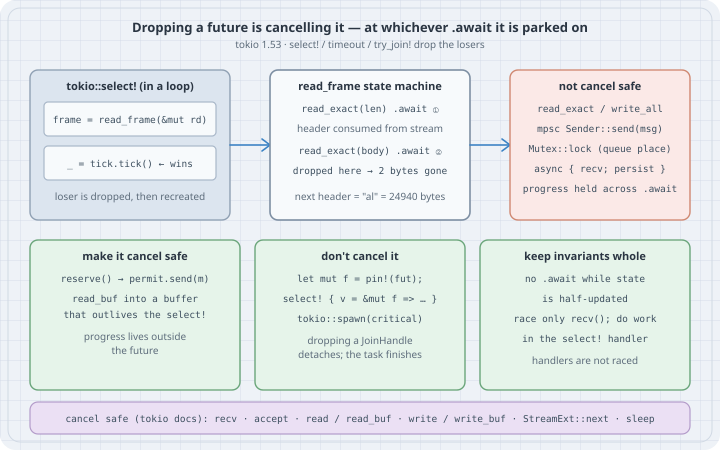

# Cancel Safety: Dropping a Future Is Cancelling It

## Thesis

Async Rust has one universal cancellation protocol, and it is very easy to trigger: **drop the future**. A future is an inert state machine that only advances when it is polled. Once it is dropped it never runs again, and it stops at whichever `.await` it was parked on. You don't need to call drop yourself. `tokio::select!` drops every branch that loses, `tokio::time::timeout` drops the future when the deadline fires, and `try_join!` drops the siblings of the first error. Because parents own their children, cancellation propagates down the whole call tree.

That makes two different questions worth asking about every `.await`:

- **Cancel safety** is a local property of one future: *if I drop it before it completes and create it again, is that a no-op?* `mpsc::Receiver::recv` passes. `read_exact` and `Sender::send(msg)` fail.
- **Cancel correctness** is a property of the whole system: *if this future is dropped here, is any invariant, message, or cleanup lost?* Dropping a cancel-unsafe future is a bug only when it breaks something you care about. Losing a half-read frame during shutdown is fine. Losing it in a `select!` loop is not.

This chapter reproduces the four bug shapes behind most production cancellation incidents and fixes each one. The fixes follow Rain's "Cancelling Async Rust" (RustConf 2025) and Tokio's own cancel-safety documentation.

## Mental model

{fig-alt="Top row: a select! loop with a read_frame branch and a winning tick branch; the read_frame state machine with read_exact for the length at await 1 and for the body at await 2, where a drop loses the two header bytes so the next header reads al as 24940 bytes; a list of cancel-unsafe operations: read_exact and write_all, mpsc send, Mutex lock queue place, an async block doing recv then persist, progress held across an await. Bottom row: three remedies: make it cancel safe with reserve then permit.send and read_buf into a buffer that outlives the select; don't cancel it by pinning the future and selecting on &mut, or spawning a task; keep invariants whole by not awaiting while state is half-updated and doing work in the select handler. A footer lists cancel-safe operations from the Tokio docs."}

A future can only be cancelled at an `.await`, because that is the only place it gives control back. So the audit question for any async fn is concrete: *at each `.await`, what has this future already done that would be lost or left half-done if it never resumed?*

| Operation (Tokio 1.53) | Cancel safe? | What a drop loses |
|------------------------|--------------|-------------------|
| `mpsc::Receiver::recv`, `broadcast::Receiver::recv`, `watch::Receiver::changed` | yes | nothing |
| `TcpListener::accept`, `AsyncReadExt::read` / `read_buf`, `AsyncWriteExt::write` / `write_buf` | yes | nothing (no data was read or written) |
| `tokio::time::sleep`, `StreamExt::next` | yes | nothing |
| `AsyncReadExt::read_exact`, `read_to_end`, `read_to_string` | **no** | bytes already read into the future's buffer |
| `AsyncWriteExt::write_all` | **no** | how much was written |
| `mpsc::Sender::send(msg)` | **no** | `msg` itself, which moved into the future |
| `Mutex::lock`, `RwLock::read/write`, `Semaphore::acquire`, `Notify::notified`, `Sender::reserve` | partially | your place in a fair queue |
| `async { a.await; b.await }` built from cancel-safe parts | **no** | whatever `a` produced |

## Worked examples

Everything below was built and run with **rustc/cargo 1.85.1** (the distro toolchain on the box) and **Tokio 1.53.3**, the current release on crates.io, with edition 2024. The current stable Rust is **1.99.1**. Nothing in this chapter changes between the two. Each case uses Tokio's paused clock (`start_paused = true`, from the `test-util` feature), so timers fire in virtual time and every run prints the same thing.

```bash
cargo new --vcs none cancel && cd cancel
rm src/main.rs && mkdir -p src/bin
```

```toml
# Cargo.toml
[package]
name = "cancel"
version = "0.1.0"
edition = "2024"
rust-version = "1.85"

[dependencies]
tokio = { version = "1.53.3", features = ["rt", "macros", "time", "sync", "io-util", "test-util"] }
```

### Case 1: A future is a value, and dropping it cancels it

```rust
// src/bin/case1.rs — a future is a value; dropping it is cancelling it.
use std::time::Duration;
use tokio::time::{sleep, timeout};

struct Guard(&'static str);
impl Drop for Guard {
    fn drop(&mut self) {
        println!("  drop: {}", self.0);
    }
}

async fn three_steps() -> &'static str {
    let _g = Guard("three_steps locals");
    println!("  step 1");
    sleep(Duration::from_millis(10)).await;
    println!("  step 2");
    sleep(Duration::from_millis(10)).await; // cancelled while parked here
    println!("  step 3");
    "done"
}

#[tokio::main(flavor = "current_thread", start_paused = true)]
async fn main() {
    println!("create the future:");
    let fut = three_steps(); // nothing runs yet: futures are inert
    println!("  (nothing printed: not polled)");

    println!("await with a 15 ms timeout:");
    match timeout(Duration::from_millis(15), fut).await {
        Ok(v) => println!("  finished: {v}"),
        Err(_) => println!("  timed out: future was dropped at an .await"),
    }
}
```

```bash
cargo run -q --bin case1
```

```
create the future:
  (nothing printed: not polled)
await with a 15 ms timeout:
  step 1
  step 2
  drop: three_steps locals
  timed out: future was dropped at an .await
```

Creating the future ran nothing. `timeout` polled it through step 1, through the first `sleep`, and into step 2. At 15 ms it dropped the future while it was parked on the second `sleep`. Locals are dropped normally (the `Guard` runs), but `step 3` and everything after it never happen. No exception or error reaches the future. It is simply never polled again.

### Case 2: `send` under a timeout loses the message, `reserve` does not

The channel holds one message, and the consumer needs 25 ms per message. The producer gives each send 10 ms.

```rust
// src/bin/case2.rs — `send` under a timeout loses the message; `reserve` doesn't.
use std::time::Duration;
use tokio::sync::mpsc;
use tokio::time::{sleep, timeout};

struct Msg {
    id: u32,
    delivered: bool,
}
fn msg(id: u32) -> Msg {
    Msg { id, delivered: false }
}
impl Drop for Msg {
    fn drop(&mut self) {
        if !self.delivered {
            println!("    (Msg {} dropped undelivered)", self.id);
        }
    }
}

/// A consumer that takes 25 ms per message; the channel holds one.
fn slow_consumer(mut rx: mpsc::Receiver<Msg>) -> tokio::task::JoinHandle<Vec<u32>> {
    tokio::spawn(async move {
        let mut got = Vec::new();
        while let Some(mut m) = rx.recv().await {
            m.delivered = true;
            got.push(m.id);
            sleep(Duration::from_millis(25)).await;
        }
        got
    })
}

#[tokio::main(flavor = "current_thread", start_paused = true)]
async fn main() {
    println!("send(msg) inside timeout(10 ms):");
    let (tx, rx) = mpsc::channel::<Msg>(1);
    let consumer = slow_consumer(rx);
    for i in 1..=4 {
        match timeout(Duration::from_millis(10), tx.send(msg(i))).await {
            Ok(Ok(())) => println!("  sent {i}"),
            Ok(Err(_)) => return,
            Err(_) => println!("  timeout on {i}"),
        }
    }
    drop(tx);
    let got: Vec<u32> = consumer.await.unwrap();
    println!("  consumer received {got:?}");

    println!("reserve() inside timeout(10 ms), message built after:");
    let (tx, rx) = mpsc::channel::<Msg>(1);
    let consumer = slow_consumer(rx);
    let mut next = 1;
    while next <= 4 {
        match timeout(Duration::from_millis(10), tx.reserve()).await {
            Ok(Ok(permit)) => {
                permit.send(msg(next)); // synchronous, cannot be cancelled
                println!("  sent {next}");
                next += 1;
            }
            Ok(Err(_)) => return,
            Err(_) => println!("  timeout waiting for a slot; {next} still ours"),
        }
    }
    drop(tx);
    let got: Vec<u32> = consumer.await.unwrap();
    println!("  consumer received {got:?}");
}
```

```bash
cargo run -q --bin case2
```

```
send(msg) inside timeout(10 ms):
  sent 1
  sent 2
    (Msg 3 dropped undelivered)
  timeout on 3
    (Msg 4 dropped undelivered)
  timeout on 4
  consumer received [1, 2]
reserve() inside timeout(10 ms), message built after:
  sent 1
  sent 2
  timeout waiting for a slot; 3 still ours
  timeout waiting for a slot; 3 still ours
  sent 3
  timeout waiting for a slot; 4 still ours
  timeout waiting for a slot; 4 still ours
  sent 4
  consumer received [1, 2, 3, 4]
```

`tx.send(msg)` takes the message **by value**, so the message lives inside the send future. When `timeout` drops that future, the message is dropped with it. Tokio documents exactly this: "the message was not sent. However, in that case, the message is dropped and will be lost." Messages 3 and 4 disappear, and nothing reports an error.

`reserve()` splits the operation in two. Waiting for capacity is the only `.await`, and it holds no message. `permit.send(msg)` is a synchronous call that cannot be cancelled. The message is built after the slot is secured, so a timeout leaves it in the producer's hands, and all four arrive. (`reserve` is not perfectly cancel safe: dropping it gives up your place in the channel's FIFO queue of waiting senders. If that matters, pin the `reserve` future and poll it by `&mut`, as in Case 3b.)

### Case 3: A `select!` loop over `read_exact` corrupts a framed stream

A peer sends length-prefixed frames, and the header and body arrive 15 ms apart. The reader also wants a 10 ms tick, so it uses `select!` in a loop. That is the shape Tokio's documentation warns about.

```rust
// src/bin/case3.rs — a select! loop over read_exact loses bytes mid-frame;
// a persistent buffer filled by the cancel-safe read_buf does not.
use std::time::Duration;
use tokio::io::{AsyncRead, AsyncReadExt, AsyncWriteExt, DuplexStream, duplex};
use tokio::time::{interval, sleep};

/// Peer: 2-byte big-endian length, then payload, with a pause in between.
async fn peer(mut w: DuplexStream) {
    for word in ["alpha", "bravo", "charlie"] {
        w.write_all(&(word.len() as u16).to_be_bytes()).await.unwrap();
        sleep(Duration::from_millis(15)).await; // header and body arrive apart
        w.write_all(word.as_bytes()).await.unwrap();
    }
}

/// Not cancel safe: two read_exact calls, two places to be dropped.
async fn read_frame<R: AsyncRead + Unpin>(r: &mut R) -> std::io::Result<String> {
    let mut len = [0u8; 2];
    r.read_exact(&mut len).await?;
    let n = u16::from_be_bytes(len) as usize;
    println!("    header says {n} bytes");
    let mut body = vec![0u8; n];
    r.read_exact(&mut body).await?;
    Ok(String::from_utf8_lossy(&body).into_owned())
}

/// Pop one complete frame from the front of `buf`, if there is one.
fn parse_frame(buf: &mut Vec<u8>) -> Option<String> {
    if buf.len() < 2 {
        return None;
    }
    let n = u16::from_be_bytes([buf[0], buf[1]]) as usize;
    if buf.len() < 2 + n {
        return None;
    }
    let body: Vec<u8> = buf.drain(..2 + n).skip(2).collect();
    Some(String::from_utf8_lossy(&body).into_owned())
}

#[tokio::main(flavor = "current_thread", start_paused = true)]
async fn main() {
    println!("select! {{ read_frame(), tick }}:");
    let (mut rd, wr) = duplex(64);
    tokio::spawn(peer(wr));
    let mut tick = interval(Duration::from_millis(10));
    for _ in 0..8 {
        tokio::select! {
            f = read_frame(&mut rd) => match f {
                Ok(s) => println!("  frame {s:?}"),
                Err(e) => { println!("  error: {e}"); break; }
            },
            _ = tick.tick() => println!("  tick"),
        }
    }

    println!("select! {{ read_buf(&mut buf), tick }} + parse:");
    let (mut rd, wr) = duplex(64);
    tokio::spawn(peer(wr));
    let mut tick = interval(Duration::from_millis(10));
    let mut buf = Vec::with_capacity(64); // survives every cancellation
    let mut frames = 0;
    while frames < 3 {
        tokio::select! {
            n = rd.read_buf(&mut buf) => {
                if n.unwrap() == 0 { break; }
                while let Some(s) = parse_frame(&mut buf) {
                    println!("  frame {s:?}");
                    frames += 1;
                }
            }
            _ = tick.tick() => println!("  tick ({} bytes buffered)", buf.len()),
        }
    }
}
```

```bash
cargo run -q --bin case3
```

```
select! { read_frame(), tick }:
  tick
    header says 5 bytes
  tick
    header says 24940 bytes
  tick
  tick
    header says 25202 bytes
  tick
    header says 25448 bytes
  error: early eof
select! { read_buf(&mut buf), tick } + parse:
  tick (0 bytes buffered)
  tick (2 bytes buffered)
  frame "alpha"
  tick (2 bytes buffered)
  tick (2 bytes buffered)
  frame "bravo"
  tick (2 bytes buffered)
  frame "charlie"
```

In the first loop, `read_frame` gets past `read_exact(&mut len)`, consuming the two header bytes from the stream, and is then parked on the body. The tick wins, so `select!` drops `read_frame`, and those two bytes go with it. The next iteration starts a new `read_frame`, which reads the first two body bytes `"al"` as a length: `0x616c` = **24940**. From there the stream is permanently out of sync. No frame is ever delivered, and the reader dies with `early eof`.

The second loop keeps its progress **outside the future**. `read_buf` is cancel safe (if it loses the race, no data was read). The bytes it does read land in `buf`, which lives in the loop, not in a future, and frames are parsed out of `buf` synchronously. A tick can interrupt as often as it likes, and the buffered bytes stay put (`2 bytes buffered` is a header waiting for its body).

### Case 3b: Or don't cancel at all: poll one future by `&mut`

The other remedy is to stop recreating the future. Pin one `read_frame` future outside the loop, race `&mut frame` against the tick, and only replace it once it has completed. Dropping a `&mut` reference cancels nothing. The function owns the reader and hands it back, so the finished future can be swapped for a new one with `Pin::set`.

```rust
// src/bin/case3b.rs — the other fix: don't cancel. Keep one frame future
// alive across loop iterations and poll it by `&mut`.
use std::pin::pin;
use std::time::Duration;
use tokio::io::{AsyncReadExt, AsyncWriteExt, DuplexStream, duplex};
use tokio::time::{interval, sleep};

async fn peer(mut w: DuplexStream) {
    for word in ["alpha", "bravo", "charlie"] {
        w.write_all(&(word.len() as u16).to_be_bytes()).await.unwrap();
        sleep(Duration::from_millis(15)).await;
        w.write_all(word.as_bytes()).await.unwrap();
    }
}

/// Owns the reader and hands it back, so a finished future can be replaced.
async fn read_frame(mut r: DuplexStream) -> (DuplexStream, std::io::Result<String>) {
    let mut len = [0u8; 2];
    if let Err(e) = r.read_exact(&mut len).await {
        return (r, Err(e));
    }
    let mut body = vec![0u8; u16::from_be_bytes(len) as usize];
    let res = r.read_exact(&mut body).await;
    (r, res.map(|_| String::from_utf8_lossy(&body).into_owned()))
}

#[tokio::main(flavor = "current_thread", start_paused = true)]
async fn main() {
    let (rd, wr) = duplex(64);
    tokio::spawn(peer(wr));
    let mut tick = interval(Duration::from_millis(10));
    let mut frame = pin!(read_frame(rd));
    let mut frames = 0;
    while frames < 3 {
        tokio::select! {
            (rd, f) = &mut frame => {
                println!("  frame {:?}", f.unwrap());
                frames += 1;
                frame.set(read_frame(rd)); // start the next one only now
            }
            _ = tick.tick() => println!("  tick (frame future kept)"),
        }
    }
}
```

```bash
cargo run -q --bin case3b
```

```
  tick (frame future kept)
  tick (frame future kept)
  frame "alpha"
  tick (frame future kept)
  tick (frame future kept)
  frame "bravo"
  tick (frame future kept)
  frame "charlie"
```

The same `read_exact` code that corrupted the stream in Case 3 is correct here, because it is never dropped mid-frame.

### Case 4: Cancel correctness: an invariant broken across an `.await`

This is the shape of a real Oxide production bug. Shared state sits behind a Tokio mutex. An operation takes the value out (`Option::take`, leaving `None`), awaits some I/O, and puts the new value back. The invariant is "the slot is `Some` whenever the lock is free".

```rust
// src/bin/case4.rs — cancel correctness: an invariant broken across an .await.
use std::sync::Arc;
use std::time::Duration;
use tokio::sync::Mutex;
use tokio::time::{sleep, timeout};

#[derive(Debug)]
struct Sled {
    generation: u32,
}

/// Invariant: `slot` is Some whenever the lock is not held.
type Shared = Arc<Mutex<Option<Sled>>>;

async fn upgrade(shared: Shared) {
    let mut slot = shared.lock().await;
    let sled = slot.take().expect("invariant: slot is Some");
    sleep(Duration::from_millis(20)).await; // talk to the sled: an .await
    *slot = Some(Sled { generation: sled.generation + 1 });
}

#[tokio::main(flavor = "current_thread", start_paused = true)]
async fn main() {
    println!("timeout(10 ms, upgrade()):");
    let shared: Shared = Arc::new(Mutex::new(Some(Sled { generation: 1 })));
    let r = timeout(Duration::from_millis(10), upgrade(shared.clone())).await;
    println!("  result: {}", if r.is_ok() { "done" } else { "timed out" });
    println!("  slot now: {:?}", *shared.lock().await);

    println!("timeout(10 ms, spawned upgrade task):");
    let shared: Shared = Arc::new(Mutex::new(Some(Sled { generation: 1 })));
    let task = tokio::spawn(upgrade(shared.clone()));
    let r = timeout(Duration::from_millis(10), task).await; // drops the JoinHandle
    println!("  result: {}", if r.is_ok() { "done" } else { "timed out (task keeps running)" });
    println!("  slot now: {:?}", *shared.lock().await); // waits for the task's guard
}
```

```bash
cargo run -q --bin case4
```

```
timeout(10 ms, upgrade()):
  result: timed out
  slot now: None
timeout(10 ms, spawned upgrade task):
  result: timed out (task keeps running)
  slot now: Some(Sled { generation: 2 })
```

The timeout dropped `upgrade` while it was parked on `sleep`, holding the lock with the slot empty. The guard's destructor released the lock correctly. That made things worse, because the next caller can acquire it and find `None`, which panics on `expect` or silently forgets the sled. Every individual piece here is "safe". The bug is in the composition.

The fix is to not let the caller cancel the critical section. `tokio::spawn` makes the runtime drive the work instead of the caller. The `timeout` around the `JoinHandle` still gives the caller its deadline. When the `JoinHandle` is dropped, the task is **detached, not cancelled**, so it runs to completion and restores the invariant (`generation: 2`). The structural fix is just as valid: don't hold a half-updated state across an `.await`. Compute the new value first, then swap it in under the lock without awaiting.

## The trap

**Cancel-safe pieces don't compose into a cancel-safe branch.** `recv()` is on Tokio's cancel-safe list, so a `select!` branch that "just receives and stores" looks fine:

```rust
// src/bin/trap.rs — cancel-safe pieces do not compose into a cancel-safe branch.
use std::time::Duration;
use tokio::sync::mpsc;
use tokio::time::{interval, sleep};

async fn persist(id: u32, log: &mut Vec<u32>) {
    sleep(Duration::from_millis(15)).await; // write to disk, say
    log.push(id);
}

async fn run(composite: bool) -> Vec<u32> {
    let (tx, mut rx) = mpsc::channel(8);
    for id in 1..=3 {
        tx.send(id).await.unwrap();
    }
    drop(tx);
    let mut log = Vec::new();
    let mut tick = interval(Duration::from_millis(10));
    tick.tick().await; // skip the immediate first tick
    loop {
        if composite {
            tokio::select! {
                // recv() is cancel safe; recv-then-persist is not.
                done = async {
                    let Some(id) = rx.recv().await else { return true };
                    persist(id, &mut log).await;
                    false
                } => if done { break },
                _ = tick.tick() => println!("  tick"),
            }
        } else {
            tokio::select! {
                // Only the cancel-safe recv races; the handler body is not raced.
                id = rx.recv() => match id {
                    Some(id) => persist(id, &mut log).await,
                    None => break,
                },
                _ = tick.tick() => println!("  tick"),
            }
        }
    }
    log
}

#[tokio::main(flavor = "current_thread", start_paused = true)]
async fn main() {
    println!("branch = async {{ recv().await; persist().await }}:");
    println!("  persisted {:?}", run(true).await);
    println!("branch = recv(), persist() in the handler:");
    println!("  persisted {:?}", run(false).await);
}
```

```bash
cargo run -q --bin trap
```

```
branch = async { recv().await; persist().await }:
  tick
  tick
  tick
  persisted []
branch = recv(), persist() in the handler:
  tick
  tick
  tick
  tick
  persisted [1, 2, 3]
```

The `async { recv; persist }` block is a new future with two `.await`s. Once `recv` returns, the message lives inside that block, and the tick that wins during `persist` drops it. All three messages are received and none are persisted. The loop exits cleanly with an empty log. In the fixed version only `rx.recv()` races. `select!` **handler bodies** (the code after `=>`) are not raced against anything, so `persist` runs to completion. The tick is just delayed.

The same trap appears wherever you build a future and hand it to something that may drop it:

- `timeout(d, async { ... several awaits ... })`
- `try_join!(a(), b())`, where one error drops the other mid-way (Oxide's "stop all services" bug)
- an HTTP framework that drops the handler future when the client disconnects
- `let _ = some_async_fn();` without `.await`. The future is dropped immediately. Clippy's `let_underscore_future` lint catches this.

## The boring rule

Treat every `.await` as a place where your future may stop forever. Race only cancel-safe operations in `select!` and `timeout`, and do the real work in the handler body. Keep progress (buffers, messages, half-built state) outside the future that might be dropped. Use `reserve` + `permit.send`, `read_buf` into a persistent buffer, or a future pinned outside the loop and polled by `&mut`. Never hold a broken invariant across an `.await`. Code that must finish goes in a `tokio::spawn`ed task, because dropping a `JoinHandle` detaches the task and doesn't cancel it.

## Try this

1. In Case 2, replace `timeout(..., tx.reserve())` with a `reserve` future pinned outside the loop and polled by `&mut` in a `select!` against a 10 ms tick. Show that the producer keeps its place in the queue.
2. Rewrite Case 3's reader as a task that owns the stream and sends complete frames over an `mpsc` channel. The `select!` loop then races only `recv()`, which is cancel safe.
3. In Case 4, keep the direct `upgrade` call (no `spawn`) but restructure it so that the `.await` happens before `take()`. Does the timeout still break the invariant?
4. Wrap `write_all` in a `timeout` against a `duplex(8)` stream whose reader is slow. How many bytes did the peer receive when the timeout fired? Then switch to `write_all_buf` with a `Cursor` that outlives the timeout, and resume.
5. Audit one async fn in a codebase you own: list every `.await` and write down what would be lost if the future stopped there.

## Sources

- Tokio, `select!` documentation, "Cancellation safety" (the lists in this chapter's table): <https://docs.rs/tokio/latest/tokio/macro.select.html#cancellation-safety>
- Tokio, `mpsc::Sender::send` and `Sender::reserve` cancel-safety notes: <https://docs.rs/tokio/latest/tokio/sync/mpsc/struct.Sender.html>
- Tokio, `JoinHandle` ("detaches the associated task when it is dropped"): <https://docs.rs/tokio/latest/tokio/task/struct.JoinHandle.html>
- Tokio, `AsyncReadExt::read_buf` and `AsyncWriteExt::write_all_buf`: <https://docs.rs/tokio/latest/tokio/io/trait.AsyncReadExt.html>, <https://docs.rs/tokio/latest/tokio/io/trait.AsyncWriteExt.html>
- Tokio tutorial, `select!`, "Cancellation" and "Resuming an async operation": <https://tokio.rs/tokio/tutorial/select>
- Rain (Oxide Computer Company), "Cancelling async Rust", written version of the RustConf 2025 talk: <https://sunshowers.io/posts/cancelling-async-rust/>
- Oxide RFD 400, "Dealing with cancel safety in async Rust": <https://rfd.shared.oxide.computer/rfd/0400>
- Rust standard library, `std::pin::pin!` and `Pin::set`: <https://doc.rust-lang.org/std/pin/macro.pin.html>, <https://doc.rust-lang.org/std/pin/struct.Pin.html#method.set>
- Clippy lint `let_underscore_future`: <https://rust-lang.github.io/rust-clippy/master/index.html#let_underscore_future>
- Rust release channel manifest (stable 1.99.1, 2026-10-13): <https://static.rust-lang.org/dist/channel-rust-stable.toml>
