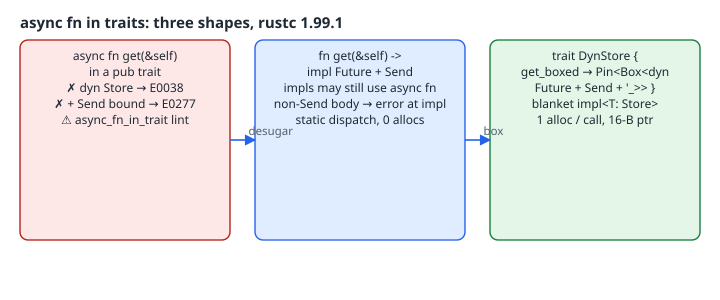

# async fn in Traits vs dyn Trait: Desugaring, Send Bounds and Boxing

## Thesis

Since Rust 1.75 you can write `async fn` directly inside a trait. That works well for static dispatch. It stops working at two points that every library author eventually reaches:

1. **`dyn Trait`**. A trait with an `async fn` is not dyn compatible, so `Box<dyn Store>` is a compile error.
2. **`Send`**. The future that `async fn` returns has a hidden type, and callers can't add `+ Send` to it. Generic code that spawns onto a multi-threaded runtime therefore can't prove the future is thread-safe.

Both problems come from the same desugaring: `async fn get(&self) -> u32` means `fn get(&self) -> impl Future<Output = u32>`. Each implementor returns its own, differently sized state machine. A vtable can't hold "a function returning some unknown-size type", and a bound you never wrote can't be assumed.

This chapter reproduces all three compiler diagnostics on rustc 1.99.1 and fixes them with two moves: desugar by hand to add `+ Send`, then add a boxed, dyn-compatible twin trait. The `dynosaur` and `async-trait` crates automate the same boxing. Everything here uses only `std`, including a ten-line `block_on`, so you can run it without Tokio.

{fig-alt="Left: trait Store with async fn get. Box<dyn Store> fails with E0038, a Send bound fails with E0277, and a pub trait triggers the async_fn_in_trait lint. Middle: desugared fn get returning impl Future plus Send; implementors may still write async fn, a non-Send body is rejected at the impl; static dispatch with zero allocations. Right: DynStore twin trait whose get_boxed returns Pin<Box<dyn Future + Send>>, with a blanket impl for every Store; Vec<Box<dyn DynStore>> works across threads at one heap allocation per call."}

## Failure 1: `dyn Store` is rejected

```rust
pub trait Store {
    async fn get(&self, key: u32) -> u32;
}
struct Mem;
impl Store for Mem {
    async fn get(&self, key: u32) -> u32 { key * 2 }
}
fn main() {
    let stores: Vec<Box<dyn Store>> = vec![Box::new(Mem)];
    let _ = stores;
}
```

`rustc --edition 2024 dynfail.rs` gives:

```text
error[E0038]: the trait `Store` is not dyn compatible
 --> dynfail.rs:9:29
  |
9 |     let stores: Vec<Box<dyn Store>> = vec![Box::new(Mem)];
  |                             ^^^^^ `Store` is not dyn compatible
  |
note: for a trait to be dyn compatible it needs to allow building a vtable
      for more information, visit <https://doc.rust-lang.org/reference/items/traits.html#dyn-compatibility>
 --> dynfail.rs:2:14
  |
1 | pub trait Store {
  |           ----- this trait is not dyn compatible...
2 |     async fn get(&self, key: u32) -> u32;
  |              ^^^ ...because method `get` is `async`
  = help: consider moving `get` to another trait
  = help: only type `Mem` implements `Store` within this crate; consider using it directly instead.
```

The [reference's dyn-compatibility rules](https://doc.rust-lang.org/reference/items/traits.html#dyn-compatibility) list "not an `async fn`" among the requirements for a dispatchable method, and also exclude methods that return `impl Trait`. Every method in a vtable has to have one concrete signature. `Mem::get` returns one anonymous future type and another implementor returns a different one with a different size, so no single function-pointer type fits both.

## Failure 2: callers can't require `Send`

```rust
use std::future::Future;
pub trait Store { async fn get(&self, key: u32) -> u32; }
fn require_send<F: Future + Send>(f: F) -> F { f }
async fn use_any<S: Store + Sync>(s: &S) -> u32 { require_send(s.get(1)).await }
```

```text
error[E0277]: `impl Future<Output = u32>` cannot be sent between threads safely
 --> sendfail.rs:4:64
  |
4 | async fn use_any<S: Store + Sync>(s: &S) -> u32 { require_send(s.get(1)).await }
  |                                                   ------------ ^^^^^^^^ `impl Future<Output = u32>` cannot be sent between threads safely
  |                                                   |
  |                                                   required by a bound introduced by this call
  |
```

`require_send` stands in for `tokio::spawn`, which demands `F: Send + 'static`. Even though `S: Sync`, the trait never promised that `get`'s future is `Send`, and the compiler won't infer it for an unknown `S`. Concrete calls such as `Mem.get(1)` *do* pass, because there the compiler can see the actual future type. That is why this bug tends to appear only once the code becomes generic.

## The compiler's own warning

Compiling the same trait as a library makes the compiler warn you before any caller hits the problem:

```text
warning: use of `async fn` in public traits is discouraged as auto trait bounds cannot be specified
 --> lint.rs:2:5
  |
2 |     async fn get(&self, key: u32) -> u32;
  |     ^^^^^
  |
  = note: you can suppress this lint if you plan to use the trait only in your own code, or do not care about auto traits like `Send` on the `Future`
  = note: `#[warn(async_fn_in_trait)]` on by default
help: you can alternatively desugar to a normal `fn` that returns `impl Future` and add any desired bounds such as `Send`, but these cannot be relaxed without a breaking API change
  |
2 -     async fn get(&self, key: u32) -> u32;
2 +     fn get(&self, key: u32) -> impl std::future::Future<Output = u32> + Send;
  |
```

The [`async_fn_in_trait` lint](https://doc.rust-lang.org/rustc/lints/listing/warn-by-default.html#async-fn-in-trait) fires only for **public** traits, because the problem belongs to downstream users. The suggestion it prints is fix number one.

## Fix 1: desugar and promise `Send`

```rust
pub trait Store {
    fn get(&self, key: u32) -> impl Future<Output = u32> + Send;
}
impl Store for Mem {
    async fn get(&self, key: u32) -> u32 { key * 2 }   // still allowed
}
```

The trait author writes the return-position `impl Trait` (RPITIT) form. Implementors can keep writing `async fn`, which the [stabilisation announcement](https://blog.rust-lang.org/2023/12/21/async-fn-rpit-in-traits/) explicitly allows. The `Send` promise is now enforced **at the impl**. An implementor that holds an `Rc` across an `.await` gets an error at its own definition, not somewhere far away in a caller:

```text
error: future cannot be sent between threads safely
  --> notsend.rs:30:38
   |
30 |     async fn get(&self, key: u32) -> u32 {
   |                                      ^^^ future returned by `get` is not `Send`
   |
   = help: within `impl Future<Output = u32>`, the trait `Send` is not implemented for `Rc<u32>`
note: future is not `Send` as this value is used across an await
  --> notsend.rs:32:32
   |
31 |         let rc = std::rc::Rc::new(key);
   |             -- has type `Rc<u32>` which is not `Send`
32 |         std::future::ready(()).await;
   |                                ^^^^^ await occurs here, with `rc` maybe used later
```

The lint's note is worth taking seriously: this is a one-way door. Adding `+ Send` later breaks implementors whose futures aren't `Send`. Removing it later breaks callers that relied on it. Decide before you publish 1.0. If you need both flavours, the announcement post points to the `trait-variant` crate, which generates a `Send` variant from a local trait.

## Fix 2: a boxed, dyn-compatible twin

To get dynamic dispatch, give the vtable a single concrete return type. Boxing the future as a `Pin<Box<dyn Future>>` does exactly that:

```rust
pub type BoxFut<'a, T> = Pin<Box<dyn Future<Output = T> + Send + 'a>>;
pub trait DynStore: Send + Sync {
    fn get_boxed(&self, key: u32) -> BoxFut<'_, u32>;
}
// Blanket impl: every Store is automatically a DynStore.
impl<T: Store + Send + Sync> DynStore for T {
    fn get_boxed(&self, key: u32) -> BoxFut<'_, u32> {
        Box::pin(self.get(key))
    }
}
```

The blanket impl means implementors write `impl Store` only once, and every `Store` becomes a `DynStore` for free. [`dynosaur`](https://docs.rs/dynosaur/latest/dynosaur/) automates the same boxing from an attribute such as `#[dynosaur::dynosaur(DynStore = dyn(box) Store)]`, though it generates a wrapper type rather than a twin trait. [`async-trait`](https://docs.rs/async-trait/latest/async_trait/) takes the older route of rewriting the *original* trait so that every method returns a boxed future, which means it allocates even under static dispatch.

## Running it with nothing but std

The futures in this example never return `Pending`, so a busy-poll loop with [`Waker::noop`](https://doc.rust-lang.org/std/task/struct.Waker.html#method.noop) is a complete executor for them. It is not a real runtime. It only keeps the example free of dependencies.

```rust
// Static dispatch: zero boxing, monomorphised per S.
async fn sum_static<S: Store>(s: &S) -> u32 { s.get(1).await + s.get(2).await }

// Dynamic dispatch: one heap allocation per call.
async fn sum_dyn(stores: &[Box<dyn DynStore>]) -> u32 {
    let mut total = 0;
    for s in stores { total += s.get_boxed(10).await; }
    total
}

fn require_send<F: Future + Send>(f: F) -> F { f }

// Minimal executor: these futures never pend, so a no-op waker is enough.
fn block_on<F: Future>(f: F) -> F::Output {
    let mut f = std::pin::pin!(f);
    let mut cx = Context::from_waker(Waker::noop());
    loop {
        if let Poll::Ready(v) = f.as_mut().poll(&mut cx) { return v; }
    }
}

fn main() {
    println!("static Mem: {}", block_on(sum_static(&Mem)));
    let stores: Vec<Box<dyn DynStore>> = vec![Box::new(Mem), Box::new(Offset(5))];
    println!("dyn [Mem, Offset(5)]: {}", block_on(sum_dyn(&stores)));
    // The Send bound now holds for generic callers and across threads:
    let h = std::thread::spawn(move || block_on(require_send(sum_dyn(&stores))));
    println!("dyn on another thread: {}", h.join().unwrap());
    println!("size_of BoxFut = {} bytes (fat pointer)", std::mem::size_of::<BoxFut<'static, u32>>());
}
```

`rustc --edition 2024 -O fixed.rs && ./fixed` on rustc 1.99.1:

```text
static Mem: 6
dyn [Mem, Offset(5)]: 35
dyn on another thread: 35
size_of BoxFut = 16 bytes (fat pointer)
```

All three paths work, including handing the whole `Vec<Box<dyn DynStore>>` to another thread through `require_send`. The 16 bytes are the box's data pointer plus its vtable pointer.

## Choosing between them

| Need | Use | Cost |
|---|---|---|
| Private trait, static dispatch only | plain `async fn` (silence the lint) | none |
| Public trait used with multi-threaded runtimes | `fn … -> impl Future + Send` | locks in `Send` for all implementors |
| Heterogeneous collections, plugins, `dyn` | boxed twin trait by hand, or `dynosaur` | one heap allocation and an indirect call per invocation |
| Pre-1.75 compiler, or every method boxed anyway | `async-trait` | allocates even with static dispatch |

The boxing cost is a heap allocation per *call*, not per object. In an I/O-bound service that is noise next to a syscall. In a tight loop of in-memory lookups it may not be, so measure it before building the hot path on `dyn`. I didn't benchmark it here.

## Takeaways

- `async fn` in a trait is sugar for `-> impl Future`. Both its dyn incompatibility and its missing `Send` follow directly from that hidden, per-impl return type.
- For public traits, write the desugared form with `+ Send`. That moves the error to the implementor that caused it.
- Get `dyn` by boxing the future in a second trait with a blanket impl, and keep the zero-cost trait for generic code.
- The `+ Send` decision is part of your semver contract.
