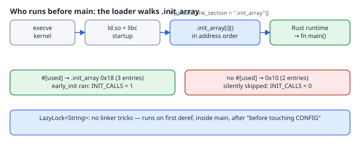

Rust's stated model is that nothing of yours runs before `main`. The platform disagrees. On ELF systems (Linux, the BSDs), the dynamic linker calls every function pointer stored in the `.init_array` section before control reaches the language runtime's entry point. C++ static constructors and `__attribute__((constructor))` use this mechanism, and the [`ctor`](https://docs.rs/ctor/latest/ctor/) crate brings it to Rust. This chapter does the same thing by hand in about 20 lines so you can see exactly what the crate is hiding. It also shows the one attribute whose absence makes the whole trick silently do nothing.

{fig-alt="Kernel exec, then ld.so and libc startup, then each .init_array entry in address order, then the Rust runtime and main. With #[used] the section had 3 entries and early_init ran; without it, 2 entries and it silently never ran. LazyLock instead initialises on first access inside main."}

## The mechanism, from the ELF spec

The System V gABI defines [`SHT_INIT_ARRAY`](https://refspecs.linuxbase.org/elf/gabi4+/ch4.sheader.html) as "an array of pointers to initialization functions". Its [dynamic-section chapter](https://refspecs.linuxbase.org/elf/gabi4+/ch5.dynamic.html) says those functions are executed by the dynamic linker in the order their addresses appear in the array. The `.fini_array` entries run in reverse order. So a constructor is nothing more than one pointer-sized value that lands in that section.

Rust gives you the two tools you need:

- [`link_section`](https://doc.rust-lang.org/reference/abi.html#the-link_section-attribute) "specifies the section of the object file that a function or static's content will be placed into."
- [`used`](https://doc.rust-lang.org/reference/abi.html#the-used-attribute) "forces a static to be kept in the output object file … even if it's never used or referenced by any other item in the crate."

## The whole program

```rust
// Life before main without crates: a function pointer placed in .init_array.
use std::sync::atomic::{AtomicU32, Ordering};

static INIT_CALLS: AtomicU32 = AtomicU32::new(0);

extern "C" fn early_init() {
    INIT_CALLS.fetch_add(1, Ordering::Relaxed);
    // Only use things that need no runtime setup: raw write(2) to stdout.
    let msg = b"[early_init] running before main\n";
    unsafe { libc_write(1, msg.as_ptr().cast(), msg.len()) };
}

unsafe extern "C" {
    #[link_name = "write"]
    fn libc_write(fd: i32, buf: *const core::ffi::c_void, n: usize) -> isize;
}

#[used]
#[unsafe(link_section = ".init_array")]
static EARLY_INIT: extern "C" fn() = early_init;

// A lazily-initialised alternative that needs no linker tricks.
static CONFIG: std::sync::LazyLock<String> = std::sync::LazyLock::new(|| {
    println!("[LazyLock] initialising on first use");
    "mode=fast".to_string()
});

fn main() {
    println!("main: INIT_CALLS = {}", INIT_CALLS.load(Ordering::Relaxed));
    println!("main: before touching CONFIG");
    println!("main: CONFIG = {}", *CONFIG);
    println!("main: CONFIG again = {}", *CONFIG);
}
```

Notes on the choices:

- `early_init` is `extern "C"` because the loader calls it with the platform C ABI, not Rust's ABI.
- It calls only `write(2)`. The `ctor` docs give the rule plainly: constructor code "should be careful to limit itself to libc functions and code that does not rely on Rust's stdlib services." `println!` takes the stdout lock and touches a lazily set-up `Stdout`. That happens to work on glibc today, but nothing promises it, so the constructor avoids it.
- The `write` declaration uses `*const core::ffi::c_void`. My first draft used `*const u8`, and rustc warned that this was a "suspicious definition of the runtime `write` symbol", because it clashes with std's own declaration of the same symbol. Match the C prototype exactly.

## Real output (rustc 1.99.1, x86_64 Linux, glibc 2.41)

```text
$ rustc --edition 2024 -O before.rs -o before && ./before
[early_init] running before main
main: INIT_CALLS = 1
main: before touching CONFIG
[LazyLock] initialising on first use
main: CONFIG = mode=fast
main: CONFIG again = mode=fast
```

The constructor ran once, before `main`'s first line. The `LazyLock` ran once, inside `main`, on first dereference, and not again on the second.

## Drop `#[used]` and it silently disappears

Here is the same file with only the `#[used]` line removed:

```text
$ rustc --edition 2024 -O nouse.rs -o nouse
warning: function `early_init` is never used
warning: static `EARLY_INIT` is never used
warning: function `libc_write` is never used
warning: 3 warnings emitted
$ ./nouse
main: INIT_CALLS = 0
main: before touching CONFIG
[LazyLock] initialising on first use
main: CONFIG = mode=fast
main: CONFIG again = mode=fast
```

It still compiles, it still runs, and the constructor is gone. The section headers show why:

```text
$ readelf -S before | grep -A1 init_array
  [22] .init_array       INIT_ARRAY       0000000000050e48  0004ee48
       0000000000000018  0000000000000000 WAo       0     0     8
$ readelf -S nouse | grep -A1 init_array
  [22] .init_array       INIT_ARRAY       0000000000050db8  0004edb8
       0000000000000010  0000000000000000 WAo       0     0     8
```

Without `#[used]` the array holds 0x10 bytes (two 8-byte pointers that were already there, contributed by the C startup objects and the standard library — I did not trace which is which). With it, the array holds 0x18 bytes, so our entry is the third pointer. Nothing references `EARLY_INIT`, so the compiler treats it as dead and drops it. The only clue is the dead-code warning. If you treat warnings as noise, or `#![allow(dead_code)]` is set at crate level, nothing tells you.

Two more details from the reference: `#[used]` only keeps the item in the *object file*, and "the linker, however, is still free to remove it." In this binary the linker kept it, because `.init_array` is a section the linker preserves. With a custom section name and `--gc-sections`, you would need to check again.

If you dump the raw bytes with `readelf -x .init_array before`, they are all zeros. This is a position-independent executable, so the pointers are filled in at load time by `R_X86_64_RELATIVE` relocations, not stored in the file. Don't conclude the entry is missing from the hex dump; count the section size instead.

## Edition 2024: `link_section` is an unsafe attribute

In the 2024 edition, [`export_name`, `link_section` and `no_mangle` must be written as `unsafe(...)`](https://doc.rust-lang.org/edition-guide/rust-2024/unsafe-attributes.html). These attributes control linking in a global symbol namespace, and getting them wrong can cause UB from otherwise safe code. The plain spelling is a hard error:

```text
$ rustc --edition 2024 plain.rs
error: unsafe attribute used without unsafe
  --> plain.rs:19:3
   |
19 | #[link_section = ".init_array"]
   |   ^^^^^^^^^^^^ usage of unsafe attribute
   |
help: wrap the attribute in `unsafe(...)`
```

Under `--edition 2021` the same file builds, and the constructor runs (`[early_init] running before main`). Migrating to 2024 adds the `unsafe(...)` marker; it doesn't change what the attribute does.

The `unsafe` marker is honest. Code in `.init_array` runs:

- before `std` has finished setting up its runtime (for example, the main thread's name and the stack-overflow handlers on Unix);
- in an order you only partly control, across crates and shared libraries;
- with no way to catch a panic. Unwinding out of an `extern "C" fn` aborts the process.

## What to do instead, most of the time

[`std::sync::LazyLock`](https://doc.rust-lang.org/std/sync/struct.LazyLock.html) (stable since 1.80) covers almost every "I need a global initialised once" case:

- it runs on first access, inside `main`, with the full standard library available;
- it is thread-safe;
- it needs no linker, unsafe attribute, or platform-specific section name.

The output above shows the difference in timing: `before touching CONFIG` prints *before* the initialiser does.

Reach for a real constructor only when something has to happen before *any* user code. Examples include registering with a plugin host that `dlopen`s your `cdylib`, or self-registering test cases or types across crates, which is what `inventory`-style crates are for. Even then, use `ctor` rather than the hand-rolled version. It knows each platform's section name (its docs show `.init_array` on Linux, `__DATA,__mod_init_func` on Apple, `.CRT$XCU` on Windows), and in its 1.x API it makes you write `#[ctor(unsafe)]` to acknowledge the same caveats.

## Checklist

- [ ] `#[used]` on the static, or it is silently removed.
- [ ] `#[unsafe(link_section = ".init_array")]` on edition 2024.
- [ ] `extern "C" fn()` signature, with no arguments and no panics.
- [ ] Body uses only libc-level calls and atomics: no `println!`, allocation-heavy work, or thread spawning.
- [ ] Verified by section size (`readelf -S`), not by the zero-filled hex dump.
- [ ] Asked first whether `LazyLock` solves it, and the answer is usually yes.
