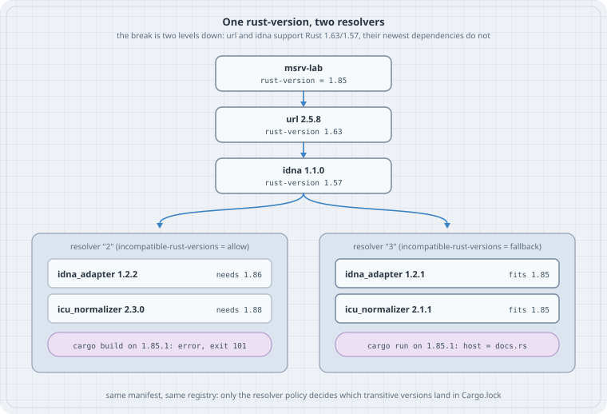

# MSRV in practice: `rust-version` and the MSRV-aware resolver

Your crate's **minimum supported Rust version** (MSRV) is not just a property of your own code. It is a property of the whole dependency graph that `Cargo.lock` pins. One `cargo update` can pull in a transitive dependency, two or three levels down, that needs a newer compiler than you promised. Your source is unchanged, and the build breaks for everyone on the older toolchain. This chapter shows that break with real crates, then fixes it with the tools Cargo has shipped since 1.84: `package.rust-version`, resolver `"3"` (the MSRV-aware resolver, default in edition 2024), `cargo add`'s MSRV awareness, `--ignore-rust-version`, and `--locked`.

## Learning goals

By the end of this chapter you can:

- Explain why a dependency with an old MSRV can still break your MSRV build
- Read Cargo's `requires Rust 1.xx` annotations and its "rustc … is not supported" error
- Switch a project to the MSRV-aware resolver and see what it downgrades and why
- Tell when the resolver *cannot* help (your own version requirement is too new)
- Make CI check the MSRV with the committed lockfile

## Thesis

> `rust-version` is a promise about the build graph, not just your crate. Since Cargo 1.84 the resolver can keep that promise for you. With resolver `"3"` it prefers dependency versions whose own `rust-version` fits yours. It only does that if you opt in (edition 2024, `resolver = "3"`, or config), if dependencies declare `rust-version`, and if your version requirements leave it room.

## Mental model

```text
  Cargo.toml requirement      →   resolver picks a version    →   Cargo.lock    →   rustc checks every
  url = "2.5"                     (newest that matches;            pins it          package's rust-version
                                   resolver 3: newest that                          at build time
                                   ALSO fits your rust-version)
```

{fig-alt="A chain from msrv-lab (rust-version 1.85) to url 2.5.8 (rust-version 1.63) to idna 1.1.0 (rust-version 1.57), splitting into two panels. The left panel, resolver 2 with incompatible-rust-versions = allow, picks idna_adapter 1.2.2 needing 1.86 and icu_normalizer 2.3.0 needing 1.88, and cargo build on 1.85.1 fails with exit 101. The right panel, resolver 3 with fallback, picks idna_adapter 1.2.1 and icu_normalizer 2.1.1, which fit 1.85, and cargo run prints host = docs.rs."}

| Knob | Where | Effect |
|------|-------|--------|
| `package.rust-version = "1.85"` | `Cargo.toml` | Your MSRV. Cargo refuses to build on an older rustc. `cargo add` and resolver `"3"` use it to choose versions |
| `resolver = "3"` | `[package]` or `[workspace]` | Default for **edition 2024**. Sets `incompatible-rust-versions = "fallback"` |
| `resolver.incompatible-rust-versions` | `.cargo/config.toml` / `CARGO_RESOLVER_INCOMPATIBLE_RUST_VERSIONS` | `allow` (old behaviour) or `fallback` (prefer compatible, use incompatible only if nothing else matches). Respected since Cargo 1.84 |
| `--ignore-rust-version` | CLI | Build or resolve as if no `rust-version` were set |
| `--locked` | CLI | Fail instead of changing `Cargo.lock` |

"Your Rust version" for the resolver is the workspace's `rust-version`. If that is unset, Cargo uses the **toolchain you are running** (Case 5).

## Worked examples

Run on Debian 13 x86_64 with the distribution toolchain **rustc 1.85.1 / cargo 1.85.1**. This box has no rustup toolchain installed and none was installed for this chapter. The current stable release is **Rust 1.99** (Cargo 1.99, 2026-10-01). Running an older compiler is the situation this chapter is about. One difference on a current Cargo, from the Cargo changelog: Cargo 1.92 reworded the rust-version incompatibility error, so your message text will differ. The behaviour shown here has been stable since resolver v3 was stabilised in Cargo 1.84. Crate versions are whatever crates.io served on 2026-10-17. Rerunning later may pick newer versions, but the mechanism is the same.

Run the labs in order. They share `/tmp/msrv-lab`. Each one is a bash script you can paste.

## Case 1 — The break is two levels down

`url` declares `rust-version = "1.63"`. `idna` declares 1.57. Neither is the problem.

```bash
#!/usr/bin/env bash
# lab-01-break.sh — a direct dep with an old MSRV, a transitive dep with a new one
set -uo pipefail
rm -rf /tmp/msrv-lab && mkdir -p /tmp/msrv-lab/src && cd /tmp/msrv-lab
cat > Cargo.toml <<'TOML'
[package]
name = "msrv-lab"
version = "0.1.0"
edition = "2021"          # resolver "2": rust-version of deps is ignored
rust-version = "1.85"

[dependencies]
url = "2.5"               # url itself declares rust-version 1.63
TOML
cat > src/main.rs <<'RS'
// src/main.rs — parse one URL so the dependency is really used
fn main() {
    let u = url::Url::parse("https://docs.rs/url/latest/url/").expect("valid URL");
    println!("host = {}", u.host_str().unwrap_or("?"));
}
RS
cargo --version
cargo generate-lockfile 2>&1
cargo fetch -q              # download now so later output is only about resolution
echo '--- who pulls in the ICU crates?'
cargo tree -i icu_normalizer --edges normal 2>&1
echo '--- build on this toolchain'
cargo build -q 2>&1 | head -20
echo "[cargo build exit ${PIPESTATUS[0]}]"
```

```text
cargo 1.85.1 (d73d2caf9 2024-12-31)
    Updating crates.io index
     Locking 35 packages to latest compatible versions
      Adding icu_collections v2.3.0 (requires Rust 1.88)
      Adding icu_locale_core v2.3.0 (requires Rust 1.88)
      Adding icu_normalizer v2.3.0 (requires Rust 1.88)
      Adding icu_normalizer_data v2.3.0 (requires Rust 1.88)
      Adding icu_properties v2.3.0 (requires Rust 1.88)
      Adding icu_properties_data v2.3.0 (requires Rust 1.88)
      Adding icu_provider v2.3.1 (requires Rust 1.88)
      Adding idna_adapter v1.2.2 (requires Rust 1.86)
--- who pulls in the ICU crates?
icu_normalizer v2.3.0
└── idna_adapter v1.2.2
    └── idna v1.1.0
        └── url v2.5.8
            └── msrv-lab v0.1.0 (/tmp/msrv-lab)
--- build on this toolchain
error: rustc 1.85.1 is not supported by the following packages:
  icu_collections@2.3.0 requires rustc 1.88
  icu_locale_core@2.3.0 requires rustc 1.88
  icu_normalizer@2.3.0 requires rustc 1.88
  icu_normalizer_data@2.3.0 requires rustc 1.88
  icu_normalizer_data@2.3.0 requires rustc 1.88
  icu_normalizer_data@2.3.0 requires rustc 1.88
  icu_properties@2.3.0 requires rustc 1.88
  icu_properties_data@2.3.0 requires rustc 1.88
  icu_properties_data@2.3.0 requires rustc 1.88
  icu_properties_data@2.3.0 requires rustc 1.88
  icu_provider@2.3.1 requires rustc 1.88
  idna_adapter@1.2.2 requires rustc 1.86
Either upgrade rustc or select compatible dependency versions with
`cargo update <name>@<current-ver> --precise <compatible-ver>`
where `<compatible-ver>` is the latest version supporting rustc 1.85.1

[cargo build exit 101]
```

Even with resolver `"2"` (the edition 2021 default), Cargo 1.85 *annotates* each pick with `(requires Rust 1.88)`, but it still locks those versions. The build then fails before compiling anything: rustc checks every package's `rust-version` against itself. `cargo tree -i` shows the path. `icu_normalizer` comes from `idna_adapter`, which comes from `idna`, which comes from `url`. None of those is in your `Cargo.toml`. This is the "one transitive update breaks the build" failure, and it can happen to a crate whose own code has not changed in years.

## Case 2 — Let the resolver keep the promise

```bash
#!/usr/bin/env bash
# lab-02-fallback.sh — same manifest, MSRV-aware resolver (resolver "3")
set -uo pipefail
cd /tmp/msrv-lab
sed -i 's/^rust-version = "1.85"/rust-version = "1.85"\nresolver = "3"             # default for edition 2024; needs Cargo 1.84+/' Cargo.toml
grep -E '^(edition|rust-version|resolver)' Cargo.toml
echo '--- re-resolve against rust-version 1.85'
cargo update 2>&1
echo '--- build and run'
cargo run -q 2>&1
echo "[cargo run exit $?]"
```

```text
edition = "2021"          # resolver "2": rust-version of deps is ignored
rust-version = "1.85"
resolver = "3"             # default for edition 2024; needs Cargo 1.84+
--- re-resolve against rust-version 1.85
    Updating crates.io index
     Locking 8 packages to latest Rust 1.85 compatible versions
 Downgrading icu_collections v2.3.0 -> v2.1.1 (available: v2.3.0, requires Rust 1.88)
 Downgrading icu_locale_core v2.3.0 -> v2.1.1 (available: v2.3.0, requires Rust 1.88)
 Downgrading icu_normalizer v2.3.0 -> v2.1.1 (available: v2.3.0, requires Rust 1.88)
 Downgrading icu_normalizer_data v2.3.0 -> v2.1.1 (available: v2.3.0, requires Rust 1.88)
 Downgrading icu_properties v2.3.0 -> v2.1.2 (available: v2.3.0, requires Rust 1.88)
 Downgrading icu_properties_data v2.3.0 -> v2.1.2 (available: v2.3.0, requires Rust 1.88)
 Downgrading icu_provider v2.3.1 -> v2.1.1 (available: v2.3.1, requires Rust 1.88)
 Downgrading idna_adapter v1.2.2 -> v1.2.1 (available: v1.2.2, requires Rust 1.86)
--- build and run
host = docs.rs
[cargo run exit 0]
```

The same manifest and the same registry give a different lockfile. Each `Downgrading … (available: v2.3.0, requires Rust 1.88)` line is the resolver telling you what it held back and why. You do not have to add pins or `=` requirements by hand, and when you later raise `rust-version`, a plain `cargo update` brings the newer versions back. Here `resolver = "3"` is set explicitly while keeping edition 2021. Moving to `edition = "2024"` gets the same default.

## Case 3 — `cargo add` is MSRV-aware; your requirement wins over the resolver

```bash
#!/usr/bin/env bash
# lab-03-direct.sh — cargo add is MSRV-aware; a hand-written requirement can still force a break
set -uo pipefail
cd /tmp/msrv-lab
echo '--- cargo add picks the newest uuid that fits rust-version'
cargo add uuid --features v4 2>&1 | grep -vE '^ +[-+] |Features:'   # drop the feature list
grep '^uuid' Cargo.toml
cargo build -q 2>&1 && echo '[build ok]'

echo '--- now ask for a version that only exists for newer Rust'
sed -i 's/^uuid = .*/uuid = { version = "1.28", features = ["v4"] }/' Cargo.toml
cargo update -p uuid 2>&1
cargo build -q 2>&1 | head -4
echo "[cargo build exit ${PIPESTATUS[0]}]"
```

```text
--- cargo add picks the newest uuid that fits rust-version
    Updating crates.io index
warning: ignoring uuid@1.28.0 (which requires rustc 1.89.0) to maintain msrv-lab's rust-version of 1.85
      Adding uuid v1.26.1 to dependencies
    Updating crates.io index
     Locking 18 packages to latest Rust 1.85 compatible versions
      Adding bumpalo v3.20.3
      Adding cfg-if v1.0.5
      Adding futures-core v0.3.34
      Adding futures-task v0.3.34
      Adding futures-util v0.3.34
      Adding getrandom v0.4.3
      Adding js-sys v0.3.106
      Adding libc v0.2.191
      Adding once_cell v1.21.4
      Adding pin-project-lite v0.2.17
      Adding r-efi v6.0.0
      Adding rustversion v1.0.23
      Adding slab v0.4.12
      Adding uuid v1.26.1 (available: v1.28.0, requires Rust 1.89.0)
      Adding wasm-bindgen v0.2.129
      Adding wasm-bindgen-macro v0.2.129
      Adding wasm-bindgen-macro-support v0.2.129
      Adding wasm-bindgen-shared v0.2.129
uuid = { version = "1.26.1", features = ["v4"] }
[build ok]
--- now ask for a version that only exists for newer Rust
    Updating crates.io index
     Locking 1 package to latest Rust 1.85 compatible version
    Updating uuid v1.26.1 -> v1.28.0 (requires Rust 1.89.0)
note: pass `--verbose` to see 8 unchanged dependencies behind latest
error: rustc 1.85.1 is not supported by the following package:
  uuid@1.28.0 requires rustc 1.89.0
Either upgrade rustc or select compatible dependency versions with
`cargo update <name>@<current-ver> --precise <compatible-ver>`
[cargo build exit 101]
```

`cargo add` chose `1.26.1` and said why (`ignoring uuid@1.28.0 (which requires rustc 1.89.0)`). Once the manifest says `"1.28"`, no version that satisfies the requirement fits Rust 1.85. The resolver's `fallback` policy is documented to pick an incompatible version instead of failing resolution, so `cargo update` succeeded, and `cargo build` refused. The fix is in `Cargo.toml`: lower the requirement or raise `rust-version`. The resolver cannot fix it.

## Case 4 — Your own `rust-version`, the escape hatch, and `--locked`

```bash
#!/usr/bin/env bash
# lab-04-own-msrv.sh — rust-version also guards your own package
set -uo pipefail
cd /tmp/msrv-lab
sed -i 's/^uuid = .*/uuid = { version = "1.26", features = ["v4"] }/' Cargo.toml
cargo update -q -p uuid --precise 1.26.1 2>&1
sed -i 's/^rust-version = "1.85"/rust-version = "1.90"/' Cargo.toml
echo '--- claim a newer MSRV than this toolchain'
cargo build -q 2>&1 | head -4
echo "[cargo build exit ${PIPESTATUS[0]}]"
echo '--- the escape hatch (use when you know why)'
cargo build -q --ignore-rust-version 2>&1 && echo '[build ok with --ignore-rust-version]'
sed -i 's/^rust-version = "1.90"/rust-version = "1.85"/' Cargo.toml

echo '--- CI: the lockfile is the contract'
cargo build -q --locked 2>&1 && echo '[--locked build ok]'
sed -i 's/^url = "2.5"/url = "=2.5.4"/' Cargo.toml
cargo build -q --locked 2>&1 | head -3
echo "[--locked build exit ${PIPESTATUS[0]}]"
```

```text
--- claim a newer MSRV than this toolchain
error: rustc 1.85.1 is not supported by the following package:
  msrv-lab@0.1.0 requires rustc 1.90

[cargo build exit 101]
--- the escape hatch (use when you know why)
[build ok with --ignore-rust-version]
--- CI: the lockfile is the contract
[--locked build ok]
error: the lock file /tmp/msrv-lab/Cargo.lock needs to be updated but --locked was passed to prevent this
If you want to try to generate the lock file without accessing the network, remove the --locked flag and use --offline instead.
[--locked build exit 101]
```

- Claiming `rust-version = "1.90"` makes Cargo reject your *own* package on 1.85.1 with a clear message, before rustc can fail on some syntax error deep in your code. That is what the field is for.
- `--ignore-rust-version` builds anyway. Use it when you know the newer feature is behind a cfg you do not hit, not as a habit.
- `--locked` makes the committed lockfile the contract. When the manifest and the lockfile disagree, CI fails instead of silently resolving a new graph. That is how you stop a CI run from picking up a transitive update that nobody reviewed.

## Case 5 — No `rust-version`? Then your toolchain is the MSRV

```bash
#!/usr/bin/env bash
# lab-05-no-msrv.sh — no rust-version at all: what does resolver "3" compare against?
set -uo pipefail
cd /tmp/msrv-lab
sed -i 's/^url = "=2.5.4"/url = "2.5"/; /^rust-version = /d' Cargo.toml
grep -E '^(edition|rust-version|resolver)' Cargo.toml
rm -f Cargo.lock
cargo generate-lockfile 2>&1 | grep -E 'Locking|uuid|icu_normalizer '
cargo build -q 2>&1 && echo '[build ok on rustc 1.85.1]'
```

```text
edition = "2021"          # resolver "2": rust-version of deps is ignored
resolver = "3"             # default for edition 2024; needs Cargo 1.84+
     Locking 53 packages to latest Rust 1.85.1 compatible versions
      Adding icu_normalizer v2.1.1 (available: v2.3.0, requires Rust 1.88)
      Adding uuid v1.26.1 (available: v1.28.0, requires Rust 1.89.0)
[build ok on rustc 1.85.1]
```

With `rust-version` removed, resolver `"3"` resolved against **"Rust 1.85.1"**, the toolchain running `cargo`. That is convenient on one machine and a trap on a team. A developer on 1.99 and a CI runner on 1.85 generate *different* lockfiles from the same manifest. Declare `rust-version` and the result no longer depends on who ran `cargo update`.

## Case 6 — Check the MSRV in CI (configuration, not run here)

This needs a second toolchain (`rustup toolchain install`), which this box does not have, so it was not run. It is the pattern the Cargo book's "Rust version" chapter and its CI guide describe: verify the MSRV with the lockfile you ship.

```yaml
# .github/workflows/msrv.yml — build the committed Cargo.lock on the declared MSRV
name: msrv
on: [push, pull_request]
jobs:
  msrv:
    runs-on: ubuntu-latest
    steps:
      - uses: actions/checkout@v5
      - run: rustup toolchain install 1.85 --profile minimal
      - run: cargo +1.85 check --locked --all-targets
```

Pair it with a normal job on the latest stable, so you also see breakage that a newer compiler would catch. For libraries, remember that downstream users do not use your `Cargo.lock`. Their resolver, their `rust-version` and their toolchain decide what they get. The `rust-version` field on every crate in the graph is what lets their resolver choose well.

## The trap

The trap is reading MSRV as "the oldest compiler that compiles *my* code". You test once on the old toolchain, it works, and you ship. Weeks later a routine `cargo update`, or a fresh clone without a lockfile, pulls `icu_normalizer 2.3.0` three levels down, and the MSRV build fails with no change to your code. The two usual fixes make it worse. Pinning the transitive crate with `=` in your own `Cargo.toml` freezes it for every downstream user. Dropping `rust-version` makes Cargo resolve against whichever toolchain happens to run, so the lockfile changes from one machine to the next.

## The boring rule

> Declare `package.rust-version`. Use resolver `"3"` (edition 2024 gives it to you). Let `cargo add` choose versions. Commit `Cargo.lock` for applications and build with `--locked` in CI. Keep one CI job on the declared MSRV and one on latest stable. When a dependency needs a newer compiler, decide deliberately: raise `rust-version` (a minor-version bump per the Cargo book) or keep the older dependency. Don't hand-pin transitive crates.

## Try this

1. In `/tmp/msrv-lab`, set `resolver = "2"`, run `cargo update`, and confirm the ICU crates jump back to 2.3.0. Then set `CARGO_RESOLVER_INCOMPATIBLE_RUST_VERSIONS=fallback` for one `cargo update` and compare.
2. Raise `rust-version` to `"1.88"`, run `cargo update`, and read which `Downgrading` notes turn into `Updating`.
3. Use `cargo update icu_normalizer@2.1.1 --precise 2.3.0` with resolver `"3"`. What does `--precise` do to the MSRV policy?
4. Add a second workspace member with no `rust-version` that also depends on `url = "2.5"`. Which `idna_adapter` does the shared lockfile get, and why? (Hint: version unification in the resolver chapter.)
5. On a machine with rustup, run the Case 6 workflow steps locally (`cargo +1.85 check --locked --all-targets`) against one of your own crates.

## Sources

- The Cargo Book, "Rust version" (`rust-version`, support expectations, policies): <https://doc.rust-lang.org/cargo/reference/rust-version.html>
- The Cargo Book, "Dependency resolution": resolver versions (`"3"` = edition 2024 default, Rust 1.84+) and the Rust-version section: <https://doc.rust-lang.org/cargo/reference/resolver.html>
- The Cargo Book, configuration: `resolver.incompatible-rust-versions` (`allow` / `fallback`, MSRV 1.84): <https://doc.rust-lang.org/cargo/reference/config.html#resolverincompatible-rust-versions>
- The Cargo Book, `cargo add`, `cargo update` (`--precise`), and the `--locked` / `--ignore-rust-version` flags: <https://doc.rust-lang.org/cargo/commands/>
- Cargo changelog (1.84 stabilises resolver v3; 1.92 "Improve error message for rust-version incompatibility diagnostics"; 1.99 is current, released 2026-10-01): <https://doc.rust-lang.org/nightly/cargo/CHANGELOG.html>
- Rust 2024 edition guide, "Cargo: Rust-version aware resolver": <https://doc.rust-lang.org/edition-guide/rust-2024/cargo-resolver.html>
- crates.io API (`rust_version` per published version) for the versions used here: `https://crates.io/api/v1/crates/<name>/versions`
