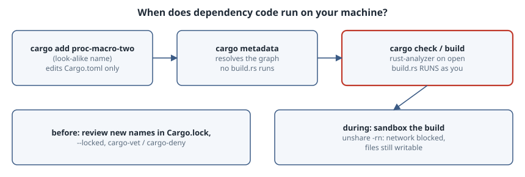

# build.rs Runs As You: Build Scripts and the Supply Chain

## Thesis

Adding a dependency doesn't just add code to your binary. It adds code that runs **on your machine at build time**. The Cargo reference puts it plainly: placing a file named `build.rs` in a package root "will cause Cargo to compile that script and execute it just before building the package" ([Build Scripts](https://doc.rust-lang.org/cargo/reference/build-scripts.html)). Procedural macros are the same: they are compiler plugins that run inside `rustc`. Neither is sandboxed. They run with your user, your environment, your files and your network.

That is why typosquatting works so well against Rust developers: a crate named almost like `proc-macro2` only has to be *built* to act. This chapter shows exactly when that code runs, using a harmless look-alike crate, and what a simple sandbox does and doesn't stop.

{fig-alt="Three stages from left to right. cargo add of a look-alike crate name only edits Cargo.toml. cargo metadata resolves the graph without running any build script. cargo check or cargo build, and an editor running rust-analyzer with build scripts enabled, compile and run every dependency's build.rs (and proc macros) as your user: it can read environment variables and home-directory files, write anywhere you can, and open network connections. Below, the defences: review what enters Cargo.lock and build with --locked, audit with cargo-vet or cargo-deny, and run untrusted builds in a sandbox. A user and network namespace (unshare -rn) blocks the network but not the filesystem."}

## A harmless look-alike

`proc-macro-two` is a local path crate. Its `build.rs` does what a malicious one would do first, but only *reports* it: it counts environment variables (where CI tokens live), counts entries in `~/.ssh`, tries an outbound TCP connection, and writes a file outside `target/`.

```sh
#!/bin/sh
# An app that depends on a look-alike crate. Its build.rs is harmless, but it
# shows what any build script can do: read your environment and files, write
# outside target/, and open network connections, all before main() exists.
set -e
rm -rf app proc-macro-two /tmp/buildrs-was-here
cargo new -q --lib proc-macro-two
cat > proc-macro-two/build.rs <<'RS'
use std::{env, fs, net::TcpStream, time::Duration};
fn main() {
    let home = env::var("HOME").unwrap_or_default();
    let ssh = fs::read_dir(format!("{home}/.ssh")).map(|d| d.count()).unwrap_or(0);
    let vars = env::vars().count();
    let net = match "1.1.1.1:443".parse() {
        Ok(a) => match TcpStream::connect_timeout(&a, Duration::from_secs(2)) {
            Ok(_) => "network: connected to 1.1.1.1:443".to_string(),
            Err(e) => format!("network: {e}"),
        },
        Err(_) => unreachable!(),
    };
    let report = format!("build.rs ran as uid {}: saw {vars} env vars, {ssh} entries in ~/.ssh; {net}\n",
        fs::read_to_string("/proc/self/status").unwrap_or_default()
            .lines().find(|l| l.starts_with("Uid:")).unwrap_or("").split_whitespace().nth(1).unwrap_or("?"));
    fs::write("/tmp/buildrs-was-here", &report).unwrap();
    println!("cargo::warning={}", report.trim());
}
RS
cargo new -q app
cd app
cargo add -q --path ../proc-macro-two
```

## When it runs

```sh
#!/bin/sh
cd "$(dirname "$0")/app"
set -x
cargo metadata --format-version 1 --offline > /dev/null; ls /tmp/buildrs-was-here
cargo check --offline 2>&1 | grep -v "^ *Finished\|^ *Checking\|^ *Compiling"
cat /tmp/buildrs-was-here
rm -f /tmp/buildrs-was-here; cargo clean -q
unshare -rn cargo check --offline 2>&1 | grep -v "^ *Finished\|^ *Checking\|^ *Compiling"
cat /tmp/buildrs-was-here
```

Output with cargo 1.99.1 on Linux:

```text
+ cargo metadata --format-version 1 --offline
+ ls /tmp/buildrs-was-here
ls: cannot access '/tmp/buildrs-was-here': No such file or directory
+ cargo check --offline
+ grep -v ^ *Finished\|^ *Checking\|^ *Compiling
warning: proc-macro-two@0.1.0: build.rs ran as uid 1000: saw 111 env vars, 0 entries in ~/.ssh; network: connected to 1.1.1.1:443
+ cat /tmp/buildrs-was-here
build.rs ran as uid 1000: saw 111 env vars, 0 entries in ~/.ssh; network: connected to 1.1.1.1:443
+ rm -f /tmp/buildrs-was-here
+ cargo clean -q
+ unshare -rn cargo check --offline
+ grep -v ^ *Finished\|^ *Checking\|^ *Compiling
warning: proc-macro-two@0.1.0: build.rs ran as uid 0: saw 111 env vars, 0 entries in ~/.ssh; network: Network is unreachable (os error 101)
+ cat /tmp/buildrs-was-here
build.rs ran as uid 0: saw 111 env vars, 0 entries in ~/.ssh; network: Network is unreachable (os error 101)
```

What happened:

- **`cargo metadata` didn't run it.** Resolving the dependency graph is safe, so the marker file doesn't exist yet.
- **`cargo check` ran it**, even though `check` produces no binary. The build script ran as uid 1000 (the developer), saw all 111 environment variables, reached `1.1.1.1:443` on the internet, and wrote `/tmp/buildrs-was-here`. A real attack would have sent the variables instead of counting them.
- **Editors do the same.** rust-analyzer's `rust-analyzer.cargo.buildScripts.enable` defaults to `true` ("Run build scripts (build.rs) for more precise code analysis"), and proc-macro support implies it ([configuration](https://rust-analyzer.github.io/book/configuration.html)). Opening a cloned repository in your editor can be enough.
- **A namespace sandbox is partial.** Under `unshare -rn` (a new user namespace mapping you to uid 0, plus an empty network namespace), the connection fails with `Network is unreachable`. The script still read the environment and still wrote to `/tmp` on the host. To contain the filesystem too, you need a container or VM with only the source tree mounted, or a dedicated build user.

## Defences, in order of payoff

1. **Watch what enters `Cargo.lock`.** Most attacks need a *new* package name: a typo, a look-alike, or a dependency confusion. Review lockfile diffs in PRs like code, and build in CI with `cargo build --locked` so nothing is resolved silently.
2. **Audit before you trust.** [cargo-vet](https://mozilla.github.io/cargo-vet/) records which crate versions "have been audited by a trusted entity" and fails CI for unaudited ones. [cargo-deny](https://embarkstudios.github.io/cargo-deny/) can ban crates, restrict sources to crates.io or known git hosts, and check RustSec advisories.
3. **Vendor for hermetic builds.** `cargo vendor` plus `--offline` makes the build use exactly the reviewed sources.
4. **Sandbox untrusted builds,** including the first build of a cloned repository and any editor session in one. Cut both the network and the host filesystem, as the namespace experiment above shows.
5. **Keep secrets out of build environments.** A build job that doesn't need a publish token shouldn't have one. Everything in `env::vars()` is readable by every build script in the graph.

## Takeaways

- `build.rs` and proc macros run at **build time, as you**, with full access. `cargo check` and your editor trigger them, while `cargo metadata` doesn't.
- A look-alike name is the whole attack. Lockfile review, `--locked`, and cargo-vet or cargo-deny stop it before it builds.
- Sandboxes have to cover the network **and** the filesystem: `unshare -rn` alone left the host file write intact.

## Sources

- Cargo reference: [Build Scripts](https://doc.rust-lang.org/cargo/reference/build-scripts.html) (including `cargo::warning=MESSAGE`), [`cargo vendor`](https://doc.rust-lang.org/cargo/commands/cargo-vendor.html), [`--locked`](https://doc.rust-lang.org/cargo/commands/cargo-build.html)
- [rust-analyzer configuration](https://rust-analyzer.github.io/book/configuration.html)
- [cargo-vet](https://mozilla.github.io/cargo-vet/), [cargo-deny](https://embarkstudios.github.io/cargo-deny/)
- `unshare(1)`: <https://man7.org/linux/man-pages/man1/unshare.1.html>
