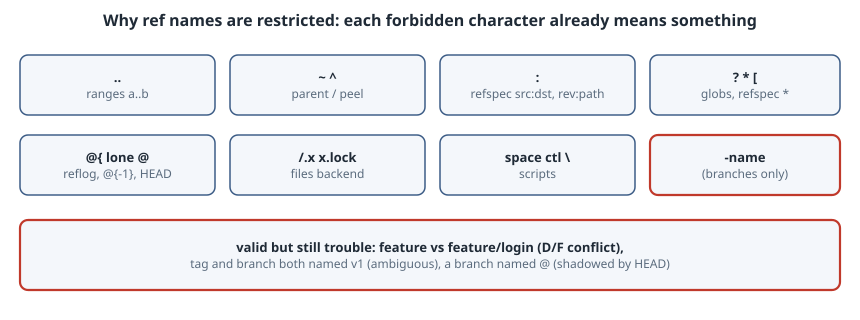

# Ref Name Rules: What `git check-ref-format` Allows, and Why

## Thesis

Branch and tag names look like free text, but Git enforces a short list of rules on them. Nearly every forbidden character already means something in **revision syntax** (`a..b`, `HEAD~2`, `v1^{}`, `main@{1}`), in **refspecs** (`src:dst`, `refs/heads/*`), or in the **files ref backend**, where refs are paths and `.lock` files are real. Branches add one rule of their own: they can't start with `-`, so a name can't be parsed as an option.

`git check-ref-format` is the plumbing command that applies these rules. Any tool that turns user input into a branch name (a bot that makes branches from issue titles, a CI job, a forge) should call it rather than reimplement it.

This chapter tests each rule, shows the stricter `--branch` mode, and covers names that are *valid* but still cause trouble. Everything was run with Git 2.47.3.

{fig-alt="Git ref name rules and the syntax each one protects. Two dots are reserved for ranges like main..topic. Tilde and caret are parent and peel operators. Colon separates src:dst in refspecs and rev:path. Question mark, asterisk and open bracket are shell globs and refspec patterns. @{ starts reflog syntax like main@{1} and @{-1}. A component starting with a dot or ending in .lock clashes with hidden files and lock files in the files backend. Spaces, control characters and backslash break scripts. Branches add one more rule: no leading dash, so a name cannot be parsed as an option. Even valid names can still conflict: feature and feature/login cannot coexist, a tag and branch with the same name make the name ambiguous, and a branch named @ is shadowed by HEAD."}

## The rules, tested one at a time

`git check-ref-format <refname>` exits 0 if the name is valid and 1 if it isn't, and prints nothing either way. This script checks each candidate as a full ref under `refs/heads/`:

```sh
#!/bin/sh
# Each candidate checked as a full ref under refs/heads/
for n in 'feature/login' 'fix-123' 'release/v2.0' 'a..b' 'wip.' 'x.lock' 'feat/.hidden' 'has space' 'tilde~1' 'caret^' 'colon:x' 'what?' 'star*' 'brack[et' 'back\slash' 'trail/' 'dbl//slash' '@' 'at@{x' '-dash' 'naïve' 'UPPER/Case' "$(printf 'ctl\001')"; do
  if git check-ref-format "refs/heads/$n"; then r="valid  "; else r="INVALID"; fi
  printf "%s  %s\n" "$r" "$(printf "%s" "$n" | tr "\001" "?")"
done
```

```text
$ ./run1.sh
valid    feature/login
valid    fix-123
valid    release/v2.0
INVALID  a..b
INVALID  wip.
INVALID  x.lock
INVALID  feat/.hidden
INVALID  has space
INVALID  tilde~1
INVALID  caret^
INVALID  colon:x
INVALID  what?
INVALID  star*
INVALID  brack[et
INVALID  back\slash
INVALID  trail/
INVALID  dbl//slash
valid    @
INVALID  at@{x
valid    -dash
valid    naïve
valid    UPPER/Case
INVALID  ctl?
```

Mapping each rejection to the documented rule, and to what it protects:

| Rejected | Rule | Why |
|---|---|---|
| `a..b` | no `..` anywhere | `a..b` is a range |
| `wip.` / `feat/.hidden` | no trailing `.`; no component starting with `.` | hidden files and directories, and `..` path tricks |
| `x.lock` | no component ending in `.lock` | the files backend writes `<ref>.lock` while updating |
| `has space`, `ctl^A` | no space, control characters or DEL | scripts that split on whitespace |
| `tilde~1`, `caret^` | no `~` or `^` | `HEAD~1` (parent), `v1^{}` (peel) |
| `colon:x` | no `:` | `src:dst` refspecs, `rev:path` |
| `what?`, `star*`, `brack[et` | no `?`, `*` or `[` | shell globs, and `*` in refspec patterns |
| `back\slash` | no `\` | escaping, and Windows paths |
| `trail/`, `dbl//slash` | no leading or trailing `/`; no `//` | path normalization |
| `at@{x` | no `@{` | reflog syntax: `main@{1}`, `@{-1}`, `@{u}` |

Three results tend to surprise people. `refs/heads/@` is **valid**, because the "cannot be the single character `@`" rule applies to the whole refname, not to a component. `refs/heads/-dash` is **valid** as a ref; the dash rule only exists for branch names (next section). Non-ASCII UTF-8 such as `naïve` is **valid**, because Git only bans bytes below `\040`, DEL and the listed punctuation.

## `--branch`: the stricter check porcelain uses

`--branch` takes a short branch name, expands `@{-N}` (the previous checkout), and applies extra rules: no leading `-`, and not `HEAD`:

```text
$ git check-ref-format --branch <name>
topic      -> topic
-dash      -> fatal: '-dash' is not a valid branch name
@          -> @
HEAD       -> fatal: 'HEAD' is not a valid branch name
@{-1}      -> topic
feat/.x    -> fatal: 'feat/.x' is not a valid branch name

$ git check-ref-format --normalize
refs/heads//x    -> refs/heads/x
refs/heads/x/    -> INVALID (exit 1)
/refs/heads/y    -> refs/heads/y
main             -> INVALID (exit 1)

$ one-level and patterns
main                                 INVALID
--allow-onelevel main                valid
refs/heads/*                         INVALID
--refspec-pattern refs/heads/*       valid
--refspec-pattern refs/heads/*/x/*   INVALID
```

- **`@{-1}` printed `topic`.** It was resolved to the branch checked out before `main`. A tool that accepts branch names should run input through `--branch` and use **the printed name**, not the raw input.
- **`-dash` is rejected here but was valid as `refs/heads/-dash`.** This is the guard against argument injection. A name like `--upload-pack=…` can never become a branch. Wrappers should still put `--` or `--end-of-options` before operands (see the argument-injection chapter in Security), because refs created by plumbing or arriving from remotes don't go through `--branch`.
- **`--normalize`** removes leading slashes and collapses `//`, then validates. A trailing slash is still rejected.
- **One-level names** such as `main` fail without `--allow-onelevel`, because a full refname must contain a `/`. Pass `--branch`, or `refs/heads/$name`, rather than a bare name.
- **`--refspec-pattern`** allows exactly one `*`, the way `fetch = +refs/heads/*:refs/remotes/origin/*` uses it.

## Valid names that still cause trouble

Passing `check-ref-format` doesn't mean a name will work in *this* repository:

```text
$ ./run3.sh
== ref-format=files
  fatal: cannot lock ref 'refs/heads/feature/login': 'refs/heads/feature' exists; cannot create 'refs/heads/feature/login'
  after deleting 'feature': feature/login created
  fatal: cannot lock ref 'refs/heads/feature': 'refs/heads/feature/login' exists; cannot create 'refs/heads/feature'
== ref-format=reftable
  fatal: 'refs/heads/feature' exists; cannot create 'refs/heads/feature/login'
  after deleting 'feature': feature/login created
  fatal: 'refs/heads/feature/login' exists; cannot create 'refs/heads/feature'
== same name as branch and tag
  tag v1=383d9fc branch v1=2e577f8
  git rev-parse v1 -> 383d9fc
  warning: refname 'v1' is ambiguous.
== a branch literally named @
  refs/heads/@=383d9fc  @=2e577f8  HEAD=2e577f8
== leading dash
  fatal: '-dash' is not a valid branch name
  hint: See `man git check-ref-format`
  hint: Disable this message with "git config advice.refSyntax false"
```

- **Directory/file (D/F) conflicts.** `feature` and `feature/login` can't both exist. In the files backend, `refs/heads/feature` can't be both a file and a directory. The reftable backend has no such limitation on disk, but it refuses the same names, so a repository behaves the same with either backend. If teams use `feature/<name>` namespaces, never create a bare `feature` branch.
- **Ambiguous short names.** With both a tag and a branch called `v1`, `git rev-parse v1` warns and picks the **tag**. Per gitrevisions, the lookup order is `refs/<name>`, then `refs/tags/`, then `refs/heads/`, then `refs/remotes/`. Scripts should always pass full refnames (`refs/heads/v1`).
- **A branch named `@`.** It's allowed, but in revision syntax `@` means `HEAD`, so `@` resolves to HEAD's commit (2e577f8) while `refs/heads/@` points elsewhere (383d9fc). Nobody wants this; refuse it in tooling.
- **Case.** On a case-insensitive filesystem (the defaults on macOS and Windows), the files backend stores `Feature` and `feature` as the same path, so they collide or behave inconsistently depending on whether the ref is loose or packed. Stick to lowercase names in shared repos.

## Turning free text into a branch name

A bot that creates branches from issue titles should first map the text into a conservative ASCII subset, then let Git have the final say:

```sh
#!/bin/sh
# slug.sh "<free text>" -> a branch name that passes check-ref-format --branch
slug=$(printf '%s' "$1" |
  LC_ALL=C tr -c 'A-Za-z0-9._/-' '-' |      # anything else becomes '-'
  sed -e 's#\.\.*#.#g' \
      -e 's#\.lock\(/\|$\)#-lock\1#g' \
      -e 's#/[-.]*#/#g' -e 's#[-.]*/#/#g' \
      -e 's#//*#/#g' -e 's#--*#-#g' \
      -e 's#^[-/.]*##' -e 's#[-/.]*$##')
[ -n "$slug" ] || slug=branch
git check-ref-format --branch "$slug" >/dev/null 2>&1 || { echo "refusing: $slug" >&2; exit 1; }
printf '%s\n' "$slug"
```

```text
$ for t in ...; do ../slug.sh "$t"; done
Fix: login fails on Safari?    -> Fix-login-fails-on-Safari
feat/../../etc                 -> feat/etc
--upload-pack=touch /tmp/pwn   -> upload-pack-touch/tmp/pwn
wip.lock                       -> wip-lock
release/v2.0.                  -> release/v2.0
@{-1}                          -> 1
a.lock/b                       -> a-lock/b
...                            -> branch
```

The `tr` step drops everything outside `[A-Za-z0-9._/-]`, which removes spaces, `~^:?*[\`, `@{` and control bytes in one go. The `sed` steps handle the rules that depend on context: `..`, `.lock`, components starting with a dot or dash, and leading or trailing separators. `check-ref-format --branch` is the backstop. If a future Git version tightens the rules, the script refuses rather than creating a bad ref.

The script doesn't check for collisions with existing refs. Before creating a branch, check `git show-ref --verify --quiet refs/heads/$slug`, and look for D/F conflicts with `git for-each-ref refs/heads/$slug/`.

## Pitfalls

- **Validating with a regex you wrote.** You'll miss `.lock`, `@{` or the single-`@` rule. Call `git check-ref-format`.
- **Validating the raw input instead of the `--branch` output.** `@{-1}` passes validation as itself, but it means a different branch for every user.
- **Using short names in scripts.** `git rev-parse v1` depends on which namespaces contain `v1`. Use `refs/heads/…` and `refs/tags/…`.
- **Relying on name rules for security.** Ref names from remotes and plumbing can start with `-`. Always use `--` and `--end-of-options` in wrappers.

## Takeaways

- Every forbidden character in a ref name is reserved for something else in Git: ranges, parent and peel operators, refspecs, globs, reflogs or lock files.
- `git check-ref-format` validates full refnames. `--branch` adds `@{-N}` expansion and the no-leading-dash and not-`HEAD` rules. Use its printed output.
- A valid name can still collide: D/F conflicts, a tag and branch with the same name, `@`, and case on macOS and Windows.
- To turn free text into a branch name, restrict it to a safe subset, fix the context rules, then let `check-ref-format --branch` have the final say.

## Sources

- [git-check-ref-format(1)](https://git-scm.com/docs/git-check-ref-format): the full rule list, `--branch`, `--normalize`, `--refspec-pattern`, `--allow-onelevel`.
- [gitrevisions(7)](https://git-scm.com/docs/gitrevisions): `..`, `~`, `^`, `@{…}`, `@` and the short-name lookup order.
- [git-branch(1)](https://git-scm.com/docs/git-branch) and [git-init(1)](https://git-scm.com/docs/git-init) (`--ref-format=files|reftable`).
- [gitglossary(7)](https://git-scm.com/docs/gitglossary): ref, refspec, and the definition of a pattern.
