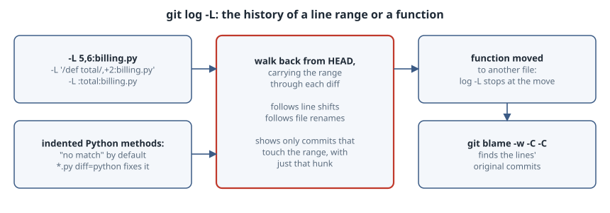

# git log -L: The History of One Function

## Thesis

`git blame` tells you who last touched each line. `git log -- file` lists every commit that touched the file. Often the real question is in between: **how did this function come to look like this?** `git log -L` answers it. You give it a line range or a function name, and it walks history *backwards*, carrying that range through every diff. It lists only the commits that changed those lines, and only the matching hunk of each. It follows lines as they shift and follows file renames.

It has two traps. Function names depend on Git's **funcname** rules, which don't recognise indented Python methods out of the box. And `-L` stops where code moved in from **another file**.

{fig-alt="Left: two ways to name the range in the current file. -L start,end:file, or a regex like /def total/,+2, and -L :funcname:file, which needs a funcname line; in Python, methods are indented so the default rule finds no match until .gitattributes sets diff=python. Middle: Git walks history backwards, carrying the range through each commit's diff: it follows line shifts when code is inserted above, follows file renames such as billing.py from pricing.py, and lists only the commits that changed lines in the range, each with just that part of the diff. Right: the limit. When a function is moved to a different file, log -L stops at the commit that created the new file; git blame -w -C -C on the new file recovers the original commits from pricing.py."}

All output below is from Git 2.47.3.

## A repository with a story

The script builds six commits with fixed dates, so the commit IDs below are reproducible:

1. Add a `Pricing` class.
2. Insert a `TAX` constant above it, which shifts every line down, and cap discounts.
3. Change `total`.
4. Change `apply_discount`.
5. Rename `pricing.py` to `billing.py`.
6. Move `apply_discount` out into `discounts.py`.

```sh
#!/bin/sh
# Build a small repo whose history exercises git log -L. Fixed dates and identity
# make the commit IDs reproducible.
set -e
rm -rf demo && git init -q -b main demo && cd demo
export GIT_AUTHOR_NAME=Ana GIT_AUTHOR_EMAIL=ana@example.com
export GIT_COMMITTER_NAME=Ana GIT_COMMITTER_EMAIL=ana@example.com
n=0
commit() { n=$((n+1)); d="2026-10-0${n}T10:00:00+00:00"
  git add -A
  GIT_AUTHOR_DATE=$d GIT_COMMITTER_DATE=$d git commit -q -m "$1"; }

cat > pricing.py <<'PY'
class Pricing:
    def total(self, items):
        return sum(i.price for i in items)

    def apply_discount(self, amount, pct):
        return amount - amount * pct / 100
PY
commit "add Pricing"

cat > pricing.py <<'PY'
TAX = 0.18


class Pricing:
    def total(self, items):
        return sum(i.price for i in items)

    def apply_discount(self, amount, pct):
        if pct > 50:
            raise ValueError("discount too large")
        return amount - amount * pct / 100
PY
commit "cap discounts at 50%"

sed -i 's/return sum(i.price for i in items)/return sum(i.price * i.qty for i in items)/' pricing.py
commit "total: multiply by quantity"

sed -i 's|return amount - amount \* pct / 100|return round(amount * (1 - pct / 100), 2)|' pricing.py
commit "apply_discount: round to cents"

git mv pricing.py billing.py
commit "rename pricing.py to billing.py"

# Move apply_discount into its own module (a cross-file move).
python3 - <<'PY'
src = open("billing.py").read()
head, sep, fn = src.partition("\n    def apply_discount")
open("billing.py", "w").write(head.rstrip("\n") + "\n")
body = ("def apply_discount" + fn.replace("\n        ", "\n    ")).replace("(self, ", "(")
open("discounts.py", "w").write(body)
PY
commit "move apply_discount to discounts.py"
```

## Asking for a function by name

```sh
#!/bin/sh
cd demo
echo '$ git log --oneline'; git log --oneline
echo
echo '$ git log -L :total:billing.py --format="%h %s"    # no diff driver yet'
git log -L :total:billing.py --format="%h %s" 2>&1
echo
echo '$ echo "*.py diff=python" > .gitattributes'
echo '*.py diff=python' > .gitattributes
echo '$ git log -L :total:billing.py --format="%h %s"'
git log -L :total:billing.py --format="%h %s"
```

```text
$ git log --oneline
926db38 move apply_discount to discounts.py
472e679 rename pricing.py to billing.py
4f47c10 apply_discount: round to cents
2b1702e total: multiply by quantity
8895fe8 cap discounts at 50%
5f8646c add Pricing

$ git log -L :total:billing.py --format="%h %s"    # no diff driver yet
fatal: -L parameter 'total' starting at line 1: no match

$ echo "*.py diff=python" > .gitattributes
$ git log -L :total:billing.py --format="%h %s"
2b1702e total: multiply by quantity

diff --git a/pricing.py b/pricing.py
--- a/pricing.py
+++ b/pricing.py
@@ -5,2 +5,2 @@
     def total(self, items):
-        return sum(i.price for i in items)
+        return sum(i.price * i.qty for i in items)
5f8646c add Pricing

diff --git a/pricing.py b/pricing.py
--- /dev/null
+++ b/pricing.py
@@ -0,0 +2,2 @@
+    def total(self, items):
+        return sum(i.price for i in items)
```

The first attempt fails with `no match`, although `def total` is plainly in the file. `-L :<funcname>:<file>` searches for a line that matches the regex **and** is a "funcname line" according to the file's diff driver. That is the same rule that produces the `@@ ... @@ def foo` context in hunk headers. The default rule only accepts lines that start at column 0 with a letter, `_` or `$`, and Python methods are indented. The [built-in `python` driver](https://git-scm.com/docs/gitattributes#_defining_a_custom_hunk_header) knows about indented `def` and `class`, so a single `.gitattributes` line fixes it. Commit that file in real repositories. Git also has built-in drivers for `cpp`, `java`, `golang`, `rust`, `csharp`, `bash` and others.

Once the driver is set, the result is exactly the right two commits for `total`. Three things are worth noticing:

- **Line shifts are followed.** Commit `8895fe8` inserted three lines above the class, moving `total` from lines 2–3 to 5–6. `-L` maps the range through that diff, and because that commit didn't change `total` itself, it isn't listed.
- **Renames are followed.** We asked about `billing.py`, and the hunks are labelled `pricing.py`, the name at the time. You don't need `--follow`.
- **Only the range's hunk is shown.** Changes elsewhere in the same commits are left out.

## Line numbers and regex ranges

```sh
#!/bin/sh
cd demo
echo '$ git log -L 5,6:billing.py -s --format="%h %ad %s" --date=short'
git log -L 5,6:billing.py -s --format="%h %ad %s" --date=short
echo
echo '$ git log -L "/def total/,+2:billing.py" -s --format="%h %ad %s" --date=short'
git log -L "/def total/,+2:billing.py" -s --format="%h %ad %s" --date=short
echo
echo '$ git log -L :apply_discount:discounts.py --format="%h %s"'
git log -L :apply_discount:discounts.py --format="%h %s"
echo
echo '$ git blame -w -C -C discounts.py'
git blame -w -C -C discounts.py
echo
echo '$ git log -L :apply_discount:billing.py 926db38^ -s --format="%h %s"'
git log -L :apply_discount:billing.py 926db38^ -s --format="%h %s"
```

```text
$ git log -L 5,6:billing.py -s --format="%h %ad %s" --date=short
2b1702e 2026-10-03 total: multiply by quantity
5f8646c 2026-10-01 add Pricing

$ git log -L "/def total/,+2:billing.py" -s --format="%h %ad %s" --date=short
2b1702e 2026-10-03 total: multiply by quantity
5f8646c 2026-10-01 add Pricing

$ git log -L :apply_discount:discounts.py --format="%h %s"
926db38 move apply_discount to discounts.py

diff --git a/discounts.py b/discounts.py
--- /dev/null
+++ b/discounts.py
@@ -0,0 +1,4 @@
+def apply_discount(amount, pct):
+    if pct > 50:
+        raise ValueError("discount too large")
+    return round(amount * (1 - pct / 100), 2)

$ git blame -w -C -C discounts.py
926db38f discounts.py (Ana 2026-10-06 10:00:00 +0000 1) def apply_discount(amount, pct):
8895fe8e pricing.py   (Ana 2026-10-02 10:00:00 +0000 2)     if pct > 50:
8895fe8e pricing.py   (Ana 2026-10-02 10:00:00 +0000 3)         raise ValueError("discount too large")
4f47c101 pricing.py   (Ana 2026-10-04 10:00:00 +0000 4)     return round(amount * (1 - pct / 100), 2)

$ git log -L :apply_discount:billing.py 926db38^ -s --format="%h %s"
4f47c10 apply_discount: round to cents
8895fe8 cap discounts at 50%
5f8646c add Pricing
```

- `-L 5,6:billing.py` and `-L '/def total/,+2:billing.py'` name the same lines and produce the same history. The regex form keeps working after the file changes. `-s` (`--no-patch`) turns the output into a quick timeline.
- **The limit:** asking about `apply_discount` in `discounts.py` gives a single commit, the move, shown as the creation of a new file. Commits `8895fe8` (the 50% cap) and `4f47c10` (rounding) are missing. `-L` follows renames of *whole files* but doesn't detect a block of lines that came from a different file. `git blame -w -C -C` does detect it ([`git-blame -C`](https://git-scm.com/docs/git-blame): "detect lines moved or copied from other files that were modified in the same commit"). It attributes lines 2–4 to their original commits in `pricing.py`, and `-w` ignores the re-indentation. To continue the history, run `-L` again on the old file, starting at the parent of the move (`926db38^`). The last command above does this and recovers the earlier three commits.

## Rules worth knowing

From the [`git log -L` documentation](https://git-scm.com/docs/git-log#Documentation/git-log.txt--Lfuncnamefile):

- The start, end or funcname must exist in the **starting revision**, which is `HEAD` unless you give one.
- You can't add pathspec limiters, and you can give at most one positive revision. `-L` walks from a single starting point.
- `-L` can be given more than once, to trace several ranges or functions together.
- `-L` implies `--patch`. Use `-s`/`--no-patch` for just the commit list.
- A `:funcname` range runs from the matching line to the next funcname line. If the driver is wrong, the range is wrong too: it either matches nothing, as above, or swallows the following functions.

## Takeaways

- `git log -L :fn:file` is the answer to "how did this function evolve?" It follows line shifts and file renames and shows only the relevant hunks.
- Set a diff driver (`*.py diff=python`, `*.go diff=golang`, …) in `.gitattributes`, or `:funcname` may fail with "no match".
- `-L` doesn't cross a move between files. Use `git blame -w -C -C` to find where the lines came from, then restart `-L` on the old path before the move.

## Sources

- Git documentation: [`git log -L`](https://git-scm.com/docs/git-log#Documentation/git-log.txt--Lfuncnamefile), [`gitattributes`: defining a custom hunk-header](https://git-scm.com/docs/gitattributes#_defining_a_custom_hunk_header), [`git blame -C`](https://git-scm.com/docs/git-blame)
