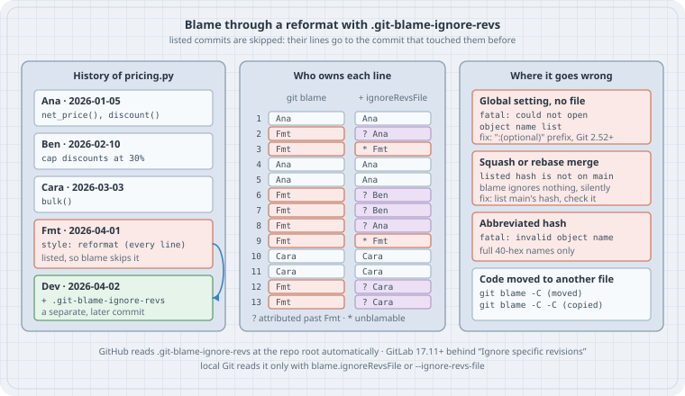

# Blame through reformats: `.git-blame-ignore-revs`

After this page you can run a mass reformat (a new formatter, a re-indent, a quote-style change) without making `git blame` useless for the code it touched. You can tell `git blame` to look *through* that commit, mark the lines where it had to guess, and share that setting with the whole team through one committed file that GitHub and GitLab read too. You will also know the four ways this setup breaks: a global setting that makes blame fatal in every other repository, a squash merge that quietly changes the hash you listed, an abbreviated hash, and code that moved to another file.

## Thesis

`git blame` gives each line to the **last commit that changed it**. A formatter changes nearly every line, so after a reformat, blame names the formatter, and the question you wanted answered ("who wrote this check, and why?") is one `git log` hop further away, for every line, forever.

`-w` (ignore whitespace) only helps when the formatter changed nothing but whitespace. Formatters usually change more: quotes, trailing commas, wrapped calls.

Git 2.23 (2019) added the real fix. `git blame --ignore-rev <commit>` assigns blame **"as if the change never happened"**: lines that commit changed go to the commit that touched them before. `--ignore-revs-file <file>`, and the config key `blame.ignoreRevsFile`, read a list of such commits from a file. By convention that file is `.git-blame-ignore-revs` at the repository root, and the forges read it under that name. Newer releases filled in the edges:

- 2.50 made `--porcelain` report the `ignored` and `unblamable` lines.
- 2.52 added the `:(optional)` prefix for path-valued settings, so a global `blame.ignoreRevsFile` stops being fatal in repositories that don't have the file.
- 2.56 (2026-09-28, current) aligns the hash column only when marks are shown.

What it doesn't do: it never changes history. The reformat commit is still there for `git log` and `git show`. Ignoring is a view setting for blame, and without the setting you get the plain view back.

## Mental model

{fig-alt="Left: the history of pricing.py. Ana wrote net_price and discount, Ben capped discounts at 30 percent, Cara added bulk, a formatter commit rewrote every line, and a later commit listed the formatter commit in .git-blame-ignore-revs. Middle: who owns each of the 13 lines. Plain git blame gives 8 lines to the formatter. With blame.ignoreRevsFile the formatter keeps only the 2 blank lines it added, marked unblamable with a star, and the other lines go back to Ana, Ben and Cara, marked with a question mark where blame looked past the formatter. Right: where it goes wrong. A global setting in a repo without the file is fatal unless the value uses the optional prefix from Git 2.52. A squash or rebase merge changes the hash, so the listed hash is not on main and blame silently ignores nothing. An abbreviated hash is fatal. Code moved to another file needs blame -C, or -C -C for copies. Footer: GitHub reads the file automatically, GitLab 17.11 and later behind a blame preference, and local Git only with blame.ignoreRevsFile or --ignore-revs-file."}

```text
git blame pricing.py
  for each line: walk back to the last commit that changed it
    commit in the ignore list?  → pretend its diff didn't happen; keep walking
                                  (Git matches the line to the parent's lines nearby;
                                   blame.markIgnoredLines marks it "?")
    the commit only *added* the line (nothing to match)? → it stays on the ignored commit
                                  (blame.markUnblamableLines marks it "*")
  ignore list = blame.ignoreRevsFile files (config order), then --ignore-revs-file, then --ignore-rev
```

| Knob | What it does | Since |
|------|--------------|-------|
| `git blame --ignore-rev <rev>` | Ignore one commit. Repeatable. An unknown revision is fatal | 2.23 |
| `git blame --ignore-revs-file <file>` | Ignore the commits listed in a file. Repeatable; `""` clears every list read so far, config files included | 2.23 |
| `blame.ignoreRevsFile` | The same file, from config. Repeatable; an empty value resets. A relative path is taken from the top of the work tree | 2.23 |
| `:(optional)<path>` value | The setting is treated as absent if the file doesn't exist | 2.52 |
| `blame.markIgnoredLines` | Prefix `?` on lines blame passed past an ignored commit | 2.23 |
| `blame.markUnblamableLines` | Prefix `*` on lines an ignored commit added that blame couldn't hand back. (The 2.23 manual spelled it `blame.markUnblamables`; the code has always read `markUnblamableLines`) | 2.23 |
| `--porcelain` / `--line-porcelain` | An `ignored` or `unblamable` line in the entry's header | 2.50 |

File format (from `git-config(1)`, `blame.ignoreRevsFile`): one **unabbreviated** object name per line; whitespace and `#` comments are ignored. It is the same format as `fsck.skipList`. The parser (`oidset_parse_file_carefully()` in `oidset.c`) fails on anything that isn't a full hash, and the blame code silently skips any hash that isn't a commit it can find. Case 5 shows both.

## Worked examples (Cases)

Run on Debian 13 (Linux 6.12) with **Git 2.56.0**, the current release (2026-09-28), built from the release tarball in user space. The box's distribution Git is 2.47.3, and Case 4 uses it on purpose. Every listing below was run, and every output block is pasted from the run. Commit hashes are reproducible because names and dates are fixed.

Source this file first. It points "global" config at a throwaway file and fixes names and dates per commit:

```bash
# env.sh — source this so your hashes match the transcripts (needs git 2.52+)
export GIT_CONFIG_GLOBAL=/tmp/blamelab/global.gitconfig GIT_CONFIG_NOSYSTEM=1
export GIT_CONFIG_COUNT=1 GIT_CONFIG_KEY_0=init.defaultBranch GIT_CONFIG_VALUE_0=main
# commit as <name> on <date>: as Ana 2026-01-05 commit -m "..."
as() { local who=$1 day=$2; shift 2
  GIT_AUTHOR_NAME=$who GIT_AUTHOR_EMAIL=$(echo "$who" | tr A-Z a-z)@example.com \
  GIT_COMMITTER_NAME=$who GIT_COMMITTER_EMAIL=$(echo "$who" | tr A-Z a-z)@example.com \
  GIT_AUTHOR_DATE="${day}T09:00:00Z" GIT_COMMITTER_DATE="${day}T09:00:00Z" git "$@"; }
```

Run the cases in order; they share `/tmp/blamelab`.

### Case 1: A reformat takes over blame

Three people write `pricing.py`, then a formatter re-indents it from two spaces to four, switches to double quotes, and puts two blank lines between functions.

```bash
#!/usr/bin/env bash
# lab-01-history.sh — three people write pricing.py, then a formatter rewrites every line
set -e; . ./env.sh
rm -rf /tmp/blamelab && mkdir -p /tmp/blamelab && cd /tmp/blamelab && : > global.gitconfig
git init -q desk && cd desk

cat > pricing.py <<'PY'
def net_price(gross, vat):
  return round(gross / (1 + vat), 2)

def discount(price, pct):
  if pct > 50:
    raise ValueError('discount too large')
  return price * (1 - pct / 100)
PY
git add pricing.py && as Ana 2026-01-05 commit -qm "pricing: net price and discount"

sed -i "s/pct > 50/pct > 30/; s/'discount too large'/'discount over 30% needs approval'/" pricing.py
git add pricing.py && as Ben 2026-02-10 commit -qm "pricing: cap discounts at 30%"

cat >> pricing.py <<'PY'

def bulk(prices, pct):
  total = sum(discount(p, pct) for p in prices)
  return round(total, 2)
PY
git add pricing.py && as Cara 2026-03-03 commit -qm "pricing: bulk discount total"

# the formatter: 4-space indent, double quotes, two blank lines between functions
python3 - <<'PY'
import re
src = open("pricing.py").read().splitlines()
out = []
for line in src:
    if line.startswith("def ") and out:
        while out and out[-1] == "": out.pop()
        out += ["", ""]
    m = re.match(r"( *)(.*)", line)
    line = " " * (len(m.group(1)) * 2) + m.group(2)
    out.append(line.replace("'", '"'))
open("pricing.py", "w").write("\n".join(out) + "\n")
PY
git add pricing.py && as Fmt 2026-04-01 commit -qm "style: reformat (4-space indent, double quotes)"

git log --format='%h %an %ad %s' --date=short
echo "--- git blame pricing.py"
git blame --date=short pricing.py
echo "--- git blame -w pricing.py"
git blame -w --date=short pricing.py
```

```text
f2170a2 Fmt 2026-04-01 style: reformat (4-space indent, double quotes)
fcd481d Cara 2026-03-03 pricing: bulk discount total
e226a2a Ben 2026-02-10 pricing: cap discounts at 30%
97c900f Ana 2026-01-05 pricing: net price and discount
--- git blame pricing.py
^97c900f (Ana  2026-01-05  1) def net_price(gross, vat):
f2170a20 (Fmt  2026-04-01  2)     return round(gross / (1 + vat), 2)
f2170a20 (Fmt  2026-04-01  3) 
^97c900f (Ana  2026-01-05  4) 
^97c900f (Ana  2026-01-05  5) def discount(price, pct):
f2170a20 (Fmt  2026-04-01  6)     if pct > 30:
f2170a20 (Fmt  2026-04-01  7)         raise ValueError("discount over 30% needs approval")
f2170a20 (Fmt  2026-04-01  8)     return price * (1 - pct / 100)
f2170a20 (Fmt  2026-04-01  9) 
fcd481d1 (Cara 2026-03-03 10) 
fcd481d1 (Cara 2026-03-03 11) def bulk(prices, pct):
f2170a20 (Fmt  2026-04-01 12)     total = sum(discount(p, pct) for p in prices)
f2170a20 (Fmt  2026-04-01 13)     return round(total, 2)
--- git blame -w pricing.py
^97c900f (Ana  2026-01-05  1) def net_price(gross, vat):
^97c900f (Ana  2026-01-05  2)     return round(gross / (1 + vat), 2)
^97c900f (Ana  2026-01-05  3) 
f2170a20 (Fmt  2026-04-01  4) 
^97c900f (Ana  2026-01-05  5) def discount(price, pct):
e226a2a6 (Ben  2026-02-10  6)     if pct > 30:
f2170a20 (Fmt  2026-04-01  7)         raise ValueError("discount over 30% needs approval")
^97c900f (Ana  2026-01-05  8)     return price * (1 - pct / 100)
fcd481d1 (Cara 2026-03-03  9) 
f2170a20 (Fmt  2026-04-01 10) 
fcd481d1 (Cara 2026-03-03 11) def bulk(prices, pct):
fcd481d1 (Cara 2026-03-03 12)     total = sum(discount(p, pct) for p in prices)
fcd481d1 (Cara 2026-03-03 13)     return round(total, 2)
```

Plain blame gives 8 of 13 lines to `Fmt`. `-w` gets the indentation-only lines back (Ben's `if pct > 30:`, Cara's `bulk()` body). It can't help line 7: the quotes changed, so to `-w` it's a real change, and Ben's error message still belongs to the formatter. Most real formatters change more than whitespace.

### Case 2: `--ignore-rev`, and the marks that show the guesses

```bash
#!/usr/bin/env bash
# lab-02-ignore-rev.sh — blame "as if the reformat never happened", and mark what that guessed
set -e; . ./env.sh; cd /tmp/blamelab/desk
fmt=$(git rev-parse HEAD)          # the "style: reformat" commit
echo "--- git blame --ignore-rev $fmt"
git blame --date=short --ignore-rev "$fmt" pricing.py
echo "--- the same, with blame.markIgnoredLines and blame.markUnblamableLines"
git -c blame.markIgnoredLines=true -c blame.markUnblamableLines=true \
    blame --date=short --ignore-rev "$fmt" pricing.py
echo "--- porcelain: one 'ignored' or 'unblamable' line per affected entry"
git -c blame.markIgnoredLines=true -c blame.markUnblamableLines=true \
    blame --line-porcelain --ignore-rev "$fmt" pricing.py |
  awk '/^[0-9a-f]{40} /{n=$3} /^author /{a=$2} /^(ignored|unblamable)$/{m=$1}
       /^\t/{printf "%2d %-5s %s\n", n, a, m; m=""}'
```

```text
--- git blame --ignore-rev f2170a20db04e64e3d4d950c496f0ded431cba9a
^97c900f (Ana  2026-01-05  1) def net_price(gross, vat):
^97c900f (Ana  2026-01-05  2)     return round(gross / (1 + vat), 2)
f2170a20 (Fmt  2026-04-01  3) 
^97c900f (Ana  2026-01-05  4) 
^97c900f (Ana  2026-01-05  5) def discount(price, pct):
e226a2a6 (Ben  2026-02-10  6)     if pct > 30:
e226a2a6 (Ben  2026-02-10  7)         raise ValueError("discount over 30% needs approval")
^97c900f (Ana  2026-01-05  8)     return price * (1 - pct / 100)
f2170a20 (Fmt  2026-04-01  9) 
fcd481d1 (Cara 2026-03-03 10) 
fcd481d1 (Cara 2026-03-03 11) def bulk(prices, pct):
fcd481d1 (Cara 2026-03-03 12)     total = sum(discount(p, pct) for p in prices)
fcd481d1 (Cara 2026-03-03 13)     return round(total, 2)
--- the same, with blame.markIgnoredLines and blame.markUnblamableLines
^97c900fc (Ana  2026-01-05  1) def net_price(gross, vat):
^?97c900f (Ana  2026-01-05  2)     return round(gross / (1 + vat), 2)
*f2170a20 (Fmt  2026-04-01  3) 
^97c900fc (Ana  2026-01-05  4) 
^97c900fc (Ana  2026-01-05  5) def discount(price, pct):
?e226a2a6 (Ben  2026-02-10  6)     if pct > 30:
?e226a2a6 (Ben  2026-02-10  7)         raise ValueError("discount over 30% needs approval")
^?97c900f (Ana  2026-01-05  8)     return price * (1 - pct / 100)
*f2170a20 (Fmt  2026-04-01  9) 
fcd481d10 (Cara 2026-03-03 10) 
fcd481d10 (Cara 2026-03-03 11) def bulk(prices, pct):
?fcd481d1 (Cara 2026-03-03 12)     total = sum(discount(p, pct) for p in prices)
?fcd481d1 (Cara 2026-03-03 13)     return round(total, 2)
--- porcelain: one 'ignored' or 'unblamable' line per affected entry
 1 Ana   
 2 Ana   ignored
 3 Fmt   unblamable
 4 Ana   
 5 Ana   
 6 Ben   ignored
 7 Ben   ignored
 8 Ana   ignored
 9 Fmt   unblamable
10 Cara  
11 Cara  
12 Cara  ignored
13 Cara  ignored
```

Every line of real code is back with the person who wrote it. Line 7 is Ben's again, and line 8 is Ana's, because Ben never touched it. The marks say how sure blame is:

- **`?`** means the ignored commit changed this line, and blame matched it to a line in the parent. Here every match is right. In general it's a heuristic: a line the formatter rewrote beyond recognition can be matched to the wrong neighbour.
- **`*`** means the ignored commit *added* this line, and there was nothing to match it to. These are the formatter's extra blank lines (3 and 9). They stay on `Fmt`, which is the honest answer.

The default, unmarked output is shorter but hides which lines are guesses. Turn the marks on in any repository that ignores commits. The porcelain format (used by editors and scripts) has carried the same information since 2.50.

Notice the hash column. Here a line can carry two marks (`^` for the boundary commit, plus `?`), so Git widens the column to 9 characters and extends unmarked hashes to match. Git 2.56 reserves room for marks only when the output actually shows them. Case 3's `-L6,7` listing has no marks and prints plain 7-character hashes, while Git 2.47.3 prints 8 (`e226a2a6`) for the same two lines.

### Case 3: Share it: `.git-blame-ignore-revs` and `blame.ignoreRevsFile`

Passing `--ignore-rev` by hand doesn't scale. The convention is to commit a file at the root listing the mechanical commits, and have each clone opt in once.

```bash
#!/usr/bin/env bash
# lab-03-ignore-file.sh — commit .git-blame-ignore-revs, opt in once with blame.ignoreRevsFile
set -e; . ./env.sh; cd /tmp/blamelab/desk
fmt=$(git log -1 --format=%H --grep='^style: reformat')
cat > .git-blame-ignore-revs <<IGN
# .git-blame-ignore-revs — mechanical commits that blame should look through.
# Full 40-hex hashes only; add one line per commit, with a comment saying what it was.

# style: reformat (4-space indent, double quotes), 2026-04-01
$fmt
IGN
mkdir -p docs && echo "# Pricing rules" > docs/pricing.md
git add .git-blame-ignore-revs docs && as Dev 2026-04-02 commit -qm "blame: ignore the reformat commit"

who() { git blame --line-porcelain "$@" | sed -n 's/^author //p' | sort | uniq -c; }
echo "--- who owns pricing.py, before opting in"
who pricing.py
git config blame.ignoreRevsFile .git-blame-ignore-revs
echo "--- after: git config blame.ignoreRevsFile .git-blame-ignore-revs"
who pricing.py
echo "--- the relative path is read from the top of the work tree, so a subdirectory works too"
(cd docs && git blame --date=short -L6,7 ../pricing.py)
echo "--- one-off: see the formatter again"
git blame --date=short --ignore-revs-file="" -L6,7 pricing.py
```

```text
--- who owns pricing.py, before opting in
      3 Ana
      2 Cara
      8 Fmt
--- after: git config blame.ignoreRevsFile .git-blame-ignore-revs
      5 Ana
      2 Ben
      4 Cara
      2 Fmt
--- the relative path is read from the top of the work tree, so a subdirectory works too
e226a2a (Ben 2026-02-10 6)     if pct > 30:
e226a2a (Ben 2026-02-10 7)         raise ValueError("discount over 30% needs approval")
--- one-off: see the formatter again
f2170a2 (Fmt 2026-04-01 6)     if pct > 30:
f2170a2 (Fmt 2026-04-01 7)         raise ValueError("discount over 30% needs approval")
```

Three details that matter in practice:

- **The file is added in a later commit.** A commit can't contain its own hash, so the reformat lands first and its hash is added afterwards. Nothing breaks in between; blame just isn't fixed yet.
- **The relative path works from anywhere in the work tree.** `git blame` runs from the top of the work tree, so `.git-blame-ignore-revs` is found from `docs/` too.
- **`--ignore-revs-file=""` clears the list for one run.** That's how to answer "what did the formatter actually change?", which `git show <fmt>` answers better anyway.

The opt-in is per clone: `blame.ignoreRevsFile` lives in `.git/config`, which isn't cloned. GitHub's blame view reads `.git-blame-ignore-revs` at the root of the repository automatically and shows an "Ignoring revisions in .git-blame-ignore-revs" banner. GitLab reads the same file since 17.11, behind the **Ignore specific revisions** blame preference. Local Git reads it only when told to.

### Case 4: Put it in global config, and blame breaks everywhere else

The obvious shortcut is to set it once in `~/.gitconfig` for every repository. Done plainly, that makes blame fatal in every repository that doesn't have the file.

```bash
#!/usr/bin/env bash
# lab-04-global-trap.sh — a global blame.ignoreRevsFile breaks blame in repos without the file
. ./env.sh; cd /tmp/blamelab
git -C desk config --unset blame.ignoreRevsFile
git init -q other && echo hello > other/README && git -C other add README &&
  as Eve 2026-05-01 -C other commit -qm "readme"

git config --global blame.ignoreRevsFile .git-blame-ignore-revs
echo "--- global setting, repo without the file"
git -C other blame README; echo "exit=$?"

git config --global blame.ignoreRevsFile ':(optional).git-blame-ignore-revs'
echo "--- global ':(optional)' setting (Git 2.52+)"
git -C other blame README; echo "exit=$?"
git -C desk blame --date=short -L6,6 pricing.py; echo "exit=$?"

echo "--- the same global file read by an older Git"
/usr/bin/git --version
/usr/bin/git -C desk blame --date=short -L6,6 pricing.py; echo "exit=$?"
```

```text
--- global setting, repo without the file
fatal: could not open object name list: .git-blame-ignore-revs
exit=128
--- global ':(optional)' setting (Git 2.52+)
^a81f622 (Eve 2026-05-01 09:00:00 +0000 1) hello
exit=0
e226a2a (Ben 2026-02-10 6)     if pct > 30:
exit=0
--- the same global file read by an older Git
git version 2.47.3
fatal: could not open object name list: :(optional).git-blame-ignore-revs
exit=128
```

`blame.ignoreRevsFile` names a file that **must exist**: `oidset_parse_file_carefully()` dies if it can't open it. Git 2.52 added the generic `:(optional)` prefix for path-valued settings ("treated as if it does not exist, if the named path does not exist", `git-config(1)`). With it, one global line works in every repository: the repositories that ship the file get it, and the rest are untouched.

The catch is older Git. 2.47.3 doesn't know the prefix, reads `:(optional).git-blame-ignore-revs` as a literal file name, and dies in **every** repository, including the ones that have the file. If your team has Git older than 2.52 anywhere, including CI images and editor plugins that ship their own Git, keep the setting per repository (`git config blame.ignoreRevsFile .git-blame-ignore-revs` in each clone), or in a conditional include that only matches repositories you know have the file.

### Case 5: The squash merge that ignored nothing

The commonest silent failure. A contributor wraps long lines on a branch, adds the branch commit's hash to the ignore file in the same pull request, and a maintainer **squash-merges** it.

```bash
#!/bin/sh
# check-ignore-revs — every hash in .git-blame-ignore-revs must be a commit in HEAD's history
f=${1:-.git-blame-ignore-revs}; bad=0
for rev in $(sed 's/#.*//' "$f"); do
  if ! git cat-file -e "$rev^{commit}" 2>/dev/null; then
    echo "missing:     $rev"; bad=1
  elif ! git merge-base --is-ancestor "$rev" HEAD; then
    echo "not on HEAD: $rev $(git log -1 --format=%s "$rev")"; bad=1
  fi
done
exit $bad
```

```bash
#!/usr/bin/env bash
# lab-05-squash-trap.sh — a squash merge rewrites the hash you listed; blame says nothing
. ./env.sh; CHECK=$PWD/check-ignore-revs; cd /tmp/blamelab/desk
git config blame.ignoreRevsFile .git-blame-ignore-revs

git switch -qc wrap-lines
python3 - <<'PY'
p = "pricing.py"; s = open(p).read()
s = s.replace('        raise ValueError("discount over 30% needs approval")\n',
              '        raise ValueError(\n            "discount over 30% needs approval"\n        )\n')
open(p, "w").write(s)
PY
git add pricing.py && as Fmt 2026-05-04 commit -qm "style: wrap long lines"
printf '\n# style: wrap long lines, 2026-05-04\n%s\n' "$(git rev-parse HEAD)" >> .git-blame-ignore-revs
git add .git-blame-ignore-revs && as Fmt 2026-05-04 commit -qm "blame: ignore the wrap commit"

git switch -q main && git merge -q --squash wrap-lines &&
  as Maya 2026-05-05 commit -qm "style: wrap long lines (#42)"
git log --oneline --graph --all | head -5
echo "--- blame on main: the squash commit owns the wrapped lines, and nothing warns"
git blame --date=short -L6,9 pricing.py; echo "exit=$?"
echo "--- check-ignore-revs"
$CHECK; echo "exit=$?"
echo "--- after the branch is deleted and gc runs, the object is gone too"
git branch -qD wrap-lines && git reflog expire --expire=now --all && git gc -q --prune=now
$CHECK; echo "exit=$?"
git blame --date=short -L6,9 pricing.py; echo "blame exit=$?"
echo "--- fix: list the commit that is on main, in a follow-up commit"
sq=$(git log -1 --format=%H --grep='(#42)')
sed -i '$d' .git-blame-ignore-revs && echo "$sq" >> .git-blame-ignore-revs
git add .git-blame-ignore-revs && as Maya 2026-05-05 commit -qm "blame: ignore #42 (squash commit)"
$CHECK; echo "exit=$?"
git blame --date=short -L6,9 pricing.py
echo "--- and an abbreviated hash is not 'ignored', it is fatal"
echo "${sq:0:12}" >> .git-blame-ignore-revs
git blame -L6,6 pricing.py; echo "exit=$?"
git checkout -q .git-blame-ignore-revs
```

```text
Squash commit -- not updating HEAD
* 79b0ee8 style: wrap long lines (#42)
| * a778d40 blame: ignore the wrap commit
| * da6a82d style: wrap long lines
|/  
* 0660c5c blame: ignore the reformat commit
--- blame on main: the squash commit owns the wrapped lines, and nothing warns
e226a2a (Ben  2026-02-10 6)     if pct > 30:
79b0ee8 (Maya 2026-05-05 7)         raise ValueError(
79b0ee8 (Maya 2026-05-05 8)             "discount over 30% needs approval"
79b0ee8 (Maya 2026-05-05 9)         )
exit=0
--- check-ignore-revs
not on HEAD: da6a82d797fdb060cbf9ba1f6d1b9a11a1245d8a style: wrap long lines
exit=1
--- after the branch is deleted and gc runs, the object is gone too
missing:     da6a82d797fdb060cbf9ba1f6d1b9a11a1245d8a
exit=1
e226a2a (Ben  2026-02-10 6)     if pct > 30:
79b0ee8 (Maya 2026-05-05 7)         raise ValueError(
79b0ee8 (Maya 2026-05-05 8)             "discount over 30% needs approval"
79b0ee8 (Maya 2026-05-05 9)         )
blame exit=0
--- fix: list the commit that is on main, in a follow-up commit
exit=0
e226a2a (Ben 2026-02-10 6)     if pct > 30:
e226a2a (Ben 2026-02-10 7)         raise ValueError(
e226a2a (Ben 2026-02-10 8)             "discount over 30% needs approval"
e226a2a (Ben 2026-02-10 9)         )
--- and an abbreviated hash is not 'ignored', it is fatal
fatal: invalid object name: 79b0ee856adc
exit=128
```

The listed hash `da6a82d` is a real commit, but not one in `main`'s history. The squash created `79b0ee8` instead, so blame on `main` had nothing to ignore. It said nothing about it: blame skips listed hashes it can't resolve to a commit, and a commit that isn't in the file's history is never reached. After the branch was deleted and garbage-collected, the hash didn't exist at all, and blame still said nothing. Only the check script noticed.

The same happens with rebase-and-merge (the forge re-creates the commits) and with any later history rewrite (filter-repo, a rebase of `main`). A merge commit is the only merge style that keeps the hash. The fix works with any merge style: **list the hash that is on the default branch, in a follow-up commit**, and run a check like `check-ignore-revs` in CI so an entry that doesn't exist or isn't on the default branch fails the build.

The opposite mistake is loud: a short hash is not "close enough", it's `fatal: invalid object name`. The file wants full names: 40 hex digits, or 64 in a SHA-256 repository.

### Case 6: Code that moved to another file

Ignoring a commit doesn't help when the code **moved**. Splitting a module creates new lines in the new file, and plain blame credits the person who moved them. That's a different problem, with a different flag.

```bash
#!/usr/bin/env bash
# lab-06-moved-code.sh — moved and copied code: -C follows it into the new file
. ./env.sh; cd /tmp/blamelab/desk
python3 - <<'PY'
s = open("pricing.py").read()
head, sep, bulk = s.partition("\n\ndef bulk(")
open("pricing.py", "w").write(head.rstrip("\n") + "\n")
open("bulk.py", "w").write("from pricing import discount\n\n\ndef bulk(" + bulk)
PY
git add pricing.py bulk.py && as Dev 2026-06-01 commit -qm "split bulk pricing into bulk.py"
sed -n '/^def net_price/,/^$/p' pricing.py | sed '/^$/d' > tax.py
git add tax.py && as Dev 2026-06-02 commit -qm "tax: start from a copy of net_price"

echo "--- bulk.py: plain blame, then -C (moved from a file changed in the same commit)"
git blame --date=short bulk.py | tail -3
echo "-- -C"
git blame --date=short -C bulk.py | tail -3
echo "--- tax.py: copied from a file the commit did not touch, so it needs -C -C"
git blame --date=short -C tax.py
echo "-- -C -C"
git blame --date=short -C -C tax.py
echo "--- the same -C -C without the ignore file (the repo's blame.ignoreRevsFile cleared)"
git blame --date=short -C -C --ignore-revs-file="" tax.py
```

```text
--- bulk.py: plain blame, then -C (moved from a file changed in the same commit)
a7ef20e (Dev 2026-06-01 4) def bulk(prices, pct):
a7ef20e (Dev 2026-06-01 5)     total = sum(discount(p, pct) for p in prices)
a7ef20e (Dev 2026-06-01 6)     return round(total, 2)
-- -C
fcd481d pricing.py (Cara 2026-03-03 4) def bulk(prices, pct):
fcd481d pricing.py (Cara 2026-03-03 5)     total = sum(discount(p, pct) for p in prices)
fcd481d pricing.py (Cara 2026-03-03 6)     return round(total, 2)
--- tax.py: copied from a file the commit did not touch, so it needs -C -C
256a406 (Dev 2026-06-02 1) def net_price(gross, vat):
256a406 (Dev 2026-06-02 2)     return round(gross / (1 + vat), 2)
-- -C -C
^97c900f pricing.py (Ana 2026-01-05 1) def net_price(gross, vat):
^97c900f pricing.py (Ana 2026-01-05 2)     return round(gross / (1 + vat), 2)
--- the same -C -C without the ignore file (the repo's blame.ignoreRevsFile cleared)
^97c900f pricing.py (Ana 2026-01-05 1) def net_price(gross, vat):
f2170a20 pricing.py (Fmt 2026-04-01 2)     return round(gross / (1 + vat), 2)
```

- **`-C`** looks for lines moved or copied from other files changed **in the same commit**. Moving `bulk()` out of `pricing.py` changed both files, so one `-C` finds Cara.
- **`-C -C`** also looks in other files when the commit **creates** the file, even if that commit didn't touch them. `tax.py` was a copy from an untouched `pricing.py`, so it needs two. (`-C -C -C` searches every commit, and gets slow on large histories.)
- **`-M`** does the same within one file, for blocks that moved up or down.
- Both have thresholds: at least 20 alphanumeric characters for `-M` and 40 for `-C` before blame believes a block moved. Tiny moves stay with the mover.

The last listing shows the two features combine. `-C -C` finds Ana's line in `pricing.py`, but without the ignore file, line 2 then stops at the reformat that touched it there. With both, it goes all the way back.

## The trap

Treating the ignore file as "set and forget". It fails silently in the direction that matters:

- a hash that a squash or rebase rewrote, or that a history rewrite removed, ignores nothing and warns about nothing;
- an engineer whose clone never set `blame.ignoreRevsFile` sees the formatter on every line and assumes the file is broken;
- a heuristic `?` line can be matched to the wrong author.

And it fails loudly in the direction you notice least, until someone hits it: a global setting without `:(optional)` (or with it, on old Git) makes blame fatal.

## The boring rule

Make every mechanical change its **own commit**, with no logic changes. Merge it so its hash survives, or list the hash that actually landed on the default branch, in a follow-up commit with a `#` comment saying what it was. Turn on `blame.markIgnoredLines` and `blame.markUnblamableLines`. Check the file in CI. Set `blame.ignoreRevsFile` per repository, or globally with `:(optional)` only once every Git in use is 2.52 or newer. When code moves between files, reach for `-C` rather than the ignore file.

## Try this

1. In Case 2's repository, re-run `git blame --ignore-rev` without the marks and pick out the guessed lines from the plain output. (You can't. That's the argument for turning the marks on.)
2. Change the Case 1 formatter so it also renames `pct` to `percent`. Which lines does `--ignore-rev` now hand back, and which ones does `?` mark? Is every guess right?
3. Turn `check-ignore-revs` into a `pre-push` hook or a CI step that fails when an entry isn't an ancestor of the default branch. What should it do for a shallow CI clone, where old commits are missing?
4. Run Case 6's `tax.py` with `-C -C -C`, and time `-C`, `-C -C` and `-C -C -C` on a large repository you have locally. Where does the cost go?
5. Put `blame.ignoreRevsFile` in an `[includeIf "gitdir:~/src/work/"]` file instead of the global config. Which repositories get it, and what happens in one of them that doesn't have the file?

## Next

- [git blame](04-blame-and-annotate.qmd) for `-L` ranges and line ownership in general.
- [Pickaxe and --follow](05-pickaxe-and-follow.qmd) for the other half of the hunt: `git log -S` finds when a string appeared, even after blame has moved on.

## Verification

- **Run here:** every listing, with Git **2.56.0** (current, released 2026-09-28) built in user space from the release tarball, on Debian 13, Linux 6.12. Case 4 also runs the distribution's Git 2.47.3. All six cases were re-run from scratch twice, with identical output, hashes included.
- **Checked in the Git 2.56.0 sources:**
  - `builtin/blame.c` (`build_ignorelist()`, `peel_to_commit_oid()`: unknown or non-commit names in the file are skipped; `--ignore-rev` with an unknown revision is fatal)
  - `oidset.c` (`oidset_parse_file_carefully()`: a missing file and a non-full hash are fatal)
  - `config.c` (`git_config_pathname()` and `:(optional)`)
  - release notes 2.23.0, 2.50.0, 2.52.0 and 2.56.0 for the version attributions
- **Not run:** the GitHub and GitLab blame views. Their behaviour is from the forge documentation below.

## Sources

- Git — [`git-blame(1)`](https://git-scm.com/docs/git-blame): `--ignore-rev`, `--ignore-revs-file`, `-M`, `-C`, `--porcelain`
- Git — [`git-config(1)`](https://git-scm.com/docs/git-config): `blame.ignoreRevsFile`, `blame.markIgnoredLines`, `blame.markUnblamableLines`, and the `:(optional)` prefix for pathname values
- Git release notes — [2.23.0](https://github.com/git/git/blob/master/Documentation/RelNotes/2.23.0.adoc), [2.50.0](https://github.com/git/git/blob/master/Documentation/RelNotes/2.50.0.adoc), [2.52.0](https://github.com/git/git/blob/master/Documentation/RelNotes/2.52.0.adoc), [2.56.0](https://github.com/git/git/blob/master/Documentation/RelNotes/2.56.0.adoc)
- Git source — [`builtin/blame.c`](https://github.com/git/git/blob/master/builtin/blame.c), [`oidset.c`](https://github.com/git/git/blob/master/oidset.c), [`config.c`](https://github.com/git/git/blob/master/config.c)
- GitHub Docs — [Viewing and understanding files: Ignore commits in the blame view](https://docs.github.com/en/repositories/working-with-files/using-files/viewing-and-understanding-files#ignore-commits-in-the-blame-view)
- GitLab Docs — [Git file blame: Ignore specific revisions](https://docs.gitlab.com/user/project/repository/files/git_blame/#ignore-specific-revisions)
