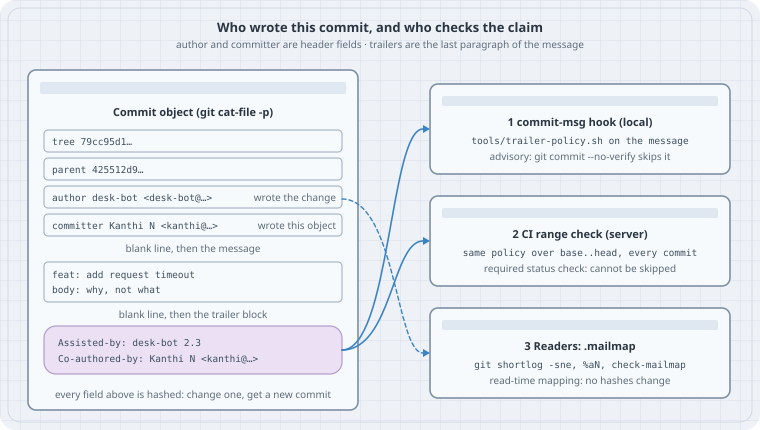

# Trailers and mailmap: keeping agent commits honest

After this page you can say, for any commit, *who wrote the change*, *who wrote the commit object*, and *which people and tools helped*. You can add that last part with `git commit --trailer` and `git interpret-trailers`, read it back with `--parse` and `%(trailers)`, enforce it with a `commit-msg` hook plus a CI check, and clean up identity drift with `.mailmap`. The running example is a coding agent called `desk-bot` that commits next to a human, Kanthi.

## Thesis

A commit has exactly two identity fields in its header: **author** and **committer**. Everything else about who was involved lives in **trailers**. Trailers are `Key: value` lines in the last paragraph of the message. Git hashes all of it. Git verifies none of it.

So honesty is a convention you have to set up yourself:

1. An agent commits under **its own** identity. It does not borrow the human's `user.name`.
2. The agent records what it is in a trailer (`Assisted-by:`). The humans who shaped the change go in `Co-authored-by:`.
3. Only a human adds `Signed-off-by:`, because that line is a legal statement (the DCO).
4. A local hook catches mistakes early. A CI check on the pushed range is the gate, because hooks can be skipped.
5. `.mailmap` fixes how identities *read* (in `shortlog` and `log`). It never rewrites history.

## Mental model

```text
  commit object (what cat-file -p prints)

  tree       79cc95d1…
  parent     425512d9…
  author     desk-bot <desk-bot@users.noreply.example.com> 1792211400 +0530   ← wrote the change
  committer  Kanthi N <kanthi@example.com>                1792216800 +0530   ← wrote this object
                                                                              (amend, rebase, cherry-pick, am)
  feat: add request timeout                      ← subject
                                                 ← blank line
  Why the timeout exists …                       ← body
                                                 ← blank line
  Assisted-by: desk-bot 2.3                      ┐ trailer block: the LAST paragraph,
  Co-authored-by: Kanthi N <kanthi@example.com>  ┘ every line `Key: value`
```

{fig-alt="Left: a commit object card with tree, parent, author desk-bot (wrote the change), committer Kanthi N (wrote this object), subject and body, and a highlighted trailer block with Assisted-by and Co-authored-by. Right: three checkpoint cards. 1 commit-msg hook, local, skippable with --no-verify. 2 CI range check on the server, a required status check. 3 .mailmap for readers, read-time mapping that changes no hashes."}

| Field | Set from | Changes when |
|-------|----------|--------------|
| author | `--author=` if given, else `GIT_AUTHOR_NAME/EMAIL` env, else `author.name/email`, else `user.name/email` | Set when the commit is first made. Amend, rebase and cherry-pick keep it unless you pass `--reset-author` or `--author` |
| committer | `GIT_COMMITTER_NAME/EMAIL` env, else `committer.name/email`, else `user.name/email` | Every time the object is rewritten (amend, rebase, cherry-pick, `am`) |
| trailers | The message text: `--trailer`, `-s`, an editor, a hook | When someone edits the message |

The env vars win over config. `git-commit(1)` says this under COMMIT INFORMATION: `author.name` and `committer.name` "override `user.name` and `user.email` if set and are overridden themselves by the environment variables". Case 2 is that sentence going wrong.

**Trailer** is Git's word for the structured footer. GitHub reads `Co-authored-by:` to credit co-authors. The Linux kernel uses `Signed-off-by:`, `Co-developed-by:`, `Reviewed-by:`, and for AI tools `Assisted-by:`. Git itself only knows the format.

## Worked examples

Tested on Debian 13 (Linux 6.12), **Git 2.47.3**. Current upstream is **Git 2.56.0** (2026-09-28). The trailer behaviour shown here is the same in 2.56, with two exceptions. Both are called out where they matter (Case 4 and Case 8).

Every lab sets `GIT_CONFIG_GLOBAL=/dev/null` and `GIT_CONFIG_NOSYSTEM=1` so your own `~/.gitconfig` stays out of it. Every lab also pins `GIT_AUTHOR_DATE` and `GIT_COMMITTER_DATE`, so the hashes below come out the same on your machine. Run the labs in order. They share `/tmp/trailers-lab`.

### Case 1: Author is not committer

```bash
#!/usr/bin/env bash
# lab-01-identities.sh — author vs committer in a throwaway repo
set -euo pipefail
export GIT_CONFIG_GLOBAL=/dev/null GIT_CONFIG_NOSYSTEM=1   # ignore your own config
export GIT_AUTHOR_DATE='2026-10-17T10:00:00+05:30'          # pinned so hashes reproduce
export GIT_COMMITTER_DATE="$GIT_AUTHOR_DATE"

rm -rf /tmp/trailers-lab && git init -q -b main /tmp/trailers-lab && cd /tmp/trailers-lab
git config user.name 'Kanthi N'
git config user.email 'kanthi@example.com'

echo 'GET /ping' > README.md && git add README.md
git commit -q -m 'docs: add README'

# The agent commits under its own identity, not the human's.
echo 'pong' > ping.txt && git add ping.txt
git -c user.name='desk-bot' -c user.email='desk-bot@users.noreply.example.com' \
    commit -q -m 'feat: add ping fixture'

echo '--- log: author | committer'
git log --format='%h %an <%ae> | %cn <%ce> | %s'

# The human reviews and amends. Author stays; committer becomes the human.
export GIT_COMMITTER_DATE='2026-10-17T11:30:00+05:30'
git commit -q --amend --no-edit
echo '--- after the human amends'
git log -1 --format='%h %an <%ae> %ad | %cn <%ce> %cd' --date=iso
echo '--- raw object'
git cat-file -p HEAD
```

```bash
./lab-01-identities.sh
```

```text
--- log: author | committer
8afc755 desk-bot <desk-bot@users.noreply.example.com> | desk-bot <desk-bot@users.noreply.example.com> | feat: add ping fixture
425512d Kanthi N <kanthi@example.com> | Kanthi N <kanthi@example.com> | docs: add README
--- after the human amends
d594efa desk-bot <desk-bot@users.noreply.example.com> 2026-10-17 10:00:00 +0530 | Kanthi N <kanthi@example.com> 2026-10-17 11:30:00 +0530
--- raw object
tree 79cc95d1f5eef5baab6de124179a266390db4f53
parent 425512d9d82623b1baf66b7539cddaececa4a42c
author desk-bot <desk-bot@users.noreply.example.com> 1792211400 +0530
committer Kanthi N <kanthi@example.com> 1792216800 +0530

feat: add ping fixture
```

The amend changed one header line, `committer`, and the hash moved from `8afc755` to `d594efa`. The author line (and its timestamp) stayed. This split is useful: after review, `git log --format='%an | %cn'` shows both that the agent wrote the change and that a human wrote the final object.

### Case 2: A stray `GIT_AUTHOR_*` wins over `-c user.name`

Agents and CI wrappers often export identity env vars. If one of them leaks into a later step, that step commits as the wrong person. Nothing warns you.

```bash
#!/usr/bin/env bash
# lab-02-stray-env.sh — a leftover GIT_AUTHOR_* beats -c user.name
set -euo pipefail
export GIT_CONFIG_GLOBAL=/dev/null GIT_CONFIG_NOSYSTEM=1
export GIT_AUTHOR_DATE='2026-10-17T12:00:00+05:30' GIT_COMMITTER_DATE='2026-10-17T12:00:00+05:30'
cd /tmp/trailers-lab

# Some earlier tool in this shell session exported an identity and never unset it.
export GIT_AUTHOR_NAME='Old Session' GIT_AUTHOR_EMAIL='someone-else@example.com'

BOT=(-c user.name=desk-bot -c user.email=desk-bot@users.noreply.example.com)
echo '--- what Git will use'
git "${BOT[@]}" var GIT_AUTHOR_IDENT
git "${BOT[@]}" var GIT_COMMITTER_IDENT

echo 'v1' > version.txt && git add version.txt
git "${BOT[@]}" commit -q -m 'chore: add version file'
git log -1 --format='%an <%ae> | %cn <%ce>'

echo '--- same command with the stray variables removed'
git reset -q --soft HEAD~1
env -u GIT_AUTHOR_NAME -u GIT_AUTHOR_EMAIL -u GIT_COMMITTER_NAME -u GIT_COMMITTER_EMAIL \
    git "${BOT[@]}" commit -q -m 'chore: add version file'
git log -1 --format='%an <%ae> | %cn <%ce>'
```

```bash
./lab-02-stray-env.sh
```

```text
--- what Git will use
Old Session <someone-else@example.com> 1792218600 +0530
desk-bot <desk-bot@users.noreply.example.com> 1792218600 +0530
Old Session <someone-else@example.com> | desk-bot <desk-bot@users.noreply.example.com>
--- same command with the stray variables removed
desk-bot <desk-bot@users.noreply.example.com> | desk-bot <desk-bot@users.noreply.example.com>
```

`git var GIT_AUTHOR_IDENT` and `git var GIT_COMMITTER_IDENT` print the identity the next commit will get. Run them before a bot commits. Better: start the commit with `env -u GIT_AUTHOR_NAME -u GIT_AUTHOR_EMAIL -u GIT_COMMITTER_NAME -u GIT_COMMITTER_EMAIL` so only the identity you pass on the command line can apply.

### Case 3: Writing trailers

`git commit --trailer` (Git 2.32+) runs the message through `git interpret-trailers`. You get one consistent block, with no hand-typed blank-line mistakes.

```bash
#!/usr/bin/env bash
# lab-03-add-trailers.sh — write trailers with git commit --trailer and interpret-trailers
set -euo pipefail
export GIT_CONFIG_GLOBAL=/dev/null GIT_CONFIG_NOSYSTEM=1
export GIT_AUTHOR_DATE='2026-10-17T13:00:00+05:30' GIT_COMMITTER_DATE='2026-10-17T13:00:00+05:30'
cd /tmp/trailers-lab
BOT=(-c user.name=desk-bot -c user.email=desk-bot@users.noreply.example.com)

echo 'timeout=5s' > config.ini && git add config.ini
git "${BOT[@]}" commit -q -m 'feat: add request timeout' \
    --trailer 'Assisted-by: desk-bot 2.3' \
    --trailer 'Co-authored-by: Kanthi N <kanthi@example.com>'
echo '--- message as stored'
git log -1 --format=%B

echo '--- aliases: short names for long keys (repo config)'
git config trailer.coauth.key 'Co-authored-by'
git config trailer.assist.key 'Assisted-by'
printf 'fix: clamp timeout\n\nNegative values fell through to 0.\n' |
  git interpret-trailers --trailer 'assist: desk-bot 2.3' \
                         --trailer 'coauth: Kanthi N <kanthi@example.com>'

echo '--- the same trailer twice: default ifExists=addIfDifferentNeighbor'
printf 'x\n\nCo-authored-by: Kanthi N <kanthi@example.com>\n' |
  git interpret-trailers --trailer 'coauth: Kanthi N <kanthi@example.com>'
echo '--- --if-exists=add forces a duplicate'
printf 'x\n\nCo-authored-by: Kanthi N <kanthi@example.com>\n' |
  git interpret-trailers --if-exists=add --trailer 'coauth: Kanthi N <kanthi@example.com>'

echo '--- tokens are prefix-matched against configured keys (case-insensitive)'
printf 'y\n' | git interpret-trailers --trailer 'co: B <b@example.com>' --trailer 'Co-Author: C <c@example.com>'
echo '--- ...but only configured ones: outside this repo they stay as typed'
(cd /tmp && printf 'y\n' | git interpret-trailers --trailer 'Co-Author: C <c@example.com>')
```

```bash
./lab-03-add-trailers.sh
```

```text
--- message as stored
feat: add request timeout

Assisted-by: desk-bot 2.3
Co-authored-by: Kanthi N <kanthi@example.com>

--- aliases: short names for long keys (repo config)
fix: clamp timeout

Negative values fell through to 0.

Assisted-by: desk-bot 2.3
Co-authored-by: Kanthi N <kanthi@example.com>
--- the same trailer twice: default ifExists=addIfDifferentNeighbor
x

Co-authored-by: Kanthi N <kanthi@example.com>
--- --if-exists=add forces a duplicate
x

Co-authored-by: Kanthi N <kanthi@example.com>
Co-authored-by: Kanthi N <kanthi@example.com>
--- tokens are prefix-matched against configured keys (case-insensitive)
y

Co-authored-by: B <b@example.com>
Co-authored-by: C <c@example.com>
--- ...but only configured ones: outside this repo they stay as typed
y

Co-Author: C <c@example.com>
```

There are three things to notice:

- `trailer.<alias>.key` turns `coauth:` into `Co-authored-by:`. Once a key is configured, any `--trailer` token that is a **case-insensitive prefix** of the alias or the key expands to the full key. Here even `co:` and `Co-Author:` became `Co-authored-by:`. Without that config, tokens are written exactly as typed. Case 5 shows this quietly "fixing" a typo before a hook can see it.
- The default `trailer.ifExists` is `addIfDifferentNeighbor`. Adding the same `Co-authored-by` again does nothing. `--if-exists=add` forces the duplicate.
- `-s` / `--signoff` adds `Signed-off-by:` with the **committer** identity. An agent should not use it (Case 5).

### Case 4: What Git actually parses as a trailer

A line that looks like a trailer is only a trailer if Git's parser agrees. `git interpret-trailers --parse` is the parser. CI should ask it, not `grep`.

```bash
#!/usr/bin/env bash
# lab-04-parse-trailers.sh — what Git actually parses as a trailer
set -euo pipefail
export GIT_CONFIG_GLOBAL=/dev/null GIT_CONFIG_NOSYSTEM=1
cd /tmp/trailers-lab

parse() { printf '%s\n' "--- $1"; printf "$2" | git interpret-trailers --parse; echo "[exit $?]"; }

parse 'clean block'           'feat: x\n\nbody\n\nCo-authored-by: A <a@example.com>\nAssisted-by: desk-bot 2.3\n'
parse 'no blank line before'  'feat: x\nCo-authored-by: A <a@example.com>\n'
parse 'one prose line inside (repo has trailer.coauth.key set)' 'feat: x\n\nCo-authored-by: A <a@example.com>\nthanks for the review!\n'
(cd /tmp && parse 'same text, no trailer config at all' 'feat: x\n\nCo-authored-by: A <a@example.com>\nthanks for the review!\n')
parse 'space in the key'      'feat: x\n\nCo authored by: A <a@example.com>\n'
parse 'a URL as the last line' 'feat: x\n\nsee the issue\n\nhttps://example.com/issues/42\n'

echo '--- read trailers out of history'
git log --format='%h %s%n    co-authors: %(trailers:key=co-authored-by,valueonly,separator=%x2C )%n    assisted:   %(trailers:key=Assisted-by,valueonly)' -3
```

```bash
./lab-04-parse-trailers.sh
```

```text
--- clean block
Co-authored-by: A <a@example.com>
Assisted-by: desk-bot 2.3
[exit 0]
--- no blank line before
[exit 0]
--- one prose line inside (repo has trailer.coauth.key set)
Co-authored-by: A <a@example.com>
[exit 0]
--- same text, no trailer config at all
[exit 0]
--- space in the key
[exit 0]
--- a URL as the last line
https: //example.com/issues/42
[exit 0]
--- read trailers out of history
b77371a feat: add request timeout
    co-authors: Kanthi N <kanthi@example.com>
    assisted:   desk-bot 2.3

aaa3097 chore: add version file
    co-authors: 
    assisted:   
d594efa feat: add ping fixture
    co-authors: 
    assisted:   
```

Read each result against the rules in `git-interpret-trailers(1)`:

- **No blank line**: the `Co-authored-by` line is part of the subject paragraph, not a trailer. Anything that parses trailers, including a forge crediting co-authors, will not see it. GitHub's instructions call for the empty line for this reason.
- **One prose line inside the block**: the block has to be either *all* trailers, or contain at least one Git-generated or **user-configured** trailer and be at least 25% trailers. Inside the lab repo, `trailer.coauth.key` from Case 3 makes `Co-authored-by` "user-configured", so it parses. The same text outside any repo parses to nothing. This is why the parse can differ between your laptop and CI. Keep the block clean.
- **Space in the key**: keys are ASCII letters, digits and `-` only. `Co authored by:` is prose.
- **URL as the last line**: Git 2.47 reads `https://example.com/issues/42` as the trailer `https: //example.com/issues/42`. That is a real bug. Git 2.56 fixed it ("avoid mistaking lines that begin with a URL … as trailer lines"), and the current manual adds a rule that a candidate whose value starts with `//` right after the `:` is not a trailer. On older Git, keep URLs out of the last paragraph or put them in a `Refs:` trailer.

`%(trailers:key=…,valueonly)` in `--format` matches keys case-insensitively. It is the cheapest way to get co-authors or tools out of history for a report.

### Case 5: A `commit-msg` hook, and why it is not enough

The same policy script serves both the local hook and CI. The script parses trailers with Git and applies these rules:

- An agent-authored commit (email matching `*-bot@*` or `*[bot]@*`) must carry `Assisted-by:`.
- An agent identity must not add `Signed-off-by:` for itself. The kernel's `coding-assistants.rst` says it directly: "AI agents MUST NOT add Signed-off-by tags. Only humans can legally certify the Developer Certificate of Origin."
- `Co-authored-by:` must be `Name <email>`, the form GitHub documents.
- Unknown keys are rejected, which catches typos the parser *does* see.

Save `trailer-policy.sh`, `commit-msg` and `check-range.sh` in the same directory as the labs. `lab-05-hook.sh` copies them into the repo: the policy goes in `tools/`, where CI can run it, and the hook goes in `.git/hooks/`.

```bash
#!/usr/bin/env bash
# trailer-policy.sh — shared policy for the commit-msg hook and the CI check
# usage: trailer-policy.sh <author-email> <message-file>
set -uo pipefail
author_email=$1 msg=$2
fail=0
err() { printf 'trailer-policy: %s\n' "$*" >&2; fail=1; }

is_bot=0
case $author_email in *-bot@*|*'[bot]'@*) is_bot=1 ;; esac

assisted=0
while IFS= read -r line; do
  key=${line%%:*} val=${line#*: }
  case ${key,,} in
    assisted-by)    assisted=1 ;;
    co-authored-by) [[ $val =~ ^[^\<\>]+\ \<[^\<\>@\ ]+@[^\<\>\ ]+\>$ ]] \
                      || err "Co-authored-by needs 'Name <email>': $val" ;;
    signed-off-by)  [[ $is_bot == 1 && $val == *"<$author_email>"* ]] \
                      && err "an agent identity cannot sign off (DCO is a human statement): $val" ;;
    reviewed-by|acked-by|fixes|refs|change-id) ;;
    *) err "unknown trailer key '$key' (typo? allowed: Assisted-by Co-authored-by Signed-off-by Reviewed-by Acked-by Fixes Refs Change-Id)" ;;
  esac
done < <(git interpret-trailers --parse "$msg")

[[ $is_bot == 1 && $assisted == 0 ]] && err "agent-authored commit ($author_email) needs an Assisted-by: trailer"
exit $fail
```

```bash
#!/usr/bin/env bash
# .git/hooks/commit-msg — runs the shared policy on the message being committed
email=$(git var GIT_AUTHOR_IDENT | sed -E 's/^.*<([^>]*)>.*$/\1/')
exec "$(git rev-parse --show-toplevel)/tools/trailer-policy.sh" "$email" "$1"
```

```bash
#!/usr/bin/env bash
# tools/check-range.sh — CI: run the same policy over every commit in a range
# usage: check-range.sh <base>..<head>
set -uo pipefail
bad=0
for rev in $(git rev-list --reverse "$1"); do
  git log -1 --format=%B "$rev" > /tmp/msg.$$
  if tools/trailer-policy.sh "$(git log -1 --format=%ae "$rev")" /tmp/msg.$$ 2>/tmp/err.$$; then
    echo "ok   $(git log -1 --format='%h %ae %s' "$rev")"
  else
    echo "FAIL $(git log -1 --format='%h %ae %s' "$rev")"; sed 's/^/     /' /tmp/err.$$; bad=1
  fi
done
rm -f /tmp/msg.$$ /tmp/err.$$
exit $bad
```

```bash
#!/usr/bin/env bash
# lab-05-hook.sh — enforce the policy locally, then see why CI must enforce it too
set -uo pipefail
export GIT_CONFIG_GLOBAL=/dev/null GIT_CONFIG_NOSYSTEM=1
export GIT_AUTHOR_DATE='2026-10-17T14:00:00+05:30' GIT_COMMITTER_DATE='2026-10-17T14:00:00+05:30'
cd /tmp/trailers-lab
mkdir -p tools && cp "$OLDPWD"/{trailer-policy.sh,check-range.sh} tools/ && cp "$OLDPWD/commit-msg" .git/hooks/
chmod +x tools/*.sh .git/hooks/commit-msg
git add tools && git commit -q -m 'ci: add trailer policy' && echo "policy committed: $(git log -1 --format=%h)"
BOT=(-c user.name=desk-bot -c user.email=desk-bot@users.noreply.example.com)

n=0
try() {
  echo "--- $1"; shift
  n=$((n+1)); echo "$n" > n.txt; git add n.txt
  if "$@"; then echo "[committed $(git log -1 --format=%h)]"; git log -1 --format='%(trailers)' | sed '/^$/d;s/^/    /'
  else echo "[rejected, exit $?]"; git reset -q n.txt; fi
}

try 'agent commit, no Assisted-by'  git "${BOT[@]}" commit -q -m 'feat: bump n'
try 'agent signs off as itself'     git "${BOT[@]}" commit -q -s -m 'feat: bump n' --trailer 'Assisted-by: desk-bot 2.3'
try 'misspelled key'                git "${BOT[@]}" commit -q -m 'feat: bump n' --trailer 'Assisted-by: desk-bot 2.3' --trailer 'Coauthored-by: Kanthi N <kanthi@example.com>'
try 'co-author without an email'    git "${BOT[@]}" commit -q -m 'feat: bump n' --trailer 'Assisted-by: desk-bot 2.3' --trailer 'Co-authored-by: Kanthi'
try 'prefix of a configured key'    git "${BOT[@]}" commit -q -m 'feat: bump n' --trailer 'Assisted-by: desk-bot 2.3' --trailer 'Co-Author: Kanthi N <kanthi@example.com>'
try '--no-verify skips the hook'    git "${BOT[@]}" commit -q --no-verify -m 'feat: bump n'
```

```bash
./lab-05-hook.sh
```

```text
policy committed: 356ca80
--- agent commit, no Assisted-by
trailer-policy: agent-authored commit (desk-bot@users.noreply.example.com) needs an Assisted-by: trailer
[rejected, exit 1]
--- agent signs off as itself
trailer-policy: an agent identity cannot sign off (DCO is a human statement): desk-bot <desk-bot@users.noreply.example.com>
[rejected, exit 1]
--- misspelled key
trailer-policy: unknown trailer key 'Coauthored-by' (typo? allowed: Assisted-by Co-authored-by Signed-off-by Reviewed-by Acked-by Fixes Refs Change-Id)
[rejected, exit 1]
--- co-author without an email
trailer-policy: Co-authored-by needs 'Name <email>': Kanthi
[rejected, exit 1]
--- prefix of a configured key
[committed 7d279bc]
    Assisted-by: desk-bot 2.3
    Co-authored-by: Kanthi N <kanthi@example.com>
--- --no-verify skips the hook
[committed 1b640af]
```

There are two lessons here:

- **"Prefix of a configured key" committed with the correct key.** `--trailer 'Co-Author: …'` is a case-insensitive prefix of the configured key `Co-authored-by`, so Git expanded it before the hook ran. The hook never saw a typo. That is helpful, but it means a hand-typed message and a `--trailer` argument can produce different text from the same intent.
- **`--no-verify` committed a commit that breaks the policy.** `githooks(5)` says `commit-msg` "can be bypassed with the `--no-verify` option". Hooks are not even cloned. Every clone has to install them. A hook is a convenience for honest users. It is not a control.

### Case 6: The gate lives on the server

```bash
#!/usr/bin/env bash
# lab-06-ci.sh — the server-side half: check every commit since the policy landed
export GIT_CONFIG_GLOBAL=/dev/null GIT_CONFIG_NOSYSTEM=1
cd /tmp/trailers-lab
base=$(git log --format=%h --grep='^ci: add trailer policy' -1)
tools/check-range.sh "$base..HEAD"; echo "[check-range exit $?]"
```

```bash
./lab-06-ci.sh
```

```text
ok   7d279bc desk-bot@users.noreply.example.com feat: bump n
FAIL 1b640af desk-bot@users.noreply.example.com feat: bump n
     trailer-policy: agent-authored commit (desk-bot@users.noreply.example.com) needs an Assisted-by: trailer
[check-range exit 1]
```

In a real pipeline the range is the pull request's `base..head`. Make the job a **required status check** on the protected branch. Then `--no-verify`, a missing hook, or a commit made in a web editor all hit the same rule. The script exits non-zero and names the commit, so the fix is `git rebase -i` with `reword` on that commit (or, on Git 2.54+, `git rebase --trailer`; see Case 8).

### Case 7: `.mailmap` fixes how identities read, not what history says

Identities drift. A container commits as `root`, and a laptop has a work address. `.mailmap` at the top of the tree maps each of them to one canonical identity.

```bash
#!/usr/bin/env bash
# lab-07-mailmap.sh — one person (or agent), many identities; .mailmap fixes the read side
set -euo pipefail
export GIT_CONFIG_GLOBAL=/dev/null GIT_CONFIG_NOSYSTEM=1
export GIT_AUTHOR_DATE='2026-10-17T15:00:00+05:30' GIT_COMMITTER_DATE='2026-10-17T15:00:00+05:30'
cd /tmp/trailers-lab
rm -f .git/hooks/commit-msg            # this lab is about reading, not policy

# Before the bot got a real identity, it committed with whatever the container had.
echo a > old.txt && git add old.txt
git -c user.name=root -c user.email=root@buildbox.local commit -q -m 'chore: old bot run'
echo b > work.txt && git add work.txt
git -c user.name='K. N.' -c user.email=kanthi@work.example.com commit -q -m 'docs: from the work laptop'

echo '--- shortlog, no mailmap'
git shortlog -sne HEAD

cat > .mailmap <<'MAP'
Kanthi N <kanthi@example.com> <kanthi@work.example.com>
desk-bot <desk-bot@users.noreply.example.com> root <root@buildbox.local>
MAP
echo '--- shortlog, with .mailmap'
git shortlog -sne HEAD
echo '--- check-mailmap'
git check-mailmap 'root <root@buildbox.local>' '<kanthi@work.example.com>' 'Someone <x@example.com>'
echo '--- %an (raw) vs %aN (mapped); the objects are unchanged'
git log -2 --format='%h raw=%an <%ae>  mapped=%aN <%aE>'
```

```bash
./lab-07-mailmap.sh
```

```text
--- shortlog, no mailmap
     5	desk-bot <desk-bot@users.noreply.example.com>
     2	Kanthi N <kanthi@example.com>
     1	K. N. <kanthi@work.example.com>
     1	root <root@buildbox.local>
--- shortlog, with .mailmap
     6	desk-bot <desk-bot@users.noreply.example.com>
     3	Kanthi N <kanthi@example.com>
--- check-mailmap
desk-bot <desk-bot@users.noreply.example.com>
Kanthi N <kanthi@example.com>
Someone <x@example.com>
--- %an (raw) vs %aN (mapped); the objects are unchanged
b0821b0 raw=K. N. <kanthi@work.example.com>  mapped=Kanthi N <kanthi@example.com>
6c42fda raw=root <root@buildbox.local>  mapped=desk-bot <desk-bot@users.noreply.example.com>
```

The mapping format is `Proper Name <proper@email> [Commit Name] <commit@email>` (`gitmailmap(5)`). `git shortlog` always applies it. `git log` and `git show` apply it because `log.mailmap` is true by default. In `--format`, use `%aN`/`%aE` (mapped) or `%an`/`%ae` (raw). The commits `6c42fda` and `b0821b0` are unchanged: same author bytes, same hashes. Two caveats:

- `%(trailers)` is **not** mailmapped. A `Co-authored-by:` with an old address stays old.
- The `trailer-policy.sh` check in Case 6 reads raw `%ae`. That is deliberate. Policy should judge what was recorded, not what it is displayed as.

### Case 8: What is newer than this box's Git

These were not run here, because Git 2.47.3 does not have them. They come from the upstream release notes and manuals:

- **Git 2.54**: `git rebase --trailer=<trailer>` appends a trailer to every rebased commit through the interpret-trailers machinery. It implies `--force-rebase`, so every commit in the range gets a new hash and a new committer line. That is the one-command fix for "the agent forgot `Assisted-by:` on six commits". It is still a history rewrite, so do it before the branch is shared.
- **Git 2.56**: the URL-as-trailer fix from Case 4, and an updated `git-interpret-trailers(1)` that defines keys (alphanumeric and hyphen) and documents how comment lines are handled.

## The trap

The commit *looks* fine in a forge UI, and you assume the metadata is checked. It isn't. Git hashes whatever identity your environment produced: a stale `GIT_AUTHOR_NAME`, the human's `user.email` borrowed by an agent, or a `Co-authored-by` glued to the subject line with no blank line before it. A `commit-msg` hook only helps on machines where someone installed it and nobody passed `--no-verify`. Then `.mailmap` makes `shortlog` look tidy and hides the drift. The record you meant to be honest is honest only by accident.

## The boring rule

> Agents commit as themselves, with stray `GIT_*` identity variables unset. They say what they are in `Assisted-by:` and never sign off. Humans who shaped the change go in `Co-authored-by: Name <email>` as the last paragraph. Parse trailers with `git interpret-trailers --parse`, never `grep`. Enforce the rule on the pushed range in a required CI check. Use the hook only as an early warning. Use `.mailmap` for display, never as a substitute for correct identities.

## Try this

1. Run `git var GIT_AUTHOR_IDENT` in the shell your agent uses. Then `export GIT_AUTHOR_EMAIL=x@example.com` and run it again. Put an `env -u …` wrapper in front of the agent's commit command.
2. Add `trailer.assist.key "Assisted-by"` to a repo and commit with `--trailer 'assist: <tool> <version>'`. Read it back with `git log --format='%h %(trailers:key=Assisted-by,valueonly)'`.
3. Feed `git interpret-trailers --parse` a message whose last line is a URL. If your Git is older than 2.56, you will see the bogus `https:` trailer. Decide where URLs go in your messages.
4. Wire `tools/check-range.sh "$BASE..$HEAD"` into your CI and make it a required check. Push a `--no-verify` commit to a test branch and watch it fail.
5. Write a `.mailmap` for your own repo and compare `git shortlog -sne` before and after.

## Sources

- `git-commit(1)`: COMMIT INFORMATION (identity precedence), `--trailer`, `--signoff`: <https://git-scm.com/docs/git-commit>
- `git-interpret-trailers(1)` and `trailer.*` config (Git 2.56 manual): <https://git-scm.com/docs/git-interpret-trailers>
- `git-var(1)` (`GIT_AUTHOR_IDENT`, `GIT_COMMITTER_IDENT`): <https://git-scm.com/docs/git-var>
- `githooks(5)` (`commit-msg`, `--no-verify`): <https://git-scm.com/docs/githooks>
- `pretty-formats` (`%(trailers)`, `%aN`): <https://git-scm.com/docs/pretty-formats>
- `gitmailmap(5)`, `git-check-mailmap(1)`, `log.mailmap`: <https://git-scm.com/docs/gitmailmap>
- `git-rebase(1)` `--trailer` and Git 2.54 release notes: <https://git-scm.com/docs/git-rebase>, <https://github.com/git/git/blob/master/Documentation/RelNotes/2.54.0.adoc>
- Git 2.56 release notes (trailer URL fix, interpret-trailers docs): <https://github.com/git/git/blob/master/Documentation/RelNotes/2.56.0.adoc>
- GitHub Docs, "Creating a commit with multiple authors": <https://docs.github.com/en/pull-requests/committing-changes-to-your-project/creating-and-editing-commits/creating-a-commit-with-multiple-authors>
- Linux kernel, "AI Coding Assistants" (`Assisted-by:`, no `Signed-off-by` from agents): <https://docs.kernel.org/process/coding-assistants.html>
- Linux kernel, "Submitting patches" (`Signed-off-by`, `Co-developed-by`): <https://docs.kernel.org/process/submitting-patches.html>
