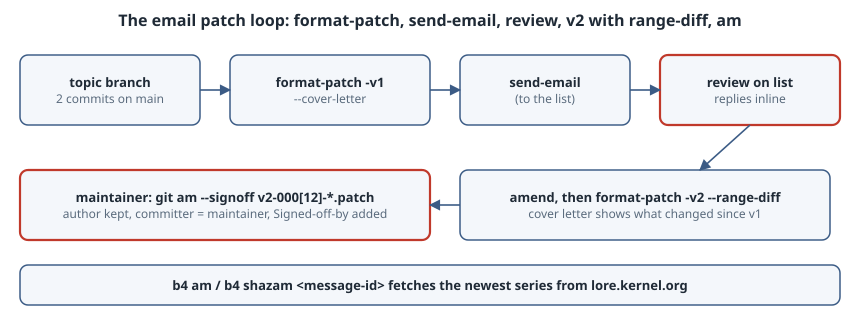

# The Email Patch Workflow: `format-patch`, `send-email`, `am`, and Versioned Series

## Thesis

Git was built to send changes as email, and the Linux kernel, Git itself, and many other projects (including SourceHut-hosted ones) still work that way. The loop has three parts:

1. The **contributor** turns commits into patch files with `git format-patch` and mails them with `git send-email`.
2. **Reviewers** reply inline on the mailing list.
3. The **maintainer** applies the series with `git am`, which keeps the author and records the maintainer as committer.

Revisions are sent as *versioned series* (v1, v2, …) with a cover letter that summarizes the changes. Since Git 2.19, that summary can be generated automatically as a **range-diff**. This chapter runs the whole loop locally with two clones. Every listing below is real output from Git 2.47.3. The only exception is `send-email`, which needs the separate `git-email` package. It is not installed on the build box, so that section is taken from the documentation and marked as not run.

{fig-alt="Contributor: commits on a topic branch, git format-patch -v1 --cover-letter, then git send-email to the list. Reviewers reply on the list. The contributor amends and runs git format-patch -v2 --range-diff to make v2. The maintainer runs git am --signoff to apply the series; the author stays the contributor, the committer becomes the maintainer, and a Signed-off-by trailer is added. b4 automates fetching a series from lore by message-id."}

## Setup

An `upstream` repository owned by Ada (maintainer), and a clone where Lin (contributor) makes two commits on `topic`:

```bash
git init upstream && cd upstream
printf 'int add(int a, int b) { return a + b; }\n' > math.c
git add math.c && git commit -m 'Initial import'
cd .. && git clone upstream contrib && cd contrib
git switch -c topic
printf 'int sub(int a, int b) { return a - b; }\n' >> math.c
git commit -am 'math: add sub()' -m 'Subtraction is needed by the calculator front end.'
printf 'int mul(int a, int b) { return a * b; }\n' >> math.c
git commit -am 'math: add mul()' -m 'Multiplication for the same front end.'
```

## 1. Turn commits into mail: `git format-patch`

`format-patch` writes one RFC 2822 message per commit in `<since>..HEAD`. `-v1` puts the version in the subject and file names, and `--cover-letter` adds a `0/N` message that introduces the series:

```text
$ git format-patch -v1 --cover-letter -o outgoing/ main
outgoing/v1-0000-cover-letter.patch
outgoing/v1-0001-math-add-sub.patch
outgoing/v1-0002-math-add-mul.patch

$ sed -n 1,12p outgoing/v1-0001-math-add-sub.patch
From eb702adb1924a0fd661889114972a4c1e2435b14 Mon Sep 17 00:00:00 2001
From: Lin Contributor <lin@example.org>
Date: Sat, 31 Oct 2026 09:00:00 +0530
Subject: [PATCH v1 1/2] math: add sub()

Subtraction is needed by the calculator front end.
---
 math.c | 1 +
 1 file changed, 1 insertion(+)

diff --git a/math.c b/math.c
index 1f76448..6d08eea 100644
```

Each file is a complete email. The `From` line carries the commit's author, `Subject` is the commit summary with a `[PATCH v1 1/2]` prefix, and the body is the commit message. The text between `---` and the diff (here the diffstat) is a comment for reviewers that `git am` discards. That makes it the place for notes like "tested on arm64" that shouldn't end up in history.

The cover letter is a template that you fill in by hand:

```text
$ grep -n "SUBJECT\|BLURB" outgoing/v1-0000-cover-letter.patch
4:Subject: [PATCH v1 0/2] *** SUBJECT HERE ***
6:*** BLURB HERE ***
```

After the placeholders are replaced:

```text
From 38f9edbad6d89b75e4d87b0685c28ae3e306c9f6 Mon Sep 17 00:00:00 2001
From: Lin Contributor <lin@example.org>
Date: Sat, 31 Oct 2026 09:00:00 +0530
Subject: [PATCH v1 0/2] math: add sub() and mul()

Two small helpers for the calculator front end.

Lin Contributor (2):
  math: add sub()
  math: add mul()

 math.c | 2 ++
 1 file changed, 2 insertions(+)

```

## 2. Send it: `git send-email` (from the docs; not run here)

`git send-email` is packaged separately on most distributions (Debian/Ubuntu `git-email`), and the build box doesn't have it, so this step was not run. According to the [git-send-email documentation](https://git-scm.com/docs/git-send-email), the usual setup is:

```bash
git config sendemail.smtpServer smtp.example.org
git config sendemail.smtpServerPort 587
git config sendemail.smtpEncryption tls
git config sendemail.smtpUser lin@example.org

# always rehearse first: prints what would be sent, sends nothing
git send-email --dry-run --to=list@example.org outgoing/v1-*.patch
git send-email --to=list@example.org outgoing/v1-*.patch
```

By default, `send-email` threads patches 1..N as replies to the cover letter (`--thread`, with `--no-chain-reply-to`). It also adds `Cc:` lines from `Signed-off-by:` and similar trailers unless you pass `--suppress-cc`. For a v2, add `--in-reply-to=<v1 cover letter Message-ID>` so the new series lands in the same thread.

## 3. Revise it: v2 with a range-diff

Say a reviewer asks for `mul()` to work on `long`. Lin first keeps a reference to v1, then fixes the commit in place with a fixup and an autosquash rebase. Fixing in place matters: the email workflow reviews a *series of commits*, not the final diff, so a separate "address review" commit would be rejected.

```bash
git branch topic-v1
sed -i 's/int mul(int a, int b)/long mul(long a, long b)/' math.c   # (simplified)
git commit -a --fixup=HEAD
git rebase -i --autosquash main
```

With `--range-diff=<v1 range>`, `format-patch` compares the old series with the new one and puts the result in the cover letter:

```text
$ git format-patch -v2 --cover-letter --range-diff=main..topic-v1 -o outgoing/ main
outgoing/v2-0000-cover-letter.patch
outgoing/v2-0001-math-add-sub.patch
outgoing/v2-0002-math-add-mul.patch

$ sed -n "/Range-diff/,/^-- $/p" outgoing/v2-0000-cover-letter.patch
Range-diff against v1:
1:  eb702ad = 1:  eb702ad math: add sub()
2:  38f9edb ! 2:  a9c5b89 math: add mul()
    @@ math.c
     @@
      int add(int a, int b) { return a + b; }
      int sub(int a, int b) { return a - b; }
    -+int mul(int a, int b) { return a * b; }
    ++long mul(long a, long b) { return a * b; }
-- 
```

Read the range-diff as a diff of diffs. Patch `1:` is unchanged (`=`), and patch `2:` changed (`!`): its `+int mul(...)` line became `+long mul(...)`. Reviewers only need to look at that hunk. The [git-range-diff docs](https://git-scm.com/docs/git-range-diff) explain the notation.

## 4. Apply it: `git am`

On the maintainer's side, `git am` reads each message and recreates the commit. It takes the author, date and message from the mail, and uses the person running `am` as the committer. `--signoff` adds the maintainer's `Signed-off-by:` trailer, which is how the kernel's [Developer's Certificate of Origin](https://docs.kernel.org/process/submitting-patches.html#sign-your-work-the-developer-s-certificate-of-origin) chain is recorded.

```text
$ git am --signoff ../contrib/outgoing/v2-000[12]-*.patch
Applying: math: add sub()
Applying: math: add mul()

$ git log --format="%h %an | committer: %cn | %s" main
ae25e75 Lin Contributor | committer: Ada Maintainer | math: add mul()
a2bfed4 Lin Contributor | committer: Ada Maintainer | math: add sub()
93bda59 Ada Maintainer | committer: Ada Maintainer | Initial import

$ git log -1 --format=%B
math: add mul()

Multiplication for the same front end.

Signed-off-by: Ada Maintainer <ada@example.org>

```

The author is still Lin, and the committer is Ada. That distinction is one reason the email flow keeps credit more accurately than squash-merging on a forge.

When a patch doesn't apply, `git am` stops and leaves the series in progress. The usual recovery is `git am --3way` (fall back to a three-way merge using the blob IDs in the patch's `index` lines), resolve, `git add`, then `git am --continue`. To give up, `git am --abort` restores the branch.

## 5. At kernel scale: b4 (from the docs; not run here)

Large lists are archived at [lore.kernel.org](https://lore.kernel.org/), and [b4](https://b4.docs.kernel.org/) automates both sides of the loop. Per its documentation:

- `b4 am <message-id>` fetches the newest version of a series from lore, collects trailers that reviewers posted (`Reviewed-by:`, `Acked-by:`), and writes an mbox that `git am` can apply. `b4 shazam` fetches and applies in one step.
- `b4 prep` manages a contributor's series as a branch, including the cover letter and version number. `b4 send` sends it, through the kernel.org web endpoint or your own SMTP.

b4 isn't installed on the build box, so these commands are described from the documentation rather than run.

## Pitfalls

- **Mailers that rewrap or reflow.** Pasting a patch into a web mail client breaks whitespace, and `git am` will reject it. Use `send-email`, or a client configured as in the kernel's [email-clients guide](https://docs.kernel.org/process/email-clients.html).
- **Notes in the wrong place.** Anything above `---` becomes part of the commit message. Put review notes below it.
- **Forgetting `-v`.** An unversioned resend breaks reviewers' threading and tools like b4.
- **Squashing review feedback into a new commit.** Rewrite the series instead (fixup + autosquash), and let the range-diff show what changed.

## Takeaways

- `format-patch -vN --cover-letter` turns a topic branch into a versioned, self-describing series.
- `--range-diff` shows exactly what changed between versions, and belongs in every cover letter after v1.
- `git am --signoff` keeps authorship and records the maintainer as committer.
- `send-email` and b4 do the transport, and both come with a `--dry-run` or equivalent rehearsal mode. Use it.

## Sources

- Git documentation: [git-format-patch](https://git-scm.com/docs/git-format-patch), [git-send-email](https://git-scm.com/docs/git-send-email), [git-am](https://git-scm.com/docs/git-am), [git-range-diff](https://git-scm.com/docs/git-range-diff)
- Linux kernel documentation: [Submitting patches](https://docs.kernel.org/process/submitting-patches.html) and [Email clients info for Linux](https://docs.kernel.org/process/email-clients.html)
- [b4 documentation](https://b4.docs.kernel.org/)
