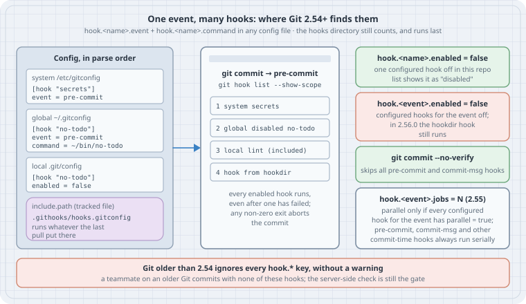

# Config-based hooks: sharing hooks without copying files into `.git/hooks`

After this page you can define Git hooks in configuration instead of as files named after events: several hooks per event, defined once in `~/.gitconfig` and reused by every repository, switched off per repository, shipped with a project through `include.path`, and (for server-side events) run in parallel. You will also know the four places this goes wrong: an event-wide off switch that doesn't switch everything off, an included hook file that runs whatever the last pull brought, older Git versions that ignore all of it silently, and parallel hooks that don't overlap.

## Thesis

Until Git 2.54 a hook was a **file**: Git looked for an executable called `pre-commit` (or `commit-msg`, `pre-push`, …) in `$GIT_DIR/hooks`, or in `core.hooksPath` if set, and ran it. One event, one file. Sharing it meant copying it into every clone, or pointing every clone's `core.hooksPath` at one directory and writing a dispatcher script to run several checks from it.

Git 2.54 (2026-04-20) added **config-based hooks**. A hook is now a named block in any Git config file:

```ini
[hook "no-todo"]
	event = pre-commit
	command = ~/bin/no-todo
```

- `hook.<name>.event` is multi-valued: one hook can serve many events, and many hooks can serve one event.
- `hook.<name>.command` is a path or a shell one-liner. The last value parsed wins.
- `hook.<name>.enabled = false` switches one hook off, for example in one repository's `.git/config`, while it stays defined in `~/.gitconfig`.
- Git 2.55 (2026-06-29) added `hook.<name>.parallel` and `hook.jobs` / `hook.<event>.jobs` to run several hooks for the same event at once, and the event-wide `hook.<event>.enabled` switch. The `git-hook(1)` manual is unchanged in 2.56.

What did **not** change: client-side hooks are still a local convenience. They are not cloned, `--no-verify` still skips them, and the real policy still lives on the server and in CI. Config-based hooks make the local half easier to share. They don't make it enforceable.

## Mental model

{fig-alt="Left: config sources in parse order (system, global, local, and a tracked file pulled in with include.path), each defining hook blocks with event and command. Middle: the run list for pre-commit as git hook list --show-scope prints it, configured hooks first in parse order, one marked disabled, then the hook from the hooks directory last. Every enabled hook runs even after one fails; any non-zero exit aborts the commit. Right: the switches. hook.name.enabled false turns off one hook. hook.event.enabled false turns off configured hooks for the event, but in 2.56.0 the hooks-directory hook still runs. git commit --no-verify skips all pre-commit and commit-msg hooks. hook.event.jobs runs hooks in parallel only if every configured hook sets parallel true, and commit-time hooks always run serially. Footer: Git older than 2.54 ignores every hook key without a warning."}

```text
git commit
  └─ event "pre-commit"
       run list = configured hooks, in the order their hook.<name>.event lines were parsed
                  (system → global → local → worktree → -c; include.path files where included)
                + the traditional hook file (core.hooksPath, else .git/hooks), LAST
       every enabled hook runs; any non-zero exit aborts the commit
```

| Key (scope) | Meaning | Since |
|-------------|---------|-------|
| `hook.<name>.command` | What to run: a path or a shell one-liner. Last value wins | 2.54 |
| `hook.<name>.event` | Which event(s) run it. Multi-valued; an empty value resets the list | 2.54 |
| `hook.<name>.enabled` | `false` switches this hook off without deleting it | 2.54 |
| `hook.<event>.enabled` | `false` switches off the *configured* hooks for that event (see Case 2) | 2.55 |
| `hook.<name>.parallel` | `true` declares this hook safe to run concurrently with the others | 2.55 |
| `hook.jobs`, `hook.<event>.jobs` | How many hooks may run at once (`-1` = CPU count). Default 1 | 2.55 |
| `git hook list [--show-scope] <event>` | Print the run list for an event, with the config scope of each hook | 2.54 |
| `git hook run [-j N] <event> [-- args]` | Run an event's hooks by hand, the way Git would | 2.36 (config hooks 2.54, `-j` 2.55) |

A `<name>` must not be an event name: `hook.pre-commit.command` is a fatal error, because `hook.pre-commit.enabled` and `hook.pre-commit.jobs` already mean "the event" (`git-config(1)`, `hook.<friendly-name>.event`).

## Worked examples (Cases)

Run on Debian 13 (Linux 6.12) with **Git 2.56.0**, the current release (2026-09-28), built from the release tarball in user space. The box's distribution Git is 2.47.3, and Case 4 uses it on purpose. Every listing below was run, and every output block is pasted from the run.

Source this file first. It keeps your own `~/.gitconfig` out of the way by pointing "global" at a throwaway file, so Case 1 can write to it safely:

```bash
# env.sh — source this so your hashes match the transcripts (needs git 2.55+)
export GIT_AUTHOR_NAME="Dev" GIT_AUTHOR_EMAIL="dev@example.com"
export GIT_COMMITTER_NAME="Dev" GIT_COMMITTER_EMAIL="dev@example.com"
export GIT_AUTHOR_DATE="2026-10-01T09:00:00Z" GIT_COMMITTER_DATE="2026-10-01T09:00:00Z"
export GIT_CONFIG_GLOBAL=/tmp/hooklab/global.gitconfig GIT_CONFIG_NOSYSTEM=1
export GIT_CONFIG_COUNT=1 GIT_CONFIG_KEY_0=init.defaultBranch GIT_CONFIG_VALUE_0=main
```

Run the cases in order; they share `/tmp/hooklab`.

### Case 1: Two hooks on one event, defined once for every repository

Two small checks, `no-todo` and `no-big`, live in `~/bin`-style scripts and are registered in the global config. The repository has no hook files at all:

```bash
#!/usr/bin/env bash
# lab-01-one-event-two-hooks.sh — two named hooks on pre-commit, defined in config, no files in .git/hooks
set -euo pipefail
rm -rf /tmp/hooklab && mkdir -p /tmp/hooklab/bin && cd /tmp/hooklab
: > global.gitconfig
cat > bin/no-todo <<'SH'
#!/bin/sh
# bin/no-todo — refuse staged lines that add "TODO"
if git diff --cached -U0 | grep -q '^+.*TODO'; then
  echo "no-todo: staged change adds a TODO" >&2; exit 1
fi
echo "no-todo: ok"
SH
cat > bin/no-big <<'SH'
#!/bin/sh
# bin/no-big — refuse staged files over 1 MiB
git diff --cached --name-only -z | xargs -0 -r -I{} sh -c \
  'test $(wc -c < "{}") -le 1048576 || { echo "no-big: {} is over 1 MiB" >&2; exit 1; }' || exit 1
echo "no-big: ok"
SH
chmod +x bin/*
git config set --global hook.no-todo.command /tmp/hooklab/bin/no-todo
git config set --global --append hook.no-todo.event pre-commit
git config set --global hook.no-big.command /tmp/hooklab/bin/no-big
git config set --global --append hook.no-big.event pre-commit
git init -q repo && cd repo
ls .git/hooks | grep -v '\.sample$' || echo "(no active hook files in .git/hooks)"
git hook list --show-scope pre-commit
echo 'print("hi")' > app.py && git add app.py
git commit -qm "add app" && git log --oneline
echo '# TODO: remove' >> app.py && git add app.py
git commit -qm "add todo" || echo "commit refused, exit $?"
```

```text
(no active hook files in .git/hooks)
global	no-todo
global	no-big
no-todo: ok
no-big: ok
f652878 add app
no-todo: staged change adds a TODO
no-big: ok
commit refused, exit 1
```

Three things to read off this:

- `.git/hooks` has only the `.sample` files `git init` copies in. The hooks come entirely from config, and `git hook list --show-scope` says from which scope.
- On the refused commit **both** hooks ran: `no-big: ok` is printed after `no-todo` failed. Git runs every hook for the event and then refuses if any of them exited non-zero. Write each hook as if it were the only one, with its own clear message.
- `git config set --append` is the Git 2.46+ spelling. With the older `git config` syntax, the equivalent of `--append` is `--add`; `git config --global --append …` is rejected as an unknown option.

### Case 2: Order, the hooks directory, and the off switches

Add a traditional `.git/hooks/pre-commit` file to the same repository and try each way of turning hooks off:

```bash
#!/usr/bin/env bash
# lab-02-order-and-off-switches.sh — config hooks + a .git/hooks file: order, disabling, --no-verify
set -euo pipefail
cd /tmp/hooklab/repo
git restore --staged app.py && git checkout -q -- app.py
printf '#!/bin/sh\necho "legacy .git/hooks/pre-commit"\n' > .git/hooks/pre-commit
chmod +x .git/hooks/pre-commit
git hook list --show-scope pre-commit
echo "--- run the event by hand"
git hook run pre-commit
echo "--- this repo opts out of one global hook"
git config set --local hook.no-big.enabled false
git hook list --show-scope pre-commit
echo "--- switch the whole event off for this repo"
git config set --local hook.pre-commit.enabled false
git hook run pre-commit; echo "exit $?"
git config unset --local hook.pre-commit.enabled
echo "--- --no-verify skips config hooks too"
echo '# TODO: later' >> app.py && git add app.py
git commit -q --no-verify -m "wip: todo (skipped hooks)" && git log --oneline -1
```

```text
global	no-todo
global	no-big
hook from hookdir
--- run the event by hand
no-todo: ok
no-big: ok
legacy .git/hooks/pre-commit
--- this repo opts out of one global hook
global	no-todo
global	disabled	no-big
hook from hookdir
--- switch the whole event off for this repo
legacy .git/hooks/pre-commit
exit 0
--- --no-verify skips config hooks too
092fc2a wip: todo (skipped hooks)
```

- The traditional hook is still honoured and runs **last**, after every configured hook. `git hook list` shows it as `hook from hookdir`. If `core.hooksPath` is set, that directory replaces `.git/hooks` as the "hookdir" and the configured hooks still run; on this box, setting `core.hooksPath` to a shared directory made `git hook list pre-commit` print `no-todo`, `no-big`, `hook from hookdir`, and the hookdir hook it ran was the shared one.
- `hook.no-big.enabled=false` in `.git/config` turns off a hook defined in `~/.gitconfig` for this repository only, and the list marks it `disabled`. This is the clean way to opt one repository out of a personal or company-wide hook.
- `hook.pre-commit.enabled=false` switched off both configured hooks, **but the `.git/hooks/pre-commit` file still ran**. `git-config(1)` describes the event switch as "no hooks fire for that event". In Git 2.56.0 the code that applies it (`list_hooks_add_configured()` in `hook.c`) marks only configured hooks as event-disabled; `list_hooks_add_default()` adds the hookdir hook afterwards without that check. Don't rely on this switch to silence a legacy hook file; remove or rename the file.
- `--no-verify` skipped the configured hooks as well as the file, and the `TODO` was committed. It skips `pre-commit` and `commit-msg` hooks of every kind.

### Case 3: Shipping hook config with the project

Config is not cloned, any more than `.git/hooks` is. What a project *can* ship is a tracked config file that each developer chooses to include. The project keeps the hook script and its definition under `.githooks/`; a clone opts in once with `include.path`:

```bash
#!/usr/bin/env bash
# lab-03-shared-from-repo.sh — ship hook config in the repo; each clone opts in with include.path
set -euo pipefail
cd /tmp/hooklab && rm -rf proj proj.git alice && : > global.gitconfig
git init -q proj && cd proj
mkdir .githooks
cat > .githooks/check-subject <<'SH'
#!/bin/sh
# .githooks/check-subject — commit-msg: subject line at most 50 characters
len=$(head -n1 "$1" | wc -c)
[ "$len" -le 51 ] || { echo "check-subject: subject is $((len-1)) chars (max 50)" >&2; exit 1; }
SH
chmod +x .githooks/check-subject
cat > .githooks/hooks.gitconfig <<'CFG'
# .githooks/hooks.gitconfig — reviewed hook definitions; clones opt in with include.path
[hook "check-subject"]
	event = commit-msg
	command = .githooks/check-subject
CFG
git add .githooks && git commit -qm "ship commit-msg policy" && cd ..
git clone -q --bare proj proj.git && git clone -q proj.git alice && cd alice
echo "--- fresh clone: nothing runs"
git hook list commit-msg || true
git config set --local include.path ../.githooks/hooks.gitconfig
echo "--- after opting in"
git hook list --show-scope commit-msg
git config list --show-origin | grep '^file:.*hook\.'
git commit -q --allow-empty -m "this subject line is far too long to pass the policy check" || echo "refused"
git commit -q --allow-empty -m "short subject" && git log --oneline -1
echo "--- from a subdirectory: the relative command still resolves"
mkdir -p src && cd src && git commit -q --allow-empty -m "from src/" && git log --oneline -1
```

```text
--- fresh clone: nothing runs
warning: no hooks found for event 'commit-msg'
--- after opting in
local	check-subject
file:.git/../.githooks/hooks.gitconfig	hook.check-subject.event=commit-msg
file:.git/../.githooks/hooks.gitconfig	hook.check-subject.command=.githooks/check-subject
check-subject: subject is 58 chars (max 50)
refused
7831542 short subject
--- from a subdirectory: the relative command still resolves
1c40431 from src/
```

- A fresh clone runs nothing. Opting in is one `git config set --local include.path ../.githooks/hooks.gitconfig`; the path is relative to the directory of the including file, `.git/`, which is why `--show-origin` prints `.git/../.githooks/hooks.gitconfig`.
- `git hook list --show-scope` reports an included hook under the scope of the file that included it: `local`.
- Hooks run from the top of the working tree (`githooks(5)`), so `command = .githooks/check-subject` works from `src/` too.

Compared with `core.hooksPath=.githooks`, this keeps the project's hooks *and* your own global ones, needs no dispatcher script, and lets a developer disable one project hook with `hook.<name>.enabled=false` without editing tracked files.

### Case 4: The teammate on an older Git

Same clone, same policy, two Git versions:

```bash
#!/usr/bin/env bash
# lab-04-old-git.sh — the same clone, committed with an older Git: config hooks silently do nothing
set -uo pipefail
cd /tmp/hooklab/alice
for g in git /usr/bin/git; do
  echo "--- $($g --version)"
  $g hook list commit-msg 2>&1 | head -1
  $g commit -q --allow-empty -m "a subject line that is much longer than fifty characters" \
    && { echo "commit accepted: $($g log -1 --format=%s)"; $g reset -q --soft HEAD~1; } \
    || echo "commit refused"
done
```

```text
--- git version 2.56.0
check-subject
check-subject: subject is 56 chars (max 50)
commit refused
--- git version 2.47.3
error: unknown subcommand: `list'
commit accepted: a subject line that is much longer than fifty characters
```

Git 2.47.3 has no idea what `hook.check-subject.*` means, and unknown config keys are not an error in Git, so the over-long subject was accepted without a word. Git 2.47.3 does have `git hook run` (it dates from 2.36), but not `git hook list`. That is the safest single check to put in a setup script: if `git hook list commit-msg` fails, the developer's hooks are not running. Stating "requires Git 2.54+" in the contributing guide matters more than usual here, because the failure is silent.

### Case 5: An included hook runs whatever the last pull brought

`include.path` to a tracked file, like `core.hooksPath` to a tracked directory, means "run the version of these files that is checked out right now". Another contributor changes the hook script, the change is merged, Alice pulls:

```bash
#!/usr/bin/env bash
# lab-05-trust-on-pull.sh — an included hook file runs whatever the last pull brought
set -euo pipefail
cd /tmp/hooklab && rm -rf mallory
git clone -q proj.git mallory && cd mallory
cat > .githooks/check-subject <<'SH'
#!/bin/sh
# .githooks/check-subject — (changed upstream)
echo "check-subject: this line arrived with the last pull and runs as $(id -un)" >&2
SH
git commit -qam "tweak subject check" && git push -q origin main
cd ../alice && git pull -q --rebase origin main
echo "--- review what the pull changed under .githooks before the next commit"
git diff --stat ORIG_HEAD HEAD -- .githooks
git commit -q --allow-empty -m "next commit"
```

```text
--- review what the pull changed under .githooks before the next commit
 .githooks/check-subject | 5 ++---
 1 file changed, 2 insertions(+), 3 deletions(-)
check-subject: this line arrived with the last pull and runs as box
```

The new script ran on Alice's next commit, under her user, with her credentials and SSH agent in reach. Nothing asked. This is not a Git bug; it is what opting in to a tracked hook means, and it is the reason `git clone` never runs hooks in the first place. Treat `.githooks/` like CI workflow files:

- Protect the path with code-owner review on the server (a `CODEOWNERS` rule for `/.githooks/`) so changes to it need a named reviewer.
- After a pull, check `git diff --stat ORIG_HEAD HEAD -- .githooks` (as above) or `git log -p ORIG_HEAD..HEAD -- .githooks` before your next commit.
- Point `command` at something that cannot change under you when it matters: a tool installed from a package with a pinned version, rather than a script in the working tree.

### Case 6: Parallel hooks on the server

Parallelism is for slow, independent hooks such as notifications after a push. Commit-time hooks always run one at a time: `git-hook(1)` lists `applypatch-msg`, `pre-commit`, `prepare-commit-msg`, `commit-msg`, `post-commit`, `post-checkout` and `push-to-checkout` as always serial, because they share the index, working tree or message file. `post-receive` on a bare repository is a good candidate. Two hooks each sleep one second to stand in for a slow webhook; the push is timed:

```bash
#!/usr/bin/env bash
# lab-06-parallel-post-receive.sh — two slow server-side hooks: serial vs hook.<event>.jobs
set -euo pipefail
cd /tmp/hooklab && rm -rf srv.git dev && : > global.gitconfig
git init -q --bare srv.git
cat > notify <<'SH'
#!/bin/sh
# notify — post-receive: read the first "<old> <new> <ref>" line, then a slow "webhook"
read -r old new ref
start=$(date +%s%N); sleep 1
echo "$1: $ref, slow part began at +$(( (start - $(cat /tmp/hooklab/t0)) / 1000000 )) ms"
SH
cat > notify-drain <<'SH'
#!/bin/sh
# notify-drain — same, but read ALL of stdin (to EOF) before the slow part
refs=$(cat)
start=$(date +%s%N); sleep 1
echo "$1: slow part began at +$(( (start - $(cat /tmp/hooklab/t0)) / 1000000 )) ms"
SH
chmod +x notify notify-drain
git -C srv.git config set hook.chat.command "/tmp/hooklab/notify chat"
git -C srv.git config set --append hook.chat.event post-receive
git -C srv.git config set hook.ci.command "/tmp/hooklab/notify ci"
git -C srv.git config set --append hook.ci.event post-receive
git init -q dev && cd dev && git remote add origin ../srv.git
push() { git commit -q --allow-empty -m "$1"; date +%s%N > /tmp/hooklab/t0
         s=$(date +%s%N); git push -q origin main 2>&1 | sed 's/^remote: /  remote: /; s/ *$//'
         echo "  push took $(( ($(date +%s%N) - s) / 1000000 )) ms"; }
echo "--- default: serial"; push one
git -C ../srv.git config set hook.post-receive.jobs 2
echo "--- jobs=2, but no hook declares parallel=true: still serial"; push two
git -C ../srv.git config set hook.chat.parallel true
git -C ../srv.git config set hook.ci.parallel true
echo "--- jobs=2 and both hooks parallel=true"; push three
git -C ../srv.git config set hook.chat.command "/tmp/hooklab/notify-drain chat"
git -C ../srv.git config set hook.ci.command "/tmp/hooklab/notify-drain ci"
echo "--- same, but each hook drains stdin to EOF first"; push four
```

```text
--- default: serial
  remote: chat: refs/heads/main, slow part began at +12 ms
  remote: ci: refs/heads/main, slow part began at +1017 ms
  push took 2023 ms
--- jobs=2, but no hook declares parallel=true: still serial
  remote: chat: refs/heads/main, slow part began at +13 ms
  remote: ci: refs/heads/main, slow part began at +1017 ms
  push took 2023 ms
--- jobs=2 and both hooks parallel=true
  remote: chat: refs/heads/main, slow part began at +14 ms
  remote: ci: refs/heads/main, slow part began at +14 ms
  push took 1020 ms
--- same, but each hook drains stdin to EOF first
  remote: chat: slow part began at +1021 ms
  remote: ci: slow part began at +17 ms
  push took 2028 ms
```

- **Serial by default.** `ci` starts about 1,000 ms after `chat`; the push takes 2 s.
- **`hook.post-receive.jobs=2` alone changes nothing.** Every configured hook for the event must also declare `hook.<name>.parallel=true`. One hook without it keeps the whole event serial. That is deliberate: the hook's author, not the admin, says whether it is safe to run alongside others.
- **Both declared parallel:** both start at +14 ms and the push takes 1 s.
- **The same hooks reading stdin to EOF first:** the push is back to 2 s. `ci` starts at +17 ms, but `chat` doesn't get end-of-file on its stdin until `ci` exits. While the hooks were running, `/proc/<pid>/fd` of the second hook process showed two extra pipe descriptors (fd 8 and 9) besides its own stdin and stdout. That is consistent with the second child inheriting the write end of the first child's stdin pipe, which would hold that pipe open until the second hook exits. Whatever the exact cause, the effect on Git 2.56.0 is measurable: a parallel `post-receive` hook that reads all of stdin before doing its slow work gains nothing. Read the ref lines you need, then start the slow part, and measure on your own server before counting on the speed-up.

With `jobs` above 1, Git also merges hook stdout into stderr for `pre-push` so parallel output can be de-interleaved (`git-config(1)`, `hook.jobs`). A `pre-push` hook that writes something meaningful to stdout behaves differently when run in parallel.

## The trap

Config-based hooks *feel* like policy, because they live in config next to everything else and can be set centrally in `/etc/gitconfig` or a tracked include. They are still courtesy. A teammate on Git 2.47 runs none of them and sees no warning (Case 4). `--no-verify` skips them all (Case 2). The event-wide off switch leaves a legacy hook file running (Case 2). An included hook runs whatever the last merge put into the working tree (Case 5). And `jobs=4` on its own is a no-op until every hook declares `parallel=true`, and even then may not overlap (Case 6). If a rule must hold for every commit that reaches `main`, it belongs in a server-side check or a required CI job. The hook only gets it to the developer sooner.

## The boring rule

> Define hooks as named `hook.<name>` blocks, one check per hook, and look at the result with `git hook list --show-scope <event>`. Share project hooks as a tracked `.githooks/hooks.gitconfig` that each clone includes on purpose, guarded by code-owner review. Opt a repository out with `hook.<name>.enabled=false`, and delete legacy `.git/hooks` files rather than relying on the event switch. Require Git 2.54+ and check it in setup. Run anything that must hold for everyone on the server, not in a hook.

## Try this

1. Move one hook you already use from `.git/hooks/` into `~/.gitconfig` as a `hook.<name>` block, and confirm with `git hook list --show-scope <event>` that it appears once, and not twice.
2. Give one hook two events (`git config set --append hook.lint.event pre-push`) and run `git hook run pre-push -- origin https://example.invalid` to see it fire without pushing.
3. In Case 3's repository, set `hook.check-subject.enabled=false` in `.git/config` and confirm a long subject goes through, while `.githooks/hooks.gitconfig` stays unchanged.
4. Add a third `post-receive` hook to Case 6 without `parallel=true`. Predict the push time before you run it.
5. Write a `scripts/setup.sh` that fails with a clear message if `git hook list commit-msg` fails, and run it under the older Git on your machine if you have one.

## Sources

- `git-hook(1)` (Git 2.56 manual, and the 2.54.0 version for what 2.54 already had: <https://git-scm.com/docs/git-hook/2.54.0>): config-defined hooks, `list --show-scope`, `run -j`, always-serial events, the WRAPPERS section: <https://git-scm.com/docs/git-hook>
- `git-config(1)`, `hook.*` keys (`command`, `event`, `enabled`, `parallel`, `hook.jobs`, `hook.<event>.jobs`): <https://git-scm.com/docs/git-config>
- `githooks(5)`: hook events, working directory, `core.hooksPath`: <https://git-scm.com/docs/githooks>
- `git-config(1)`, "Includes" (`include.path`, relative paths): <https://git-scm.com/docs/git-config#_includes>
- Git 2.54.0 release notes ("Hook commands are now allowed to be defined (possibly centrally) in the configuration files"): <https://github.com/git/git/blob/master/Documentation/RelNotes/2.54.0.adoc>
- Git 2.55.0 release notes ("Hook scripts defined via the configuration system can now be configured to run in parallel"): <https://github.com/git/git/blob/master/Documentation/RelNotes/2.55.0.adoc>
- Git 2.56.0 source, `hook.c` (`list_hooks()`, `list_hooks_add_configured()`, `get_hook_jobs()`): <https://github.com/git/git/blob/v2.56.0/hook.c>
- GitHub Docs, "About code owners" (protecting `/.githooks/`): <https://docs.github.com/en/repositories/managing-your-repositorys-settings-and-features/customizing-your-repository/about-code-owners>
