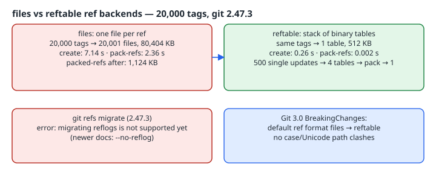

Every branch, tag and remote-tracking ref in a classic Git repository is a file under `.git/refs/`, plus a `packed-refs` file that collects the cold ones. Git's [BreakingChanges](https://git-scm.com/docs/BreakingChanges) document plans to change the default ref storage format for new repositories in Git 3.0 "from "files" to "reftable"". This chapter creates the same 20,000 tags under both backends, measures what changes, looks at the on-disk layout, and walks through a migration, including the point where it failed on the box's Git 2.47.3.

{fig-alt="files backend: 20,001 loose files using 80,404 KB of blocks, 7.14 s to create the tags in one transaction, 2.36 s to pack into a 1,124 KB packed-refs. reftable: one 512 KB table, 0.26 s to create, 0.002 s to pack; 500 single updates leave 4 tables that pack-refs compacts to 1. git refs migrate in 2.47.3 fails on reflogs; newer docs add --no-reflog. Git 3.0 plans reftable as the default."}

## Setup

```bash
git --version                     # git version 2.47.3
git init -q --ref-format=files    r-files
git init -q --ref-format=reftable r-reftable
# in each repo, after one empty commit:
h=$(git rev-parse HEAD)
time (seq 1 20000 | sed "s|.*|create refs/tags/v& $h|" | git update-ref --stdin)
```

`git update-ref --stdin` applies all 20,000 `create` lines as one transaction, so each backend gets its best case.

## Measured (git 2.47.3, ext4, same box)

```text
== files
show-ref-format: files
create 20000 tags: 7.140s
loose ref files under .git/refs: 20001
on-disk: refs=80404K packed-refs=-K reftable=-K
for-each-ref all: 0.271s
pack-refs/compact: 2.364s
after pack: loose=0
== reftable
show-ref-format: reftable
create 20000 tags: 0.256s
loose ref files under .git/refs: 1
reftable dir:
0x000000000001-0x000000000003-437f3a78.ref
tables.list
on-disk: refs=8K packed-refs=-K reftable=512K
for-each-ref all: 0.183s
pack-refs/compact: 0.002s
after pack: loose=1
```

After `pack-refs --all`, the files repository had a 1,124 KB `packed-refs` file.

What these numbers show:

- **Bulk writes are where `files` struggles.** It created 20,000 separate 41-byte files, each taking a full 4 KiB filesystem block, for 80 MB of blocks to hold about 800 KB of hashes. reftable wrote one sorted binary table of 512 KB, about 28× faster.
- **Reads were closer.** `for-each-ref` took 0.27 s against 0.18 s. Listing is dominated by formatting output, not storage.
- **Small, separate updates did *not* favour reftable here.** 500 separate `git update-ref refs/heads/bN` calls took 1.281 s on reftable and 0.832 s on files. Each reftable transaction writes a new small table and rewrites `tables.list`. Afterwards the stack held 4 tables, so Git had been auto-compacting as it went, and `git pack-refs` merged them into 1. Don't expect every workload to get faster. The [reftable spec](https://git-scm.com/docs/reftable) design goals are about "near constant time lookup for any single reference" and atomic multi-ref updates, not single-ref write speed.

## What's on disk

```text
$ cat .git/HEAD
ref: refs/heads/.invalid
$ find .git/refs -type f -exec sh -c 'echo "{}: $(cat {})"' \;
.git/refs/heads: this repository uses the reftable format
$ git symbolic-ref HEAD
refs/heads/master
```

Both are placeholders. A tool that reads `.git/HEAD` directly sees a branch named `.invalid`, and one that walks `.git/refs/heads/` finds a file where it expects a directory, so it fails instead of silently reading nothing. Expect breakage in any tool that parses `.git/refs/**` itself. Use `git for-each-ref`, `git rev-parse` and `git symbolic-ref` instead.

The real data lives in `.git/reftable/`: the `.ref` tables plus `tables.list`, which the spec describes as the stack-ordering file listing the tables from oldest to newest.

The ref-name rules haven't changed. reftable still rejects a directory/file conflict:

```text
$ git update-ref refs/heads/x $h
$ git update-ref refs/heads/x/y $h
fatal: update_ref failed for ref 'refs/heads/x/y': 'refs/heads/x' exists; cannot create 'refs/heads/x/y'
```

What reftable *does* remove, per BreakingChanges, is a filesystem limitation. Under `files`, "it is impossible to store two references that only differ in casing on case-insensitive filesystems", and macOS Unicode normalisation causes a similar clash. reftable "does not use filesystem paths to encode reference names", so neither applies. I could not test this on the box: its Linux filesystem is case-sensitive, so `files` allows both names there too.

## Migrating an existing repository

[`git refs migrate`](https://git-scm.com/docs/git-refs) converts a repository in place. On 2.47.3, against the 20,501-ref files repository:

```text
$ git refs migrate --ref-format=reftable
error: migrating reflogs is not supported yet
$ git reflog expire --expire=all --all
$ git refs migrate --ref-format=reftable
error: migrating reflogs is not supported yet
```

Expiring the entries isn't enough, because the 501 per-ref log files still exist. Only removing `.git/logs` (on a throwaway lab copy) let it proceed:

```text
$ rm -rf .git/logs
$ git refs migrate --ref-format=reftable
$ git rev-parse --show-ref-format
reftable
# refs=20501 loose=1 packed-refs=gone
```

**Don't do that on a real repository.** Upgrade Git instead. The current `git refs` documentation lists `--reflog` (the default, migrate reflogs) and `--no-reflog` (discard them), so newer Git migrates reflogs and the workaround isn't needed. The same page lists known limitations:

- it is "not possible to migrate repositories that have worktrees";
- "there is no way to block concurrent writes" during migration. If the repository is registered for `git maintenance`, unregister it first.

## Checklist before Git 3.0 flips the default

- [ ] `git rev-parse --show-ref-format` in CI logs, so you know which backend each clone uses.
- [ ] Grep your tooling for `.git/refs`, `.git/HEAD` and `packed-refs` reads, and replace them with plumbing commands.
- [ ] Try `git init --ref-format=reftable`, or set `init.defaultRefFormat=reftable`, on a non-critical repository now.
- [ ] Migrate with a recent Git, with no worktrees attached, writes blocked and maintenance unregistered.
- [ ] Benchmark *your* write pattern. Bulk tag/branch creation gains a lot, while single small updates may not.
