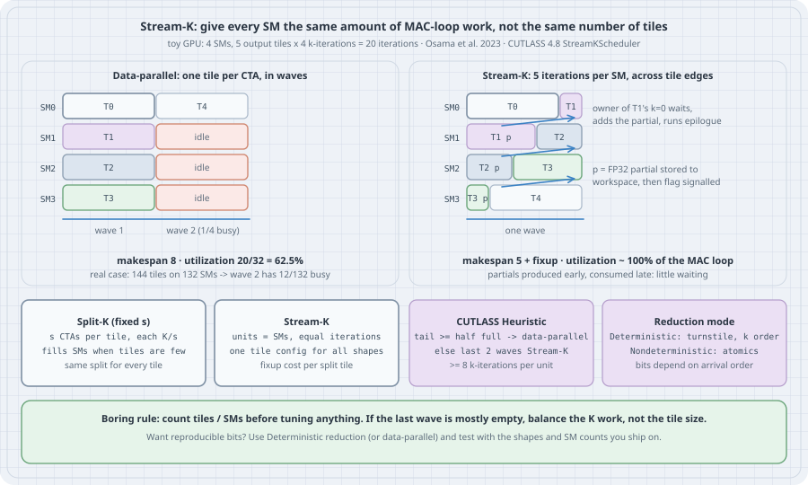

# Split-K and Stream-K: The Last Wave of a GEMM

## Thesis

The GEMM worklog so far has made a single output tile fast: coalesced loads, shared-memory tiling, register micro-tiles, tensor cores. That is necessary but not sufficient, because a GPU does not run one tile. It runs `ceil(M/BM) × ceil(N/BN)` tiles on a fixed number of SMs, in **waves**. If 144 tiles land on a 132-SM H100, the first wave keeps every SM busy and the second wave keeps 12 SMs busy while 120 wait. The kernel's inner loop can be perfect and the whole GEMM still runs at 54.5% of what the hardware could do. That loss is called **wave quantization**, and no amount of tile tuning removes it, because it comes from the *count* of tiles, not from how fast each one runs.

There are two standard fixes. **Split-K** cuts the K dimension of every tile into `s` pieces so there are `s` times more work units, then reduces the partial sums. **Stream-K** (Osama, Merrill, Cecka, Garland and Owens, 2023) goes further. It launches one persistent CTA per SM and gives each the *same number of MAC-loop iterations* from the flattened (tile, k) space, so a CTA may finish one tile, do the first half of another, and hand that partial to a neighbour. This chapter computes wave quantization for real shapes and SM counts, simulates the four schedules under one cost model, re-implements the decision rule CUTLASS 4.8 actually uses, and writes a Stream-K GEMM in Triton that is checked for correctness in interpreter mode. There is no GPU on this box. The arithmetic, the simulator and the Triton kernel's indexing and reduction logic are run here. GPU timings come from the primary sources and are labelled as such.

## Mental model

{fig-alt="Toy GPU with 4 SMs and 5 output tiles of 4 MAC iterations each. Left: data-parallel assigns one whole tile per CTA; the second wave runs one tile while three SMs are idle, makespan 8 iterations, utilization 62.5 percent. Right: Stream-K gives every SM 5 contiguous iterations of the flattened tile-by-k space; SM1 to SM3 start with a partial tile, store FP32 partials and signal; the SM owning each tile's first k iteration waits, adds the partials and runs the epilogue; makespan 5 plus fixup. Bottom: Split-K uses a fixed split per tile; Stream-K uses one unit per SM with equal iterations; CUTLASS Heuristic stays data-parallel when the tail wave is at least half full, otherwise covers the last two waves with Stream-K and keeps at least 8 k-iterations per unit; Deterministic reduction is a turnstile in k order, Nondeterministic uses atomics so bits depend on arrival order."}

| Term | Plain meaning |
|------|---------------|
| Output tile | A `BM × BN` block of C computed by one CTA (here 128 × 128) |
| MAC-loop iteration | One `BK`-wide step of the K loop for one tile: load an A and a B slab, multiply-accumulate |
| Wave | One round of CTAs, at most one per SM for a persistent GEMM kernel |
| Wave quantization | Idle SMs in the last wave because `tiles mod SMs` is small |
| Data-parallel (DP) | One CTA per tile, the whole K loop inside it; no reduction across CTAs |
| Split-K | `s` CTAs per tile, each does `K/s`; partials reduced in a second step |
| Stream-K | One persistent CTA per SM, each gets `total_iterations / SMs` iterations, crossing tile edges |
| Fixup | Combining a split tile's FP32 partials and running the epilogue once |

In the Stream-K algorithm, unit `u` owns iterations `[u·q, (u+1)·q)` of the flattened space. A tile split between units `u` and `u+1` is processed at the **end** of `u`'s range and at the **start** of `u+1`'s. The paper makes the unit that holds the tile's first k-iteration (here `u`) responsible for the fixup. Unit `u+1` stores its partial and raises a flag early in its run, and `u` reads it late in its run, so the wait is usually short. The schedule is built so that partials are produced early and consumed late.

## Worked examples

### Case 1: Count the waves before you tune anything

```python
# wave_quant.py: how many SMs sit idle in the last wave of a data-parallel GEMM
from math import ceil

GPUS = {"A100 (108 SMs)": 108, "H100 SXM (132 SMs)": 132, "B200 (148 SMs)": 148}
TILE_M, TILE_N = 128, 128          # one output tile per CTA, one CTA per SM


def waves(m, n, sms):
    tiles = ceil(m / TILE_M) * ceil(n / TILE_N)
    w = ceil(tiles / sms)
    tail = tiles - (w - 1) * sms   # CTAs that run in the final wave
    return tiles, w, tail, tiles / (w * sms)


shapes = [(2048, 2048), (1536, 1536), (4096, 4096), (128, 4096), (3840, 3840)]
print(f"tile {TILE_M}x{TILE_N}; utilization = tiles / (waves * SMs)\n")
print(f"{'M x N':>12} {'GPU':>20} {'tiles':>6} {'waves':>6} {'last wave':>10} {'util':>6}")
for m, n in shapes:
    for name, sms in GPUS.items():
        tiles, w, tail, util = waves(m, n, sms)
        print(f"{f'{m}x{n}':>12} {name:>20} {tiles:6d} {w:6d} {f'{tail}/{sms}':>10} {util:6.1%}")
    print()
```

```bash
python wave_quant.py
```

Output:

```text
tile 128x128; utilization = tiles / (waves * SMs)

       M x N                  GPU  tiles  waves  last wave   util
   2048x2048       A100 (108 SMs)    256      3     40/108  79.0%
   2048x2048   H100 SXM (132 SMs)    256      2    124/132  97.0%
   2048x2048       B200 (148 SMs)    256      2    108/148  86.5%

   1536x1536       A100 (108 SMs)    144      2     36/108  66.7%
   1536x1536   H100 SXM (132 SMs)    144      2     12/132  54.5%
   1536x1536       B200 (148 SMs)    144      1    144/148  97.3%

   4096x4096       A100 (108 SMs)   1024     10     52/108  94.8%
   4096x4096   H100 SXM (132 SMs)   1024      8    100/132  97.0%
   4096x4096       B200 (148 SMs)   1024      7    136/148  98.8%

    128x4096       A100 (108 SMs)     32      1     32/108  29.6%
    128x4096   H100 SXM (132 SMs)     32      1     32/132  24.2%
    128x4096       B200 (148 SMs)     32      1     32/148  21.6%

   3840x3840       A100 (108 SMs)    900      9     36/108  92.6%
   3840x3840   H100 SXM (132 SMs)    900      7    108/132  97.4%
   3840x3840       B200 (148 SMs)    900      7     12/148  86.9%
```

Three things stand out.

- **The same shape is fine on one GPU and poor on the next.** 1536 × 1536 runs at 54.5% on H100 and 97.3% on B200. 3840 × 3840 is the other way round: 97.4% on H100 and 86.9% on B200, because 900 tiles leave a 12-CTA tail on 148 SMs. A tile configuration tuned on one SKU is not portable.
- **Large problems hide the problem.** At 4096 × 4096 there are 7 to 10 waves, so even a nearly empty tail costs only a few percent.
- **Skinny problems are the worst case.** `M = 128` (a decode-time batch through a 4096-wide projection) has 32 tiles. Only a quarter of an H100 has anything to do, and there is no second wave to amortise it. This is the case Split-K was invented for.

The CUTLASS Stream-K example (`examples/47_ampere_gemm_universal_streamk`) documents, in its header comment, a 2048³ FP16 GEMM on an A100 at fixed clocks: 0.1126 ms data-parallel versus 0.0942 ms Stream-K, a 1.196× speedup. The first row of the table says the same shape on 108 SMs runs at 79.0% wave efficiency, which caps the possible gain from fixing quantization alone at `1/0.79 = 1.27×`. The measured 1.20× sits under that cap, which is what you would expect once fixup costs are paid. Those A100 numbers are quoted from the example, not re-measured here.

### Case 2: Four schedules, one cost model

The next listing simulates four schedules with a deliberately simple cost model: 1 time unit per MAC-loop iteration, 2 units to write a finished tile, 2 units to store or load one FP32 partial tile. The constants are assumptions. The ratios are what matter. The Stream-K function implements the paper's per-unit algorithm, including the k=0 owner waiting for its peers' flags. `cutlass_heuristic` is a line-by-line port of `get_num_sk_tiles` and `get_num_sk_units` from CUTLASS's `tile_scheduler_params.h`, restricted to 1 × 1 clusters and one group, with `ctas_per_wave` taken as the SM count.

```python
# schedule_sim.py: makespan of data-parallel, Split-K, Stream-K and the CUTLASS hybrid
# Time unit = one MAC-loop iteration (one BLK_K step of a 128x128 output tile).
# Cost model (assumptions, not measurements):
#   EPI  = cost of the epilogue that writes one finished output tile
#   PART = cost of storing (or loading) one FP32 partial accumulator tile
from math import ceil

EPI, PART = 2, 2
TILE, BLK_K = 128, 64


def data_parallel(tiles, iters, sms):
    return ceil(tiles / sms) * (iters + EPI)


def split_k(tiles, iters, sms, s):
    # s units per tile; units 1..s-1 store partials, unit 0 loads them and runs the epilogue
    units = tiles * s
    chunk = ceil(iters / s)
    per_wave = chunk + PART                      # worst unit in a wave: store or load+epilogue
    return ceil(units / sms) * per_wave + (s - 1) * PART + EPI


def stream_k_units(tiles, iters, units, start_tile=0):
    """Paper's Algorithm: unit u owns iterations [u*q, (u+1)*q) of the flattened (tile, k) space.
    Returns the finish time of every unit, including waiting for peers' partials."""
    total = tiles * iters
    q, big = divmod(total, units)                # 'big' units get one extra iteration
    bounds, it = [], 0
    for u in range(units):
        n = q + (1 if u < big else 0)
        bounds.append((it, it + n))
        it += n
    # pass 1: when does each unit publish the partial for its first (non-starting) segment?
    signal = {}
    for u, (b, e) in enumerate(bounds):
        tile_begin = (b // iters) * iters
        if b != tile_begin:                      # first segment does not start its tile
            seg_end = min(e, tile_begin + iters)
            signal[u] = (seg_end - b) + PART
    finish = []
    for u, (b, e) in enumerate(bounds):
        t, it = 0.0, b
        while it < e:
            tile_begin = (it // iters) * iters
            tile_end = tile_begin + iters
            seg_end = min(e, tile_end)
            t += seg_end - it
            if it != tile_begin:                 # not the tile's k=0 owner: hand off partials
                t += PART
            else:                                # k=0 owner: wait for peers, reduce, epilogue
                if e < tile_end:
                    peer = u + 1
                    while peer < units and bounds[peer][0] < tile_end:
                        t = max(t, signal[peer]) + PART
                        peer += 1
                t += EPI
            it = seg_end
        finish.append(t)
    return max(finish)


def cutlass_heuristic(tiles, iters, sms, min_iters=8):
    """get_num_sk_tiles + get_num_sk_units from CUTLASS tile_scheduler_params.h (1x1 cluster, 1 group)."""
    full_waves, total_waves = tiles // sms, ceil(tiles / sms)
    if full_waves == total_waves or iters <= min_iters:
        return "DataParallel", 0, 0
    tail = tiles - full_waves * sms
    if 2 * tail >= sms:                          # tail wave at least half full: stay data-parallel
        return "DataParallel", 0, 0
    dp_waves = full_waves - 1 if full_waves > 1 else 0
    sk_tiles = tiles - dp_waves * sms
    sk_units = min(sms, (iters * sk_tiles) // min_iters)
    if sk_tiles < sk_units and sk_units % sk_tiles == 0:
        return f"SplitK(s={sk_units // sk_tiles})", sk_tiles, sk_units
    return "StreamK", sk_tiles, sk_units


def hybrid(tiles, iters, sms):
    mode, sk_tiles, sk_units = cutlass_heuristic(tiles, iters, sms)
    if mode == "DataParallel":
        return mode, data_parallel(tiles, iters, sms)
    dp_tiles = tiles - sk_tiles
    t_sk = stream_k_units(sk_tiles, iters, sk_units)
    return f"{mode} sk_tiles={sk_tiles} units={sk_units}", t_sk + data_parallel(dp_tiles, iters, sms)


def report(m, n, k, sms, gpu):
    tiles = ceil(m / TILE) * ceil(n / TILE)
    iters = ceil(k / BLK_K)
    ideal = (tiles * (iters + EPI)) / sms
    print(f"{m}x{n}x{k} on {gpu}: {tiles} tiles x {iters} iters, ideal makespan {ideal:.1f}")
    rows = [("data-parallel", data_parallel(tiles, iters, sms))]
    for s in (2, 4):
        rows.append((f"split-K s={s}", split_k(tiles, iters, sms, s)))
    rows.append(("stream-K (all tiles, 1 unit/SM)", stream_k_units(tiles, iters, sms)))
    label, t = hybrid(tiles, iters, sms)
    rows.append((f"CUTLASS heuristic -> {label}", t))
    for name, t in rows:
        print(f"  {name:<50} {t:8.1f}  eff {ideal / t:6.1%}")
    print()


print(f"cost model: 1 per MAC iteration, epilogue {EPI}, partial store/load {PART}\n")
report(1536, 1536, 4096, 132, "H100 SXM")
report(128, 4096, 4096, 132, "H100 SXM")
report(3840, 3840, 4096, 148, "B200")
report(4096, 4096, 4096, 132, "H100 SXM")
```

```bash
python schedule_sim.py
```

Output:

```text
cost model: 1 per MAC iteration, epilogue 2, partial store/load 2

1536x1536x4096 on H100 SXM: 144 tiles x 64 iters, ideal makespan 72.0
  data-parallel                                         132.0  eff  54.5%
  split-K s=2                                           106.0  eff  67.9%
  split-K s=4                                            98.0  eff  73.5%
  stream-K (all tiles, 1 unit/SM)                        78.0  eff  92.3%
  CUTLASS heuristic -> StreamK sk_tiles=144 units=132     78.0  eff  92.3%

128x4096x4096 on H100 SXM: 32 tiles x 64 iters, ideal makespan 16.0
  data-parallel                                          66.0  eff  24.2%
  split-K s=2                                            38.0  eff  42.1%
  split-K s=4                                            26.0  eff  61.5%
  stream-K (all tiles, 1 unit/SM)                        29.0  eff  55.2%
  CUTLASS heuristic -> StreamK sk_tiles=32 units=132     29.0  eff  55.2%

3840x3840x4096 on B200: 900 tiles x 64 iters, ideal makespan 401.4
  data-parallel                                         462.0  eff  86.9%
  split-K s=2                                           446.0  eff  90.0%
  split-K s=4                                           458.0  eff  87.6%
  stream-K (all tiles, 1 unit/SM)                       408.0  eff  98.4%
  CUTLASS heuristic -> StreamK sk_tiles=160 units=148    408.0  eff  98.4%

4096x4096x4096 on H100 SXM: 1024 tiles x 64 iters, ideal makespan 512.0
  data-parallel                                         528.0  eff  97.0%
  split-K s=2                                           548.0  eff  93.4%
  split-K s=4                                           584.0  eff  87.7%
  stream-K (all tiles, 1 unit/SM)                       517.0  eff  99.0%
  CUTLASS heuristic -> DataParallel                     528.0  eff  97.0%
```

Read it shape by shape.

- **1536 × 1536 on H100.** Data-parallel pays a whole second wave for 12 tiles, which gives 54.5%. Split-K helps a little, because it multiplies the number of units but keeps the quantization (288 or 576 units on 132 SMs still leave a ragged last wave). Stream-K brings it to 92.3%. CUTLASS's rule sees a tail wave less than half full (`2 × 12 < 132`), so it hands all 144 tiles to 132 Stream-K units.
- **128 × 4096 on H100.** Here Split-K with `s = 4` (26.0) beats Stream-K (29.0). With 32 tiles spread over 132 units, each tile is split about four ways, and in this model the owner loads its peers' partials one after another. Fixup cost grows with the number of peers per tile, which is why CUTLASS caps how thinly work is spread (`min_iters_per_sk_unit_ = 8`) and why it switches to plain Split-K whenever the units divide evenly over the tiles (`sk_units % sk_tiles == 0`). The source also contains a *separate reduction* path for this regime, but in CUTLASS 4.8 `should_perform_separate_reduction` simply returns `false`, with the comment "temporarily disabled, pending fixes".
- **3840 × 3840 on B200.** The rule keeps five full waves data-parallel and gives the last 160 tiles (the final full wave plus the 12-tile tail) to Stream-K. That is the hybrid "data-parallel waves, plus Stream-K for the remainder" the paper argues for. It keeps most tiles free of fixup and cache-friendly, and it still removes the tail.
- **4096 × 4096 on H100.** The tail wave is 100/132 full, so the rule chooses data-parallel. Pure Stream-K would gain 2% in this model, and in practice that gain is easily eaten by fixup traffic and lost L2 locality.

One more fact from the source: the function that was meant to refine this choice with an analytical model (`analytical_model`) is compiled out with `#if 0` in CUTLASS 4.8, with a comment calling it a placeholder. What ships is the rule above.

### Case 3: A Stream-K GEMM in Triton, checked in the interpreter

The kernel below is the paper's algorithm with one simplification. Instead of spinning on flags, which needs real concurrency, the reduction runs as a separate fixup kernel. Every partial is written to a fixed workspace slot: each unit has at most two partial segments, its first and its last. The fixup kernel then sums a tile's partials in k order. That is the same idea as CUTLASS's separate-reduction path, which exists in the source but is currently switched off. An `ATOMIC=True` path instead does `tl.atomic_add` straight into C, which is the shape of CUTLASS's *Nondeterministic* reduction mode. A `perm` array maps program IDs to units so that the CPU run can imitate different arrival orders.

`TRITON_INTERPRET=1` runs each program as NumPy code, one program at a time. That validates the indexing, the segment boundaries and the reduction logic. It does not reproduce GPU concurrency or speed.

```python
# streamk_triton.py: a Stream-K GEMM in Triton, checked on CPU with TRITON_INTERPRET=1
# Each program ("unit") owns an equal, contiguous range of the flattened (tile, k-iteration) space.
import os
os.environ.setdefault("TRITON_INTERPRET", "1")

import torch
import triton
import triton.language as tl


@triton.jit
def streamk_kernel(A, B, C, WS, perm, M, N, K, q, total_iters, iters_per_tile, tiles_n,
                   BM: tl.constexpr, BN: tl.constexpr, BK: tl.constexpr, ATOMIC: tl.constexpr):
    u = tl.load(perm + tl.program_id(0))          # unit id (perm lets us vary arrival order)
    it = u * q
    end = tl.minimum(it + q, total_iters)
    slot = 0
    rm = tl.arange(0, BM)
    rn = tl.arange(0, BN)
    rk = tl.arange(0, BK)
    while it < end:
        tile = it // iters_per_tile
        tile_begin = tile * iters_per_tile
        seg_end = tl.minimum(end, tile_begin + iters_per_tile)
        pm = (tile // tiles_n) * BM + rm
        pn = (tile % tiles_n) * BN + rn
        acc = tl.zeros((BM, BN), dtype=tl.float32)
        for kk in range(it - tile_begin, seg_end - tile_begin):   # MAC loop over this segment
            ks = kk * BK + rk
            a = tl.load(A + pm[:, None] * K + ks[None, :])
            b = tl.load(B + ks[:, None] * N + pn[None, :])
            acc += tl.dot(a, b)
        c_ptrs = C + pm[:, None] * N + pn[None, :]
        full = (it == tile_begin) & (seg_end == tile_begin + iters_per_tile)
        if ATOMIC:
            tl.atomic_add(c_ptrs, acc)                 # "Nondeterministic" reduction
        elif full:
            tl.store(c_ptrs, acc)                      # tile finished inside one unit
        else:
            ws = WS + ((u * 2 + slot) * BM + rm[:, None]) * BN + rn[None, :]
            tl.store(ws, acc)                          # partial: fixed slot per (unit, first/last)
        slot = 1
        it = seg_end


@triton.jit
def fixup_kernel(C, WS, N, q, iters_per_tile, tiles_n,
                 BM: tl.constexpr, BN: tl.constexpr):
    tile = tl.program_id(0)
    u_first = (tile * iters_per_tile) // q
    u_last = ((tile + 1) * iters_per_tile - 1) // q
    if u_first != u_last:                              # tile was split across units
        rm = tl.arange(0, BM)
        rn = tl.arange(0, BN)
        acc = tl.zeros((BM, BN), dtype=tl.float32)
        for u in range(u_first, u_last + 1):           # always reduce in k order: deterministic
            unit_first_tile = (u * q) // iters_per_tile
            slot = tl.where(unit_first_tile == tile, 0, 1)
            acc += tl.load(WS + ((u * 2 + slot) * BM + rm[:, None]) * BN + rn[None, :])
        pm = (tile // tiles_n) * BM + rm
        pn = (tile % tiles_n) * BN + rn
        tl.store(C + pm[:, None] * N + pn[None, :], acc)


def streamk_matmul(a, b, units, BM=64, BN=64, BK=32, atomic=False, perm=None):
    M, K = a.shape
    _, N = b.shape
    tiles_n = N // BN
    tiles = (M // BM) * tiles_n
    iters_per_tile = K // BK
    total = tiles * iters_per_tile
    q = triton.cdiv(total, units)
    c = torch.zeros((M, N), dtype=torch.float32)
    ws = torch.zeros((units * 2, BM, BN), dtype=torch.float32)
    perm = torch.arange(units, dtype=torch.int32) if perm is None else perm
    streamk_kernel[(units,)](a, b, c, ws, perm, M, N, K, q, total, iters_per_tile, tiles_n,
                             BM=BM, BN=BN, BK=BK, ATOMIC=atomic)
    if not atomic:
        fixup_kernel[(tiles,)](c, ws, N, q, iters_per_tile, tiles_n, BM=BM, BN=BN)
    return c, dict(tiles=tiles, iters_per_tile=iters_per_tile, total=total, q=q)


torch.manual_seed(0)
M, N, K = 256, 256, 1024
a = torch.randn(M, K)
b = torch.randn(K, N)
ref = (a.double() @ b.double())

dp, info = streamk_matmul(a, b, units=16)            # 16 tiles, 16 units: one whole tile each
sk, info12 = streamk_matmul(a, b, units=12)          # 12 "SMs": tiles split across units
print("data-parallel :", info)
print("stream-K      :", info12)
for name, c in [("data-parallel", dp), ("stream-K", sk)]:
    print(f"{name:14s} max |C - C_fp64| = {(c.double() - ref).abs().max().item():.3e}")
diff = (dp != sk)
print(f"elements whose bits differ between DP and Stream-K: {diff.sum().item()} of {M * N}")

sk2, _ = streamk_matmul(a, b, units=12, perm=torch.randperm(12, dtype=torch.int32))
print("stream-K + fixup, shuffled unit order, bitwise equal:", torch.equal(sk, sk2))

# Atomic ("Nondeterministic") reduction: the arrival order of peers decides the rounding.
for units in (12, 40):
    fwd = torch.arange(units, dtype=torch.int32)
    at1, inf = streamk_matmul(a, b, units=units, atomic=True, perm=fwd)
    at2, _ = streamk_matmul(a, b, units=units, atomic=True, perm=fwd.flip(0))
    peers = -(-inf["iters_per_tile"] // inf["q"]) + 1
    print(f"atomic, {units} units (q={inf['q']}, up to {peers} peers/tile), reversed order: "
          f"bitwise equal {torch.equal(at1, at2)}, {(at1 != at2).sum().item()} elements differ, "
          f"max {(at1 - at2).abs().max().item():.2e}")
fx1, _ = streamk_matmul(a, b, units=40, perm=torch.arange(40, dtype=torch.int32))
fx2, _ = streamk_matmul(a, b, units=40, perm=torch.arange(39, -1, -1, dtype=torch.int32))
print("fixup kernel, 40 units, reversed order, bitwise equal:", torch.equal(fx1, fx2))
print("versions: torch", torch.__version__, "triton", triton.__version__,
      "| TRITON_INTERPRET =", os.environ["TRITON_INTERPRET"])
```

```bash
TRITON_INTERPRET=1 python streamk_triton.py
```

Output:

```text
data-parallel : {'tiles': 16, 'iters_per_tile': 32, 'total': 512, 'q': 32}
stream-K      : {'tiles': 16, 'iters_per_tile': 32, 'total': 512, 'q': 43}
data-parallel  max |C - C_fp64| = 3.223e-05
stream-K       max |C - C_fp64| = 3.047e-05
elements whose bits differ between DP and Stream-K: 30469 of 65536
stream-K + fixup, shuffled unit order, bitwise equal: True
atomic, 12 units (q=43, up to 2 peers/tile), reversed order: bitwise equal True, 0 elements differ, max 0.00e+00
atomic, 40 units (q=13, up to 4 peers/tile), reversed order: bitwise equal False, 23154 elements differ, max 1.53e-05
fixup kernel, 40 units, reversed order, bitwise equal: True
versions: torch 2.14.1+cu130 triton 3.8.0 | TRITON_INTERPRET = 1
```

What the run shows:

- **It is correct.** With 12 units over 512 iterations (q = 43, so units cross tile edges at uneven places), the error against an FP64 reference is the same size as the data-parallel kernel's: about 3 × 10⁻⁵ for K = 1024.
- **It is not the same bits.** 30,469 of 65,536 outputs differ from the data-parallel result, because splitting a tile's K loop changes the order of the floating-point additions. Neither answer is more correct than the other.
- **A fixed-order fixup is deterministic.** Shuffling or reversing the order in which units run never changes the fixup kernel's output.
- **Atomics are deterministic only by accident.** With 12 units, a tile has at most 2 contributors, and `0 + a + b` equals `0 + b + a` because floating-point addition is commutative. With 40 units (up to 4 peers per tile), reversing the arrival order changes 23,154 outputs, by as much as 1.5 × 10⁻⁵. On a GPU the arrival order changes from run to run, so this is run-to-run nondeterminism.

### Case 4: What CUTLASS ships (not run here: needs an SM100 GPU and nvcc)

In CUTLASS 4.8 (the current release, 22 September 2026), Stream-K is a tile scheduler you plug into an ordinary 3.x GEMM kernel. From `examples/74_blackwell_gemm_streamk/blackwell_gemm_streamk.cu`:

```cpp
// From CUTLASS examples/74_blackwell_gemm_streamk (not compiled or run on this box).
using MmaTileShape_MNK = Shape<_256,_128,_64>;
using GemmKernel = cutlass::gemm::kernel::GemmUniversal<
    Shape<int,int,int, int>,             // ProblemShape
    CollectiveMainloop,
    CollectiveEpilogue,
    cutlass::gemm::StreamKScheduler      // <--- the only change from a persistent GEMM
>;
// at run time:
arguments.scheduler.splits             = options.splits;
arguments.scheduler.decomposition_mode = options.decomposition_mode; // Heuristic | DataParallel | SplitK | StreamK
arguments.scheduler.reduction_mode     = options.reduction_mode;     // Deterministic | Nondeterministic
```

The example's documented invocations:

```bash
# Not run here (no GPU). Commands from the example's header comment.
./74_blackwell_gemm_streamk --m=256 --n=256 --k=16384 --decomposition=Heuristic --reduction=Deterministic
./74_blackwell_gemm_streamk --m=256 --n=256 --k=16384 --decomposition=SplitK --reduction=Deterministic --splits=2
./74_blackwell_gemm_streamk --m=256 --n=256 --k=16384 --decomposition=StreamK --reduction=Nondeterministic
```

The scheduler's own comments define the two reduction modes. **Deterministic**: participating CTAs reduce "in a turnstile fashion in order of the K extent covered by each CTA", holding a lock, so the order is fixed. **Nondeterministic**: CTAs accumulate atomically into the same workspace "(mostly) without locking", so rounding depends on arrival order. Other details from `tile_scheduler_params.h` worth knowing when you read profiles:

| Knob in the source | What it does |
|--------------------|--------------|
| `min_iters_per_sk_unit_ = 8` | Never give a Stream-K unit fewer than 8 k-tiles; spread across fewer units instead |
| `max_sk_groups_ = 8` | Stream-K units are split into up to 8 groups, so that partial tiles computed together stay close in L2 |
| `2 * tail_tiles >= ctas_per_wave` → DP | The rudimentary heuristic ("subject to change" in the comment): a tail at least half full stays data-parallel |
| `sk_units % sk_tiles == 0` → SplitK | When units divide evenly over the split tiles, use plain Split-K for them |
| `should_perform_separate_reduction` | Would enable a dedicated reduction pass, but returns `false` in 4.8 ("temporarily disabled, pending fixes") |

## The trap

**"Split-K and Stream-K are free speedups."** They are speedups only when the last wave is mostly empty or the tile count is below the SM count. On a well-quantized shape they add partial-tile traffic (an FP32 `BM × BN` tile is 64 KiB at 128 × 128), extra synchronization, and worse L2 reuse. Case 2's 4096 × 4096 row and CUTLASS's own rule both choose data-parallel there. On skinny shapes, spreading one tile over many units makes the fixup the bottleneck. In the model, that is where Split-K `s = 4` beat Stream-K.

**"The GEMM is deterministic because the inputs are."** The moment K is split, the addition order changes. Case 3 showed 30,469 differing outputs against data-parallel, and atomic reduction that changes with arrival order once a tile has three or more contributors. Because heuristics pick the decomposition from M, N, K and the SM count, the *same* row of a matmul can get different bits when the batch size changes. If you need reproducibility, choose `ReductionMode::Deterministic` (or force data-parallel) and test it on the shapes you serve.

**"Benchmark one shape, ship everywhere."** Case 1 showed 1536² and 3840² swapping places between H100 and B200. A schedule decision depends on the SM count of the part you deploy on, including partitioned or MIG configurations that expose fewer SMs.

## The boring rule

1. Before profiling a GEMM's inner loop, compute `tiles = ceil(M/BM)·ceil(N/BN)` and `tiles mod SMs` for the GPU you ship on. If the last wave is mostly empty, the fix is the schedule, not the tile size.
2. Prefer the library's scheduler (`cutlass::gemm::StreamKScheduler` with `DecompositionMode::Heuristic`) over hand-picked split factors. Override it only with a benchmark on the real shape and SKU.
3. Keep each Stream-K unit's share large (CUTLASS uses at least 8 k-tiles). Many thin splits turn a GEMM into a reduction kernel.
4. Use deterministic reduction (turnstile or fixed-order fixup) unless you have measured that atomics matter *and* you can tolerate run-to-run bit differences.
5. Validate split schedules against an FP64 reference with a K-scaled tolerance, not bitwise against the data-parallel kernel. They are not supposed to match bitwise.

## Try this

1. In `wave_quant.py`, add 256 × 128 tiles (the tile shape used by example 74) and find, for H100 and B200, the smallest square `M = N` above 2048 whose last wave is less than half full.
2. Change `PART` in `schedule_sim.py` from 2 to 8 (a slow partial path) and find the `M` at which the CUTLASS rule's choice for `M × 4096 × 4096` on 132 SMs stops being the best of the four schedules.
3. Add a "Split-K with separate reduction kernel" variant to `schedule_sim.py` in which the reduction is its own wave of work. Compare it with Stream-K at `M = 128`.
4. In `streamk_triton.py`, replace the uniform `q = cdiv(total, units)` with the CUTLASS split ("big units" get one extra iteration) and update `fixup_kernel`'s unit-to-tile mapping to match. Confirm it is still correct and deterministic.
5. If you have an SM100 GPU, build example 74 and run the three commands from Case 4 with `--m=1536 --n=1536 --k=4096`, then with `--m=4096 --n=4096`. Check whether `Heuristic` makes the same choices as `cutlass_heuristic()` here.

## Sources

- M. Osama, D. Merrill, C. Cecka, M. Garland, J. D. Owens, "Stream-K: Work-centric Parallel Decomposition for Dense Matrix-Matrix Multiplication on the GPU", PPoPP 2023, [arXiv:2301.03598](https://arxiv.org/abs/2301.03598). The abstract reports peak speedups of up to 14× and 6.7× and more consistent performance across 32,824 GEMM geometries, from a single tile configuration per precision.
- NVIDIA CUTLASS v4.8.0 (22 September 2026): [`include/cutlass/gemm/kernel/tile_scheduler_params.h`](https://github.com/NVIDIA/cutlass/blob/main/include/cutlass/gemm/kernel/tile_scheduler_params.h) (`PersistentTileSchedulerSm90StreamKParams`: `get_num_sk_tiles`, `get_num_sk_units`, `calculate_groups`, `select_decomposition_mode`), [`tile_scheduler_detail.hpp`](https://github.com/NVIDIA/cutlass/blob/main/include/cutlass/gemm/kernel/tile_scheduler_detail.hpp) (`ReductionMode`, `DecompositionMode`), [`sm90_tile_scheduler_stream_k.hpp`](https://github.com/NVIDIA/cutlass/blob/main/include/cutlass/gemm/kernel/sm90_tile_scheduler_stream_k.hpp) (`fixup`, `requires_fixup`, the separate-reduction code path).
- CUTLASS examples [`47_ampere_gemm_universal_streamk`](https://github.com/NVIDIA/cutlass/tree/main/examples/47_ampere_gemm_universal_streamk) (A100 timings quoted in Case 1) and [`74_blackwell_gemm_streamk`](https://github.com/NVIDIA/cutlass/tree/main/examples/74_blackwell_gemm_streamk) (Case 4).
- CUTLASS docs, [Efficient GEMM](https://github.com/NVIDIA/cutlass/blob/main/media/docs/cpp/efficient_gemm.md): "parallel reduction splitK" (partitioned-K GEMM plus batched reduction), sliced-K, and the persistent tile scheduler.
- Triton 3.8.0 documentation: [`triton.language`](https://triton-lang.org/main/python-api/triton.language.html) (`tl.dot`, `tl.atomic_add`), and the interpreter mode `TRITON_INTERPRET=1`.
