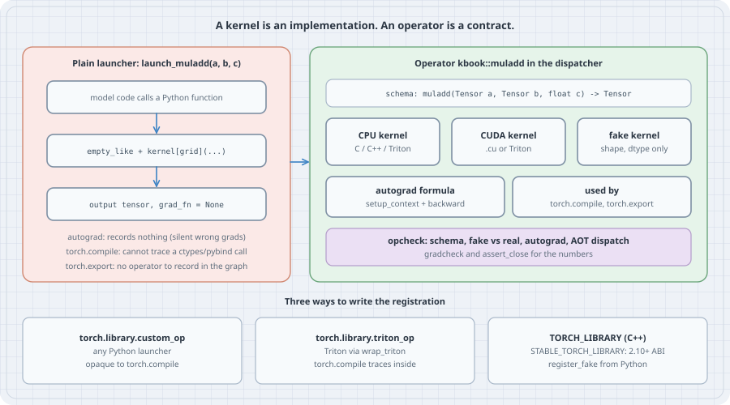

# From Kernel to Operator: Making a Hand-Written Kernel a Real PyTorch Op

## Thesis

Most kernel worklogs end at the same place: a `.cu` file or a `@triton.jit` function, a launcher that allocates the output and calls it, and a benchmark that beats the baseline. Then someone drops the launcher into a model and things go wrong, mostly without an error message. Autograd records nothing, so gradients that flow through the kernel are silently dropped. `torch.compile` cannot see inside a compiled native call (a pybind11 or ctypes binding), so it quietly breaks the graph there, or refuses to compile if you asked for `fullgraph=True`. `torch.export` has no operator to record for that call. The kernel was correct the whole time. What was missing was the **operator**: the PyTorch-facing contract that says what the kernel takes, what it returns, what it mutates, what its outputs look like without running it, and how to differentiate it.

This chapter takes one small kernel (`a * b + c`, the same example the official PyTorch C++ tutorial uses) and walks it from a bare launcher to a registered operator that passes `torch.library.opcheck`, `torch.autograd.gradcheck` and `torch.compile(fullgraph=True)`. The kernel is written in Triton and run here in the Triton interpreter, because this box has no GPU. Every Python listing below was run on the box with PyTorch 2.14.1 (CPU build) and Triton 3.8.0. The C++/CUDA registration at the end (`TORCH_LIBRARY` and the LibTorch stable ABI's `STABLE_TORCH_LIBRARY`) is taken from the official tutorial and was **not built here**. The box has a C compiler but no C++ compiler or Python headers, and no CUDA device.

## Mental model

{fig-alt="Left: a plain launcher launch_muladd(a, b, c). Model code calls a Python function, which allocates with empty_like and launches kernel[grid]; the output tensor has grad_fn None. Autograd records nothing, giving silent wrong gradients; torch.compile cannot trace a ctypes or pybind call; torch.export has no operator to record. Right: the operator kbook::muladd in the dispatcher, with a schema muladd(Tensor a, Tensor b, float c) -> Tensor, a CPU kernel (C, C++ or Triton), a CUDA kernel (.cu or Triton), a fake kernel that computes shape and dtype only, an autograd formula (setup_context plus backward), used by torch.compile and torch.export, and opcheck testing schema, fake versus real, autograd and AOT dispatch, with gradcheck and assert_close for the numbers. Bottom: three ways to write the registration: torch.library.custom_op for any Python launcher, opaque to torch.compile; torch.library.triton_op for Triton via wrap_triton, which torch.compile traces inside; TORCH_LIBRARY in C++, with STABLE_TORCH_LIBRARY for the 2.10+ stable ABI and register_fake added from Python."}

| Term | Plain meaning |
|------|---------------|
| Kernel | The implementation: a CUDA `__global__` function, a `@triton.jit` function, a C loop |
| Launcher | Host code that checks inputs, allocates outputs and launches the kernel |
| Operator | The contract PyTorch dispatches on: a namespaced name, a schema and a set of registrations |
| Schema | `muladd(Tensor a, Tensor b, float c) -> Tensor`: types, plus which inputs are mutated (`Tensor(a!)`) |
| Dispatcher | PyTorch's per-operator table that picks a kernel by backend (CPU, CUDA, Meta) and by feature (Autograd) |
| Fake kernel | A function that returns tensors with the right shape, dtype, device and strides without reading data. `torch.compile` and `torch.export` trace with it |
| Autograd formula | `setup_context` saves what backward needs; `backward` returns one gradient per input |
| `opcheck` | `torch.library.opcheck`: tests the contract (schema, fake vs real, autograd registration, AOT dispatch), not the numbers |

PyTorch's Python custom-ops guide states the split in two sentences: "A kernel is the implementation. An operator is the PyTorch-facing contract: name, inputs, outputs, mutation behavior, and subsystem registrations." Everything below follows from taking that seriously.

## Worked examples

The environment is a userland virtual environment with CPU wheels:

```bash
python -c "import sys, torch, triton; print(sys.version.split()[0], torch.__version__, triton.__version__, 'cuda available:', torch.cuda.is_available())"
```

Output:

```text
3.13.5 2.14.1+cpu 3.8.0 cuda available: False
```

### Case 1: The bare launcher, and the gradient that vanishes

Here is the kernel and the launcher a kernel repo usually ships. Nothing in it is wrong.

```python
# kernel.py: the hand-written kernel (Triton) and a bare launcher, with no PyTorch registration at all
import torch
import triton
import triton.language as tl


@triton.jit
def muladd_kernel(a_ptr, b_ptr, out_ptr, c, n, BLOCK: tl.constexpr):
    pid = tl.program_id(0)
    offs = pid * BLOCK + tl.arange(0, BLOCK)
    mask = offs < n
    a = tl.load(a_ptr + offs, mask=mask)
    b = tl.load(b_ptr + offs, mask=mask)
    tl.store(out_ptr + offs, a * b + c, mask=mask)


def launch_muladd(a: torch.Tensor, b: torch.Tensor, c: float) -> torch.Tensor:
    """Allocate the output, launch the kernel, return. This is all most kernel repos ship."""
    assert a.shape == b.shape and a.dtype == b.dtype
    a, b = a.contiguous(), b.contiguous()
    out = torch.empty_like(a)
    n = a.numel()
    if n:
        muladd_kernel[(triton.cdiv(n, 256),)](a, b, out, c, n, BLOCK=256)
    return out
```

Now use it the way a model would. Run it in the interpreter (`TRITON_INTERPRET=1` executes the Triton program with NumPy on the CPU; on a GPU you drop the variable and the same code compiles to PTX):

```python
# opaque.py: what goes wrong when the launcher is called as a plain function
import torch
from kernel import launch_muladd

torch.manual_seed(0)
a = torch.randn(1000)
b = torch.randn(1000)
print("1. eager forward matches a*b+1:", torch.allclose(launch_muladd(a, b, 1.0), a * b + 1))

# 2. Training: the kernel writes into a buffer that autograd never sees being computed.
a.requires_grad_()
y = launch_muladd(a, b, 1.0)
print("2. output requires_grad:", y.requires_grad, "| grad_fn:", y.grad_fn)

# 3. The quiet version of the same bug: mix the kernel with ordinary ops.
loss = (launch_muladd(a, b, 1.0) + a).sum()
loss.backward()
print("3. d loss / d a, first 3 entries:", a.grad[:3].tolist())
print("   correct (b + 1), first 3 entries:", (b + 1)[:3].tolist())
```

```bash
TRITON_INTERPRET=1 python opaque.py
```

Output:

```text
1. eager forward matches a*b+1: True
2. output requires_grad: False | grad_fn: None
3. d loss / d a, first 3 entries: [1.0, 1.0, 1.0]
   correct (b + 1), first 3 entries: [-1.2657949924468994, 2.099088668823242, 1.163913369178772]
```

Line 2 shows the problem directly. The kernel wrote into a buffer made by `torch.empty_like`, and autograd only records operations it dispatches, so the output has no `grad_fn`. Line 3 shows why this is dangerous rather than merely inconvenient. Called on its own, `backward()` would at least raise an error, because nothing in the loss requires grad. Mixed with an ordinary `+ a`, the loss *does* require grad, backward runs, and `a.grad` is exactly 1.0 everywhere: the `+ a` term's contribution, with the kernel's `b` silently missing. Nothing is printed and the model trains on wrong gradients.

### Case 2: A native call that `torch.compile` cannot see into

A CUDA extension bound with pybind11, or any compiled library called through ctypes, is a callable with no Python bytecode. TorchDynamo traces Python bytecode, so it has nothing to trace. The box has `gcc`, so the same kernel as a plain C function stands in for the compiled extension:

```c
/* muladd.c: the same kernel as a native CPU function, built with: gcc -O2 -shared -fPIC muladd.c -o libmuladd.so */
#include <stdint.h>

void muladd_f32(const float *a, const float *b, float c, float *out, int64_t n) {
    for (int64_t i = 0; i < n; i++) out[i] = a[i] * b[i] + c;
}
```

```python
# native.py: a compiled native kernel called through ctypes; Dynamo cannot look inside it
import ctypes
import torch
import torch._dynamo

lib = ctypes.CDLL("./libmuladd.so")
lib.muladd_f32.argtypes = [ctypes.c_void_p, ctypes.c_void_p, ctypes.c_float, ctypes.c_void_p, ctypes.c_int64]


def native_muladd(a: torch.Tensor, b: torch.Tensor, c: float) -> torch.Tensor:
    assert a.dtype == b.dtype == torch.float32 and a.shape == b.shape and a.device.type == "cpu"
    a, b = a.contiguous(), b.contiguous()
    out = torch.empty_like(a)
    lib.muladd_f32(a.data_ptr(), b.data_ptr(), c, out.data_ptr(), out.numel())
    return out


if __name__ == "__main__":
    a, b = torch.randn(1000), torch.randn(1000)
    print("eager matches a*b+1:", torch.allclose(native_muladd(a, b, 1.0), a * b + 1))

    @torch.compile(fullgraph=True)
    def f(a, b):
        return native_muladd(a, b, 1.0).relu()

    try:
        f(a, b)
        print("torch.compile(fullgraph=True): compiled")
    except Exception as e:
        lines = [l.strip() for l in str(e).strip().splitlines() if l.strip()]
        print("torch.compile(fullgraph=True) raised", type(e).__name__)
        for l in lines[:2]:
            print("  ", l[:150])

    # Without fullgraph=True there is no error: Dynamo splits the graph around the call.
    report = torch._dynamo.explain(lambda a, b: native_muladd(a, b, 1.0).relu())(a, b)
    print("without fullgraph:", report.graph_break_count, "graph break,", report.graph_count, "graphs")
    print("   break reason:", str(report.break_reasons[0].reason).strip().splitlines()[0][:120])
```

```bash
gcc -O2 -shared -fPIC muladd.c -o libmuladd.so && python native.py
```

Output:

```text
eager matches a*b+1: True
torch.compile(fullgraph=True) raised Unsupported
   call to a callable object with no traceable __call__
   Explanation: Dynamo could not trace a Python `__call__` method on this object.
without fullgraph: 1 graph break, 2 graphs
   break reason: call to a callable object with no traceable __call__
```

The last two lines show the default behaviour without `fullgraph=True`. There is no error, just a **graph break**: Dynamo compiles the code before the call, runs the call in eager Python, then compiles the code after it, and `torch._dynamo.explain` counts one break and two graphs. That is slower (no fusion across the boundary, extra guards) and it hides the problem. `fullgraph=True` is the honest test, and it is a good default while integrating a kernel.

A raw `@triton.jit` launch is a special case. The PyTorch recipe *Using User-Defined Triton Kernels with torch.compile* documents that, on a GPU, `torch.compile` can trace a Triton launch directly, without any wrapper. Under the CPU interpreter used here it cannot: running `opaque.py`'s launcher under `torch.compile(fullgraph=True)` on this box fails with `Unsupported` inside `triton/runtime/jit.py`. Even on a GPU, the same recipe's chart lists a bare Triton launch as lacking a CPU fallback, FlopCounter support and tensor-subclass support, and that is where `triton_op` comes in (Case 5).

### Case 3: Register it: `custom_op` plus a fake kernel

`torch.library.custom_op` (PyTorch 2.4+) turns a Python function with type hints into an operator. The schema is inferred from the hints. `mutates_args=()` declares that the function returns fresh tensors and writes into none of its inputs. `register_fake` gives the metadata-only implementation that `torch.compile` and `torch.export` call with FakeTensors.

```python
# op.py: register the launcher as a real operator, kbook::muladd
import torch
from kernel import launch_muladd


@torch.library.custom_op("kbook::muladd", mutates_args=())
def muladd(a: torch.Tensor, b: torch.Tensor, c: float) -> torch.Tensor:
    return launch_muladd(a, b, c)  # real kernel: runs only on real tensors


@muladd.register_fake
def _(a, b, c):
    # Metadata only: shape, dtype, device, strides. Never read a.data here.
    torch._check(a.shape == b.shape)
    torch._check(a.dtype == b.dtype)
    torch._check(a.device == b.device)
    return torch.empty_like(a, memory_format=torch.contiguous_format)


if __name__ == "__main__":
    print("schema:", muladd._opoverload._schema)
    print("same object as torch.ops path:", torch.ops.kbook.muladd.default is muladd._opoverload)

    graphs = []

    def show_graph(gm, example_inputs):
        graphs.append(gm)
        return gm.forward

    def body(a, b):
        return torch.ops.kbook.muladd(a, b, 1.0).relu() * 2

    f = torch.compile(body, backend=show_graph, fullgraph=True, dynamic=True)

    a, b = torch.randn(1000), torch.randn(1000)
    print("compiled result correct:", torch.allclose(f(a, b), (a * b + 1).relu() * 2))
    print("graphs captured:", len(graphs))
    for node in graphs[0].graph.nodes:
        if node.op not in ("placeholder", "output"):
            print(f"  {node.op:13s} {node.target}")

    g = torch.compile(body, backend="aot_eager", fullgraph=True)
    print("aot_eager (fake tensors + functionalization) correct:", torch.allclose(g(a, b), (a * b + 1).relu() * 2))

    from torch._subclasses.fake_tensor import FakeTensorMode
    with FakeTensorMode():
        fa = torch.empty(7, 3)
        fo = muladd(fa, torch.empty(7, 3), 1.0)
        print("fake call -> shape", tuple(fo.shape), "dtype", fo.dtype, "type", type(fo).__name__)

    res = torch.library.opcheck(muladd, (a, b, 1.0))
    print("opcheck:", res)
    res = torch.library.opcheck(muladd, (torch.randn(0), torch.randn(0), 2.0))
    print("opcheck on an empty tensor:", res)
    nc = torch.randn(8, 6).t()
    res = torch.library.opcheck(muladd, (nc, torch.randn(6, 8), 0.5))
    print("opcheck on a transposed input:", res)
```

```bash
TRITON_INTERPRET=1 python op.py
```

Output:

```text
schema: kbook::muladd(Tensor a, Tensor b, float c) -> Tensor
same object as torch.ops path: True
compiled result correct: True
graphs captured: 1
  call_function kbook.muladd
  call_method   relu
  call_function <built-in function mul>
aot_eager (fake tensors + functionalization) correct: True
fake call -> shape (7, 3) dtype torch.float32 type FakeTensor
opcheck: {'test_schema': 'SUCCESS', 'test_autograd_registration': 'SUCCESS', 'test_faketensor': 'SUCCESS', 'test_aot_dispatch_dynamic': 'SUCCESS'}
opcheck on an empty tensor: {'test_schema': 'SUCCESS', 'test_autograd_registration': 'SUCCESS', 'test_faketensor': 'SUCCESS', 'test_aot_dispatch_dynamic': 'SUCCESS'}
opcheck on a transposed input: {'test_schema': 'SUCCESS', 'test_autograd_registration': 'SUCCESS', 'test_faketensor': 'SUCCESS', 'test_aot_dispatch_dynamic': 'SUCCESS'}
```

Read the output top to bottom:

- The decorator produced a real dispatcher operator, `kbook::muladd(Tensor a, Tensor b, float c) -> Tensor`, and `torch.ops.kbook.muladd.default` is the same object. Code that only has the name (a C++ caller, an exported graph) can find it.
- `torch.compile(fullgraph=True, dynamic=True)` captured **one** graph containing `kbook.muladd` as a single opaque node, followed by the `relu` and `mul` that Inductor is free to fuse. This is what "opaque" means for `custom_op`. The compiler keeps the operator whole, calls the real kernel at run time, and uses the fake kernel only to learn output shapes while tracing. The listing prints the graph with a tiny custom backend, because Inductor's CPU backend generates C++ and this box has no C++ compiler. `backend="aot_eager"` runs the full fake-tensor and functionalization path without code generation, and its result matches.
- Calling the operator under `FakeTensorMode` returns a `FakeTensor` of shape `(7, 3)` without launching anything.
- `opcheck` ran its four default tests (`test_schema`, `test_autograd_registration`, `test_faketensor`, `test_aot_dispatch_dynamic`) on a normal input, an empty tensor and a transposed, non-contiguous one, as the guide recommends ("edge shapes such as empty tensors; important memory formats or non-contiguous strides").

The fake kernel returns a contiguous tensor because the launcher calls `.contiguous()` before allocating with `empty_like`. The fake kernel must describe *what the real kernel returns*, strides included, not what looks plausible. The trap section below shows what happens when it doesn't.

### Case 4: Teach autograd the backward

`register_autograd` takes a `backward(ctx, grad)` and a `setup_context(ctx, inputs, output)`. The backward has to be built from operators PyTorch understands. The C++ tutorial is explicit that if you want your own kernel in the backward, "it must be wrapped into a custom operator". Here the backward reuses `kbook::muladd` itself with `c = 0`, which is legal precisely because it is now an operator.

```python
# grad.py: teach autograd the backward of kbook::muladd, then check it
import torch
from op import muladd


def setup_context(ctx, inputs, output):
    a, b, c = inputs
    saved_a = a if ctx.needs_input_grad[1] else None
    saved_b = b if ctx.needs_input_grad[0] else None
    ctx.save_for_backward(saved_a, saved_b)


def backward(ctx, grad):
    a, b = ctx.saved_tensors
    grad_a = muladd(grad, b, 0.0) if ctx.needs_input_grad[0] else None  # d(a*b+c)/da = b
    grad_b = muladd(grad, a, 0.0) if ctx.needs_input_grad[1] else None  # d(a*b+c)/db = a
    return grad_a, grad_b, None  # c is a float: no gradient


muladd.register_autograd(backward, setup_context=setup_context)

if __name__ == "__main__":
    torch.manual_seed(0)
    a = torch.randn(1000, requires_grad=True)
    b = torch.randn(1000)
    y = muladd(a, b, 1.0)
    print("output requires_grad:", y.requires_grad, "| grad_fn:", type(y.grad_fn).__name__)

    loss = (muladd(a, b, 1.0) + a).sum()
    loss.backward()
    print("d loss / d a, first 3 entries:", a.grad[:3].tolist())
    print("correct (b + 1), first 3:     ", (b + 1)[:3].tolist())
    print("matches b + 1 everywhere:", torch.allclose(a.grad, b + 1))

    a64 = torch.randn(64, dtype=torch.float64, requires_grad=True)
    b64 = torch.randn(64, dtype=torch.float64, requires_grad=True)
    print("gradcheck (float64):", torch.autograd.gradcheck(lambda x, y: muladd(x, y, 3.0), (a64, b64)))

    args = (torch.randn(32, requires_grad=True), torch.randn(32, requires_grad=True), 1.0)
    print("opcheck with requires_grad inputs:", torch.library.opcheck(muladd, args))

    f = torch.compile(lambda a, b: muladd(a, b, 1.0).sum(), backend="aot_eager", fullgraph=True)
    a.grad = None
    f(a, b).backward()
    print("compiled backward matches b:", torch.allclose(a.grad, b))
```

```bash
TRITON_INTERPRET=1 python grad.py
```

Output:

```text
output requires_grad: True | grad_fn: GeneratedBackwardFor_kbook_muladd_defaultBackward
d loss / d a, first 3 entries: [-1.2657949924468994, 2.099088668823242, 1.163913369178772]
correct (b + 1), first 3:      [-1.2657949924468994, 2.099088668823242, 1.163913369178772]
matches b + 1 everywhere: True
gradcheck (float64): True
opcheck with requires_grad inputs: {'test_schema': 'SUCCESS', 'test_autograd_registration': 'SUCCESS', 'test_faketensor': 'SUCCESS', 'test_aot_dispatch_dynamic': 'SUCCESS'}
compiled backward matches b: True
```

The same `(kernel(a, b) + a).sum()` loss that produced `1.0` everywhere in Case 1 now produces `b + 1`. `gradcheck` compares the formula with finite differences in float64. The Triton kernel is dtype-generic, so the same kernel runs the double-precision check. `opcheck` with `requires_grad=True` inputs exercises `test_autograd_registration` for real this time, and a compiled forward and backward (`aot_eager`) matches too.

### Case 5: The same contract from C++, and the Triton-native route

The two steps that `custom_op` hid are visible in the lower-level `torch.library.Library` API: define a schema, then register a kernel per dispatch key. This is exactly what the C++ macros do, and it runs here:

```python
# two_step.py: TORCH_LIBRARY's two steps (define a schema, then register per-backend kernels), done from Python
import torch
from kernel import launch_muladd

lib = torch.library.Library("kbook2", "DEF")   # like TORCH_LIBRARY(kbook2, m)
lib.define("muladd(Tensor a, Tensor b, float c) -> Tensor")
lib.impl("muladd", launch_muladd, "CPU")       # like TORCH_LIBRARY_IMPL(kbook2, CPU, m)

a, b = torch.randn(6), torch.randn(6)
print("CPU kernel via the dispatcher:", torch.allclose(torch.ops.kbook2.muladd(a, b, 1.0), a * b + 1))

meta = torch.empty(6, device="meta")
try:
    torch.ops.kbook2.muladd(meta, meta, 1.0)
except NotImplementedError as e:
    print("meta tensor, no fake kernel yet ->", str(e).split(". ")[0])


@torch.library.register_fake("kbook2::muladd")  # the Python half of a C++ op, as in the tutorial
def _(a, b, c):
    return torch.empty_like(a)


out = torch.ops.kbook2.muladd(meta, meta, 1.0)
print("meta tensor, after register_fake ->", out.shape, out.device)
print("opcheck:", torch.library.opcheck(torch.ops.kbook2.muladd.default, (a, b, 1.0)))
```

```bash
TRITON_INTERPRET=1 python two_step.py
```

Output:

```text
CPU kernel via the dispatcher: True
meta tensor, no fake kernel yet -> kbook2::muladd: attempted to run this operator with Meta tensors, but there was no fake impl or Meta kernel registered
meta tensor, after register_fake -> torch.Size([6]) meta
opcheck: {'test_schema': 'SUCCESS', 'test_autograd_registration': 'SUCCESS', 'test_faketensor': 'SUCCESS', 'test_aot_dispatch_dynamic': 'SUCCESS'}
```

The meta-tensor call failing *before* `register_fake` and succeeding after it is the whole job of a fake kernel. With the fake kernel in place, PyTorch can push shapes through the operator without running it.

In C++ the same split is `TORCH_LIBRARY` (define) and `TORCH_LIBRARY_IMPL` (implement per backend). For PyTorch 2.10 and later the tutorial recommends the **LibTorch stable ABI** variant, which builds one wheel that works across PyTorch 2.10, 2.11, 2.12 and later releases instead of one wheel per PyTorch version. The stable headers (`torch/csrc/stable/library.h`, with `STABLE_TORCH_LIBRARY`, `STABLE_TORCH_LIBRARY_IMPL` and `TORCH_BOX`) ship in the 2.14.1 wheel used here; the code below is from the official tutorial and was **not compiled on this box** (no `g++`, no `Python.h`, no CUDA device):

```cpp
// Not built here. From "Custom C++ and CUDA Operators" (docs.pytorch.org), stable-ABI tab, abridged.
#include <torch/csrc/stable/library.h>
#include <torch/csrc/stable/ops.h>
#include <torch/csrc/stable/tensor.h>
#include <torch/csrc/stable/c/shim.h>
#include <cuda.h>
#include <cuda_runtime.h>

__global__ void muladd_kernel(int numel, const float* a, const float* b, float c, float* result) {
  int idx = blockIdx.x * blockDim.x + threadIdx.x;
  if (idx < numel) result[idx] = a[idx] * b[idx] + c;
}

torch::stable::Tensor mymuladd_cuda(const torch::stable::Tensor& a,
                                    const torch::stable::Tensor& b, double c) {
  STD_TORCH_CHECK(a.sizes().equals(b.sizes()));
  STD_TORCH_CHECK(a.scalar_type() == torch::headeronly::ScalarType::Float);
  STD_TORCH_CHECK(a.device().type() == torch::headeronly::DeviceType::CUDA);
  torch::stable::Tensor a_contig = torch::stable::contiguous(a);
  torch::stable::Tensor b_contig = torch::stable::contiguous(b);
  torch::stable::Tensor result = torch::stable::empty_like(a_contig);
  int numel = a_contig.numel();
  void* stream_ptr = nullptr;
  TORCH_ERROR_CODE_CHECK(aoti_torch_get_current_cuda_stream(a.get_device_index(), &stream_ptr));
  muladd_kernel<<<(numel + 255) / 256, 256, 0, static_cast<cudaStream_t>(stream_ptr)>>>(
      numel, a_contig.const_data_ptr<float>(), b_contig.const_data_ptr<float>(), c,
      result.mutable_data_ptr<float>());
  return result;
}

STABLE_TORCH_LIBRARY(extension_cpp, m) {
  m.def("mymuladd(Tensor a, Tensor b, float c) -> Tensor");   // "float" is C++ double
}

STABLE_TORCH_LIBRARY_IMPL(extension_cpp, CUDA, m) {
  m.impl("mymuladd", TORCH_BOX(&mymuladd_cuda));
}
```

```python
# Not built here. setup.py from the same tutorial: one wheel for CPython 3.9+ and PyTorch 2.10+.
# Use cpp_extension.CUDAExtension instead of CppExtension when the sources include .cu files.
from setuptools import setup
from torch.utils import cpp_extension

setup(name="extension_cpp",
      ext_modules=[cpp_extension.CppExtension(
          "extension_cpp", ["muladd.cpp"],
          extra_compile_args={"cxx": ["-DPy_LIMITED_API=0x03090000",
                                      "-DTORCH_TARGET_VERSION=0x020a000000000000"]},
          py_limited_api=True)],
      cmdclass={"build_ext": cpp_extension.BuildExtension},
      options={"bdist_wheel": {"py_limited_api": "cp39"}})
```

`TORCH_TARGET_VERSION` is encoded as `[major][minor][patch][5-byte ABI tag]`, so `0x020a000000000000` means "2.10.0 or later". The Python half is the same `register_fake` and `register_autograd` calls as Cases 3 and 4, made by name (`"extension_cpp::mymuladd"`) *after* the library is loaded. The library is loaded either by importing a stub `_C` module or, with no `Python.h` at all, by calling `torch.ops.load_library(path_to_so)`. The tutorial warns that the order matters: the C++ definitions must be loaded before the Python registrations.

Two older routes are worth recognising when you meet them in existing code. `torch.utils.cpp_extension.load_inline(..., functions=[...])` and a `PYBIND11_MODULE` that binds `muladd` directly produce exactly the Case 2 situation: a callable PyTorch cannot see. They are fine for a quick eager-mode experiment and wrong for anything that trains or compiles. The tutorial also points out that pybind11 does not limit itself to the stable CPython API, which is why it builds its `_C` stub module with plain `PyModule_Create` under `Py_LIMITED_API`.

For a kernel that is *already Triton*, there is a third route: `torch.library.triton_op` with `wrap_triton(kernel)[grid](...)`. Unlike `custom_op`, which the Triton recipe describes as creating "opaque callables with respect to `torch.compile`", `torch.compile` *traces into* a `triton_op` and can optimise around the kernel, while the op still supports `register_autograd`, a CPU fallback and FlopCounter. It needs real fake-tensor tracing of the Triton launch. Under the CPU interpreter it fails here: the interpreter reads the data pointers of FakeTensors, and PyTorch rejects that ("Attempted to set the storage of a tensor on device \"meta\" to a storage on different device \"cpu\""). So this route is described from the recipe and labelled **not run**. On a GPU it is the natural wrapper for Triton kernels. The recipe's chart has one trade-off: `custom_op` works with `torch.compile(fullgraph=True)` "in all cases", while `triton_op` and bare launches do "in the majority of cases", because tracing into the kernel is more ambitious than treating it as a black box.

## The trap

The trap is that a wrong registration runs fine in eager mode. The schema and the fake kernel are *promises*. Eager execution never checks them; the compiler and exporter rely on them. All three of these broken registrations compute the right forward result in eager mode:

```python
# trap.py: three registrations that run fine in eager mode and are still wrong
import torch
from kernel import launch_muladd
from torch.library import custom_op, opcheck


def first_line(e):
    return str(e).strip().splitlines()[0].replace(" (scroll up for stack trace)", "")[:230]


def failed_tests(op, args):
    try:
        return opcheck(op, args)
    except Exception as e:
        return f"{type(e).__name__}: {first_line(e)}"


# A. A kernel that writes into its input, registered as if it were functional.
@custom_op("trap::scale_", mutates_args=())          # wrong: should be mutates_args={"x"}
def scale_(x: torch.Tensor, s: float) -> None:
    x.mul_(s)                                          # stands in for a kernel that stores into x


x = torch.ones(4)
scale_(x, 3.0)
print("A. eager result:", x.tolist())
print("   opcheck:", failed_tests(scale_, (torch.ones(4), 3.0)))


# B. A row-sum kernel whose fake kernel copies the input's shape.
@custom_op("trap::rowsum", mutates_args=())
def rowsum(x: torch.Tensor) -> torch.Tensor:
    return x.sum(dim=1)                                # stands in for a hand-written reduction


@rowsum.register_fake
def _(x):
    return torch.empty_like(x)                         # wrong: real output has shape (rows,)


print("B. eager shape:", tuple(rowsum(torch.ones(5, 3)).shape))
print("   opcheck:", failed_tests(rowsum, (torch.ones(5, 3),)))


# C. A functional kernel with a fake kernel but no autograd registration.
@custom_op("trap::muladd_noautograd", mutates_args=())
def muladd_na(a: torch.Tensor, b: torch.Tensor, c: float) -> torch.Tensor:
    return launch_muladd(a, b, c)


@muladd_na.register_fake
def _(a, b, c):
    return torch.empty_like(a)


a = torch.randn(4, requires_grad=True)
try:
    muladd_na(a, torch.randn(4), 1.0).sum().backward()
    print("C. backward ran; a.grad =", a.grad)
except Exception as e:
    print("C. backward raised", type(e).__name__ + ":", first_line(e))
```

```bash
TRITON_INTERPRET=1 python trap.py
```

Output:

```text
A. eager result: [3.0, 3.0, 3.0, 3.0]
   opcheck: OpCheckError: opcheck(op, ...): test_schema failed with Argument x is not defined as mutable but was mutated
B. eager shape: (5,)
   opcheck: OpCheckError: opcheck(op, ...): test_faketensor failed with When comparing the output of trap.rowsum.default on FakeTensor and concrete Tensors, found mismatched tensor metadata: Shapes torch.Size([5]) and torch.Size([5, 3]) are not equal!
C. backward raised RuntimeError: Trying to backward through trap.muladd_noautograd.default but no autograd formula was registered. Please use register_autograd to add one.
```

- **A** declares `mutates_args=()` for a kernel that writes into `x`. The guide is blunt about the rule: "the operator may not mutate an input that is not marked as being mutated". PyTorch does not infer the contract from the function body. Functionalization and the compiler treat the call as pure, so they may reorder or drop work around a write they were never told about. `opcheck`'s `test_schema` catches the write.
- **B** has a fake kernel that copies the input's shape for a row reduction. A `torch.compile` trace would carry `(5, 3)` forward where the real tensor is `(5,)`, and every downstream shape would be wrong. `test_faketensor` runs fake and real side by side and reports the mismatch.
- **C** has no autograd formula. This one at least fails loudly at `backward()`, instead of training on the wrong gradient as the bare launcher did in Case 1.

None of these are numerical bugs, and `opcheck` is not a numerical test either. The guide says so: use `torch.testing.assert_close` for the forward and `gradcheck` for the gradient. You need both kinds of test.

## The boring rule

Never hand a model a kernel launcher. Hand it an operator:

1. Name it in a namespace you own (`yourproject::op`) and write the schema first, including every mutated argument (`mutates_args`, or `Tensor(a!)` in C++).
2. Register the kernel per backend: `custom_op` for any Python launcher, `triton_op` + `wrap_triton` for Triton on a GPU, `TORCH_LIBRARY`/`STABLE_TORCH_LIBRARY` for C++/CUDA (prefer the stable ABI on 2.10+). If the model must run without Python (AOTInductor), the Python guide says to define the operator and its kernels in C++. The Triton recipe's chart marks `custom_op` as not supported by AOTInductor.
3. Register a fake kernel that returns *exactly* the real output's metadata and never reads data.
4. If it trains, register autograd with a backward built from operators, including your own kernels wrapped as operators.
5. Before anyone uses it, run `opcheck` on representative inputs (empty, non-contiguous, every dtype and device you support, `requires_grad=True`), plus `assert_close` and `gradcheck`, and compile once with `fullgraph=True`.

## Try this

1. Change `op.py`'s fake kernel to `return torch.empty_like(a)` with no `memory_format` and run `opcheck` on the transposed input. `empty_like` preserves the input's strides, so the fake output is transposed while the real one is contiguous. Which `opcheck` test reports it, and with what message?
2. Write an in-place `kbook::muladd_` that stores into `a`, declare `mutates_args={"a"}`, and confirm `opcheck` passes. Then return `a` from it and read the C++ tutorial's note on why returning a mutated input breaks `torch.compile`.
3. Remove `ctx.needs_input_grad` from `setup_context` and save both tensors unconditionally. Everything still passes. What memory does the conditional save, and when does it matter?
4. On a machine with a GPU, rewrite `op.py` with `triton_op` + `wrap_triton`, compile with the default Inductor backend, and compare the generated code (`TORCH_LOGS=output_code`) with the `custom_op` version. Which one fused the `relu`?

## Sources

- PyTorch tutorials, [Custom C++ and CUDA Operators](https://docs.pytorch.org/tutorials/advanced/cpp_custom_ops.html) (Richard Zou): `TORCH_LIBRARY`, `STABLE_TORCH_LIBRARY`, `TORCH_BOX`, `Py_LIMITED_API`, `TORCH_TARGET_VERSION`, `torch.ops.load_library`, Python-side `register_fake`/`register_autograd`. Companion code: [pytorch/extension-cpp](https://github.com/pytorch/extension-cpp).
- PyTorch tutorials, [Custom Python Operators](https://docs.pytorch.org/tutorials/advanced/python_custom_ops.html): the kernel-versus-operator definition, the schema and mutation/aliasing contract, fake-kernel rules and `opcheck` coverage.
- PyTorch tutorials, [The Custom Operators Manual](https://docs.pytorch.org/tutorials/advanced/custom_ops_landing_page.html).
- PyTorch recipes, [Using User-Defined Triton Kernels with torch.compile](https://docs.pytorch.org/tutorials/recipes/torch_compile_user_defined_triton_kernel_tutorial.html): bare Triton launches under `torch.compile`, `triton_op` and `wrap_triton`, and the comparison chart against `custom_op`.
- PyTorch docs, [torch.library](https://docs.pytorch.org/docs/stable/library.html) (`custom_op`, `register_fake`, `register_autograd`, `opcheck`, `Library`) and [torch.utils.cpp_extension](https://docs.pytorch.org/docs/stable/cpp_extension.html) (`load_inline`, `CppExtension`, `CUDAExtension`).
- PyTorch notes, [LibTorch Stable ABI](https://docs.pytorch.org/docs/main/notes/libtorch_stable_abi.html).
- Triton docs, [Debugging Triton](https://triton-lang.org/main/programming-guide/chapter-3/debugging.html) (`TRITON_INTERPRET=1`).
- Python docs, [ctypes](https://docs.python.org/3/library/ctypes.html).
