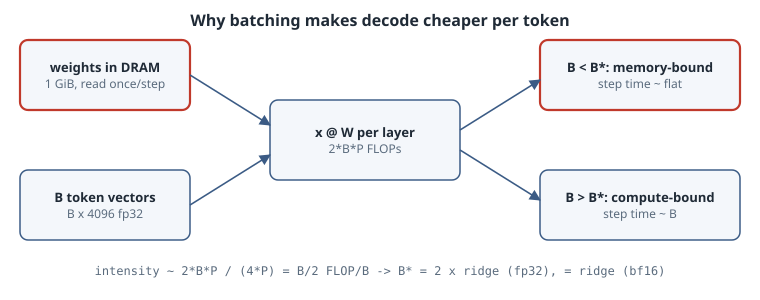

# Decode Is Memory-Bound: Measuring the Batch-Size Knee

## Thesis

An LLM generates one token per sequence per decode step, and **every weight has to be streamed from memory once per step**, whether the batch holds one sequence or a thousand. FLOPs grow with the batch size $B$, but weight bytes don't. Batch-1 decode therefore has an arithmetic intensity well below one FLOP per byte, and the batch is the main knob that moves it toward the roofline ridge. This chapter measures that on a CPU with a 1 GiB stand-in "model". Below the knee, extra sequences are almost free. Above it, step time grows linearly with $B$. The knee lands roughly where the [roofline](../01-parallelism-cpu-to-gpu/02-roofline-model-and-limits.qmd) predicts.

## Mental model

{fig-alt="A decode step reads every weight once from DRAM regardless of batch size B, while FLOPs grow as 2 times B times parameters. Arithmetic intensity is about B/2 FLOP per byte for fp32 weights. Below the ridge point the step time is set by bandwidth and stays flat as B grows; above it the step time is set by compute and grows linearly with B."}

Take a model with $P$ parameters stored with $s$ bytes each. One decode step for $B$ sequences does about $2BP$ FLOPs of matmul and reads $sP$ bytes of weights. If activations are small enough to ignore, the intensity is

$$
I(B) \approx \frac{2BP}{sP} = \frac{2B}{s}\ \text{FLOP/byte}.
$$

A machine with peak compute $\pi$ and bandwidth $\beta$ has its ridge at $I^* = \pi/\beta$. Setting $I(B^*) = I^*$ gives the knee:

$$
B^* \approx \frac{s\,\pi}{2\,\beta}.
$$

For example, NVIDIA's H100 SXM datasheet lists 989 TFLOPS of dense BF16 compute (1,979 with sparsity) and 3.35 TB/s of HBM3 bandwidth. That puts $I^* \approx 295$ FLOP/B and, with $s=2$, $B^* \approx 295$ sequences. Below that, an H100 decoding a dense model spends most of each step waiting on HBM. (This back-of-the-envelope estimate ignores the attention part of decode; see Pitfalls.)

## Worked example

The stand-in model is 16 square fp32 layers of $4096 \times 4096$, which is 1 GiB of weights. That is several times larger than this machine's 320 MiB L3, so every step streams from DRAM. One "decode step" multiplies a $(B, 4096)$ activation matrix through all 16 layers. Both ceilings come from the ends of the sweep itself rather than from datasheets. $B=1$ is a pure weight stream at 0.5 FLOP/B, so its rate is the achievable bandwidth. The best large-$B$ rate is the achievable compute.

```python
"""Decode is memory-bound at small batch: sweep batch size over a 1 GiB 'model'."""
import time
import numpy as np

D, L = 4096, 16                      # 16 square fp32 layers of 4096x4096 = 1 GiB of weights
rng = np.random.default_rng(0)
W = [rng.standard_normal((D, D), dtype=np.float32) * D ** -0.5 for _ in range(L)]
weight_bytes = sum(w.nbytes for w in W)

def best(f, reps):
    f()                                   # warm-up
    ts = []
    for _ in range(reps):
        t = time.perf_counter(); f(); ts.append(time.perf_counter() - t)
    return min(ts)

def step(x):                          # one decode step: every weight is read once for B tokens
    for w in W:
        x = x @ w
    return x

batches = [1, 2, 4, 8, 16, 32, 64, 128, 256, 512, 1024, 2048]
times = {}
for B in batches:
    x = rng.standard_normal((B, D), dtype=np.float32)
    times[B] = best(lambda: step(x), reps=7 if B <= 256 else 3)

# Ceilings taken from the two ends of the sweep:
#   B=1 is a GEMV (0.5 FLOP/B), a pure stream over the weights -> achievable read bandwidth
#   the best large-B rate (B >= 256, fat GEMMs)                -> achievable compute
bw = weight_bytes / times[1]
peak = max(2 * B * D * D * L / times[B] for B in batches if B >= 256)
ridge = peak / bw
print(f"weights {weight_bytes/2**30:.2f} GiB fp32 | read BW {bw/1e9:.1f} GB/s | "
      f"compute {peak/1e9:.0f} GFLOP/s | ridge {ridge:.1f} FLOP/B -> "
      f"knee B* = ridge*4/2 = {ridge*2:.0f} tokens\n")
print(f"{'B':>5} {'step ms':>8} {'roofline ms':>11} {'ms/token':>9} {'tokens/s':>9} "
      f"{'GFLOP/s':>8} {'weight GB/s':>11} {'AI FLOP/B':>9}")
for B in batches:
    t, flops = times[B], 2 * B * D * D * L
    ai = flops / (weight_bytes + 2 * 4 * B * D * L)          # weights + activations in/out
    pred = max(weight_bytes / bw, flops / peak)             # roofline: the slower of the two
    print(f"{B:5d} {t*1e3:8.1f} {pred*1e3:11.1f} {t*1e3/B:9.3f} {B/t:9.0f} "
          f"{flops/t/1e9:8.0f} {weight_bytes/t/1e9:11.1f} {ai:9.1f}")
```

Output (8 vCPU Intel Xeon VM, CPython 3.15.0, NumPy 2.5.4 with OpenBLAS 0.3.34; the box was shared with other jobs, with a load average of about 3, so the absolute numbers carry roughly ±20% noise between runs):

```text
weights 1.00 GiB fp32 | read BW 92.4 GB/s | compute 1546 GFLOP/s | ridge 16.7 FLOP/B -> knee B* = ridge*4/2 = 33 tokens

    B  step ms roofline ms  ms/token  tokens/s  GFLOP/s weight GB/s AI FLOP/B
    1     11.6        11.6    11.624        86       46        92.4       0.5
    2     30.0        11.6    14.992        67       36        35.8       1.0
    4     29.9        11.6     7.467       134       72        36.0       2.0
    8     29.5        11.6     3.690       271      146        36.4       4.0
   16     33.0        11.6     2.062       485      260        32.5       7.9
   32     40.2        11.6     1.255       797      428        26.7      15.8
   64     53.5        22.2     0.836      1197      642        20.1      31.0
  128     76.0        44.5     0.594      1684      904        14.1      60.2
  256    119.8        88.9     0.468      2138     1148         9.0     113.8
  512    200.2       177.8     0.391      2557     1373         5.4     204.8
 1024    355.6       355.6     0.347      2879     1546         3.0     341.3
 2048    843.5       711.3     0.412      2428     1304         1.3     512.0
```

### Reading the output

- **The flat region.** From $B=2$ to $B=16$ the step time barely moves (30.0 → 33.0 ms), yet throughput rises from 67 to 485 tokens/s. In this region the weight stream sets the cost, so extra sequences ride along almost for free. Continuous batching in servers like vLLM exploits exactly this.
- **The knee is where the roofline puts it.** The measured ceilings (92 GB/s, 1546 GFLOP/s) give a ridge of 16.7 FLOP/B, which predicts $B^* \approx 33$. Step time starts climbing between 32 and 64. By $B \ge 256$ the step time grows almost linearly with $B$ (120 → 200 → 356 ms), which is the compute-bound regime.
- **Per-token latency has diminishing returns.** ms/token falls 33× from $B=1$ to $B=1024$ (11.6 → 0.35). Most of that gain arrives by $B \approx 128$. Past the knee, extra batch buys throughput only by making each step, and therefore each user's inter-token latency, slower.
- **The transition is soft.** Measured times sit above the roofline lower bound in the middle (for example, 53.5 vs 22.2 ms at $B=64$). Real kernels don't reach peak bandwidth and peak compute at the same time, and the skinny GEMMs at mid-$B$ use neither unit efficiently.
- **$B=1$ is an outlier.** The batch-1 step (11.6 ms) is 2.6× faster than $B=2$ (30.0 ms), and its implied bandwidth is 92 GB/s against about 36 GB/s for $B = 2$–$16$. A $(1, D)$ operand is handled by a different, better-streaming code path than a skinny $(2, D)$ GEMM. We measured the effect but didn't trace which BLAS kernel runs; Exercise 1 asks you to find out. On real serving stacks, the same lesson motivates dedicated skinny-GEMM / GEMV decode kernels.
- **$B=2048$ falls off.** Activations reach 32 MiB per layer, and throughput drops back to 2428 tokens/s. Cache pressure from activations is starting to count, a reminder that the "weights only" intensity formula is an approximation.

## Pitfalls

- **Attention doesn't amortize.** The roofline above covers the weight matmuls. During decode, each sequence's attention reads *its own* KV cache, so attention bytes grow with $B$ just as FLOPs do, and attention stays memory-bound at every batch size. As contexts grow, attention's share of the step grows, and the effective knee moves out. This is why [PagedAttention](07-pagedattention-kv-cache.qmd), [Flash-Decoding](08-flash-decoding-split-kv.qmd) and [KV-cache quantization](08b-turboquant-kv-cache-quantization.qmd) target the cache, not the weights.
- **Use the right byte count.** Halving $s$ (fp32 → bf16 → fp8/int4) halves the bytes per step, and it also halves $B^*$. Weight quantization speeds up small-batch decode almost linearly, but it doesn't help much past the knee.
- **Don't trust datasheet ceilings blindly.** Achievable bandwidth and compute are usually well below the spec. This chapter measures both from the sweep itself. On a shared machine, repeat runs and take the best time, as `best()` does.
- **Latency SLOs cap the batch.** The knee maximizes hardware efficiency, not user experience. Servers pick $B$ to meet an inter-token-latency target, and that target may sit below or above $B^*$.

## Exercises

1. Explain the $B=1$ vs $B=2$ gap. Time `x[0] @ w` (a true 1-D vector) and `x @ w` for $B=1,2$, then set `OPENBLAS_NUM_THREADS=1` and repeat. Which path streams faster, and does the gap survive single-threading?
2. Rerun the sweep with `np.float64` weights ($s=8$). Does $B^*$ move by the factor that $s$ predicts? (Avoid `np.float16`: NumPy has no BLAS path for it, so you would be measuring a slow fallback loop, not memory.)
3. Add a per-sequence "KV cache" read of $B \times T \times 4096 \times 4$ bytes per layer, for $T = 512$ and $4096$. Plot tokens/s against $B$ and find where attention bytes dominate.
4. Using the H100 numbers above, compute $B^*$ for an fp8 dense model, and for a 70B model sharded over 8 GPUs (per-GPU bandwidth and FLOPs).

## Sources

- S. Williams, A. Waterman, D. Patterson, "Roofline: An Insightful Visual Performance Model for Multicore Architectures," *Communications of the ACM* 52(4), 2009. <https://doi.org/10.1145/1498765.1498785>
- R. Pope et al., "Efficiently Scaling Transformer Inference," *MLSys 2023*, arXiv:2211.05102. <https://arxiv.org/abs/2211.05102>
- W. Kwon et al., "Efficient Memory Management for Large Language Model Serving with PagedAttention," *SOSP 2023*, arXiv:2309.06180. <https://arxiv.org/abs/2309.06180>
- NVIDIA H100 Tensor Core GPU product page and datasheet (BF16 1,979 TFLOPS with sparsity, 3.35 TB/s SXM). <https://www.nvidia.com/en-us/data-center/h100/>
- NumPy [`numpy.matmul`](https://numpy.org/doc/stable/reference/generated/numpy.matmul.html); [OpenBLAS](https://github.com/OpenMathLib/OpenBLAS).
