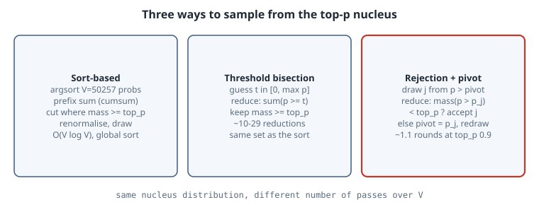

# Top-k and Top-p Sampling Without a Sort

## Thesis

After the last matmul, a serving engine still has to choose *one* token per sequence. Top-p (nucleus) sampling keeps the smallest set of tokens whose probabilities add up to at least $p$, then samples inside that set. The textbook implementation sorts the whole vocabulary, takes a cumulative sum, and cuts. Over 50k–250k-entry rows, at every decode step and in every batch, that sort becomes a visible slice of inter-token latency. You do not need it. The nucleus is just $\{i : p_i \ge t\}$ for one threshold $t$, and a draw from the nucleus can be made by **rejection sampling with a rising pivot**. Both approaches use only reductions and prefix sums, which GPUs do in one pass. This chapter runs all of these variants on real GPT-2 logits and shows they produce the same distribution:

- sort + cumsum
- threshold bisection
- single-pivot rejection
- FlashInfer's dual-pivot rejection

## Mental model

{fig-alt="Three ways to sample from the top-p nucleus. Sort-based: sort probabilities descending, cumulative sum, cut at p, sample. Threshold: bisect on a probability threshold t, where each step is one reduction of the mass at or above t, then sample from tokens above t. Rejection: draw a token from all tokens above a pivot, accept if the mass strictly above it is less than p, otherwise raise the pivot to its probability and redraw."}

**Definitions.**

- **Top-k** keeps the $k$ most probable tokens (Fan et al., 2018).
- **Top-p** keeps the smallest prefix, in descending order, whose mass is $\ge p$ (Holtzman et al., 2020).
- **Min-p** keeps every token with $p_i \ge p_{\text{base}} \cdot p_{\max}$ (Nguyen et al., 2024).

All three are a *mask*, followed by renormalisation and a categorical draw.

**The threshold view.** Let $M(t) = \sum_{p_i \ge t} p_i$. $M$ is a non-increasing step function of $t$. The nucleus is $\{i: p_i \ge t^\star\}$, where $t^\star$ is the largest $t$ with $M(t) \ge p$. Bisection on $t \in [0, p_{\max}]$ finds it. Each step is one masked sum over the row: a reduction, with no data movement.

**The rejection view.** You do not even need $t^\star$, only a draw from the nucleus.

1. Draw $j$ from all tokens above a pivot, which starts at $0$.
2. If the mass *strictly above* $p_j$ is less than $p$, then $j$ is in the nucleus. Accept it.
3. Otherwise $j$ and everything at or below $p_j$ is outside the nucleus. Set the pivot to $p_j$ and redraw.

Conditioned on acceptance, each nucleus token comes out with probability proportional to $p_i$. The FlashInfer blog gives the proof. The intuition is that a rejection only removes tokens that are all outside the nucleus, and it never changes the relative odds of the tokens inside.

**Why the dual pivot matters.** A single pivot has no worst-case bound on the number of rounds. FlashInfer v0.2.3 keeps an interval $[\text{low}, \text{high}]$. After rejecting $j$, it also tests the midpoint $(p_j + \text{high})/2$, so each rejection at least halves the interval. That bounds the rounds at $O(\log(1/\varepsilon))$.

## Worked example

First, real logits. This script runs GPT-2 small (124M, the `openai-community/gpt2` safetensors) in plain NumPy and saves the next-token logits for three prompts:

```python
"""Next-token logits from GPT-2 small (124M) in pure NumPy, for three prompts -> logits.npy"""
import json, struct
import numpy as np, tiktoken

def load(path):
    with open(path, "rb") as f:
        n = struct.unpack("<Q", f.read(8))[0]; hdr = json.loads(f.read(n))
    raw = np.memmap(path, dtype=np.uint8, mode="r"); base = 8 + n
    return {k: np.frombuffer(raw[base + m["data_offsets"][0]: base + m["data_offsets"][1]],
                             np.float32).reshape(m["shape"]) for k, m in hdr.items() if k != "__metadata__"}

W = load("model.safetensors"); L, H, D = 12, 12, 64
ln = lambda x, p: (x - x.mean(-1, keepdims=True)) / np.sqrt(x.var(-1, keepdims=True) + 1e-5) * W[p + ".weight"] + W[p + ".bias"]
gelu = lambda x: 0.5 * x * (1 + np.tanh(0.7978845608 * (x + 0.044715 * x ** 3)))

def last_logits(tokens):
    T = len(tokens); x = W["wte.weight"][tokens] + W["wpe.weight"][:T]
    mask = np.triu(np.full((T, T), -np.inf, np.float32), 1)
    for i in range(L):
        p = f"h.{i}."
        qkv = ln(x, p + "ln_1") @ W[p + "attn.c_attn.weight"] + W[p + "attn.c_attn.bias"]
        q, k, v = (a.reshape(T, H, D).transpose(1, 0, 2) for a in np.split(qkv, 3, -1))
        a = q @ k.transpose(0, 2, 1) / D ** 0.5 + mask
        a = np.exp(a - a.max(-1, keepdims=True)); a /= a.sum(-1, keepdims=True)
        x = x + (a @ v).transpose(1, 0, 2).reshape(T, H * D) @ W[p + "attn.c_proj.weight"] + W[p + "attn.c_proj.bias"]
        x = x + gelu(ln(x, p + "ln_2") @ W[p + "mlp.c_fc.weight"] + W[p + "mlp.c_fc.bias"]) @ W[p + "mlp.c_proj.weight"] + W[p + "mlp.c_proj.bias"]
    return ln(x[-1], "ln_f") @ W["wte.weight"].T          # tied embeddings

enc = tiktoken.get_encoding("gpt2")
prompts = ["The capital of France is", "My favourite colour is", "Once upon a time, there was a"]
logits = np.stack([last_logits(enc.encode(s)) for s in prompts])
np.save("logits.npy", logits)
for s, z in zip(prompts, logits):
    print(f"{s!r:36} top-5: {[enc.decode([int(t)]) for t in np.argsort(-z)[:5]]}")
```

Output:

```text
'The capital of France is'           top-5: [' the', ' now', ' a', ' France', ' Paris']
'My favourite colour is'             top-5: [' the', ' blue', ' black', ' red', ' a']
'Once upon a time, there was a'      top-5: [' man', ' great', ' time', ' certain', ' woman']
```

The top-5 are realistic for a 124M model. " Paris" is fifth for France, which is exactly the situation where sampling choices matter.

Then the samplers. There are four implementations of top-p, each checked against the sort-based reference:

```python
"""Top-k / top-p sampling three ways on real GPT-2 logits: sort+cumsum, threshold bisection, rejection with a pivot."""
import time
import numpy as np

logits = np.load("logits.npy").astype(np.float64)          # (3 prompts, 50257)
rng = np.random.default_rng(0)

def softmax(z, temp=1.0):
    z = z / temp; e = np.exp(z - z.max()); return e / e.sum()

# 1) Reference: sort descending, cumulative sum, cut (what a sort-based sampler does).
def top_p_sorted(p, top_p):
    order = np.argsort(-p, kind="stable"); cs = np.cumsum(p[order])
    keep = order[: np.searchsorted(cs, top_p) + 1]           # smallest prefix with mass >= top_p
    q = np.zeros_like(p); q[keep] = p[keep]; return q / q.sum()

def top_k_sorted(p, k):
    keep = np.argpartition(-p, k - 1)[:k]
    q = np.zeros_like(p); q[keep] = p[keep]; return q / q.sum()

# 2) Sort-free: bisect on a probability threshold t. Each step is one parallel reduction over V.
def top_p_threshold(p, top_p, iters=64):
    lo, hi = 0.0, p.max()                    # invariant: mass(p >= lo) >= top_p > mass(p >= hi)
    for i in range(iters):
        mid = 0.5 * (lo + hi)
        if p[p >= mid].sum() >= top_p: lo = mid
        else: hi = mid
        if p[(p >= lo) & (p < hi)].size == 1 or hi - lo < 1e-18: break
    q = np.where(p >= lo, p, 0.0); return q / q.sum(), i + 1

# 3) Sort-free rejection sampling with a rising pivot (the FlashInfer idea).
def top_p_rejection(p, top_p, rng):
    pivot, rounds = 0.0, 0
    while True:
        rounds += 1
        cand = np.where(p > pivot, p, 0.0)                    # one pass: mask below pivot
        j = np.searchsorted(np.cumsum(cand), rng.random() * cand.sum())   # inverse-CDF draw
        if p[p > p[j]].sum() < top_p:                         # j is inside the nucleus -> accept
            return j, rounds
        pivot = p[j]                                          # everything <= p[j] is outside: raise pivot

# 4) Dual-pivot rejection (FlashInfer v0.2.3): each rejection also halves [low, high], so rounds are bounded.
def top_p_dual_pivot(p, top_p, rng):
    ok = lambda t: p[p > t].sum() < top_p          # f(t)=1: a token with prob t is inside the nucleus
    low, high, rounds = 0.0, p.max(), 0
    while True:
        rounds += 1
        cand = np.where(p > low, p, 0.0)
        j = np.searchsorted(np.cumsum(cand), rng.random() * cand.sum())
        piv1 = p[j]; piv2 = 0.5 * (piv1 + high)
        if ok(piv1): return j, rounds
        if ok(piv2): low, high = piv1, piv2
        else: low = piv2

def tv(a, b): return 0.5 * np.abs(a - b).sum()

for row, name in zip(logits, ["France", "colour", "once upon"]):
    p = softmax(row)
    for top_p in (0.5, 0.9, 0.95):
        ref = top_p_sorted(p, top_p)
        thr, steps = top_p_threshold(p, top_p)
        n = 20000; draws, rounds = np.empty(n, int), np.empty(n, int)
        for s in range(n): draws[s], rounds[s] = top_p_rejection(p, top_p, rng)
        emp = np.bincount(draws, minlength=p.size) / n
        d2, r2 = zip(*(top_p_dual_pivot(p, top_p, rng) for _ in range(n)))
        emp2, r2 = np.bincount(d2, minlength=p.size) / n, np.array(r2)
        # sampling noise floor: TV between two multinomial samples of size n from ref itself
        noise = tv(rng.multinomial(n, ref) / n, ref)
        print(f"{name:9} top_p={top_p:.2f} nucleus={int((ref>0).sum()):5d} tokens | "
              f"threshold==sort: {np.array_equal(thr > 0, ref > 0)} ({steps:2d} bisection steps) | "
              f"rejection TV={tv(emp, ref):.4f} (noise {noise:.4f}) rounds mean={rounds.mean():.2f} max={rounds.max()}")
        print(f"{'':9} {'':10} dual-pivot TV={tv(emp2, ref):.4f} rounds mean={r2.mean():.2f} max={r2.max()}")
    for k in (1, 50):
        q = top_k_sorted(p, k); print(f"{name:9} top_k={k:<3d} kept mass={p[q>0].sum():.3f}")

# Cost on one 50257-wide row (CPU, NumPy): full sort vs bisection passes.
p = softmax(logits[2])
for f, label in [(lambda: top_p_sorted(p, 0.9), "argsort+cumsum"),
                 (lambda: top_p_threshold(p, 0.9), "threshold bisection"),
                 (lambda: top_p_rejection(p, 0.9, rng), "rejection (1 sample)"),
                 (lambda: top_p_dual_pivot(p, 0.9, rng), "dual pivot (1 sample)")]:
    t0 = time.perf_counter()
    for _ in range(200): f()
    print(f"{label:22} {(time.perf_counter() - t0) / 200 * 1e3:7.3f} ms/row")
```

Output (NumPy 2.5.4, 8-core CPU, about 50 s, almost all of it in the 20,000-draw loops):

```text
France    top_p=0.50 nucleus=   32 tokens | threshold==sort: True (10 bisection steps) | rejection TV=0.0118 (noise 0.0098) rounds mean=1.69 max=6
                     dual-pivot TV=0.0138 rounds mean=1.68 max=7
France    top_p=0.90 nucleus= 1503 tokens | threshold==sort: True (20 bisection steps) | rejection TV=0.0722 (noise 0.0741) rounds mean=1.11 max=4
                     dual-pivot TV=0.0716 rounds mean=1.10 max=4
France    top_p=0.95 nucleus= 3119 tokens | threshold==sort: True (22 bisection steps) | rejection TV=0.0983 (noise 0.0983) rounds mean=1.05 max=3
                     dual-pivot TV=0.1027 rounds mean=1.05 max=3
France    top_k=1   kept mass=0.085
France    top_k=50  kept mass=0.549
colour    top_p=0.50 nucleus=   26 tokens | threshold==sort: True (11 bisection steps) | rejection TV=0.0109 (noise 0.0099) rounds mean=1.68 max=6
                     dual-pivot TV=0.0096 rounds mean=1.69 max=7
colour    top_p=0.90 nucleus= 1972 tokens | threshold==sort: True (23 bisection steps) | rejection TV=0.0777 (noise 0.0794) rounds mean=1.11 max=4
                     dual-pivot TV=0.0765 rounds mean=1.11 max=4
colour    top_p=0.95 nucleus= 4564 tokens | threshold==sort: True (29 bisection steps) | rejection TV=0.1094 (noise 0.1076) rounds mean=1.05 max=3
                     dual-pivot TV=0.1071 rounds mean=1.05 max=3
colour    top_k=1   kept mass=0.105
colour    top_k=50  kept mass=0.576
once upon top_p=0.50 nucleus=  245 tokens | threshold==sort: True (15 bisection steps) | rejection TV=0.0379 (noise 0.0346) rounds mean=1.69 max=7
                     dual-pivot TV=0.0361 rounds mean=1.69 max=6
once upon top_p=0.90 nucleus= 3652 tokens | threshold==sort: True (22 bisection steps) | rejection TV=0.1286 (noise 0.1329) rounds mean=1.11 max=4
                     dual-pivot TV=0.1299 rounds mean=1.11 max=4
once upon top_p=0.95 nucleus= 6289 tokens | threshold==sort: True (25 bisection steps) | rejection TV=0.1604 (noise 0.1587) rounds mean=1.05 max=3
                     dual-pivot TV=0.1628 rounds mean=1.05 max=3
once upon top_k=1   kept mass=0.044
once upon top_k=50  kept mass=0.304
argsort+cumsum           3.895 ms/row
threshold bisection      1.993 ms/row
rejection (1 sample)     0.228 ms/row
dual pivot (1 sample)    0.238 ms/row
```

**Reading it.**

- **Exactness.** For all nine (prompt, $p$) pairs, the bisection threshold selects *exactly* the sort-based nucleus, in 10–29 steps. Each step is one masked sum over 50,257 floats.
- **Same distribution.** With 20,000 draws per configuration, the total-variation distance between the empirical histogram and the sort-based reference is at the multinomial noise floor for both rejection samplers. For example, France at $p = 0.9$ gives TV $0.0722$ against noise $0.0741$. The TV values look large at $p = 0.95$ only because the nucleus has thousands of tokens and 20,000 draws cannot fill them. The noise column shows the same number.
- **Few rounds.** At $p = 0.9$ the mean is $1.10$–$1.11$ rounds and the maximum is $4$. At $p = 0.5$ it is about $1.7$, because more of the mass is rejectable. On these natural distributions the dual pivot does not cut the typical round count. Its benefit is the *worst case*, which matters for adversarial or very flat rows and for tail latency.
- **Top-k is not top-p.** $k = 50$ keeps only 30% of the mass for "Once upon a time, there was a", but 58% for the colour prompt. A fixed $k$ adapts to nothing. That is the original argument for nucleus sampling.
- **Cost.** These are CPU NumPy timings, so treat them as relative. Bisection is about twice as fast as a full argsort plus cumsum. One rejection draw is about 17× faster, because it does a few passes and never orders the row. On a GPU, the gap comes from replacing a radix sort plus a scatter with fused block reductions and scans. The FlashInfer post reports more than a 50% reduction in vLLM's sampling time.

## Pitfalls

- **`>` versus `>=` at the boundary.** The nucleus includes the token that crosses $p$. Accept when the mass *strictly above* $p_j$ is $< p$, and threshold with $p_i \ge t$. Swapping either comparison drops or adds the boundary token.
- **Ties.** If several tokens share the boundary probability, the sort-based "smallest prefix" depends on the sort's tie-break, while a threshold keeps all of them. Decide which you mean. Engines that need bitwise-reproducible sampling must pin this down.
- **Order of operations.** Temperature is applied to logits *before* softmax and filtering. Top-k then top-p ("top-k first") is not the same as applying both jointly. FlashInfer exposes both. Check what your engine documents (vLLM's `SamplingParams`).
- **Prefix sums in floating point are not monotone.** A parallel scan in fp32 can produce a CDF that decreases slightly, and then an inverse-CDF search can return an index with zero probability. The FlashInfer post calls this out explicitly. Clamp the search, or guard against selecting a masked token.
- **Renormalise or not.** Rejection never renormalises explicitly. It samples $u \cdot \sum \text{cand}$. A mask-then-`multinomial` path must renormalise, or the probabilities passed to it do not sum to 1.

## Try this

1. Add min-p to the rejection loop. The acceptance test becomes $p_j \ge p_{\text{base}} \cdot p_{\max}$, and it needs no prefix sum at all.
2. Implement joint top-k + top-p rejection by accepting only when both the count strictly above $p_j$ is $< k$ and the mass strictly above it is $< p$. Compare it to top-k-first.
3. Build a flat adversarial row, for example 50,000 tokens with geometric probabilities of ratio $0.9999$, and compare the maximum rounds of the single-pivot and dual-pivot samplers.
4. Replace `np.cumsum` with a blocked fp32 scan (sum per 1,024-element block, then within the block) and count how often the inverse-CDF index lands on a masked token.

## Sources

- A. Holtzman et al., "The Curious Case of Neural Text Degeneration", ICLR 2020. [arXiv:1904.09751](https://arxiv.org/abs/1904.09751)
- A. Fan, M. Lewis, Y. Dauphin, "Hierarchical Neural Story Generation", ACL 2018 (top-k). [arXiv:1805.04833](https://arxiv.org/abs/1805.04833)
- M. Nguyen et al., "Turning Up the Heat: Min-p Sampling for Creative and Coherent LLM Outputs". [arXiv:2407.01082](https://arxiv.org/abs/2407.01082)
- S. Xing, Z. Ye, B. Hou, L. Ceze, T. Chen, "Sorting-Free GPU Kernels for LLM Sampling", FlashInfer blog, 2025-03-10. [flashinfer.ai](https://flashinfer.ai/2025/03/10/sampling.html)
- FlashInfer API: [`flashinfer.sampling.top_p_sampling_from_probs`](https://docs.flashinfer.ai/generated/flashinfer.sampling.top_p_sampling_from_probs.html)
- vLLM [`SamplingParams`](https://docs.vllm.ai/en/latest/api/vllm/sampling_params.html)
- GPT-2 small weights: [openai-community/gpt2](https://huggingface.co/openai-community/gpt2)
