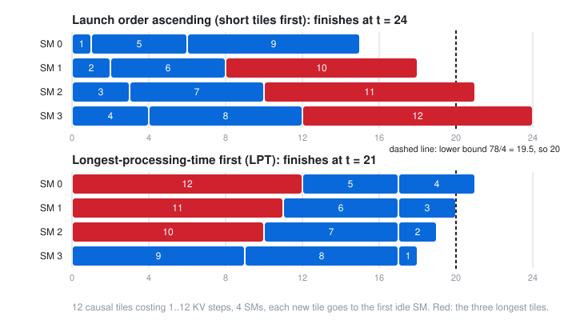

# Scheduling Causal Attention Tiles: Longest-Processing-Time First and the L2 Swizzle

## Thesis

In causal attention, query block $m$ attends to KV blocks $0..m$, so tile costs grow linearly from 1 to $n$. If tiles launch in the natural order, the most expensive ones start last. They then run on a few SMs while the rest of the GPU sits idle. FlashAttention-4's `SingleTileLPTScheduler` makes two changes:
- It reverses the block order, so the longest tiles go first. This is Graham's 1969 *longest-processing-time-first* (LPT) rule.
- It walks heads in small groups ("sections") sized so their K and V fit in L2.

This chapter reads that scheduler's index arithmetic and reimplements it exactly. It then measures both effects in a simple simulator of a 148-SM GPU:
- **makespan**: how much longer the kernel runs than its work requires
- **HBM traffic**: how many KV blocks miss in L2

The results:
- LPT removes most of the tail. In the worst case the overrun drops from 14.5% to 2.0%.
- LPT without the swizzle multiplies HBM KV reads by up to 32×.
- The swizzle restores the minimum traffic and keeps the balance.

## Mental model

{fig-alt="Two Gantt charts with 4 rows labelled SM 0 to SM 3 and a time axis from 0 to 24. Top: tiles launched in ascending cost order 1 to 12, each going to the first idle SM. The three longest tiles, 10, 11 and 12, start last and the schedule ends at t = 24. Bottom: tiles launched longest first, 12 down to 1. The long tiles start at t = 0, the short ones fill the gaps, and the schedule ends at t = 21. A dashed line marks the lower bound of 20, which is the total work 78 divided by 4 SMs, rounded up."}

**The cost model.** Take a causal forward pass with $n$ query blocks per head, all blocks the same size. Tile $(m, h)$ runs $m+1$ KV iterations. Total work per head is $n(n+1)/2$. On $S$ SMs, no schedule can finish before
$$
\text{LB} = \max\!\Big(\Big\lceil \tfrac{H\,n(n+1)/2}{S} \Big\rceil,\; n\Big).
$$

**List scheduling.** A one-tile-per-CTA grid behaves roughly like this: the block scheduler hands the next CTA in grid order to an SM that has room. With ascending costs, the last few tiles are the biggest. If one of them starts just before the others finish, the kernel waits for it alone. Ordering longest first means the final tiles to start are the shortest ones, which fill the gaps. Graham proved that LPT's makespan is at most $(4/3 - 1/(3S))$ times optimal.

**What FA4 actually computes.** In `flash_fwd_sm100.py`, a causal or local (sliding-window) forward pass without variable lengths selects `SingleTileLPTScheduler`, and it sets `lpt=self.is_causal or self.is_local`. Here is the static path of its `get_current_work` at commit `4616f51` (lines 703–718, abridged):

```python
# Static path: L2-swizzled coordinate mapping
bidhb, l2_mod = divmod(self._tile_idx, params.l2_major_divmod)      # section index
if bidhb < params.num_hb_quotient:
    block, bidhb_residual = divmod(l2_mod, params.l2_minor_divmod)   # heads fastest within a section
else:
    block, bidhb_residual = divmod(l2_mod, params.l2_minor_residual_divmod)
bidhb_actual = bidhb * params.l2_minor + bidhb_residual
batch_idx, head_idx = divmod(bidhb_actual, params.num_head_divmod)
if const_expr(params.lpt):
    block = params.num_block - 1 - block                              # longest first
```

The section width, `l2_minor`, is the swizzle. It is the number of (batch, head) pairs whose K and V fit in a 50 MiB budget, rounded down to a power of two:
```python
size_one_kv_head = seqlen_k * (headdim + headdim_v) * element_size
swizzle = 1 if size_l2 < size_one_head else 1 << log2_floor(size_l2 // size_one_head)
```
Within a section, consecutive CTAs take the **same $m$ for neighbouring heads**, starting from the largest $m$. The whole section finishes before the next one starts, so its K and V stay hot in L2. The last section, the "residual", has fewer heads. It divides by the remainder so that no CTA indexes a head that does not exist. In the CLC (cluster launch control) path the source notes "no L2 swizzle (hardware decides order)", but the block reversal for LPT still applies.

## Worked example

The simulator below has four parts:

- `order_lpt` is a line-for-line port of the index arithmetic above, with batch folded into heads.
- `simulate` hands tiles in grid order to the earliest-idle SM.
- An LRU model of L2 holds 800 KV blocks of 64 KiB, which is the 50 MiB budget.
- Four orders are compared on four B200-sized shapes: 148 SMs, `hdim = 128`, bf16, 128-row blocks.

```{.python filename="lpt_sim.py"}
"""Causal-attention tile scheduling: makespan and L2 traffic of tile orders.

Model (stated, not measured on a GPU):
- one CTA per (m_block, head) tile, causal: tile m costs m+1 KV-block steps;
- the hardware hands the next CTA in linear grid order to the first idle SM;
- L2 is an LRU cache of KV blocks; a tile reads KV blocks 0..m of its head
  when it starts (an approximation: real reads are spread over the tile).
"""
import heapq
from collections import OrderedDict

def order_blocks_fastest(nb, nh):            # SingleTileScheduler-style grid (block, head)
    return [(m, h) for h in range(nh) for m in range(nb)]

def order_lpt(nb, nh, swizzle):
    """Mirror of FA4 SingleTileLPTScheduler.get_current_work (static path, batch folded into heads)."""
    out = []
    quotient, remainder = nh // swizzle, nh % swizzle
    for tile in range(nb * nh):
        bidhb, l2_mod = divmod(tile, swizzle * nb)
        if bidhb < quotient:
            block, resid = divmod(l2_mod, swizzle)
        else:
            block, resid = divmod(l2_mod, max(remainder, 1))
        head = bidhb * swizzle + resid
        out.append((nb - 1 - block, head))
    return out

def simulate(order, n_sm, l2_blocks):
    free = [(0, s) for s in range(n_sm)]       # (time SM becomes idle, sm)
    heapq.heapify(free)
    l2 = OrderedDict()
    hits = misses = 0
    makespan = 0
    for m, h in order:
        t, s = heapq.heappop(free)
        for kv in range(m + 1):
            key = (h, kv)
            if key in l2:
                hits += 1; l2.move_to_end(key)
            else:
                misses += 1; l2[key] = None
                if len(l2) > l2_blocks:
                    l2.popitem(last=False)
        end = t + (m + 1)
        makespan = max(makespan, end)
        heapq.heappush(free, (end, s))
    return makespan, hits, misses

def swizzle_for(seqlen, hdim, elt=2, l2_bytes=50 * 1024 * 1024):
    one_head = seqlen * (hdim + hdim) * elt
    if l2_bytes < one_head:
        return 1
    return 1 << ((l2_bytes // one_head).bit_length() - 1)

def run(name, seqlen, heads, n_sm=148, blk=128, hdim=128):
    nb = seqlen // blk
    kv_block_bytes = blk * (hdim + hdim) * 2
    l2_blocks = (50 * 1024 * 1024) // kv_block_bytes
    total = heads * nb * (nb + 1) // 2
    lb = max(-(-total // n_sm), nb)
    sw = swizzle_for(seqlen, hdim)
    print(f"\n== {name}: seqlen={seqlen}, batch*heads={heads}, {nb} m-blocks, {heads*nb} tiles, {n_sm} SMs ==")
    print(f"   work={total} KV-steps, lower bound on makespan={lb}, unique KV blocks={heads*nb}, L2 holds {l2_blocks}; FA4 swizzle={sw}")
    print(f"   {'order':<34} {'makespan':>8} {'vs LB':>6} {'HBM KV reads':>12} {'L2 hit':>7}")
    rows = [("blocks fastest, ascending m", order_blocks_fastest(nb, heads)),
            ("blocks fastest, descending m", [(nb - 1 - m, h) for m, h in order_blocks_fastest(nb, heads)]),
            ("LPT, heads fastest, no swizzle", order_lpt(nb, heads, heads)),
            (f"LPT + L2 swizzle={sw} (FA4)", order_lpt(nb, heads, sw))]
    for label, order in rows:
        assert sorted(order) == sorted((m, h) for m in range(nb) for h in range(heads))
        ms, hit, miss = simulate(order, n_sm, l2_blocks)
        print(f"   {label:<34} {ms:>8} {ms/lb:>6.3f} {miss:>12} {hit/(hit+miss):>7.1%}")

if __name__ == "__main__":
    print("first 6 tiles of FA4's LPT order (nb=4, heads=6, swizzle=4):", order_lpt(4, 6, 4)[:6])
    print("tiles 16..23 (residual section of 2 heads):                ", order_lpt(4, 6, 4)[16:24])
    run("very long context, two heads", seqlen=65536, heads=2)
    run("long context, few heads", seqlen=32768, heads=8)
    run("prefill batch", seqlen=8192, heads=4 * 32)
    run("short sequences, many heads", seqlen=2048, heads=16 * 32)
```

Output:

```text
first 6 tiles of FA4's LPT order (nb=4, heads=6, swizzle=4): [(3, 0), (3, 1), (3, 2), (3, 3), (2, 0), (2, 1)]
tiles 16..23 (residual section of 2 heads):                 [(3, 4), (3, 5), (2, 4), (2, 5), (1, 4), (1, 5), (0, 4), (0, 5)]

== very long context, two heads: seqlen=65536, batch*heads=2, 512 m-blocks, 1024 tiles, 148 SMs ==
   work=262656 KV-steps, lower bound on makespan=1775, unique KV blocks=1024, L2 holds 800; FA4 swizzle=1
   order                              makespan  vs LB HBM KV reads  L2 hit
   blocks fastest, ascending m            2032  1.145         1024   99.6%
   blocks fastest, descending m           1811  1.020         1024   99.6%
   LPT, heads fastest, no swizzle         1811  1.020       103056   60.8%
   LPT + L2 swizzle=1 (FA4)               1811  1.020         1024   99.6%

== long context, few heads: seqlen=32768, batch*heads=8, 256 m-blocks, 2048 tiles, 148 SMs ==
   work=263168 KV-steps, lower bound on makespan=1779, unique KV blocks=2048, L2 holds 800; FA4 swizzle=2
   order                              makespan  vs LB HBM KV reads  L2 hit
   blocks fastest, ascending m            1919  1.079         2048   99.2%
   blocks fastest, descending m           1801  1.012         2048   99.2%
   LPT, heads fastest, no swizzle         1780  1.001       223568   15.0%
   LPT + L2 swizzle=2 (FA4)               1797  1.010         2048   99.2%

== prefill batch: seqlen=8192, batch*heads=128, 64 m-blocks, 8192 tiles, 148 SMs ==
   work=266240 KV-steps, lower bound on makespan=1799, unique KV blocks=8192, L2 holds 800; FA4 swizzle=8
   order                              makespan  vs LB HBM KV reads  L2 hit
   blocks fastest, ascending m            1839  1.022         8192   96.9%
   blocks fastest, descending m           1830  1.017         8192   96.9%
   LPT, heads fastest, no swizzle         1799  1.000       264128    0.8%
   LPT + L2 swizzle=8 (FA4)               1803  1.002         8192   96.9%

== short sequences, many heads: seqlen=2048, batch*heads=512, 16 m-blocks, 8192 tiles, 148 SMs ==
   work=69632 KV-steps, lower bound on makespan=471, unique KV blocks=8192, L2 holds 800; FA4 swizzle=32
   order                              makespan  vs LB HBM KV reads  L2 hit
   blocks fastest, ascending m             481  1.021         8192   88.2%
   blocks fastest, descending m            480  1.019         8192   88.2%
   LPT, heads fastest, no swizzle          471  1.000        69344    0.4%
   LPT + L2 swizzle=32 (FA4)               471  1.000         8192   88.2%
```

The toy schedule in the figure comes from the same greedy rule:

```{.python filename="gantt.py"}
import heapq
def gantt(costs, n_sm):
    free=[(0,s) for s in range(n_sm)]; heapq.heapify(free); out=[]
    for i,c in enumerate(costs):
        t,s=heapq.heappop(free); out.append((s,t,c)); heapq.heappush(free,(t+c,s))
    return out, max(t+c for s,t,c in out)
asc=list(range(1,13)); desc=asc[::-1]
if __name__ == "__main__":
  for name,c in (("ascending",asc),("LPT",desc)):
    g,ms=gantt(c,4); print(name, ms, g)
```

```text
ascending 24 [(0, 0, 1), (1, 0, 2), (2, 0, 3), (3, 0, 4), (0, 1, 5), (1, 2, 6), (2, 3, 7), (3, 4, 8), (0, 6, 9), (1, 8, 10), (2, 10, 11), (3, 12, 12)]
LPT 21 [(0, 0, 12), (1, 0, 11), (2, 0, 10), (3, 0, 9), (3, 9, 8), (2, 10, 7), (1, 11, 6), (0, 12, 5), (0, 17, 4), (1, 17, 3), (2, 17, 2), (3, 17, 1)]
```

### Reading it

- **The port matches the source.** For 6 heads with swizzle 4:
  - The first tiles are `(3,0) (3,1) (3,2) (3,3)`: the largest $m$, across the 4 heads of section 0.
  - Then come `(2,0) (2,1) …`.
  - Tiles 16–23 form the residual section of 2 heads, `(3,4) (3,5) (2,4) …`.
  
  That is the divide-by-remainder branch working.
- **The tail is real, and worst with few heads.** Ascending order overruns the lower bound by 14.5% (two heads at 64k), 7.9% (8 heads at 32k), 2.2% (128 heads at 8k) and 2.1% (512 heads at 2k). With few heads, the 148 SMs each get only a few tiles, so the last ones dominate. With FA4's order, the overrun is 2.0%, 1.0%, 0.2% and 0.0%. In the toy example, LPT gives 21 against a lower bound of 20 and ascending order gives 24. Graham's guarantee for 4 SMs is a factor of $4/3 - 1/12 = 1.25$.
- **LPT alone wrecks L2.** If the reversed order walks *all* heads at each $m$ ("heads fastest, no swizzle"), the KV working set is every head at once. HBM KV reads then go from 8,192 (each block read once, the compulsory minimum) to 264,128 in the prefill shape, about 32×, with an L2 hit rate of 0.8%. The swizzle restores exactly the compulsory 8,192 reads, and the makespan stays within 0.2% of the bound.
- **Most of the win is the reversal itself.** "Blocks fastest, descending $m$" (one head at a time, longest first) is nearly as good in this model: 2.0%, 1.2%, 1.7% and 1.9%, also with minimal traffic. Interleaving heads inside a section brings the remaining 1–2 points. Neighbouring CTAs then have *equal* costs, so each wave finishes together. The swizzle is what makes that interleaving free in terms of L2.
- **When the swizzle is 1** (two heads at 64k: one head is 32 MiB, so two do not fit in 50 MiB), FA4's order is the same as descending blocks-fastest. Both rows show 1,811 and 1,024 reads, as they should.

## Pitfalls

- **This is a model, not a measurement.** It has no per-tile fixed cost (Q load, epilogue), its L2 reads all happen at tile start, it ignores L2 sets and associativity, and its SMs hold one CTA each. Real numbers on a B200 will differ. The *direction* of each effect is what transfers, and you should confirm it with Nsight Compute: look at the L2 hit rate (`lts__t_sector_hit_rate.pct`) and SM active cycles.
- **Launch order is not a CUDA guarantee.** Hardware tends to dispatch CTAs in increasing linear block index, and schedulers like this one rely on that for performance. The programming guide says the opposite: blocks "may be executed in any order". Correctness must never depend on the order, only speed. A persistent kernel with an atomic tile counter, or CLC, makes the order explicit.
- **The 50 MiB budget is a constant in the source**, with the comment "40 MB for K & V". It is not read from the device. On a GPU with a smaller L2, sections can thrash, so recompute the swizzle for your part.
- **Variable-length batches break the cost model.** With `cu_seqlens`, tile cost depends on each sequence's length, and "reverse $m$" is no longer "longest first" across the batch. FA4 itself switches to varlen-specific schedulers in that case.
- **Non-causal attention gains nothing from LPT.** All tiles cost $n$, so the reversal is a no-op for balance. Only the swizzle still matters there.

## Try this

1. Add a fixed cost $c$ per tile (for example $c = 4$ KV steps for the Q load and epilogue). How does the ascending-order overrun change for the short-sequence shape?
2. Replace the 50 MiB budget with a 25 MiB L2. Recompute the swizzle with `swizzle_for` and rerun. Which shape thrashes first?
3. Implement a persistent variant: $S$ CTAs, each pulling the next tile from an atomic counter. Does it differ from the one-tile-per-CTA model when tiles are ordered LPT?
4. Port the order to a Triton causal-attention kernel by remapping `tl.program_id(0)`, and measure ascending vs LPT order on a real GPU with `triton.testing.do_bench`.

## Sources

- FlashAttention, `flash_attn/cute/tile_scheduler.py`, `SingleTileLPTScheduler` (commit `4616f51`, 30 Oct 2026): <https://github.com/Dao-AILab/flash-attention/blob/4616f5116d33e3ba3cbb71d582caffcfcb49649c/flash_attn/cute/tile_scheduler.py#L505-L776>
- R. L. Graham, "Bounds on Multiprocessing Timing Anomalies", *SIAM J. Appl. Math.* 17(2), 1969, 416–429: <https://doi.org/10.1137/0117039>
- FlashAttention, `flash_attn/cute/flash_fwd_sm100.py` (scheduler selection): <https://github.com/Dao-AILab/flash-attention/blob/4616f5116d33e3ba3cbb71d582caffcfcb49649c/flash_attn/cute/flash_fwd_sm100.py#L285-L300>
- NVIDIA, CUDA Programming Guide, Programming Model ("may be executed in any order"): <https://docs.nvidia.com/cuda/cuda-programming-guide/01-introduction/programming-model.html>
- Inspiration: <https://x.com/SubhoGhosh02/status/2072716219967537488>
