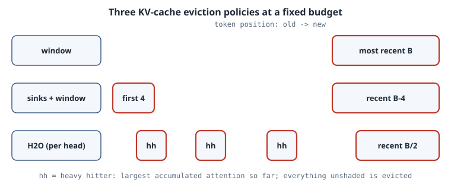

# KV-Cache Eviction: Sinks, Windows and Heavy Hitters on a Real Model

## Thesis

In long-context serving, the KV cache, not the weights, is what runs out of memory. Paging ([PagedAttention](07-pagedattention-kv-cache.qmd)) packs it tightly, and quantization ([TurboQuant](08b-turboquant-kv-cache-quantization.qmd)) shrinks each entry. **Eviction** goes further and drops entries entirely, holding the cache to a fixed budget of $B$ tokens per layer no matter how long the sequence gets. The choice of *which* tokens to drop matters a great deal. On GPT-2 with a 64-token budget, the naive "keep the most recent 64" policy pushes perplexity from 53 to over 7,000. Keeping just four extra tokens at the start of the sequence (the **attention sinks**) brings it back to 76. This chapter runs three policies on real weights and measures them. It then explains what each policy costs a kernel writer.

## Mental model

{fig-alt="Three rows of cache slots over token positions. Window keeps only the most recent slots. Sinks plus window keeps the first four tokens and the most recent slots. H2O keeps the most recent half plus, per head, the older tokens with the largest accumulated attention."}

- **Window.** Keep the most recent $B$ tokens. This is cheap and uniform across heads, but it throws away the first tokens.
- **Sinks + window** ([StreamingLLM](https://arxiv.org/abs/2309.17453), Xiao et al. 2023). Keep the first 4 tokens plus the most recent $B-4$. The paper's finding is that softmax attention puts a large share of its weight on the first few tokens regardless of their content. Those tokens act as a "sink" for probability mass that has to go somewhere. Remove them, and every later attention distribution is renormalized onto the wrong keys.
- **H2O, the heavy-hitter oracle** ([Zhang et al. 2023](https://arxiv.org/abs/2306.14048)). Keep a recent window plus the older tokens that have accumulated the most attention so far, chosen separately for every head. The policy adapts to the content, but now the kept set differs from head to head, and the policy needs attention *probabilities* to compute its score.
- **Positions matter less here than with RoPE.** GPT-2 adds learned absolute position embeddings at the input, so a cached key keeps the position it was computed at. StreamingLLM also discusses re-assigning positions inside the cache for rotary models, which this lab doesn't need.

## Worked example: GPT-2 small in NumPy

The listing loads GPT-2 small (124M parameters, from the [Hugging Face `openai-community/gpt2`](https://huggingface.co/openai-community/gpt2) safetensors file) with a 20-line [safetensors](https://huggingface.co/docs/safetensors/index) reader. It runs token-by-token decoding with a per-layer cache, applies an eviction policy after every step, and scores next-token perplexity on tokens 256–1022 of *A Scandal in Bohemia* (Project Gutenberg #1661). Before trusting any eviction result, it checks that the incremental decoder with a full cache gives the same argmax predictions as a batched causal forward pass.

```python
# kv_evict.py -- KV-cache eviction policies on a real model (GPT-2 small, NumPy)
import json, struct, sys, time
import numpy as np, tiktoken

def load_safetensors(path):
    with open(path, "rb") as f:
        n = struct.unpack("<Q", f.read(8))[0]
        header = json.loads(f.read(n)); base = 8 + n
    raw = np.memmap(path, dtype=np.uint8, mode="r")
    out = {}
    for name, meta in header.items():
        if name == "__metadata__": continue
        a, b = meta["data_offsets"]
        out[name] = np.frombuffer(raw[base + a: base + b], dtype=np.float32).reshape(meta["shape"]).copy()
    return out

W = load_safetensors("model.safetensors")
W["lm_head"] = np.ascontiguousarray(W["wte.weight"].T)    # tied embeddings
L, H, D = 12, 12, 64

def ln(x, p):
    m = x.mean(-1, keepdims=True); v = ((x - m) ** 2).mean(-1, keepdims=True)
    return (x - m) / np.sqrt(v + 1e-5) * W[p + ".weight"] + W[p + ".bias"]

def gelu(x):
    return 0.5 * x * (1 + np.tanh(0.7978845608 * (x + 0.044715 * x ** 3)))

class Cache:                                   # per layer: K, V, accumulated attention, position
    def __init__(self):
        self.k = np.zeros((H, 0, D), np.float32); self.v = self.k.copy()
        self.score = np.zeros((H, 0), np.float32); self.pos = np.zeros((H, 0), np.int64)

def evict(c, policy, budget, sinks=4):
    n = c.k.shape[1]
    if n <= budget: return
    if policy == "window":                     # keep the most recent `budget`
        keep = np.tile(np.arange(n - budget, n), (H, 1))
    elif policy == "sinks+window":             # StreamingLLM: first `sinks` + most recent
        keep = np.tile(np.r_[np.arange(sinks), np.arange(n - budget + sinks, n)], (H, 1))
    elif policy == "h2o":                      # half recent, half heavy hitters, per head
        recent = budget // 2
        old = c.score[:, : n - recent]
        heavy = np.sort(np.argsort(-old, axis=1)[:, : budget - recent], axis=1)
        keep = np.concatenate([heavy, np.tile(np.arange(n - recent, n), (H, 1))], axis=1)
    g = lambda a: np.take_along_axis(a, keep[:, :, None], 1)
    c.k, c.v = g(c.k), g(c.v)
    c.score = np.take_along_axis(c.score, keep, 1); c.pos = np.take_along_axis(c.pos, keep, 1)

def step(tok, t, caches, policy, budget):
    x = W["wte.weight"][tok] + W["wpe.weight"][t]
    for i, c in enumerate(caches):
        p = f"h.{i}."
        qkv = ln(x, p + "ln_1") @ W[p + "attn.c_attn.weight"] + W[p + "attn.c_attn.bias"]
        q, k, v = (a.reshape(H, 1, D) for a in np.split(qkv, 3))
        c.k = np.concatenate([c.k, k], 1); c.v = np.concatenate([c.v, v], 1)
        c.score = np.concatenate([c.score, np.zeros((H, 1), np.float32)], 1)
        c.pos = np.concatenate([c.pos, np.full((H, 1), t)], 1)
        s = (q @ c.k.transpose(0, 2, 1))[:, 0] / D ** 0.5          # (H, n)
        a = np.exp(s - s.max(1, keepdims=True)); a /= a.sum(1, keepdims=True)
        c.score += a                                                 # H2O statistic
        o = (a[:, None, :] @ c.v).reshape(H * D)
        x = x + o @ W[p + "attn.c_proj.weight"] + W[p + "attn.c_proj.bias"]
        m = gelu(ln(x, p + "ln_2") @ W[p + "mlp.c_fc.weight"] + W[p + "mlp.c_fc.bias"])
        x = x + m @ W[p + "mlp.c_proj.weight"] + W[p + "mlp.c_proj.bias"]
        if policy != "full": evict(c, policy, budget)
    return ln(x, "ln_f") @ W["lm_head"]

def run(tokens, policy, budget, start):
    caches = [Cache() for _ in range(L)]
    nll, top1 = [], []
    for t in range(len(tokens) - 1):
        logits = step(tokens[t], t, caches, policy, budget)
        if t >= start:
            z = logits - logits.max(); lp = z - np.log(np.exp(z).sum())
            nll.append(-lp[tokens[t + 1]]); top1.append(int(logits.argmax()))
    return np.array(nll), np.array(top1)

def full_forward(tokens):                       # batched causal forward, for a correctness check
    T = len(tokens); x = W["wte.weight"][tokens] + W["wpe.weight"][:T]
    mask = np.triu(np.full((T, T), -np.inf, np.float32), 1)
    for i in range(L):
        p = f"h.{i}."
        qkv = ln(x, p + "ln_1") @ W[p + "attn.c_attn.weight"] + W[p + "attn.c_attn.bias"]
        q, k, v = (a.reshape(T, H, D).transpose(1, 0, 2) for a in np.split(qkv, 3, -1))
        s = q @ k.transpose(0, 2, 1) / D ** 0.5 + mask
        a = np.exp(s - s.max(-1, keepdims=True)); a /= a.sum(-1, keepdims=True)
        o = (a @ v).transpose(1, 0, 2).reshape(T, H * D)
        x = x + o @ W[p + "attn.c_proj.weight"] + W[p + "attn.c_proj.bias"]
        x = x + gelu(ln(x, p + "ln_2") @ W[p + "mlp.c_fc.weight"] + W[p + "mlp.c_fc.bias"]) \
              @ W[p + "mlp.c_proj.weight"] + W[p + "mlp.c_proj.bias"]
    return ln(x, "ln_f") @ W["lm_head"]

text = open("holmes.txt", encoding="utf-8").read()
text = text[text.index("I. A SCANDAL IN BOHEMIA"):]
T, START = int(sys.argv[1]), int(sys.argv[2])
tokens = tiktoken.get_encoding("gpt2").encode(text)[:T]

ref = full_forward(tokens)
nll_full, top_full = run(tokens, "full", None, START)
print(f"tokens {T}, scored positions {START}..{T-2}")
print(f"incremental decode vs batched forward: argmax mismatches "
      f"{int((ref[START:T-1].argmax(-1) != top_full).sum())}, full-cache ppl {np.exp(nll_full.mean()):.2f}")
for budget in map(int, sys.argv[3:]):
    for policy in ("window", "sinks+window", "h2o"):
        t0 = time.perf_counter()
        nll, top = run(tokens, policy, budget, START)
        print(f"budget {budget:4d} {policy:13s} ppl {np.exp(nll.mean()):7.2f}  "
              f"top-1 agrees with full {np.mean(top == top_full):6.1%}  ({time.perf_counter()-t0:4.1f} s)")
```

Run (CPython 3.15.0, NumPy 2.5.4, `OPENBLAS_NUM_THREADS=1`, `tiktoken` for the GPT-2 BPE):

```bash
OPENBLAS_NUM_THREADS=1 python kv_evict.py 1024 256 64 256
```

Output (about 5.7 minutes in total on one CPU core):

```text
tokens 1024, scored positions 256..1022
incremental decode vs batched forward: argmax mismatches 0, full-cache ppl 53.30
budget   64 window        ppl 7334.33  top-1 agrees with full   6.4%  (43.8 s)
budget   64 sinks+window  ppl   76.38  top-1 agrees with full  50.7%  (43.0 s)
budget   64 h2o           ppl  112.55  top-1 agrees with full  41.3%  (41.9 s)
budget  256 window        ppl 1603.75  top-1 agrees with full  11.3%  (53.4 s)
budget  256 sinks+window  ppl   52.93  top-1 agrees with full  65.1%  (53.2 s)
budget  256 h2o           ppl   79.45  top-1 agrees with full  72.4%  (55.7 s)
```

### Reading the output

- **The harness is correct first.** With a full cache, the incremental decoder and the batched forward pass disagree on 0 of 767 argmax predictions. The full-cache perplexity of 53.30 is the baseline for everything below.
- **The window policy collapses.** Its perplexity is 7,334 at $B=64$ and still 1,604 at $B=256$, even though at $B=256$ it keeps a quarter of the context. Top-1 agreement with the full model drops to 6–11%. The tokens it drops first, the beginning of the sequence, are exactly the ones every head was using as a sink.
- **Four sink tokens fix most of it.** With sinks + window, perplexity is 76.4 at $B=64$, and 52.9 at $B=256$, which is level with the full cache's 53.3 on this text, with only a quarter of the context kept. Top-1 agreement is still only 65%, though, so the predictions differ even where the average loss matches.
- **H2O ranks second on perplexity but first on agreement at $B=256$** (72.4% vs 65.1%). Heavy hitters keep more of the full model's *choices*, while sinks + window gives better-calibrated probabilities on this text. The H2O here is a simplified variant: raw accumulated attention, half the budget recent, no score normalization. Older tokens have had more steps in which to collect score, which biases the selection. Treat its row as one point in a design space, not as a verdict on the paper.
- **One model, one text, one machine.** Measure on your own model and traffic before you pick a policy.

### A NumPy pitfall that cost about 8×

The first version of this listing divided attention scores by `np.sqrt(D)`. That returns a NumPy `float64` scalar, and under NumPy 2's promotion rules ([NEP 50](https://numpy.org/neps/nep-0050-scalar-promotion.html)) a NumPy `float64` scalar is *not* "weak". It silently promoted the activations to float64. Every later `float64 @ float32` matmul then had to cast a float32 weight matrix to float64 before calling BLAS, and one decode step took about 340 ms. Writing `D ** 0.5`, a Python float that stays weak, keeps everything in float32. The 1,023-step runs above then average about 43 ms per step at $B=64$. Check the dtypes of your activations when a NumPy model is slower than its FLOP count suggests.

## What this means for a kernel

- **Sinks + window is the kernel-friendly policy.** The kept set is the same for every head and every layer: a prefix plus a ring buffer. With paging, it is a fixed sink block plus a sliding range of blocks. The attention kernel doesn't change at all. Only the block table does.
- **H2O needs scores that fused attention throws away.** The policy ranks tokens by accumulated softmax probability. A FlashAttention-style kernel never writes the probability matrix $P$ to memory (that is the point of [FlashAttention](01-flashattention-from-scratch-fa1-to-fa3.qmd)). To get the scores, you either add an extra reduction output to the kernel, or compute scores only for a short observation window, as [SnapKV](https://arxiv.org/abs/2404.14469) does at prefill time.
- **Per-head keep sets are ragged.** When each head keeps different tokens, the logical cache becomes a per-head gather. You can compact it physically, which costs a copy of $K$ and $V$ on every eviction. Or you can keep per-head index lists, which turns the decode kernel into an indexed gather that coalesces worse. The `np.take_along_axis` in `evict` is the CPU version of that compaction.
- **Granularity.** Serving systems evict whole pages, not single tokens, so an eviction scorer has to aggregate scores per block.

## Boring rule

> Never evict the first few tokens. Start with sinks + window because it changes only the block table, and reach for score-based eviction only when a measurement on your own traffic shows it pays for the extra kernel output and the ragged gather.

## Exercises

1. Vary `sinks` (0, 1, 4, 16) at $B=64$. How many sink tokens does GPT-2 actually need?
2. Change H2O so that it always keeps the first 4 tokens as well (sinks + heavy hitters + recent). Does it beat sinks + window on perplexity?
3. Normalize the H2O score by the number of steps each token has been cached, and re-run. Does the age bias go away?
4. Record, per layer and head, the average attention mass on token 0 during the full-cache run. Which layers rely on the sink most?

## Sources

- Xiao, Tian, Chen, Han, Lewis, *Efficient Streaming Language Models with Attention Sinks* (2023). <https://arxiv.org/abs/2309.17453>
- Zhang et al., *H2O: Heavy-Hitter Oracle for Efficient Generative Inference of Large Language Models* (2023). <https://arxiv.org/abs/2306.14048>
- Li et al., *SnapKV: LLM Knows What You are Looking for Before Generation* (2024). <https://arxiv.org/abs/2404.14469>
- Radford et al., *Language Models are Unsupervised Multitask Learners* (GPT-2, 2019); weights at <https://huggingface.co/openai-community/gpt2>
- Hugging Face safetensors format: <https://huggingface.co/docs/safetensors/index>
- NumPy NEP 50, *Promotion rules for Python scalars*: <https://numpy.org/neps/nep-0050-scalar-promotion.html>
