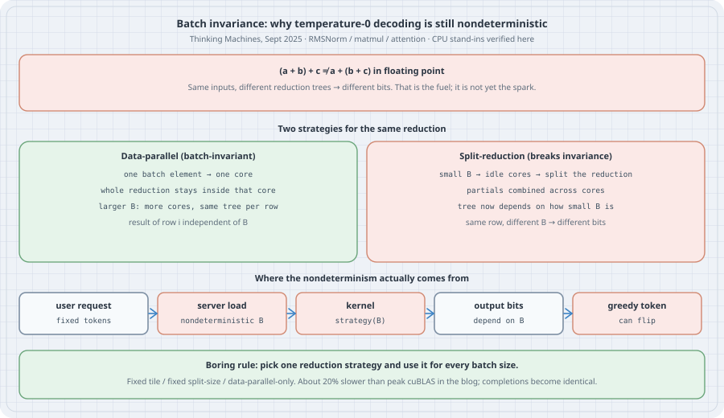

# Batch-invariant kernels: why temperature-0 decoding is still nondeterministic

## Thesis

Set the temperature to zero. Ask the same prompt a thousand times. You still get more than one completion. Thinking Machines Lab measured 80 unique greedy completions out of 1000 for a 235B model ([He et al., Sept 2025](https://thinkingmachines.ai/blog/defeating-nondeterminism-in-llm-inference/)). The usual story — "GPUs are concurrent, floating-point addition is not associative, atomics race" — is not the right explanation. The forward pass of a modern LLM has **no atomic adds**, and running the *same* matmul on the *same* batch twice is bitwise deterministic. The nondeterminism lives one layer up: kernels whose **reduction strategy depends on the batch size**. From the server's point of view the forward pass is deterministic. From the user's point of view the server load is not an input, so a non-batch-invariant kernel makes temperature-0 decoding nondeterministic.

This chapter makes that claim concrete. You will see floating-point non-associativity produce hundreds of different sums of the same eight numbers, watch a matmul and an RMSNorm change their answer for the same row when the batch around it grows, and watch a greedy token flip under three different loads. Then you will freeze the reduction strategy and watch the flips stop. There is no GPU on this box, so every listing is a CPU-side reference implementation of the *reduction tree*. The GPU strategies (Split-K, FlashDecoding, data-parallel RMSNorm) are cited from the Thinking Machines post and from the open `batch_invariant_ops` library; their wall-clock numbers are not re-run here.

## Mental model

{fig-alt="Top: floating-point addition is not associative, so two reduction trees of the same vector can disagree. Middle left: data-parallel strategy assigns one batch element to one core, keeps the whole reduction inside that core, and is batch-invariant. Middle right: split-reduction used when the batch is small to fill idle cores changes the tree and breaks invariance. Bottom: user request to server load (nondeterministic B) to kernel strategy(B) to output bits to a greedy token that can flip. Boring rule: pick one reduction strategy and use it for every batch size."}

| Idea | Plain meaning |
|------|----------------|
| Run-to-run determinism | Same kernel, same inputs, same batch → same bits, every time |
| Batch invariance | Result for element *i* does not depend on how many other elements are in the batch |
| Data-parallel reduction | One batch element (or output tile) per core; the whole reduction stays inside that core |
| Split-K / Split-KV | When the batch is too small to fill the GPU, split *one* reduction across cores; the tree now depends on how small the batch was |
| User-facing nondeterminism | Server load sets B; B picks the strategy; strategy changes bits; greedy token can flip |

Pointwise ops (add, mul, activation) are batch-invariant. The three reductions that matter for a transformer forward pass are **RMSNorm**, **matmul**, and **attention**. Make those three batch-invariant and temperature-0 decoding becomes deterministic. That is the whole program.

## Worked examples

### Case 1: The fuel — floating-point non-associativity

```python
# fp_demo.py
print((0.1 + 1e20) - 1e20)
print(0.1 + (1e20 - 1e20))
```

```bash
python3.15 fp_demo.py
```

Output:

```text
0.0
0.1
```

Same three numbers, two association trees, two answers. Scale that up to a random shuffle of eight cancelling values and a left-fold `+`:

```python
# shuffle_sum.py: floating-point non-associativity as unique sums of the same list
import random
import sys


def left_fold(xs):
    s = 0.0
    for x in xs:
        s = s + x                                 # one binary + at a time; no compensation
    return s


vals0 = [1e-10, 1e-5, 1e-2, 1.0]
vals0 = vals0 + [-v for v in vals0]

random.seed(42)
left = set()
builtin = set()
for _ in range(10_000):
    vals = vals0[:]
    random.shuffle(vals)
    left.add(left_fold(vals))
    builtin.add(sum(vals))                        # CPython's compensated sum

print(sys.version.split()[0])
print(f"left-fold +:  {len(left)} unique sums from 10000 orders of {len(vals0)} values")
print(f"  span {min(left)} .. {max(left)}")
print(f"builtin sum:  {len(builtin)} unique (compensated; hides the associativity bug)")
```

```bash
python3.15 shuffle_sum.py
```

Output:

```text
3.15.0
left-fold +:  255 unique sums from 10000 orders of 8 values
  span -2.220446049250313e-16 .. 2.220446049250313e-16
builtin sum:  1 unique (compensated; hides the associativity bug)
```

255 different sums of the *same* eight numbers, just by changing the order of the seven additions. Note that CPython's builtin `sum` hides the bug with compensated summation (one unique result). The GPU does not use Kahan; it uses whatever tree the kernel launched. That is the fuel. It is not yet the spark: a kernel that always uses the *same* tree is still run-to-run deterministic.

### Case 2: Different trees, different answers

```python
# reduction_orders.py: same vector, different reduction trees → different float32 results
import numpy as np


def sequential(a):
    s = np.float32(0)
    for x in a:
        s = s + np.float32(x)
    return float(s)


def pairwise(a):
    a = [np.float32(x) for x in a]
    while len(a) > 1:
        nxt = []
        for i in range(0, len(a) - 1, 2):
            nxt.append(a[i] + a[i + 1])
        if len(a) % 2:
            nxt.append(a[-1])
        a = nxt
    return float(a[0])


def split_k(a, splits):
    """Split into `splits` contiguous chunks, sum each, then sum the chunks.
    CPU stand-in for a Split-K / FlashDecoding reduction tree."""
    chunks = np.array_split(a, splits)
    partials = [sequential(c) for c in chunks]
    return sequential(partials)


rng = np.random.default_rng(0)
a = (rng.standard_normal(4096) * 1e3).astype(np.float32)
print("dtype float32, n =", len(a))
print(f"sequential:  {sequential(a):.8e}")
print(f"pairwise:    {pairwise(a):.8e}")
print(f"{'splits':>6}  {'sum':>14}  {'|diff vs seq|':>14}")
for s in (1, 2, 4, 8, 16, 32, 64, 128):
    v = split_k(a, s)
    print(f"{s:6d}  {v:14.8e}  {abs(v - sequential(a)):14.8e}")
```

```bash
venv-mult/bin/python reduction_orders.py
```

Output:

```text
dtype float32, n = 4096
sequential:  -6.60646328e+04
pairwise:    -6.60646094e+04
splits             sum   |diff vs seq|
     1  -6.60646328e+04  0.00000000e+00
     2  -6.60646641e+04  3.12500000e-02
     4  -6.60646328e+04  0.00000000e+00
     8  -6.60646250e+04  7.81250000e-03
    16  -6.60646016e+04  3.12500000e-02
    32  -6.60645859e+04  4.68750000e-02
    64  -6.60646094e+04  2.34375000e-02
   128  -6.60646016e+04  3.12500000e-02
```

One float32 vector of length 4096. Sequential, pairwise, and Split-K with 2…128 splits disagree by up to about `5e-2`. That is the CPU stand-in for "the cleanup reduction after a Split-K matmul" or "FlashDecoding with a different number of KV splits." The values are close enough that a unit test with `atol=1e-3` would pass, and different enough that a greedy argmax over a sharp logit distribution can flip (Case 5).

### Case 3: A matmul that is not batch-invariant

The Thinking Machines listing shows `torch.mm(a[:1], b)` and `torch.mm(a, b)[:1]` disagreeing by ~1669 on CUDA bf16. Here is the same shape of bug with a CPU heuristic that picks a K-tile from the batch size — the way a real GEMM library reaches for Split-K when M is tiny:

```python
# batch_matmul.py: a matmul whose reduction strategy depends on batch size
# CPU stand-in for "data-parallel when B is large, Split-K when B is small"
import numpy as np


def matvec_tile(a_row, B, tile_k):
    """Dot one row of A with B, reducing K in fixed tiles of size tile_k.
    The tile size is the reduction strategy. Changing it changes the float result."""
    k = a_row.shape[0]
    acc = np.zeros(B.shape[1], dtype=np.float32)
    for t in range(0, k, tile_k):
        # one "core" reduces a K-slice, then we add the partial into acc
        # (the Split-K story: more tiles ⇒ more partials ⇒ different tree)
        partial = a_row[t:t + tile_k] @ B[t:t + tile_k]
        acc = acc + partial.astype(np.float32)
    return acc


def mm_batch_aware(A, B):
    """Pick a K-tile size from the batch size, the way a real GEMM heuristic does:
    small M → Split-K (many small tiles); large M → one fat reduction per output tile."""
    m, k = A.shape
    tile_k = 64 if m < 32 else (256 if m < 256 else k)   # heuristic, not a real cuBLAS table
    return np.stack([matvec_tile(A[i], B, tile_k) for i in range(m)]), tile_k


rng = np.random.default_rng(1)
D = 4096
# linspace like the Thinking Machines listing: large dynamic range along the batch
A = np.linspace(-1000, 1000, 2048 * D, dtype=np.float32).reshape(2048, D)
B = np.linspace(-1000, 1000, D * D, dtype=np.float32).reshape(D, D)

out_full, tile_full = mm_batch_aware(A, B)
out_one, tile_one = mm_batch_aware(A[:1], B)
print(f"batch=2048 → tile_k={tile_full};  batch=1 → tile_k={tile_one}")
print(f"|out_full[0] - out_one[0]|_max = {np.max(np.abs(out_full[0] - out_one[0])):.4f}")
# Same kernel config for every batch size: batch-invariant
out_full_fixed = np.stack([matvec_tile(A[i], B, 256) for i in range(2048)])
out_one_fixed = matvec_tile(A[0], B, 256)
print(f"fixed tile_k=256: |diff|_max = {np.max(np.abs(out_full_fixed[0] - out_one_fixed)):.4f}")
```

```bash
venv-mult/bin/python batch_matmul.py
```

Output:

```text
batch=2048 → tile_k=4096;  batch=1 → tile_k=64
|out_full[0] - out_one[0]|_max = 1292.0000
fixed tile_k=256: |diff|_max = 0.0000
```

At batch 2048 the heuristic uses one fat reduction (`tile_k = K`). At batch 1 it uses Split-K with `tile_k = 64`. The first row differs by 1292. Freeze the tile at 256 for every batch size and the difference drops to **0**. That is batch invariance: one kernel configuration, every shape.

### Case 4: RMSNorm with a load-dependent tree

```python
# batch_rmsnorm.py: RMSNorm whose reduction *order* depends on batch size
import numpy as np


def sum_sq_ordered(row, reverse=False):
    data = row[::-1] if reverse else row
    s = np.float32(0)
    for x in data:
        s = s + np.float32(x) * np.float32(x)
    return s


def rms(row, weight, reverse=False, eps=1e-6):
    inv = np.float32(1.0) / np.sqrt(sum_sq_ordered(row, reverse) / row.shape[0] + eps)
    return row.astype(np.float32) * inv * weight.astype(np.float32)


rng = np.random.default_rng(2)
H = 4096
weight = np.ones(H, dtype=np.float32)
# Decreasing magnitudes: forward accumulation keeps a large running sum and
# drops tiny contributions; reverse does the opposite.
row = np.array([2.0 ** -(i // 64) for i in range(H)], dtype=np.float32)

ss_fwd = sum_sq_ordered(row, reverse=False)
ss_rev = sum_sq_ordered(row, reverse=True)
print(f"sum_sq forward: {ss_fwd:.8e}")
print(f"sum_sq reverse: {ss_rev:.8e}")
print(f"|diff|:         {abs(ss_fwd - ss_rev):.8e}")

# Heuristic stand-in: a tiny batch runs a different tree (here: reversed)
# because a Split-K cleanup combines partials in a different order.
def rms_heuristic(row, weight, batch_size):
    return rms(row, weight, reverse=(batch_size < 8))

def rms_fixed(row, weight, batch_size):
    return rms(row, weight, reverse=False)                    # always the same tree

alone = rms_heuristic(row, weight, 1)
in_batch = rms_heuristic(row, weight, 16)
print(f"heuristic: |alone(B=1) - in_batch(B=16)|_max = {np.max(np.abs(alone - in_batch)):.6e}")
print(f"fixed:     |alone(B=1) - in_batch(B=16)|_max = {np.max(np.abs(rms_fixed(row, weight, 1) - rms_fixed(row, weight, 16))):.6e}")
print(f"bitwise equal? heuristic {np.array_equal(alone, in_batch)}; fixed {np.array_equal(rms_fixed(row, weight, 1), rms_fixed(row, weight, 16))}")
print(f"heuristic differing elements: {int(np.sum(alone != in_batch))} / {alone.size}")
```

```bash
venv-mult/bin/python batch_rmsnorm.py
```

Output:

```text
sum_sq forward: 8.53330078e+01
sum_sq reverse: 8.53333282e+01
|diff|:         3.20434570e-04
heuristic: |alone(B=1) - in_batch(B=16)|_max = 1.287460e-05
fixed:     |alone(B=1) - in_batch(B=16)|_max = 0.000000e+00
bitwise equal? heuristic False; fixed True
heuristic differing elements: 4096 / 4096
```

Forward and reverse accumulation of the same squares already disagree in the fourth significant digit. The heuristic stand-in ("tiny batch → reverse tree, large batch → forward tree") makes every element of the normalized row differ when the same token is served alone vs inside a batch of 16. The fixed tree makes them bitwise equal. On a GPU the two trees are "data-parallel, one row per SM" vs "split-reduction across SMs when B is smaller than the SM count" — see the Thinking Machines figures and the vLLM / `batch_invariant_ops` Triton RMSNorm that keeps **one program per row** and never splits the reduction.

### Case 5: Server load as the nondeterministic input

```python
# load_nondet.py: from the user's view, varying batch size is nondeterminism
import numpy as np


def logits_for_request(token_row, W, batch_size, tile_fn):
    tile = tile_fn(batch_size)
    k = token_row.shape[0]
    acc = np.zeros(W.shape[1], dtype=np.float32)
    for t in range(0, k, tile):
        acc = acc + (token_row[t:t + tile] @ W[t:t + tile]).astype(np.float32)
    return acc


rng = np.random.default_rng(7)
D, V = 4096, 8192
# Wide dynamic range so Split-K partials round differently
token = np.linspace(-50, 50, D, dtype=np.float32)
W = np.linspace(-1, 1, D * V, dtype=np.float32).reshape(D, V)

def heuristic(bs):
    return 64 if bs < 8 else (256 if bs < 64 else D)

def fixed(_bs):
    return 256

loads = [1, 2, 4, 8, 16, 32, 64, 128]
ref = logits_for_request(token, W, 128, fixed)
print(f"{'load':>4}  {'tile':>4}  {'argmax':>6}  {'|logits-ref|_max':>16}  {'top1 logit':>12}")
h_tokens = []
for bs in loads:
    logits = logits_for_request(token, W, bs, heuristic)
    tok = int(np.argmax(logits))
    h_tokens.append(tok)
    print(f"{bs:4d}  {heuristic(bs):4d}  {tok:6d}  {np.max(np.abs(logits - ref)):16.4f}  {logits[tok]:12.4f}")
print(f"unique greedy tokens under heuristic: {sorted(set(h_tokens))} ({len(set(h_tokens))} distinct)")
f_tokens = [int(np.argmax(logits_for_request(token, W, bs, fixed))) for bs in loads]
print(f"unique greedy tokens under fixed:     {sorted(set(f_tokens))} ({len(set(f_tokens))} distinct)")
```

```bash
venv-mult/bin/python load_nondet.py
```

Output:

```text
load  tile  argmax  |logits-ref|_max    top1 logit
   1    64      80            0.0312    68283.3594
   2    64      80            0.0312    68283.3594
   4    64      80            0.0312    68283.3594
   8   256    1718            0.0000    68283.3516
  16   256    1718            0.0000    68283.3516
  32   256    1718            0.0000    68283.3516
  64  4096    1815            0.0938    68283.4141
 128  4096    1815            0.0938    68283.4141
unique greedy tokens under heuristic: [80, 1718, 1815] (3 distinct)
unique greedy tokens under fixed:     [1718] (1 distinct)
```

One request, eight loads. The heuristic picks three different K-tiles (64, 256, 4096) and the greedy token takes **three** different values: 80, 1718, 1815. The logit gaps are tiny (`|logits − ref|_max` ≤ 0.09 on values around 68 000) — well inside any training tolerance — and still enough to flip argmax. Freeze the tile and every load returns the same token. This is the user's view of an inference server: the other concurrent requests are not an input you control, so a non-batch-invariant kernel makes your completion a function of the load.

### Case 6: What the GPU kernels actually do (from the primary sources)

No GPU here, so this case is a reading of the primary sources, not a benchmark.

| Kernel | Default strategy | When it breaks batch invariance | Batch-invariant fix |
|--------|------------------|----------------------------------|---------------------|
| RMSNorm | Data-parallel: one row per core | Tiny B → split the reduction across cores to fill SMs | Keep data-parallel always; accept idle SMs at B=1 ([`batch_invariant_ops`](https://github.com/thinking-machines-lab/batch_invariant_ops), vLLM `_rms_norm_kernel`: one program per row) |
| Matmul | Data-parallel over output tiles | Small M,N → Split-K; very small M → smaller tensor-core instruction or no tensor cores | One compiled config for all shapes; no Split-K. Blog: ~20% slower than cuBLAS on their Triton kernel |
| Attention | FlashAttention-2: parallelize over Q | Decode (short Q) → Split-KV / FlashDecoding with a **#splits** that depends on how much parallelism is needed; KV-cache vs prefill boundary that changes the #blocks | Update the KV cache *before* the kernel so K/V layout is consistent; use a **fixed split-size** (varying #splits), not a fixed #splits |

Attention is the hardest of the three because the reduction is over sequence, and serving engines slice sequences (chunked prefill, prefix caching). The reduction order for token 1000 must be identical whether 0 or 999 tokens are already in the KV cache. The Thinking Machines post walks through why "score the cache and the new tokens in separate loops" fails that test.

Their vLLM demo with unoptimized FlexAttention was about 2× slower than default (26 s → 55 s for 1000 short sequences on one GPU running Qwen3-8B); an improved attention kernel brought it to 42 s. With batch-invariant kernels enabled, all 1000 temperature-0 completions were identical. Those numbers are from the blog, not from this box.

## The trap

**"Deterministic kernels" is not the same as "deterministic inference."** A matmul that returns the same bits every time you call it with the same arguments can still make an inference *server* nondeterministic, because the batch size is chosen by the load balancer, not by the caller. Unit-testing a kernel for run-to-run determinism (call it twice, compare) will pass. Serving the same prompt under light and heavy load will not.

**"atol=1e-3, close enough"** is the other half of the trap. Case 5's logit gaps are far below 1e-3 relative, and the greedy token still flips. If you are doing on-policy RL, a train/serve mismatch that small is enough to turn on-policy into off-policy (the blog's KL plots go from a flat zero under batch-invariant kernels to a spike that coincides with a reward collapse). Bitwise identity is the right bar for that use case; "close" is not.

## The boring rule

1. For any reduction in a serving forward pass, **pick one strategy and use it at every batch size**. Data-parallel-only for RMSNorm. One tile config and no Split-K for matmul. Fixed split-size (not fixed #splits) for attention, with the KV cache updated before the kernel.
2. Test batch invariance directly: `f(x[None])` vs `f(batch)[0]` must be bitwise equal for the rows you care about, across B ∈ {1, 2, 8, 64, 256}. Run-to-run determinism alone is not the test.
3. Do not tell yourself that temperature 0 is reproducible until those tests pass under a load generator.
4. Reach for [`thinking-machines-lab/batch_invariant_ops`](https://github.com/thinking-machines-lab/batch_invariant_ops) (or the vLLM / SGLang / Megatron ports) before inventing your own; the hard part is attention.
5. Accept a modest performance tax. The blog's unoptimized path was ~2×; a tuned one was ~1.6×. That is the price of a flat KL between sampler and trainer.

## Try this

1. In `batch_matmul.py`, add a third heuristic that switches tensor-core tile sizes the way stream-K does (different K-split per output tile). Show that it is not even *batch-position*-invariant: permuting the batch permutes the answers.
2. Extend `load_nondet.py` to a two-layer stack (RMSNorm → matmul → RMSNorm → matmul) and count how many loads produce a unique greedy token. Does the second matmul dominate?
3. Read the Triton `_rms_norm_kernel` in vLLM's `batch_invariant.py` (or the copy in `batch_invariant_ops`). Confirm that `tl.program_id(0)` indexes rows and that nothing in the kernel depends on how many rows were launched.
4. If you have a GPU: install `batch_invariant_ops`, run the blog's `torch.mm(a[:1], b)` vs `torch.mm(a, b)[:1]` check with and without `set_batch_invariant_mode()`, and paste the two diffs.
5. For attention: sketch why a fixed *number* of KV splits cannot be batch-invariant when Q length changes, and why a fixed *size* of split can.

## Sources

- Horace He and Thinking Machines Lab, ["Defeating Nondeterminism in LLM Inference"](https://thinkingmachines.ai/blog/defeating-nondeterminism-in-llm-inference/), Connectionism, 10 September 2025, doi:[10.64434/tml.20250910](https://doi.org/10.64434/tml.20250910).
- Companion library: [`thinking-machines-lab/batch_invariant_ops`](https://github.com/thinking-machines-lab/batch_invariant_ops) (`set_batch_invariant_mode`, torch.Library overrides for RMSNorm / matmul / mean / log-softmax).
- vLLM batch-invariant RMSNorm Triton kernel (`vllm/model_executor/layers/batch_invariant.py`, `_rms_norm_kernel`: one program per row).
- Megatron-Core `batch_invariant_kernels` (RMSNorm + TE GEMM patches, `set_batch_invariant_mode` context manager).
- Dao et al., FlashAttention-2; FlashDecoding / Split-KV scheduling (for the attention half of Case 6).
