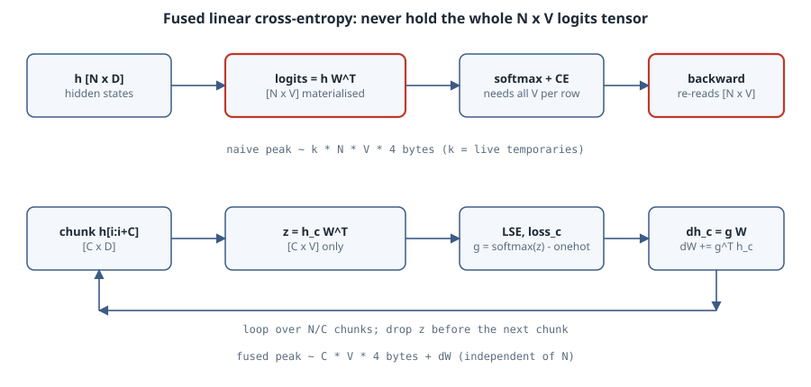

# Fused linear cross-entropy: training without the logits tensor

## Thesis

The last layer of a language model is the most memory-hungry line of code in the training loop. The LM head multiplies hidden states `h` of shape `[N, D]` (N tokens in the micro-batch, D hidden size) by a weight `W` of shape `[V, D]` (V vocabulary entries). That produces logits of shape `[N, V]`. With a 128k vocabulary and 16k tokens per micro-batch, that one tensor is 8 GiB in fp32, before the softmax, its gradient, or any temporaries. Every other activation in a transformer layer scales with D. The logits scale with V, which is often 20 to 60 times larger.

The fix is a kernel-design idea, not a library flag. Cross-entropy only needs two numbers per row: the log-sum-exp over the vocabulary and the logit of the correct token. Its gradient with respect to the logits is `softmax(z) - onehot(y)`, which you can compute from the same row. So you can process the tokens **in chunks**: compute a `[C, V]` slice of logits, reduce it to the loss, turn it straight into `dh` and a contribution to `dW`, and throw it away. The full `[N, V]` tensor never exists. Liger Kernel ships this as `LigerFusedLinearCrossEntropyLoss` ([Hsu et al., arXiv:2410.10989](https://arxiv.org/abs/2410.10989)). Apple's Cut Cross-Entropy goes further and keeps even the chunk in on-chip memory ([Wijmans et al., arXiv:2411.09009](https://arxiv.org/abs/2411.09009)).

This chapter builds a reference implementation with NumPy on the CPU, checks that it gives the same loss and gradients as the naive version, and measures peak memory. There is no GPU on this box, so the GPU parts (Triton blocking and the in-SRAM variant) are explained from the papers and are not benchmarked here.

## Mental model

{fig-alt="Top row, naive path: hidden states h of shape N by D times W transposed gives logits N by V, then softmax and loss, then backward re-reads the N by V tensor. Bottom row, fused path: for each chunk of C rows compute C by V logits, log-sum-exp and loss, then gradient g equals softmax minus one-hot, dh chunk equals g times W, dW accumulates g transposed times h chunk, then drop the chunk. Peak memory scales with C times V instead of N times V."}

Per row $i$, with logits $z_i = W h_i$ and target $y_i$:

$$
\ell_i = \log\sum_{v=1}^{V} e^{z_{iv}} - z_{i y_i},\qquad
\frac{\partial \ell_i}{\partial z_{iv}} = \operatorname{softmax}(z_i)_v - [v = y_i].
$$

With mean reduction $L = \frac1N\sum_i \ell_i$ and $G = \frac1N(\operatorname{softmax}(Z) - Y)$ where $Y$ is the one-hot target matrix:

$$
\frac{\partial L}{\partial h} = G\,W, \qquad \frac{\partial L}{\partial W} = G^{\top} h .
$$

Both gradients are sums over rows. That is the whole trick: **rows are independent**, so you can compute $G$ one block of rows at a time and accumulate.

| Quantity | Naive | Fused (chunk C) |
|---|---|---|
| Logits held at once | `N × V` | `C × V` |
| Passes over `W` | forward matmul, then two backward matmuls that re-read saved logits | one pass per chunk doing all three matmuls |
| Extra state | autograd saves logits or softmax | `dW` accumulator (`V × D`), which you need anyway |
| When it computes gradients | in `backward()` | during the forward call, stored for `backward()` |

## Worked example: naive vs chunked, forward and backward

The listing runs a small but realistically shaped head: 4096 tokens, D = 256, V = 32768. `tracemalloc` sees NumPy's array allocations, so its peak is a fair measure of the arrays each version keeps alive.

```python
# flce.py -- naive vs chunked (fused) linear cross-entropy, forward + backward
import numpy as np, tracemalloc, time

def naive(h, W, y):
    logits = h @ W.T                        # [N, V]  <- the big tensor
    m = logits.max(axis=1, keepdims=True)
    p = np.exp(logits - m)
    s = p.sum(axis=1, keepdims=True)
    loss = (np.log(s[:, 0]) + m[:, 0] - logits[np.arange(len(y)), y]).mean()
    p /= s                                   # softmax
    p[np.arange(len(y)), y] -= 1.0           # dL/dlogits * N
    p /= len(y)
    return loss, p @ W, p.T @ h              # loss, dh, dW

def chunked(h, W, y, chunk=256):
    N = len(y)
    dh = np.empty_like(h); dW = np.zeros_like(W); total = 0.0
    for i in range(0, N, chunk):
        hc, yc = h[i:i+chunk], y[i:i+chunk]
        z = hc @ W.T                         # only [chunk, V] alive
        m = z.max(axis=1, keepdims=True)
        z -= m
        np.exp(z, out=z)
        s = z.sum(axis=1, keepdims=True)
        r = np.arange(len(yc))
        total += (np.log(s[:, 0]) + m[:, 0]).sum() - (hc * W[yc]).sum(axis=1).sum()
        z /= s
        z[r, yc] -= 1.0
        z /= N
        dh[i:i+chunk] = z @ W                # gradient computed in the same pass
        dW += z.T @ hc
    return total / N, dh, dW

def peak(fn, *a):
    tracemalloc.start(); t = time.perf_counter()
    out = fn(*a)
    dt = time.perf_counter() - t
    _, pk = tracemalloc.get_traced_memory(); tracemalloc.stop()
    return out, pk / 2**20, dt

rng = np.random.default_rng(0)
N, D, V = 4096, 256, 32768                   # tokens, hidden, vocab
h = rng.standard_normal((N, D), dtype=np.float32) * 0.5
W = rng.standard_normal((V, D), dtype=np.float32) * 0.05
y = rng.integers(0, V, N)
print(f"logits tensor would be {N}x{V} fp32 = {N*V*4/2**20:.0f} MiB")
(l1, dh1, dW1), m1, t1 = peak(naive, h, W, y)
(l2, dh2, dW2), m2, t2 = peak(chunked, h, W, y)
print(f"naive   loss={l1:.6f} peak={m1:7.1f} MiB  {t1:.2f}s")
print(f"chunked loss={l2:.6f} peak={m2:7.1f} MiB  {t2:.2f}s")
print("max|dh diff| =", float(np.abs(dh1 - dh2).max()))
print("max|dW diff| =", float(np.abs(dW1 - dW2).max()))
for c in (64, 256, 1024):
    _, mc, tc = peak(chunked, h, W, y, c)
    print(f"chunk={c:5d} peak={mc:7.1f} MiB  {tc:.2f}s")
```

```bash
uv venv venv --python 3.15.0 && VIRTUAL_ENV=venv uv pip install numpy
venv/bin/python flce.py
```

```text
logits tensor would be 4096x32768 fp32 = 512 MiB
naive   loss=10.484657 peak= 1536.0 MiB  6.58s
chunked loss=10.484658 peak=  100.0 MiB  1.49s
max|dh diff| = 0.0
max|dW diff| = 6.984919309616089e-10
chunk=   64 peak=   76.0 MiB  1.42s
chunk=  256 peak=  100.0 MiB  0.97s
chunk= 1024 peak=  292.0 MiB  1.00s
```

(CPython 3.15.0, NumPy 2.5.4, shared 8-core box. Wall times are noisy. The memory numbers are deterministic.)

How to read it:

- **The loss agrees** to the sixth decimal place, and `dh` agrees bit for bit. `dW` differs by about 7e-10 because the chunked version adds the row blocks in a different order. That is ordinary floating-point reassociation, not a bug.
- **The naive peak is three logits tensors** (3 × 512 MiB). `logits`, the temporary `logits - m`, and `p` are alive at the same time. A framework does better than this hand-written NumPy, but autograd still has to keep the logits or the softmax for backward.
- **The chunked peak barely depends on N.** At C = 256 it is about 32 MiB for `dW`, 4 MiB for `dh` and two `[256, 32768]` temporaries. Doubling N would leave it unchanged. Doubling C adds `C × V × 4` bytes per live temporary, which is why C = 1024 costs 292 MiB.
- **Smaller chunks are not free.** At C = 64 each matmul is skinny, so the GPU (or here the BLAS) gets less work per call. Liger picks the chunk size from the ratio V/D for the same reason.
- The sanity check on the loss: random targets on a near-uniform softmax should give about $\ln V = \ln 32768 \approx 10.40$. The measured 10.48 is close, and slightly higher because the random logits are not quite flat.

## The trap: chunking the forward pass is not enough

The obvious PyTorch version is a loop that calls `F.cross_entropy(h[i:i+C] @ W.T, y[i:i+C])` and sums the results. It computes the same loss and **saves no memory**. Autograd keeps every chunk's logits (or softmax) for the backward pass, so after the loop all N/C chunks are alive again. That is the full `[N, V]` tensor, cut into pieces.

There are two working designs:

1. **Compute the gradients during the forward pass**, as the listing does. The custom `autograd.Function` returns the loss and stores only `dh` and `dW`. Its `backward` multiplies those by the incoming scalar gradient (usually 1.0). Liger's fused linear cross-entropy works this way, and it writes the gradient back into the logits chunk buffer to avoid another allocation.
2. **Recompute in backward.** Save nothing but `h`, `W` and `y`, then recompute each chunk's logits inside `backward`. That costs one extra `h @ W.T` and is how a checkpointed loss behaves.

Either way, the rule is the same: the `[C, V]` block must die before the next one is created.

## What a GPU kernel adds

On a GPU the chunk is still a big tensor in HBM (global memory): 256 × 128k × 4 bytes is 128 MiB. Two further steps remove it:

- **Online log-sum-exp.** You do not need the max before you start summing. Keep a running max $m$ and running sum $s$ per row. When a new block raises the max to $m'$, rescale $s \leftarrow s\,e^{m-m'}$. This is the same recurrence FlashAttention uses for its softmax, and it lets a kernel stream over vocabulary tiles.
- **Never write the logits at all.** Cut Cross-Entropy computes the needed logit $z_{iy_i}$ with one dot product, computes the log-sum-exp tile by tile in on-chip memory, and in backward recomputes logit tiles and skips those whose softmax values are below float precision (gradient filtering). The paper reports the loss computation's memory falling from gigabytes to megabytes for Gemma 2 (2B), without hurting training convergence ([arXiv:2411.09009](https://arxiv.org/abs/2411.09009)).

Things a production version must also handle, each of which is a per-row change to the loop above:

- `ignore_index` (padding or prompt tokens). Mask the rows and divide by the number of *valid* tokens, not N.
- Label smoothing. Mix in the mean log-probability over V.
- z-loss ($\lambda\cdot\text{LSE}^2$) and logit soft-capping ($c\tanh(z/c)$). The soft-cap changes the gradient by a factor $1-\tanh^2(z/c)$ per element.
- bf16 inputs. Do the LSE in fp32 inside the chunk, and accumulate `dW` in fp32.

## Boring rule

If V is much larger than D, the loss layer is likely to set your peak memory. Use a fused linear cross-entropy (Liger's, Cut Cross-Entropy, or your trainer's built-in option) instead of `logits = lm_head(h); F.cross_entropy(logits, y)`. When you write your own, check two things: it matches the naive loss and gradients on a small case, and it never keeps more than one `[C, V]` block alive.

## Exercises

1. Add `ignore_index=-100` to `chunked` and check it against `naive` with 30% of the targets masked. What denominator must both versions use?
2. Replace the per-chunk `max` with the online log-sum-exp recurrence over vocabulary tiles of 4096 columns. Confirm the loss still matches to 1e-6.
3. Measure peak memory for N = 8192 at C = 256. Explain why it hardly moves.
4. Write the "chunked forward only" version that leaves the gradients to a stored-softmax backward. How much memory does it keep alive?

## Sources

- P.-L. Hsu et al., *Liger Kernel: Efficient Triton Kernels for LLM Training*, [arXiv:2410.10989](https://arxiv.org/abs/2410.10989), and the [Liger Kernel repository](https://github.com/linkedin/Liger-Kernel).
- E. Wijmans et al., *Cut Your Losses in Large-Vocabulary Language Models* (Cut Cross-Entropy), [arXiv:2411.09009](https://arxiv.org/abs/2411.09009), and [apple/ml-cross-entropy](https://github.com/apple/ml-cross-entropy).
- M. Milakov and N. Gimelshein, *Online normalizer calculation for softmax*, [arXiv:1805.02867](https://arxiv.org/abs/1805.02867).
- PyTorch, [`torch.nn.functional.cross_entropy`](https://docs.pytorch.org/docs/stable/generated/torch.nn.functional.cross_entropy.html).
